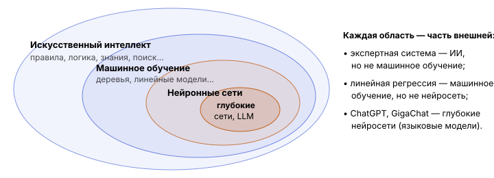

## Зачем это нужно

Слова «искусственный интеллект» сегодня звучат повсюду — от новостей до рекламы холодильников. Чтобы работать с ИИ, а не верить рекламе, нужно понимать три вещи: **что именно называют ИИ**, **как эта область развивалась** (и почему у неё были провалы) и **почему прорыв случился именно сейчас**. Это поможет трезво оценивать новые технологии — и понять, зачем в курсе столько внимания данным.

## Что называют искусственным интеллектом

Строгого общепринятого определения нет, но в России закреплено такое (Национальная стратегия развития ИИ на период до 2030 года):

> Искусственный интеллект — комплекс технологических решений, позволяющий имитировать когнитивные функции человека и получать при выполнении конкретных задач результаты, сопоставимые, как минимум, с результатами интеллектуальной деятельности человека.

Обратите внимание на слова: **имитировать** (а не «обладать разумом») и **конкретных задач** (а не «любых»). Распознать номер автомобиля на фото, перевести текст, оценить цену машины по объявлению — всё это задачи ИИ.

Внутри ИИ есть более узкие области. **Машинное обучение** — методы, которые находят закономерности по примерам, а не по правилам, написанным человеком. Внутри машинного обучения — **нейронные сети**, а среди них — **глубокие** сети и большие языковые модели вроде ChatGPT и GigaChat.



## Сильная сторона и главный минус

**Сильная сторона:** задачу для ИИ можно поставить **так же, как человеку** — словами, без математики. «Нарисуй кота» — модель поймёт примерно; опишешь подробнее — поймёт лучше; можно смотреть на результат и уточнять. Описать кота формулами было бы невероятно сложно.

**Главный минус: ИИ — стохастическая система**, то есть в нём есть случайность:

- ошибки возникают в **непредсказуемые** моменты, и ошибаться ИИ будет принципиально;
- модель **не может объяснить**, почему ошиблась, — и мы тоже часто не можем;
- сложную ошибку замечают не сразу, а со временем;
- ответ может различаться от запуска к запуску.

Сравните с формулой $y = x^2$: в любой точке мира парабола получится одинаковой и полностью объяснимой. Поэтому ответы ИИ нужно **проверять** — особенно там, где цена ошибки высока.

**Почему не обойтись формулами?** Пример с распознаванием лиц: у лица есть характерные точки, но человек бывает в фас и в профиль, с бородой, в очках, в маске. Под каждый случай алгоритм пришлось бы переделывать, а универсальной формулы нет. До эпохи современного ИИ точность распознавания на соревнованиях доходила примерно до 50 % — как охранник, подбрасывающий монетку; сейчас — далеко за 90 % (разблокировка телефона по лицу).

## Игра в имитацию: тест Тьюринга

В 1950 году британский математик **Алан Тьюринг** написал статью, которая начиналась словами: «Я предлагаю рассмотреть вопрос: могут ли машины мыслить?». Поскольку «мыслить» трудно определить, он предложил практическую проверку — **игру в имитацию**:

- судья переписывается с двумя собеседниками, которых не видит: человеком и компьютером;
- если по ответам судья не может надёжно отличить машину от человека, считается, что машина прошла тест.

Пройден ли тест? В 2014 году программа «Женя Густман», изображавшая 13-летнего мальчика из Одессы, убедила 33 % судей в соревновании Университета Рединга. Современные языковые модели в коротких переписках часто неотличимы от человека. Но тест проверяет **поведение**, а не понимание — поэтому предлагают и другие тесты:

- **кофе-тест**: машина заходит в незнакомый дом и варит кофе;
- **робот-студент**: машина поступает в университет, учится и получает диплом;
- **тест на трудоустройство**: машина выполняет экономически полезную работу на уровне человека.

## Как развивался ИИ: взлёты и «зимы»

История ИИ — не прямая линия, а волны надежд и разочарований.

**1940–1960-е: зарождение.** 1943 — Маккаллок и Питтс описали математическую модель нейрона. 1949 — правило Хебба: «если нейроны часто срабатывают вместе, связь между ними укрепляется». 1956 — на Дартмутском семинаре Джон Маккарти ввёл термин «искусственный интеллект». 1958 — персептрон Розенблатта, первая обучаемая нейросеть.

**1970-е: первая «зима».** Ожидали, что машинный перевод вот-вот заработает. Известная (возможно, апокрифическая) история: фразу «Крепок дух, но немощна плоть» перевели на английский и обратно и получили «Водка хорошая, но мясо протухло». Финансирование сократили. В 1969 году Минский и Пейперт в книге «Персептроны» показали, что однослойный персептрон не решает даже простую задачу «исключающего ИЛИ» (XOR). Интерес к нейросетям угас.

**1980-е: экспертные системы.** Программы с правилами «если [условие], то [вывод]», записанными экспертами: MYCIN диагностировала заболевания крови, XCON подбирала комплектующие компьютеров. Для ИИ строили специальные компьютеры — LISP-машины.

**Конец 1980-х: вторая «зима».** Правила быстро становились запутанными и не учитывали неопределённость; в 1987 году рынок LISP-машин рухнул — обычные рабочие станции оказались мощнее и дешевле.

**1986–2010-е: возвращение нейросетей.** 1986 — алгоритм обратного распространения ошибки позволил обучать многослойные сети. 1989 — Ян Лекун научил сеть распознавать рукописные цифры (позже — LeNet). 1997 — суперкомпьютер Deep Blue (IBM) обыграл чемпиона мира по шахматам Гарри Каспарова. 2012 — глубокая сеть AlexNet резко улучшила распознавание объектов на фото. 2015 — сеть ResNet превзошла человека на соревновании ImageNet. 2016 — AlphaGo (DeepMind) обыграла Ли Седоля в го.

**2017 — сегодня: трансформеры, большие языковые модели, агенты.** 2017 — архитектура «Трансформер» («Attention Is All You Need»). 2022 — ChatGPT сделал языковые модели доступными каждому. Сейчас развиваются **агенты** — системы, которые сами планируют шаги и пользуются инструментами (модуль 11).

Сложим ключевые события в таблицу и посчитаем интервалы — заодно попробуем запуск кода на сайте:

```python
events = [
    (1950, 'Тьюринг предлагает игру в имитацию'),
    (1956, 'Дартмутский семинар: термин «искусственный интеллект»'),
    (1958, 'Персептрон Розенблатта'),
    (1986, 'Обучение многослойных сетей: обратное распространение'),
    (1997, 'Deep Blue обыгрывает Каспарова'),
    (2012, 'AlexNet: прорыв в распознавании изображений'),
    (2016, 'AlphaGo обыгрывает Ли Седоля'),
    (2017, 'Архитектура «Трансформер»'),
    (2022, 'ChatGPT: языковые модели для всех'),
]
for year, text in events:
    print(year, '—', text)
print('От идеи Тьюринга до ChatGPT прошло', events[-1][0] - events[0][0], 'лет')
```

## Почему прорыв случился сейчас

Идеи нейросетей появились больше 70 лет назад. Почему же ИИ «выстрелил» только в последние годы? Сошлись четыре условия:

1. **Вычислительные мощности.** Графические процессоры (GPU) умеют выполнять миллионы одинаковых операций параллельно — ровно то, что нужно нейросетям. Появились удобные инструменты вроде CUDA.
2. **Данные.** Интернет дал огромные наборы текстов и изображений; например, в ImageNet — миллионы фотографий, размеченных по классам.
3. **Алгоритмы.** Свёрточные сети, трансформеры, способы обучать очень большие модели.
4. **Интерфейсы.** Чат-боты сделали ИИ доступным людям без технической подготовки.

Масштаб моделей рос стремительно. Посчитаем, во сколько раз выросло число параметров (настраиваемых чисел внутри модели):

```python
models = [
    ('AlexNet', 2012, 60e6),
    ('BERT-large', 2018, 340e6),
    ('GPT-2', 2019, 1.5e9),
    ('GPT-3', 2020, 175e9),
]
first = models[0][2]
for name, year, params in models:
    print(f'{year} {name:<11} {params / 1e6:>10,.0f} млн параметров — в {params / first:>6,.0f} раз больше AlexNet')
```

За 8 лет — рост почти в 3 000 раз. Поэтому современный ИИ — это не только алгоритмы, но и **данные** и **инфраструктура**. Именно с данных — их загрузки, проверки и описания — мы и начнём практическую часть курса.

## Типичные ошибки

:::mistake «ИИ — это и есть нейросети»
Нейросети — лишь часть ИИ. Экспертные системы, поиск, логический вывод — тоже ИИ. А многие задачи по табличным данным (как наши цены автомобилей) лучше решают не нейросети, а деревья решений и их ансамбли (модули 6–7).
:::

:::mistake «Прошёл тест Тьюринга — значит, понимает»
Тест проверяет только поведение в переписке. Программа может убедительно отвечать, не имея никакого понимания (подробнее — «китайская комната» в следующем уроке).
:::

:::mistake «ИИ появился вместе с ChatGPT»
Основным идеям — нейрону, обучению, тесту Тьюринга — больше 70 лет. Новое — масштаб данных, вычислений и доступность.
:::

## Мини-квиз

```quiz
- q: Какое ключевое слово в определении ИИ из Национальной стратегии?
  options:
    - Обладать сознанием
    - Имитировать когнитивные функции человека в конкретных задачах
    - Заменить человека во всех видах деятельности
  answer: 1
  explain: Определение говорит об имитации функций и о результатах в конкретных задачах, а не о сознании.
- q: Что стало одной из причин первой «зимы» ИИ?
  options:
    - Появление ChatGPT
    - Неудачи машинного перевода и показанные ограничения однослойного персептрона
    - Слишком дешёвые компьютеры
  answer: 1
  explain: Завышенные ожидания от перевода и книга «Персептроны» (1969) привели к сокращению финансирования.
- q: Какие факторы сделали возможным нынешний бум ИИ? Выберите все.
  options:
    - Вычисления на GPU
    - Большие наборы данных из интернета
    - Новые архитектуры, например трансформер
    - Отказ от данных в пользу правил
  answer: [0, 1, 2]
  explain: Прорыв — сочетание вычислений, данных и алгоритмов (плюс удобные интерфейсы).
```

## Что запомнить

- ИИ — технологии, имитирующие когнитивные функции человека в конкретных задачах; машинное обучение и нейросети — его части.
- ИИ — стохастическая система: ошибается непредсказуемо и не объясняет ошибок, поэтому его ответы проверяют.
- Тест Тьюринга (1950) проверяет поведение, а не понимание.
- История ИИ — волны: зарождение (1950-е), первая «зима» (1970-е), экспертные системы (1980-е), вторая «зима», возвращение нейросетей, трансформеры и языковые модели.
- Нынешний прорыв — сочетание мощных вычислений, больших данных, новых алгоритмов и удобных интерфейсов.
