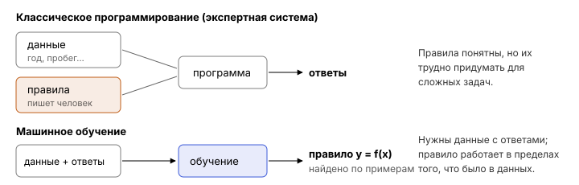

## Зачем это нужно

Языковая модель пишет связный текст, но может уверенно «выдумать» несуществующий факт. Беспилотник ездит по городу, но его можно поймать в «ловушку» из нарисованных линий. Чтобы правильно применять ИИ — и понимать, где ему нельзя доверять без проверки, — нужно различать **слабый** и **сильный** ИИ и знать, **какими способами** вообще создают интеллектуальные системы.

## Слабый и сильный ИИ

- **Слабый (узкий) ИИ** — Artificial Narrow Intelligence, ANI. Хорошо решает одну задачу или несколько близких. Эмулирует когнитивную функцию «по форме», но не понимает, что делает. Нейросеть-переводчик не умеет водить машину.
- **Сильный (общий) ИИ** — Artificial General Intelligence, AGI. Гипотетическая система, которая обладает мышлением и самосознанием и хорошо решает **любые** задачи. Иногда выделяют ещё ASI — сверхинтеллект, превосходящий человека.

Какими свойствами должен обладать сильный ИИ? Принимать решения и выбирать стратегии, действовать в условиях неопределённости, представлять знания об устройстве мира, планировать, обучаться и обобщать знания, общаться на естественном языке. Ни одна существующая система не обладает всеми этими свойствами одновременно. **Всё, что существует сегодня, — слабый ИИ**, включая самые мощные языковые модели.

Почему сильный ИИ пока не создан? Есть **философские** ограничения — нет уверенности, что он вообще возможен, — и **технические**: нет инструментов, чтобы его построить.

## Китайская комната

В 1980 году философ Джон Сёрл предложил мысленный эксперимент. Человек, не знающий китайского, сидит в комнате с толстой инструкцией: «если пришли такие иероглифы — выдай такие». Через щель ему передают вопросы на китайском, он находит нужные правила и возвращает ответы. Снаружи кажется, что в комнате сидит знаток китайского. Но человек **ничего не понимает** — он лишь следует правилам.

Сёрл утверждал: компьютер, выполняющий программу, похож на человека в комнате. **Правильное поведение не доказывает понимания.** Это важный аргумент в споре о том, «думают» ли языковые модели.

## Сильные и слабые стороны современного ИИ

Современный слабый ИИ чаще всего строят **восходящим** путём — с помощью нейросетей. У такого ИИ есть недостатки:

- работает в пределах данных, на которых обучен; обобщающая способность ограничена и непредсказуема;
- его можно проверить на тестах (**валидировать**), но нельзя строго доказать правильность (**верифицировать**);
- структура не интерпретируема: трудно объяснить, почему получен именно такой ответ;
- уязвим: незаметный для человека шум на фото меняет ответ нейросети (**состязательные атаки**); беспилотный автомобиль «запирают» кругом из линий разметки, который он не решается пересечь;
- языковой модели не хватает понимания предметной области и фактических знаний — она может уверенно ошибаться;
- нужны данные, желательно правильно размеченные.

Но и достоинства велики: не нужно формализовать задачу правилами, решение «из конца в конец» одним универсальным способом, быстрый результат, хорошее распараллеливание вычислений.

## Подходы и методы создания ИИ

Есть два больших **подхода**:

- **Нисходящий** (top-down) — создавать системы, имитирующие когнитивные функции, без требования, чтобы они работали «как мозг»: правила, логика, знания.
- **Восходящий** (bottom-up) — моделировать работу биологических элементов (нейронов) и строить из них вычислительные системы.

Конкретные **методы**:

1. **Символьные вычисления** — обработка последовательностей символов (язык LISP). Гипотеза Ньюэлла — Саймона: физическая символьная система имеет всё необходимое для интеллектуальных операций. «Универсальный решатель задач» (1959) впервые разделил знания о задаче и алгоритм поиска решения.
2. **Логический подход** — набор фактов и правила вывода (язык Prolog): программа устанавливает истинность высказываний.
3. **Агентно-ориентированный подход** — интеллектуальный агент получает сигналы из среды и действует на неё; интеллект понимается как способность достигать целей.
4. **Инженерия знаний** — базы знаний и онтологии (графы понятий и связей).
5. **Машинное обучение** — правило подбирается по данным. Артур Сэмюэл (1959): «область знаний, которая даёт компьютерам возможность обучаться без непосредственного программирования».

Сравним на нашем сквозном примере два пути. **Экспертная система**: правила, по которым стоит отправить автомобиль на проверку, записывает человек.

```python
cars = [
    {'year': 2011, 'distance': 195000, 'price': 7750},
    {'year': 1998, 'distance': 1, 'price': 2200},
    {'year': 2014, 'distance': 135000, 'price': 8550},
    {'year': 2009, 'distance': 57000, 'price': 10_000_000},
]

def needs_check(car):
    if car['distance'] < 1000 and car['year'] < 2020:
        return 'малый пробег у не новой машины'
    if car['price'] > 1_000_000:
        return 'подозрительно высокая цена'
    return None

for car in cars:
    print(car, '→', needs_check(car) or 'ок')
```

Правила понятны и прозрачны, но каждое придумал человек. Для сложных задач (распознать лицо на фото) правил столько, что записать их невозможно.

**Машинное обучение**: мы даём примеры с ответами, а алгоритм сам ищет правило. Пусть нужно по году выпуска угадывать, дорогая ли машина (дороже 10 000 €). Переберём пороги года и выберем тот, при котором правило «год ≥ порог → дорогая» чаще всего угадывает:

```python
years = [2005, 2008, 2010, 2012, 2014, 2015, 2016, 2017, 2018, 2019]
expensive = [False, False, False, False, True, False, True, True, True, True]   # известные ответы

best_threshold, best_accuracy = None, 0
for threshold in range(2004, 2021):
    predictions = [year >= threshold for year in years]
    accuracy = sum(p == e for p, e in zip(predictions, expensive)) / len(years)
    if accuracy > best_accuracy:
        best_threshold, best_accuracy = threshold, accuracy

print('Найденное правило: год >=', best_threshold, '→ дорогая')
print('Доля верных ответов на примерах:', best_accuracy)
```

Правило «год ≥ 2016» не писал человек — его нашёл перебор по данным. Это и есть суть машинного обучения: подобрать функцию $y = f(x)$ по примерам. Обратите внимание: найденное правило ошибается на одном примере (машина 2014 года дорогая, а 2015 — нет) — реальные данные редко подчиняются простым правилам.



Сегодня машинное обучение — самый популярный метод ИИ, но методы часто **совмещают**: языковые модели дополняют базами знаний (технология RAG, модуль 11), а обучение с подкреплением использует агентный подход.

## Уровни ИИ: от правил до foundation models

На лекции уровни ИИ сравнивали по трём вопросам: **сколько данных**, **кто выделяет признаки** и **насколько чётко поставлена задача**. Каждый следующий уровень нужен, когда данных больше и они сложнее:

| Уровень | Данных (записей) | Кто выделяет признаки | Пример |
|---|---|---|---|
| Экспертные правила | десятки | правила задаёт человек, обучения нет | регламент уценки товара на складе |
| Классическое машинное обучение | сотни – тысячи | признаки формулирует **человек** | кредит: доход, машина, дети → одобренная сумма |
| Глубокое обучение | миллионы | признаки не формулируются — **сеть находит сама** | рукописные цифры, фотографии, речь |
| Foundation models | сотни миллионов | даже **задачу** не ставим отдельно — модель обобщает между задачами | GPT, GigaChat |
| Сильный ИИ (AGI) | гипотетически — ещё больше | — | сам ставит себе задачи и улучшает себя |

Данные с готовыми признаками-столбцами (как наша таблица объявлений) называют **структурированными**; изображения, звук и тексты — **неструктурированными**. Много параметров у глубоких сетей — следствие, а причина в том, что вариантов в задаче так много, что признаки не сформулировать.

## Главная мысль курса: не начинайте с ИИ

Лектор повторял её с первого занятия: **искусственный интеллект — инструмент решения задач больших данных**, то есть задач, где очень много разнородных, близких по смыслу, но формально разных случаев. Если данных мало и много не станет — или есть чёткие правила, — начинать нужно с простого.

Пример с лекции: складская компания хотела внедрить ИИ, «потому что модно». Оказалось, что уценка товара жёстко регламентирована: лежит 3 месяца — одна скидка, 4 месяца — другая. Здесь уже есть **точный алгоритм**, а ИИ его не повторит без ошибок — внедрение только навредило бы.

| Разумно начинать с ИИ | Лучше начать с простого |
|---|---|
| обработка документов разных форм и почерков | процессы с жёсткими правилами и регламентом |
| умные камеры, распознавание лиц и номеров | расчёты по известной формуле |
| задачи с огромным числом разнородных случаев | данных мало, и много не станет |

А где большие данные, если языковая модель пишет **один** реферат? В **обучении**: модель учили на огромном массиве текстов. Именно поэтому в нашем курсе так много внимания данным: без них ИИ не работает.

## Типичные ошибки

:::mistake «Языковая модель — это сильный ИИ»
Даже самые мощные модели — слабый ИИ: они решают задачи в пределах обучения, не понимают смысла «по существу» и могут уверенно ошибаться.
:::

:::mistake «Раз ответы правильные — система понимает»
«Китайская комната» показывает: следование правилам может давать правильные ответы без понимания.
:::

:::mistake «Машинное обучение всегда лучше правил»
Если правило простое, известное и важно его объяснить (например, юридическое требование), правила надёжнее. Обучение выигрывает там, где правил слишком много или они неизвестны.
:::

## Мини-квиз

```quiz
- q: Нейросеть отлично распознаёт породы собак, но не может перевести текст. Это пример…
  options:
    - сильного ИИ
    - слабого (узкого) ИИ
    - экспертной системы
  answer: 1
  explain: Слабый ИИ хорошо решает одну задачу и не переносит умение на другие.
- q: Что показывает мысленный эксперимент «китайская комната»?
  options:
    - Что компьютеры не умеют работать с иероглифами
    - Что правильное поведение по правилам не доказывает понимания
    - Что китайский язык сложнее английского
  answer: 1
  explain: Человек в комнате даёт верные ответы, ничего не понимая.
- q: К какому подходу относится система правил «если — то», записанных экспертом?
  options:
    - К восходящему (моделирование нейронов)
    - К нисходящему (имитация функций правилами и знаниями)
    - К машинному обучению
  answer: 1
  explain: Экспертные системы, логика и базы знаний — нисходящий подход.
```

## Что запомнить

- Все современные системы — слабый ИИ: решают отдельные задачи и не понимают смысла; сильный (общий) ИИ пока гипотетичен.
- «Китайская комната»: верные ответы по правилам не доказывают понимания.
- Слабые места нейросетей: зависимость от данных, неинтерпретируемость, уязвимость к атакам, уверенные ошибки.
- ИИ — инструмент задач больших данных: при чётких правилах и малых данных начинайте с простого.
- Машинное обучение подбирает функцию y = f(x) по примерам; уровни ИИ — правила, классическое ML, глубокое обучение, foundation models.
