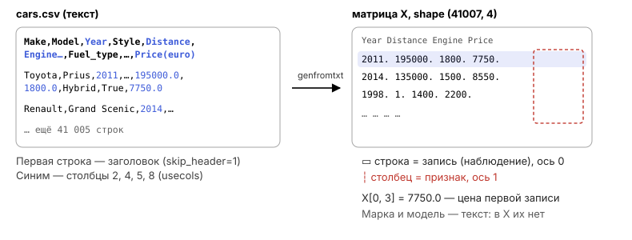

## Зачем это нужно

Весь курс мы работаем с одним набором данных — объявлениями о продаже подержанных автомобилей (файл `cars.csv`). В нём 41 007 строк: марка, модель, год выпуска, пробег, объём двигателя, тип топлива, коробка передач и цена.

Прежде чем что-то считать, аналитик задаёт вопросы **о самих данных**, а не о рынке:

- **Что является наблюдением** — автомобиль, объявление или совершённая сделка? Здесь это *объявление*: один и тот же автомобиль могли выставить дважды.
- **Где и когда собраны данные?** От этого зависит, к какому рынку и периоду относятся выводы.
- **Цена — указанная в объявлении или фактическая цена сделки?** Здесь — *указанная*. Поэтому сумму цен нельзя называть «выручкой»: о сделках мы ничего не знаем.
- **Как измерен пробег и что означает пропуск?** Пробег записал продавец; ноль может означать «не указал».

Имена столбцов на эти вопросы не отвечают. Ответы определяют, какие выводы вообще можно сделать. Например, мы будем говорить «типичная цена *в этом файле*», а не «типичная цена автомобиля в стране».

:::info Наш план на модуль
Загрузить числовые столбцы → разобраться с массивом NumPy → проверить пригодность значений → описать цены и пробеги → сравнить группы → понять, как статистика меняется от выборки к выборке → самостоятельное мини-исследование.
:::

## Строка, столбец, вектор признака

Представьте таблицу как журнал карточек: каждая **строка** — карточка одного объявления, каждый **столбец** — одна графа, которую заполняли для всех карточек.

- **Наблюдение** (объект, запись) — то, что описывает одна строка: здесь одно объявление.
- **Признак** — характеристика наблюдения, один столбец: год, пробег, цена.
- **Вектор признака** — значения одного признака для всех строк по порядку. Порядок важен: пятое значение вектора цен и пятое значение вектора пробегов относятся к одному и тому же автомобилю.

| Столбец CSV | Что означает | Как представлен |
|---|---|---|
| `Make`, `Model` | Марка и модель | текст (категория) |
| `Year` | Год выпуска | число, целые значения |
| `Style` | Тип кузова | текст |
| `Distance` | Указанный пробег | число, км |
| `Engine_capacity(cm3)` | Объём двигателя | число, см³ |
| `Fuel_type` | Тип топлива | текст |
| `AutoTransmission` | Автоматическая коробка | `True` / `False` |
| `Price(euro)` | Указанная цена | число, евро |

В этом модуле нас интересуют **четыре числовых признака**: год, пробег, объём двигателя и цена. Текстовые столбцы появятся в модуле 2, где мы перейдём к Pandas.

## Что такое CSV

CSV (comma-separated values) — обычный текстовый файл. Каждая строка файла — одна запись, значения разделены запятыми, первая строка — **заголовок** с названиями столбцов. Посмотрим на начало файла средствами стандартного модуля `csv`: он аккуратно разбивает строки на значения.

```python
import csv

with open('cars.csv', encoding='utf-8-sig', newline='') as file:
    reader = csv.reader(file)
    header = next(reader)                       # первая строка — заголовок
    first_rows = [next(reader) for _ in range(3)]

print('Столбцы:', header)
for row in first_rows:
    print(row)
```

Обратите внимание: все значения пока **строки** (`'2011'`, `'7750.0'`). Модуль `csv` не знает, что это числа, — превращать текст в числа будет NumPy.

Три строки — не описание набора. По ним не понять, какие бывают цены, есть ли пропуски и странные значения. Для этого нужен весь столбец.

## Читаем числовые столбцы в NumPy

Функция `np.genfromtxt` читает числа из текстовой таблицы и сразу складывает их в **матрицу** — прямоугольный массив «строки × столбцы». Её главные параметры:

- `delimiter=','` — разделитель значений;
- `skip_header=1` — пропустить одну строку сверху (заголовок);
- `usecols=[...]` — номера нужных столбцов, **нумерация с нуля**;
- `dtype=float` — читать как дробные числа;
- `ndmin=2` — всегда возвращать матрицу, даже если выбран один столбец.

Номера столбцов не будем вписывать вручную — найдём их по названиям в заголовке методом списка `.index()`. Так код не сломается, если столбцы поменяют местами.

```python
import numpy as np
np.set_printoptions(suppress=True, precision=2)   # печатать числа без экспоненты

numeric_names = ['Year', 'Distance', 'Engine_capacity(cm3)', 'Price(euro)']
numeric_columns = [header.index(name) for name in numeric_names]
print('Номера столбцов:', numeric_columns)

X = np.genfromtxt('cars.csv', delimiter=',', skip_header=1,
                  usecols=numeric_columns, dtype=float, ndmin=2)
print('Первые пять записей:')
print(X[:5])
```



Почему год напечатан как `2011.`? В матрице NumPy у всех элементов **общий тип**. Цена и пробег дробные, а пропуски в числах обозначаются специальным дробным значением `nan`, поэтому вся матрица хранит `float`. Год от этого не перестаёт быть целым по смыслу.

Почему в матрице нет марки и модели? Это текст. `genfromtxt` с `dtype=float` превратил бы его в `nan`, поэтому мы выбрали только числовые столбцы.

## Что означает число в матрице

Каждое число в `X` определяется двумя номерами: **строки** (какая запись) и **столбца** (какой признак). Запись `X[0, 3]` означает «строка 0, столбец 3»: первая запись, четвёртый признак в нашем списке — цена. Подробно индексацию разберём в уроке 1.3.

```python
print('X[0, 3] =', X[0, 3], '— цена первой записи, евро')
print('X[2, 1] =', X[2, 1], '— пробег третьей записи, км')
print('Всего записей прочитано:', len(X))
```

Пробег третьей записи — **1 км** у автомобиля 1998 года. Это уже повод насторожиться: скорее всего, продавец не указал пробег. Но выводы делать рано — сначала научимся работать с массивом, а проверке пригодности значений посвящён урок 1.5.

## Типичные ошибки

:::mistake Забыли skip_header=1
Заголовок прочитается как данные: текст превратится в `nan`, и первая строка матрицы будет `[nan nan nan nan]`, а строк станет на одну больше (41 008). Признак ошибки — `nan` в `X[0]`.
:::

:::mistake Нумерация столбцов с единицы
В Python и NumPy нумерация с нуля. `usecols=[3, 5, 6, 9]` прочитает не те столбцы, а номер 9 вообще не существует. Надёжнее находить номера через `header.index('Year')`.
:::

:::mistake Текстовые столбцы в числовой матрице
Если включить в `usecols` столбец `Make`, вместо марок получится столбец `nan`. Числовая матрица — только для чисел.
:::

:::warning Выводы шире данных
«Средняя цена автомобиля в стране» — неверная формулировка: у нас цены *объявлений* из *одного файла*. Говорите «в этом наборе объявлений».
:::

## Мини-квиз

```quiz
- q: Что является одним наблюдением в файле `cars.csv`?
  options:
    - Один признак, например цена
    - Одно объявление о продаже автомобиля
    - Одна марка автомобиля
    - Одна совершённая сделка
  answer: 1
  explain: Строка таблицы — одно объявление. Сделки в данных не описаны, а марка — это признак.
- q: Какие номера передать в `usecols`, чтобы прочитать столбцы `Year` и `Price(euro)`? Заголовок — `Make, Model, Year, Style, Distance, Engine_capacity(cm3), Fuel_type, AutoTransmission, Price(euro)`.
  options:
    - "`[3, 9]`"
    - "`[2, 8]`"
    - "`['Year', 'Price(euro)']`"
    - "`[2, 9]`"
  answer: 1
  explain: Нумерация с нуля — Year стоит третьим (номер 2), Price(euro) девятым (номер 8).
- q: Почему год в матрице `X` выглядит как `2011.` с точкой?
  options:
    - genfromtxt всегда округляет числа
    - У всех элементов массива общий тип; матрица хранит дробные числа (float)
    - Год записан в файле с точкой
  answer: 1
  explain: Цены и пропуски (`nan`) требуют дробного типа, поэтому весь массив — float.
```

## Что запомнить

- Сначала уточняем, что является наблюдением и как собраны данные, — от этого зависят допустимые выводы.
- Строка — наблюдение, столбец — признак, значения признака по порядку — вектор признака.
- `np.genfromtxt(path, delimiter=',', skip_header=1, usecols=[...], dtype=float, ndmin=2)` читает числовые столбцы CSV в матрицу.
- Номера столбцов считаются с нуля; надёжнее находить их через `header.index(name)`.
- В числовую матрицу попадают только числа; текст и пропуски превращаются в `nan`.
