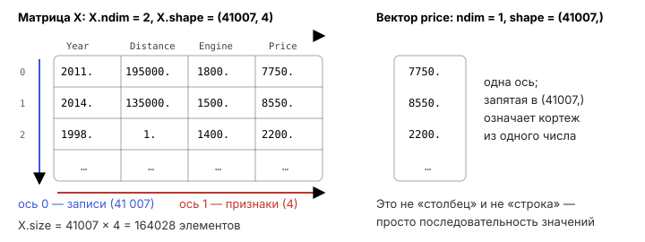

## Зачем это нужно

Первое, что делает аналитик с новыми данными, — выясняет их **размер**: сколько записей, сколько признаков, какого типа значения. От этого зависят все дальнейшие расчёты. Классическая ошибка новичка — сказать «в таблице 164 028 автомобилей», перепутав число *ячеек* с числом *записей*. Сегодня научимся не путать.

В этом уроке перед первым примером уже выполнена подготовка: матрица `X` прочитана из `cars.csv` так же, как в уроке 1.1 (функция `load_numeric` из модуля `course` повторяет те самые шаги с `np.genfromtxt`).

## Массив NumPy: одна коробка, один тип

`numpy.ndarray` («n-dimensional array», n-мерный массив) — главный объект NumPy. У массива три важных свойства:

1. **Все элементы одного типа.** Нельзя положить в один числовой массив число и текст — NumPy приведёт всё к общему типу.
2. **Есть оси.** У вектора одна ось, у матрицы две: ось 0 перебирает строки (записи), ось 1 — столбцы (признаки).
3. **Операции выполняются сразу над всеми элементами** — это разберём в уроке 1.4.

Создать массив можно из обычного списка функцией `np.array`:

```python
prices = np.array([7750, 8550, 2200])
mixed = np.array([7750, 8550.5, 2200])
words = np.array([7750, 'Toyota'])

print(prices, prices.dtype)
print(mixed, mixed.dtype)
print(words, words.dtype)
```

Посмотрите на результат. Целые числа дали целочисленный массив; одно дробное число превратило **все** элементы в дробные; а текст превратил числа в строки (`<U21` — строка Юникода). Со строковым массивом считать нельзя — поэтому в числовую матрицу мы берём только числовые столбцы.

:::info int32 или int64?
В браузерной версии Python (Pyodide, на которой работает этот сайт) целые числа по умолчанию имеют тип `int32`. На обычном компьютере, в Jupyter или Colab вы чаще увидите `int64`. На результаты в курсе это не влияет, просто не удивляйтесь разнице.
:::

## Форма, размер и число осей

Четыре атрибута описывают массив. Это именно **атрибуты** — пишутся без скобок.

| Атрибут | Что означает | Для `X` |
|---|---|---|
| `X.shape` | размеры по осям (кортеж) | `(41007, 4)` |
| `X.ndim` | число осей | `2` |
| `X.size` | число всех элементов | `164028` |
| `X.dtype` | тип элементов | `float64` |

```python
print('shape:', X.shape)
print('ndim :', X.ndim)
print('size :', X.size)
print('dtype:', X.dtype)

n_rows, n_features = X.shape      # распаковка кортежа в две переменные
print('Записей:', n_rows, '| признаков:', n_features, '| len(X):', len(X))
```

Размер — это произведение размеров по всем осям:

$$
\text{size} = n_{\text{rows}} \times n_{\text{features}} = 41\,007 \times 4 = 164\,028 .
$$

Число **записей** — это `X.shape[0]` (или `len(X)`), а не `X.size`. В каждой записи четыре числа, поэтому ячеек вчетверо больше, чем автомобилей.



У одного столбца — **вектора** — одна ось, и его форма записывается как `(41007,)`. Запятая нужна, чтобы Python понял: это кортеж из одного числа, а не просто число в скобках. Вектор — не «строка» и не «столбец», а просто последовательность значений.

## Тип элементов: почему год — дробное число

Матрица `X` имеет тип `float64`: дробные числа, 8 байт на каждое. Почему не целые? В матрице общий тип для всех ячеек, а цены, пробеги и особенно **пропуски** (`nan`, урок 1.5) требуют дробного типа. Год от этого не перестаёт быть целым по смыслу.

Тип можно изменить методом `.astype(...)` — он создаёт **новый** массив:

```python
first_years = X[:5, 0]                 # годы первых пяти записей (срезы — в уроке 1.3)
print(first_years, first_years.dtype)
as_int = first_years.astype(int)
print(as_int, as_int.dtype)

print('Память под X:', X.nbytes, 'байт ≈', round(X.nbytes / 1024**2, 2), 'МБ')
```

`X.nbytes` = 164 028 элементов × 8 байт = 1 312 224 байта. Для сравнения: тот же объём данных в списке Python занял бы в несколько раз больше памяти, потому что каждое число списка — отдельный объект.

## Номера записей: np.arange

Часто нужен вектор номеров записей: 0, 1, 2, … Его создаёт `np.arange(n)` — числа от 0 до `n − 1`. В уроке 1.6 он поможет найти исходную запись после фильтрации.

```python
row_id = np.arange(n_rows)
print(row_id[:5], '…', row_id[-1])
print('Форма:', row_id.shape, '| тип:', row_id.dtype)
```

Числа, созданные `np.arange`, — служебные номера, а не новые наблюдения рынка.

## Типичные ошибки

:::mistake Путать size и число записей
`X.size` — все ячейки (164 028), а записей — `X.shape[0]` (41 007). Говоря о числе автомобилей, используйте `len(X)` или `X.shape[0]`.
:::

:::mistake Скобки после атрибута
`X.shape()` вызывает ошибку `TypeError: 'tuple' object is not callable`: `shape` — это кортеж, а не функция. Пишите `X.shape`, `X.size`, `X.dtype` без скобок.
:::

:::mistake Текст в числовом массиве
`np.array([7750, 'Toyota'])` превращает всё в строки, и `+`, `mean` перестают работать как с числами. Держите текст и числа в разных массивах (а для таблиц с разными типами в модуле 2 появится Pandas).
:::

:::warning astype не меняет исходный массив
`X.astype(int)` возвращает новый массив, а `X` остаётся дробным. Чтобы сохранить результат, присвойте его переменной.
:::

## Мини-квиз

```quiz
- q: "Матрица `M` создана так: `M = np.array([[1, 2, 3], [4, 5, 6]])`. Чему равна `M.shape`?"
  options:
    - "`(3, 2)`"
    - "`(2, 3)`"
    - "`(6,)`"
    - "`6`"
  answer: 1
  explain: Две строки (ось 0) по три элемента (ось 1) — форма (2, 3); size = 6.
- q: "Какой тип будет у массива `np.array([1, 2.5, 3])`?"
  options:
    - "`int`, потому что большинство чисел целые"
    - "`float64`: одно дробное число делает дробными все элементы"
    - Смешанный тип — у каждого элемента свой
  answer: 1
  explain: У массива один общий тип; целые числа приводятся к дробным.
- q: "Как узнать число автомобилей в матрице `X` формы `(41007, 4)`? Выберите все верные способы."
  options:
    - "`X.size`"
    - "`X.shape[0]`"
    - "`len(X)`"
    - "`X.ndim`"
  answer: [1, 2]
  explain: Число записей — размер оси 0. `X.size` — все ячейки, `X.ndim` — число осей.
```

## Что запомнить

- `ndarray` хранит элементы одного типа; одно дробное число делает дробным весь массив, текст — строковым.
- `shape` — размеры по осям, `ndim` — число осей, `size` — всего элементов, `dtype` — тип; это атрибуты без скобок.
- Число записей — `X.shape[0]` или `len(X)`, а не `X.size`.
- У вектора форма `(n,)`; у матрицы «записи × признаки» — `(n, k)`.
- `np.arange(n)` — номера 0…n−1; `a.astype(тип)` создаёт новый массив другого типа.
