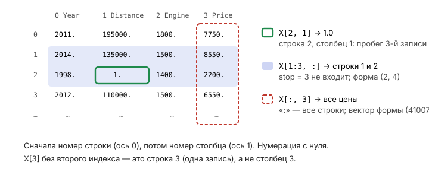

## Зачем это нужно

Аналитику почти никогда не нужна вся матрица сразу. Нужно «цена записи 100», «первые пять цен», «год и цена записей 10–14», «весь столбец пробегов». Всё это — **индексация** (выбор отдельных элементов по номерам) и **срезы** (выбор диапазона).

Ошибиться здесь легко и незаметно: взять запись 101 вместо 100 или строку вместо столбца. Код при этом не упадёт — просто посчитает не то. Поэтому разберём правила аккуратно.

## Один элемент: X[строка, столбец]

Каждый элемент матрицы адресуется двумя номерами: сначала **строка** (запись, ось 0), потом **столбец** (признак, ось 1). Как место в зрительном зале: ряд и кресло.

- Нумерация с нуля: первая запись — `0`, последняя — `n_rows − 1`.
- Отрицательные номера считают с конца: `-1` — последний элемент, `-2` — предпоследний.

Порядок наших признаков: `0` — Year, `1` — Distance, `2` — Engine_capacity(cm3), `3` — Price(euro).

## Срезы: диапазон позиций

Срез записывается как `start:stop:step`:

- берутся позиции от `start` **включительно** до `stop` **не включительно**;
- пропущенный `start` означает «с начала», пропущенный `stop` — «до конца»;
- `step` — шаг (по умолчанию 1);
- одинокое двоеточие `:` — «все элементы по этой оси».

Число элементов в срезе `a[start:stop]` (если он не выходит за границы):

$$
n = \text{stop} - \text{start}, \qquad \text{например } X[10:15] \Rightarrow 15 - 10 = 5 \text{ записей (10, 11, 12, 13, 14)}.
$$

Правило «stop не входит» удобно: `a[:5]` — ровно 5 первых элементов, а `a[5:]` — всё остальное, без пересечения.



## Признак целиком — вектор

Столбец признака — это «все строки, один столбец»: `X[:, 3]`. Сохраним четыре вектора признаков под понятными именами — дальше будем работать с ними:

```python
year = X[:, 0]
distance = X[:, 1]
engine = X[:, 2]
price = X[:, 3]

print('Форма вектора цены:', price.shape)
print('Первая цена:', price[0])
print('Последняя цена:', price[-1])
print('Пять первых цен:', price[:5])
```

Форма `(41007,)` — у вектора одна ось. Порядок значений в векторах совпадает с порядком строк в `X`: `price[7]` и `distance[7]` относятся к одному объявлению.

## Записи целиком и прямоугольные куски

Если указать только номер строки, получится вся запись. Срезом по строкам и столбцам можно вырезать прямоугольный кусок матрицы:

```python
print('Записи 10–14:')
print(X[10:15, :])           # строки 10, 11, 12, 13, 14 и все столбцы
print('Запись 100:', X[100, :])
print('Год и пробег записей 10–12:')
print(X[10:13, 0:2])         # строки 10–12, столбцы 0 и 1
```

Запись `X[100, :]` можно сократить до `X[100]` — пропущенный второй индекс означает «все столбцы». Но обратного сокращения нет: `X[3]` — это **строка** 3, а не столбец 3.

## Шаг, отрицательные номера и список номеров

Ещё три полезных приёма:

```python
print('Три последние цены:', price[-3:])
print('Каждый 10 000-й год:', year[::10_000])
print('Цены записей 0, 2 и 4:', X[[0, 2, 4], 3])
print('Год и цена записей 10–14:')
print(X[10:15, [0, 3]])
```

- `price[-3:]` — от третьей с конца до конца.
- `year[::10_000]` — от начала до конца с шагом 10 000: позиции 0, 10 000, 20 000, …
- `X[[0, 2, 4], 3]` — **список номеров** в квадратных скобках выбирает произвольные позиции, не обязательно подряд. Так же `[0, 3]` выбирает столбцы Year и Price.

:::info Срез и список номеров ведут себя по-разному
Срез (`X[10:15]`) обычно не копирует данные, а смотрит на те же ячейки. Выбор списком номеров (`X[[0, 2, 4]]`) всегда создаёт копию. Почему это важно, разберём в следующем уроке.
:::

## Типичные ошибки

:::mistake Ошибка на единицу
`X[10:15]` — это записи 10–14, их пять, запись 15 не входит. Если нужны записи с 10-й по 15-ю включительно, пишите `X[10:16]`.
:::

:::mistake Строка вместо столбца
`X[3]` — четвёртая **запись** целиком (4 числа), а не цены. Цены — `X[:, 3]`. Проверяйте форму: у столбца признака `shape == (41007,)`, у одной записи — `(4,)`.
:::

:::mistake Индекс за границей
`price[41007]` вызывает `IndexError: index 41007 is out of bounds for axis 0 with size 41007`: допустимы номера 0…41006. Последний элемент надёжнее брать как `price[-1]`.
:::

:::warning Синтаксис списка и массива
У массива NumPy пишут `X[1, 2]`. У обычного списка Python так нельзя — только `lst[1][2]`. Если видите `TypeError: list indices must be integers or slices, not tuple`, значит, перед вами список, а не массив.
:::

## Мини-квиз

```quiz
- q: Сколько элементов в `X[10:15, 3]`?
  options:
    - "4"
    - "5"
    - "6"
    - "15"
  answer: 1
  explain: "Строки 10, 11, 12, 13, 14 — stop не входит: 15 − 10 = 5 значений цены."
- q: Что вернёт `X[3]` для матрицы с признаками Year, Distance, Engine, Price?
  options:
    - Все цены (столбец 3)
    - Четвёртую запись целиком — 4 числа
    - Ошибку — нужен второй индекс
  answer: 1
  explain: Один индекс выбирает строку; столбец — `X[:, 3]`.
- q: Как получить пробег последней записи? Выберите все верные варианты.
  options:
    - "`X[-1, 1]`"
    - "`X[41006, 1]`"
    - "`X[41007, 1]`"
    - "`distance[-1]`, если `distance = X[:, 1]`"
  answer: [0, 1, 3]
  explain: Последняя строка имеет номер −1 или 41 006; номер 41 007 уже за границей.
```

## Что запомнить

- `X[i, j]` — строка `i`, столбец `j`; нумерация с нуля, `-1` — последний.
- Срез `start:stop:step` берёт позиции до `stop` не включительно: `X[10:15]` — 5 записей.
- `X[:, j]` — признак целиком (вектор), `X[i]` или `X[i, :]` — запись целиком.
- Список номеров `X[[0, 2, 4], 3]` выбирает произвольные позиции.
- Сверяйте форму результата с ожиданием: у признака `(n,)`, у записи `(4,)`.
