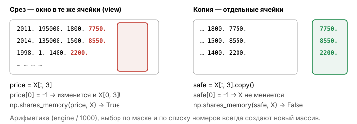

## Зачем это нужно

Объём двигателя в файле записан в кубических сантиметрах (`1800.0`), а в объявлениях и разговоре привычнее литры (`1.8`). Пробег удобнее читать в тысячах километров. Такой перевод нужен для **всех** 41 007 записей.

В обычном Python пришлось бы писать цикл по всем значениям. NumPy позволяет записать перевод **одной операцией над целым столбцом** — это короче, понятнее и в десятки раз быстрее. Но у этой мощи есть оборотная сторона: срез массива может незаметно указывать на исходные данные, и, изменив «копию», вы испортите оригинал. Разберём и то, и другое.

Перед первым примером уже выполнена подготовка: прочитана матрица `X` и выделены векторы `year`, `distance`, `engine`, `price` (как в уроке 1.3).

## Одна операция — разный смысл

Возьмём пять цен и сделаем с ними одно и то же — сначала в списке, потом в массиве:

```python
five_prices = price[:5].copy()       # .copy() объясним ниже
price_list = five_prices.tolist()     # тот же набор как обычный список Python

print('Список * 2:  ', price_list * 2)
print('Массив * 2:  ', five_prices * 2)
print('Массив + 100:', five_prices + 100)
print('Список + список:', [1, 2] + [10, 20])
print('Массив + массив:', np.array([1, 2]) + np.array([10, 20]))
```

Для списка `* 2` означает «повторить два раза», а `+` — «склеить». Для массива это **арифметика над каждым элементом**: умножить каждую цену на 2, прибавить 100 к каждой, сложить элементы попарно. Исходный файл при этом не меняется: результат — новый массив.

## Векторизация: формула для всего столбца

**Векторизация** — запись вычисления сразу для всех элементов, без явного цикла. Если `a` и `b` — массивы одинаковой формы, а `c` — число, то

$$
(a \circ b)_i = a_i \circ b_i, \qquad (a \circ c)_i = a_i \circ c,
$$

где $\circ$ — любая арифметическая операция: `+`, `-`, `*`, `/`, `**`, `//`. Например, для объёмов $[1800, 1500, 1400]$ см³ операция `engine / 1000` даёт $[1.8, 1.5, 1.4]$ л — каждое значение делится на 1000.

```python
engine_litres = engine / 1000.0
distance_thousands = distance / 1000.0
print('Двигатель, литры:   ', engine_litres[:5])
print('Пробег, тысячи км:  ', distance_thousands[:5])
print('Форма сохранилась:', engine_litres.shape == engine.shape)

age = 2021 - year                     # массив минус число
km_per_year = distance / (age + 1)    # массив делим на массив той же формы
print('Возраст, лет:       ', age[:5])
print('Пробег за год, км:  ', km_per_year[:5])
```

`2021 - year` — число и массив: число применяется к каждому элементу. `distance / (age + 1)` — два массива одной формы: делятся попарно (пробег записи *i* на возраст записи *i*). Год 2021 — самый поздний в файле; «+ 1» защищает от деления на ноль для машин 2021 года. Подробнее о таком признаке поговорим в модуле 2.

Перевод единиц должен иметь смысл: литры и тысячи км — да. Перевод евро в рубли — нет: курс без даты сделки ввёл бы ложную точность.

## Почему без цикла быстрее

Цикл Python обрабатывает числа по одному, каждый раз проверяя типы. NumPy выполняет одну и ту же операцию над непрерывным блоком памяти скомпилированным кодом. Сравним:

```python
import time

engine_list = engine.tolist()
t0 = time.perf_counter()
for _ in range(20):
    litres_loop = [v / 1000 for v in engine_list]
t_loop = time.perf_counter() - t0

t0 = time.perf_counter()
for _ in range(20):
    litres_vec = engine / 1000
t_vec = time.perf_counter() - t0

print(f'Цикл по списку: {t_loop * 1000:.1f} мс')
print(f'NumPy:          {t_vec * 1000:.1f} мс')
print(f'Быстрее примерно в {t_loop / t_vec:.0f} раз')
```

Точные цифры зависят от компьютера, но разница — десятки раз. На миллионах записей это разница между секундой и минутой.

## Срез — окно в те же данные (view и copy)

Когда вы пишете `price = X[:, 3]`, NumPy обычно **не копирует** цены. Он создаёт **представление** (view) — «окно», через которое видны те же ячейки памяти, что и в `X`. Это экономит память, но изменение через окно меняет оригинал.

Чтобы не испортить настоящие данные, проведём опыт на маленькой копии первых трёх записей:

```python
demo = X[:3].copy()          # независимая копия трёх записей
col = demo[:, 3]             # срез — окно в demo
col[0] = -1                  # меняем «вектор цен»…
print('demo после изменения col:')
print(demo)                  # …и цена в demo тоже стала -1!
print('Общая память:', np.shares_memory(col, demo))

safe = demo[:, 3].copy()     # настоящая копия
safe[1] = 0
print('demo после изменения safe:', demo[:, 3])
print('Общая память:', np.shares_memory(safe, demo))
```



Правило на практике:

- если вы собираетесь **менять** значения выделенной части, сделайте `.copy()`;
- арифметика (`engine / 1000`), выбор по маске (урок 1.5) и по списку номеров **всегда** создают новый массив — исходные данные не тронуты;
- в этом модуле мы сохраняем исходную матрицу `X` неизменной: все расчёты — в новых переменных.

## Типичные ошибки

:::mistake Цикл там, где хватит одной операции
`[v / 1000 for v in engine]` работает, но медленно и длинно. В NumPy пишите `engine / 1000`. Циклы оставляем для повторения опыта (урок 1.9), а не для поэлементной арифметики.
:::

:::mistake Список вместо массива
`[5000, 8000] * 2` даёт `[5000, 8000, 5000, 8000]`, а не удвоенные цены. Если результат «странно длинный» — проверьте `type(...)`: возможно, у вас список, а не массив.
:::

:::mistake Изменили срез — испортили оригинал
`p = X[:, 3]; p[p > 100000] = 0` молча меняет цены в `X`. Сначала `p = X[:, 3].copy()`, или вычисляйте новый массив без присваивания внутрь среза.
:::

:::mistake Разные размеры
`price[:10] + distance[:5]` вызывает `ValueError: operands could not be broadcast together with shapes (10,) (5,)`. Попарные операции требуют одинаковой формы (кроме совместимых форм — урок 1.10).
:::

## Мини-квиз

```quiz
- q: "Что выведет `print(np.array([5000, 8000]) * 2)`?"
  options:
    - "`[ 5000  8000  5000  8000]`"
    - "`[10000 16000]`"
    - Ошибку — массив нельзя умножать на число
  answer: 1
  explain: Арифметика с массивом применяется к каждому элементу.
- q: "После `p = X[:, 3]` выполнили `p[0] = 0`. Что произошло с `X[0, 3]`?"
  options:
    - Ничего — p это копия
    - Тоже стало 0 — p смотрит в те же ячейки
    - Ошибка — срез нельзя менять
  answer: 1
  explain: Срез — представление (view). Для независимых изменений нужен `.copy()`.
- q: Какие операции создают новый массив и не меняют `engine`? Выберите все.
  options:
    - "`engine / 1000`"
    - "`engine[engine > 3000]`"
    - "`engine[:5][0] = 0`"
    - "`engine.copy()`"
  answer: [0, 1, 3]
  explain: Арифметика, выбор по маске и copy дают новые массивы. Присваивание в срез меняет исходные данные.
```

## Что запомнить

- Арифметика с массивом действует на каждый элемент; два массива одной формы обрабатываются попарно.
- Для списка `*` — повторение, `+` — склейка; для массива — арифметика.
- Векторизованный код короче и в десятки раз быстрее цикла.
- Срез — окно (view) в те же данные: изменения видны в оригинале; `.copy()` даёт независимую копию.
- Новые признаки сохраняйте в новых переменных, исходную матрицу не меняйте.
