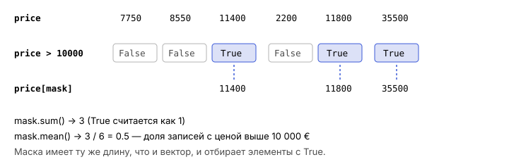

## Зачем это нужно

Попробуем сразу посчитать средний объём двигателя — и получим `nan`. Причина: в столбце есть пропуски, а любая арифметика с пропуском даёт пропуск. А если посчитать среднюю цену, получится почти 9 700 € — хотя в файле есть объявление с ценой 10 000 000 €, которое сильно тянет среднее вверх.

Поэтому до любых статистик аналитик **проверяет пригодность значений**. При этом важно различать три случая:

- **пропуск** — значения нет (продавец не указал объём двигателя);
- **подозрительное значение** — значение есть, но странное (пробег 1 км у машины 1998 года);
- **редкий настоящий объект** — значение необычное, но правдоподобное (дорогой новый внедорожник).

Аналитик сначала **замечает и описывает** такие записи, а не удаляет их автоматически. Удалить настоящий редкий автомобиль — такая же ошибка, как оставить опечатку.

## Пропуски и бесконечности

`np.nan` (Not a Number, «не число») — специальное дробное значение, которым NumPy обозначает пропуск. Его свойства:

- любая арифметика с `nan` даёт `nan`: `5 + nan = nan`, `mean([1, nan]) = nan`;
- `nan` не равен ничему, даже самому себе: `np.nan == np.nan` — `False`. Поэтому искать пропуски сравнением нельзя — только функцией `np.isnan`.

`np.inf` — бесконечность. Она появляется, например, при делении на ноль (`1 / 0.0` в NumPy). Функция `np.isfinite` возвращает `True` только для обычных конечных чисел — не `nan` и не `±inf`.

Обе функции возвращают массив `True`/`False` той же формы. Сумма такого массива — число `True` (каждое `True` считается как 1):

```python
for j, name in enumerate(numeric_names):
    column = X[:, j]
    missing = np.isnan(column).sum()
    nonfinite = (~np.isfinite(column)).sum()
    print(f'{name}: пропусков {missing}, всех неконечных {nonfinite}')

print('Средний объём через mean:   ', np.mean(engine))
print('Средний объём через nanmean:', np.nanmean(engine))
```

Пропусков в объёме двигателя 205 — доля

$$
\frac{205}{41\,007} \approx 0.005 = 0.5\%.
$$

`np.nanmean` игнорирует пропуски и даёт число ≈ 1854 см³. Но это **не очистка данных**: нули в объёме двигателя, бесконечности и опечатки `nanmean` не трогает — он просто не видит пропусков.

:::info Короче: суммы по столбцам
Счёт пропусков по всем столбцам сразу можно записать как `np.isnan(X).sum(axis=0)` — параметр `axis` разберём в уроке 1.10. Пока используем понятный цикл по столбцам.
:::

## Логическая маска

Сравнение массива с числом выполняется поэлементно, как арифметика из урока 1.4. Результат — **логическая маска**: массив `True`/`False` той же длины. Маска работает как трафарет:

- `a[mask]` оставляет только элементы, где маска `True`;
- `mask.sum()` или `np.count_nonzero(mask)` — сколько таких элементов;
- `mask.mean()` — их **доля**, потому что среднее из единиц и нулей — это доля единиц.



Формула доли записей с ценой выше порога $c$:

$$
\text{доля} = \frac{1}{n}\sum_{i=1}^{n} [x_i > c], \qquad [\text{условие}] = \begin{cases}1, & \text{если истинно}\\ 0, & \text{иначе}\end{cases}
$$

Например, для цен $[7750, 8550, 11400, 2200, 11800, 35500]$ и порога 10 000: маска $[0, 0, 1, 0, 1, 1]$, доля $= 3/6 = 0.5$.

Отберём конечные цены и посчитаем долю дорогих объявлений. Знаменатель указываем явно — «доля среди конечных цен»:

```python
known_price = np.isfinite(price)
price_values = price[known_price]       # только конечные цены
price_rows = row_id[known_price]        # номера их исходных записей (пригодятся в уроке 1.6)

expensive = price_values > 10_000
print('Конечных цен:', price_values.size, 'из', n_rows)
print('Цен выше 10 000 евро:', np.count_nonzero(expensive))
print('Доля среди конечных цен:', round(expensive.mean(), 4))
print('Примеры:', price_values[expensive][:5])
```

В цене пропусков нет, поэтому `price_values` содержит все 41 007 значений. Проверку всё равно делаем — так код останется верным и на других данных.

## Несколько условий: & | ~

Условия объединяются поэлементными операторами:

| Оператор | Смысл | Пример |
|---|---|---|
| `&` | «и» — оба условия | `(year < 2015) & (price > 5000)` |
| `\|` | «или» — хотя бы одно | `(distance == 0) \| (engine <= 0)` |
| `~` | «не» — обратная маска | `~np.isfinite(engine)` |

**Каждое условие — в скобках.** У `&` и `|` приоритет выше, чем у сравнений, поэтому `distance < 1000 & year < 2020` Python поймёт как `distance < (1000 & year) < 2020` — это ошибка.

Найдём записи, которые стоит проверить. Пороги ниже — **повод для проверки, а не доказательство ошибки**:

```python
low_distance_old_car = np.isfinite(distance) & np.isfinite(year) & (distance < 1000) & (year < 2020)
extreme_distance = np.isfinite(distance) & (distance > 1_000_000)
nonpositive_engine = np.isfinite(engine) & (engine <= 0)

print('Малый пробег при раннем годе:', low_distance_old_car.sum())
print('Пробег выше 1 млн км:       ', extreme_distance.sum())
print('Неположительный объём:      ', nonpositive_engine.sum())
print('Первые записи для проверки [номер, год, пробег, объём, цена]:')
print(np.column_stack((row_id[low_distance_old_car], X[low_distance_old_car]))[:5])
```

`np.column_stack` приклеивает номер записи слева от её признаков — так видно, какие именно строки проверять. Маленький пробег у старой машины может быть ошибкой ввода, а может — «не указан» (0 или 1 км) или редким коллекционным экземпляром. Без дополнительных сведений нельзя автоматически назвать такие записи ошибками.

:::warning Общая маска для двух признаков
Если сравниваете два признака одних автомобилей (например, год и пробег), отбирайте строки **одной общей маской** — `np.isfinite(distance) & np.isfinite(year)`. Если удалить пропуски в каждом столбце отдельно, векторы станут разной длины и потеряют соответствие строк. Подробнее — в уроке 1.8.
:::

## Типичные ошибки

:::mistake and / or вместо & / |
`(year < 2015) and (price > 5000)` вызывает `ValueError: The truth value of an array ... is ambiguous`: Python не знает, как «проверить на истинность» весь массив. Для масок — только `&`, `|`, `~`.
:::

:::mistake Забыли скобки
`year < 2015 & price > 5000` — ошибка приоритета. Пишите `(year < 2015) & (price > 5000)`.
:::

:::mistake Поиск пропусков через ==
`engine == np.nan` всегда `False`, даже для пропусков. Используйте `np.isnan(engine)`.
:::

:::mistake Маска от другого вектора
Маска должна быть той же длины, что и массив. `price_values[np.isfinite(engine)]` — маска от другого столбца; если длины разные, будет `IndexError: boolean index did not match`. А если длины совпали случайно — тихая ошибка.
:::

## Мини-квиз

```quiz
- q: "Что вернёт `np.array([1.0, np.nan, 3.0]) == np.nan`?"
  options:
    - "`[False, True, False]`"
    - "`[False, False, False]`"
    - Ошибку
  answer: 1
  explain: nan не равен ничему, даже себе. Пропуски ищут через `np.isnan`.
- q: "Маска `m` имеет 41 007 элементов, из них 3 617 — True. Чему равно `m.mean()`?"
  options:
    - "3617"
    - "≈ 0.088 — доля True"
    - "0.5"
  answer: 1
  explain: Среднее из единиц и нулей — доля единиц, 3617 / 41007 ≈ 0.088.
- q: Как правильно записать «год до 2015 И пробег больше 200 000»?
  options:
    - "`year < 2015 and distance > 200000`"
    - "`(year < 2015) & (distance > 200000)`"
    - "`year < 2015 & distance > 200000`"
    - "`(year < 2015) | (distance > 200000)`"
  answer: 1
  explain: Для массивов — `&` и скобки вокруг каждого сравнения; `|` означает «или».
```

## Что запомнить

- `np.nan` — пропуск; арифметика с ним даёт `nan`; искать — `np.isnan`, конечные числа — `np.isfinite`.
- `np.nanmean` игнорирует пропуски, но не очищает данные.
- Сравнение даёт маску; `a[mask]` отбирает, `mask.sum()` считает, `mask.mean()` даёт долю.
- Условия объединяют `&`, `|`, `~`, каждое — в скобках.
- Подозрительные записи сначала описывают и проверяют, а не удаляют автоматически.
