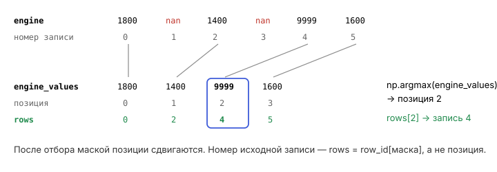

## Зачем это нужно

Заказчик спрашивает: «Какая типичная цена в этих объявлениях?». В ответ напрашивается **среднее**, но в нашем файле оно около 9 700 €, а **медиана** — 6 600 €. Разница почти в полтора раза! Какое число назвать — и почему они так расходятся?

Ответ кроется в крайних значениях: в файле есть объявление с ценой 10 000 000 €. Сегодня научимся описывать «типичный уровень» двумя статистиками, находить рекордные записи и понимать, почему одно значение может исказить картину.

Перед примерами уже выполнена подготовка: векторы признаков, номера записей `row_id` и вектор конечных цен `price_values` (урок 1.5).

## Статистика — число по множеству наблюдений

Одна запись — одно наблюдение цены. Весь столбец — множество наблюдений с разными значениями, их **распределение**. **Статистика** — число, которое мы вычисляем по этому множеству: среднее, медиана, доля, минимум.

Если выбрать запись случайно, её цена заранее неизвестна — удобно говорить о *случайной величине*. Но значения в сохранённом файле фиксированы, и все выводы относятся к **этому набору объявлений**, а не ко всему рынку.

## Среднее и медиана

**Среднее арифметическое** — сумма значений, делённая на их количество:

$$
\bar{x} = \frac{1}{n}\sum_{i=1}^{n} x_i .
$$

**Медиана** — значение посередине упорядоченного набора: половина значений не больше её, половина — не меньше. Для чётного $n$ берут среднее двух центральных.

Числовой пример: цены $[4000, 5000, 6000, 7000, 8000]$:

$$
\bar{x} = \frac{4000 + 5000 + 6000 + 7000 + 8000}{5} = 6000, \qquad \text{медиана} = 6000 \text{ (третье из пяти)}.
$$

Заменим последнее значение на 100 000:

$$
\bar{x} = \frac{4000 + 5000 + 6000 + 7000 + 100\,000}{5} = 24\,400, \qquad \text{медиана} = 6000.
$$

Одно крайнее значение увеличило среднее вчетверо, а медиану не сдвинуло вовсе. Медиана **устойчива к выбросам**, среднее — **чувствительно**.

```python
mean_price = np.mean(price_values)
median_price = np.median(price_values)
print(f'Среднее: {mean_price:.2f} евро')
print(f'Медиана: {median_price:.2f} евро')
print(f'Минимум: {np.min(price_values):.2f} евро')
print(f'Максимум: {np.max(price_values):.2f} евро')
```

Проверим чувствительность на учебном наборе. Это отдельный эксперимент — исходную таблицу мы не меняем:

```python
demo_prices = np.array([4000., 5000., 6000., 7000., 8000.])
demo_with_extreme = demo_prices.copy()
demo_with_extreme[-1] = 100_000.
for label, values in [('Исходный пример', demo_prices), ('С крайним значением', demo_with_extreme)]:
    print(f'{label}: среднее = {np.mean(values):.0f}, медиана = {np.median(values):.0f}')
```

**Как читать разницу.** Если среднее заметно больше медианы — в данных есть «длинный хвост» дорогих значений: немного очень дорогих машин тянут среднее вверх. Для фразы «типичная цена в этом файле» честнее медиана, но лучше называть обе статистики и объяснять разницу.

## Где рекорд: позиция и исходная запись

`np.argmax` возвращает **позицию** наибольшего элемента, `np.argmin` — наименьшего. `np.argsort` возвращает позиции в порядке возрастания значений: `np.argsort(a)[-5:][::-1]` — пять наибольших в порядке убывания (`[::-1]` переворачивает).

Ловушка: после отбора маской позиции **сдвигаются**. Если в векторе были пропуски, позиция 2 в отфильтрованном векторе может соответствовать записи 4 в исходной таблице. Чтобы не потерять связь, тем же фильтром отбирают и номера записей: `rows = row_id[маска]`.



```python
price_rows = row_id[known_price]           # номера исходных записей для каждой конечной цены
position_max = np.argmax(price_values)
original_row_max = price_rows[position_max]
print('Позиция в векторе конечных цен:', position_max)
print('Номер исходной записи:', original_row_max)
print('Признаки записи [год, пробег, объём, цена]:', X[original_row_max])

top_positions = np.argsort(price_values)[-5:][::-1]
print('Пять самых высоких цен: [номер записи, цена]')
print(np.column_stack((price_rows[top_positions], price_values[top_positions])))
```

В цене пропусков нет, поэтому здесь позиция и номер совпадают. Но в объёме двигателя 205 пропусков — и там они разойдутся. Проверим:

```python
known_engine = np.isfinite(engine)
engine_values = engine[known_engine]
engine_rows = row_id[known_engine]
pos = np.argmax(engine_values)
print('Позиция максимума:', pos, '| исходная запись:', engine_rows[pos])
print('Неверно: X[pos] =', X[pos])
print('Верно:   X[engine_rows[pos]] =', X[engine_rows[pos]])
```

## Рекорд — ошибка или редкость?

Объявление за 10 000 000 € для машины 2009 года с пробегом 57 000 км выглядит как опечатка или «цена-заглушка». Объём двигателя 9999 см³ встречается несколько раз — похоже на условное значение «не знаю». Но вывод «это ошибка» делают после проверки (другие поля записи, повторы, источник), а не только по величине. В отчёте честно пишут: «максимум 10 000 000 € — подозрительное значение, требует проверки; медиана 6 600 € к нему устойчива».

## Типичные ошибки

:::mistake Только среднее
При длинном хвосте среднее описывает «типичную» цену плохо. Называйте медиану (и среднее с объяснением разницы).
:::

:::mistake Позиция вместо номера записи
После `engine[known_engine]` результат `np.argmax` — позиция в отфильтрованном векторе. `X[pos]` покажет **другую** машину. Используйте `rows[pos]`, где `rows = row_id[маска]`.
:::

:::mistake Сортировка одного столбца
`np.sort(price)` упорядочит цены, но оторвёт их от остальных признаков. Чтобы видеть записи целиком, сортируйте **позиции**: `np.argsort` и затем индексирование.
:::

:::mistake Статистика с пропусками
`np.mean(engine)` даёт `nan`. Сначала отберите конечные значения (урок 1.5) — или явно используйте `np.nanmean`, понимая, что это не очистка.
:::

## Мини-квиз

```quiz
- q: "Цены: `[3000, 4000, 5000, 6000, 70000]`. Что верно?"
  options:
    - Среднее и медиана равны 5000
    - "Медиана 5000, среднее 17 600"
    - "Медиана 17 600, среднее 5000"
  answer: 1
  explain: "Медиана — центральное значение (5000); среднее = 88 000 / 5 = 17 600 — его тянет вверх 70 000."
- q: "`engine_values = engine[known_engine]`, `pos = np.argmax(engine_values)`. Как получить исходную запись с максимальным объёмом?"
  options:
    - "`X[pos]`"
    - "`X[row_id[known_engine][pos]]`"
    - "`X[np.max(engine_values)]`"
  answer: 1
  explain: Позиция относится к отфильтрованному вектору; номер записи даёт тот же фильтр, применённый к row_id.
- q: Медиана цен 6 600 €, среднее 9 727 €. Что это говорит о распределении?
  options:
    - Цены распределены симметрично
    - Есть немного очень дорогих объявлений — длинный хвост справа
    - Половина машин дороже 9 727 €
  answer: 1
  explain: Среднее заметно больше медианы — крупные значения тянут его вверх. Дороже медианы — половина, а не дороже среднего.
```

## Что запомнить

- Среднее — сумма / количество, чувствительно к выбросам; медиана — центр упорядоченных значений, устойчива.
- Если среднее заметно больше медианы — в данных длинный хвост больших значений.
- `np.min`, `np.max`, `np.argmax`, `np.argsort` — крайние значения и их позиции; `[-5:][::-1]` — пять наибольших.
- После фильтрации позиция ≠ номер записи; номер даёт `row_id[маска][позиция]`.
- Крайнее значение — повод для проверки, а не автоматически ошибка.
