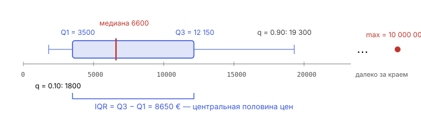

## Зачем это нужно

Медиана говорит, где «центр» цен, но не говорит, **насколько цены различаются**. Представьте два набора с одной и той же медианой 6 600 €: в первом почти все машины стоят 6–7 тыс., во втором — от 500 € до 50 000 €. Для покупателя и для аналитика это совершенно разные рынки.

Разброс описывают тремя способами: **квантилями** (границы долей), **стандартным отклонением** (типичное отклонение от среднего) и **частотами по интервалам** (сколько записей в каждом ценовом диапазоне). У каждого способа своя устойчивость к выбросам — разберёмся.

## Квантили: границы долей

**Квантиль уровня $q$** — граница, ниже которой лежит доля $q$ упорядоченных значений. Особые квантили:

- $q = 0.5$ — медиана;
- $q = 0.25$ и $q = 0.75$ — **квартили** Q1 и Q3; между ними лежит центральная половина значений;
- $q = 0.9$ — граница, ниже которой 90 % значений.

Как NumPy считает квантиль (по умолчанию — линейная интерполяция). Упорядочим значения $x_{(0)} \le x_{(1)} \le \dots \le x_{(n-1)}$ и найдём «дробную позицию» $h = q\,(n - 1)$. Если $h$ — не целое, берём точку между соседями:

$$
Q(q) = x_{(\lfloor h \rfloor)} + \bigl(h - \lfloor h \rfloor\bigr)\,\bigl(x_{(\lfloor h \rfloor + 1)} - x_{(\lfloor h \rfloor)}\bigr).
$$

Пример: цены $[2000, 3000, 5000, 8000, 12000]$, $n = 5$. Для $q = 0.25$: $h = 0.25 \cdot 4 = 1$ — это ровно $x_{(1)} = 3000$. Для $q = 0.9$: $h = 3.6$, значит

$$
Q(0.9) = 8000 + 0.6 \cdot (12000 - 8000) = 10\,400.
$$

```python
levels = np.array([0.10, 0.25, 0.50, 0.75, 0.90])
quantiles = np.quantile(price_values, levels)
for level, value in zip(levels, quantiles):
    print(f'q = {level:.2f}: {value:,.0f} евро')

q1, q3 = np.quantile(price_values, [0.25, 0.75])
iqr = q3 - q1
print(f'IQR = Q3 − Q1 = {iqr:,.0f} евро')
print(f'Размах max − min = {np.ptp(price_values):,.0f} евро')
```

Как объяснить человеку без Python: «q = 0.90 — 19 300 € означает: 90 % объявлений в файле не дороже 19 300 €».

**Межквартильный размах** IQR = Q3 − Q1 — ширина центральной половины цен: 8 650 €. Сравните с размахом `max − min` ≈ 10 000 000 €: одна подозрительная запись делает размах бессмысленным, а IQR её не замечает.



## Дисперсия и стандартное отклонение

**Дисперсия** — среднее квадратов отклонений от среднего; **стандартное отклонение** — корень из неё:

$$
\sigma^2 = \frac{1}{n}\sum_{i=1}^{n}(x_i - \bar{x})^2, \qquad \sigma = \sqrt{\sigma^2}.
$$

Пример: $[4000, 5000, 6000, 7000, 8000]$, $\bar{x} = 6000$. Отклонения: $-2000, -1000, 0, 1000, 2000$; их квадраты: $4\,000\,000,\ 1\,000\,000,\ 0,\ 1\,000\,000,\ 4\,000\,000$. Сумма $10\,000\,000$, значит

$$
\sigma^2 = \frac{10\,000\,000}{5} = 2\,000\,000\ \text{евро}^2, \qquad \sigma = \sqrt{2\,000\,000} \approx 1414\ \text{евро}.
$$

Единица дисперсии — **евро в квадрате**, поэтому для описания используют стандартное отклонение: оно в тех же единицах, что и цена.

```python
std_price = np.std(price_values, ddof=0)
variance_price = np.var(price_values, ddof=0)
print(f'Стандартное отклонение: {std_price:,.0f} евро')
print(f'Дисперсия: {variance_price:,.0f} евро²')
print(f'IQR: {iqr:,.0f} евро')

without_record = price_values[price_values < 1_000_000]   # опыт: без одной записи за 10 млн
print(f'Стандартное отклонение без рекорда: {np.std(without_record):,.0f} евро')
```

Стандартное отклонение — 50 439 €, больше самой типичной цены! Уберите одну запись за 10 млн — и оно упадёт в разы. Как и среднее, $\sigma$ **чувствительно к выбросам**. Ещё одно: по одному числу $\sigma$ нельзя заключить, что распределение «нормальное» (симметричный «колокол»): у цен длинный правый хвост.

:::info ddof=0 или ddof=1
`ddof=0` (по умолчанию в NumPy) делит на $n$ — описание **данного** набора. `ddof=1` делит на $n - 1$ — оценка разброса для генеральной совокупности по выборке. На 41 000 записях разница ничтожна. Помните: в Pandas `std()` по умолчанию использует `ddof=1`.
:::

## Частоты по интервалам

Распределение можно описать числами и без графика — сколько записей попало в каждый диапазон цен. Это делает `np.histogram`: она возвращает пару `(counts, edges)` — числа записей и границы интервалов. Интервалы вида $[\text{левая}, \text{правая})$: левая граница включается, правая нет; последний интервал включает и правую границу.

```python
bins = np.array([0., 5000., 10_000., 20_000., 50_000., np.inf])
nonnegative_prices = price_values[price_values >= 0]
counts, edges = np.histogram(nonnegative_prices, bins=bins)
print('Неотрицательных конечных цен:', nonnegative_prices.size)
for left, right, count in zip(edges[:-1], edges[1:], counts):
    share = count / nonnegative_prices.size
    bar = '█' * int(round(share * 50))
    print(f'[{left:>7,.0f}, {right:>7,.0f}): {count:>6} ({share:.3f}) {bar}')
```

Больше всего объявлений — в интервале до 5 000 €, хотя средняя цена (≈ 9 700 €) лежит в другом интервале. Это ещё одно проявление длинного хвоста. Значения вне границ `bins` не считаются — поэтому полезно сверить `counts.sum()` с числом значений. Графики распределений построим в модуле 4.

## Типичные ошибки

:::mistake Уровни в процентах
`np.quantile(a, 90)` вызовет ошибку: уровни — доли от 0 до 1 (`0.9`). Если удобнее проценты — `np.percentile(a, 90)`.
:::

:::mistake Размах как мера разброса
`max − min` определяется двумя самыми крайними записями. Один выброс — и размах ничего не говорит о типичных различиях. Для описания используйте IQR.
:::

:::mistake Стандартное отклонение при выбросах
$\sigma$, как и среднее, тянется за выбросами. Если $\sigma$ больше медианы — проверьте крайние значения, прежде чем делать выводы.
:::

:::mistake Потерянные значения в histogram
Значения вне диапазона `bins` молча отбрасываются. Ставьте `np.inf` последней границей и сверяйте `counts.sum()` с размером данных.
:::

## Мини-квиз

```quiz
- q: "`np.quantile(price_values, 0.9)` = 19 300. Что это значит?"
  options:
    - Средняя цена дорогих машин — 19 300 €
    - 90 % объявлений не дороже 19 300 €
    - 10 % объявлений не дороже 19 300 €
  answer: 1
  explain: Квантиль уровня 0.9 — граница, ниже которой 90 % упорядоченных значений.
- q: Какие меры разброса устойчивы к одному гигантскому выбросу? Выберите все.
  options:
    - IQR
    - Стандартное отклонение
    - Размах max − min
    - Разность квантилей 0.9 и 0.1
  answer: [0, 3]
  explain: Квантили почти не зависят от единичных крайних значений; σ и размах зависят сильно.
- q: "Значения `[2, 4, 4, 4, 6]`. Чему равна дисперсия (ddof=0)?"
  options:
    - "1.6"
    - "2.0"
    - "1.26"
  answer: 0
  explain: "Среднее 4; квадраты отклонений 4, 0, 0, 0, 4; сумма 8; 8 / 5 = 1.6. Стандартное отклонение ≈ 1.26."
```

## Что запомнить

- Квантиль уровня q — граница доли q значений; Q1 и Q3 ограничивают центральную половину, IQR = Q3 − Q1.
- Квантили и IQR устойчивы к выбросам; размах, среднее и стандартное отклонение — нет.
- Дисперсия — среднее квадратов отклонений (единицы²), стандартное отклонение — корень (в единицах признака).
- `np.histogram(values, bins=границы)` даёт числа записей по интервалам `[левая, правая)`.
- Описывая разброс, указывайте единицы и сравнивайте несколько мер.
