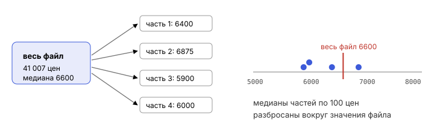

## Зачем это нужно

Представьте, что у вас не 41 007 объявлений, а только 100 случайно выбранных. Совпадёт ли их медиана с медианой всего файла? Почти наверняка — нет. А если выбрать другие 100? Получится третье число.

Это **выборочная изменчивость**: вычисленная статистика зависит от того, какие наблюдения попали в расчёт. Понимать её важно по двум причинам. Во-первых, в отчёте нужно указывать, по каким и скольким записям посчитано число. Во-вторых, в машинном обучении (модуль 5) мы будем делить данные на части — и результаты тоже будут зависеть от разбиения.

Полный файл — это наш доступный набор. Случайный выбор строк **не превращает** файл в представительную выборку всего рынка; мы лишь изучаем, как статистика меняется внутри этого файла.

## Генератор случайных чисел и seed

`np.random.default_rng(seed)` создаёт генератор случайных чисел. **Seed** («зерно») — число, задающее начальное состояние: одинаковый seed даёт одинаковую последовательность «случайных» чисел. Так опыт можно повторить — и проверить.

`rng.choice(n, size=k, replace=False)` выбирает `k` **разных** позиций из `0…n−1`. С `replace=True` позиции могут повторяться (выбор с возвращением — пригодится для бутстрэпа в модуле 6). Мы выбираем **позиции**, а затем берём значения по ним — исходные цены не заменяются сгенерированными.

## Первые строки — не случайная выборка

```python
rng = np.random.default_rng(42)
sample_size = 100
random_positions = rng.choice(price_values.size, size=sample_size, replace=False)
random_prices = price_values[random_positions]
first_prices = price_values[:sample_size]

print('Весь файл:        среднее =', round(np.mean(price_values)), ' медиана =', np.median(price_values))
print('Первые 100 строк: среднее =', round(np.mean(first_prices)), ' медиана =', np.median(first_prices))
print('Случайные 100:    среднее =', round(np.mean(random_prices)), ' медиана =', np.median(random_prices))
```

Первые строки файла могут быть упорядочены по дате, продавцу или марке — это не случайный выбор. Случайная часть честнее, но и она не обязана совпадать с файлом: у неё своя медиана.

## Повторяем опыт

Повторим выбор несколько раз **одним и тем же генератором** — каждый вызов `rng.choice` даёт новые позиции. Простой цикл здесь нужен только для повторения опыта; статистики каждой части считает NumPy.

```python
sample_means = []
sample_medians = []
for experiment in range(5):
    positions = rng.choice(price_values.size, size=sample_size, replace=False)
    selected = price_values[positions]
    sample_means.append(np.mean(selected))
    sample_medians.append(np.median(selected))
sample_means = np.array(sample_means)
sample_medians = np.array(sample_medians)
print('Средние пяти частей:', sample_means.round())
print('Медианы пяти частей:', sample_medians)
print('Размах средних:', round(np.ptp(sample_means)), '| размах медиан:', np.ptp(sample_medians))
```



Почему результаты различаются, хотя формула и файл не менялись? Потому что в каждую часть попали **разные объявления**. Это не ошибка вычислений. В отдельном опыте редкая высокая цена может сильно сдвинуть **среднее**, а медиана «дрожит» меньше.

## Чем больше часть, тем стабильнее

Повторим опыт много раз для разных размеров частей и посмотрим, насколько в среднем медиана части отклоняется от медианы файла:

```python
full_median = np.median(price_values)
rng = np.random.default_rng(0)
for size in [50, 200, 1000, 5000]:
    deviations = []
    for _ in range(100):
        positions = rng.choice(price_values.size, size=size, replace=False)
        deviations.append(abs(np.median(price_values[positions]) - full_median))
    print(f'часть по {size:>4} цен: типичное отклонение медианы ≈ {np.mean(deviations):>5.0f} евро')
```

С ростом размера части отклонение уменьшается — примерно как $1/\sqrt{n}$: вчетверо больше записей — вдвое меньше «дрожание». Но рост числа записей:

- обычно стабилизирует оценки в **случайной** выборке, но не гарантирует улучшения в каждом отдельном опыте;
- **не исправляет систематических ошибок** источника: если в файл попали только объявления одного сайта, никакое число строк не сделает их «всем рынком».

Пять повторений — иллюстрация, а не оценка доверительного интервала. Строгие методы оценки неопределённости выходят за рамки модуля.

## Типичные ошибки

:::mistake Генератор с seed внутри цикла
Если написать `rng = np.random.default_rng(42)` **внутри** цикла, каждый повтор начнётся с одного и того же состояния — все части окажутся одинаковыми, а «изменчивость» — нулевой. Создавайте генератор один раз, перед циклом.
:::

:::mistake Первые строки как выборка
`price_values[:100]` — не случайная часть. Порядок строк в файле может быть связан с датой, продавцом или маркой.
:::

:::mistake Повторы, когда их не должно быть
`rng.choice(n, size=100)` по умолчанию выбирает **с возвращением** — одна позиция может попасться дважды. Для «100 разных записей» нужен `replace=False`.
:::

:::warning Ждать точного совпадения
Медиана случайной части почти никогда не равна медиане файла. Это нормально: важно, насколько велик разброс и по скольким записям посчитано число.
:::

## Мини-квиз

```quiz
- q: Зачем задавать seed генератора?
  options:
    - Чтобы выборка стала представительной для рынка
    - Чтобы опыт можно было повторить и получить те же позиции
    - Чтобы ускорить расчёт
  answer: 1
  explain: Seed делает последовательность случайных чисел воспроизводимой, но не делает файл представительным.
- q: "В цикле `for i in range(5): rng = np.random.default_rng(42); pos = rng.choice(1000, 10, replace=False)`. Что получится?"
  options:
    - Пять разных наборов позиций
    - Пять одинаковых наборов позиций
    - Ошибка
  answer: 1
  explain: Генератор каждый раз создаётся заново с тем же seed — и выдаёт те же числа.
- q: Медианы 5 случайных частей по 100 цен — 6400, 6875, 5900, 6000, 5600. Что можно сказать?
  options:
    - Вычисления ошибочны — медиана должна быть одной
    - Статистика меняется от выборки к выборке; чем больше часть, тем меньше обычно разброс
    - Медиана файла равна 6155 — среднему этих чисел
  answer: 1
  explain: Различия — следствие того, какие записи попали в части. Медиана файла считается по всему файлу.
```

## Что запомнить

- Статистика зависит от того, какие наблюдения попали в расчёт — это выборочная изменчивость, а не ошибка.
- `rng = np.random.default_rng(seed)` — воспроизводимый генератор; создавайте его один раз.
- `rng.choice(n, size=k, replace=False)` — k разных позиций; значения берутся по позициям.
- Первые строки — не случайная выборка.
- Больше записей — меньше «дрожание» оценок, но систематические ошибки источника так не исправить.
