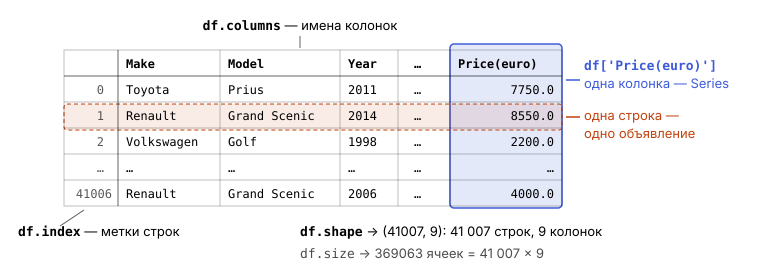

## Зачем это нужно

В модуле 1 мы читали файл через `np.genfromtxt` и брали только четыре числовых столбца. Марка, модель, кузов и тип топлива остались за бортом: NumPy-массив хранит значения одного типа, и текст превратился бы в `nan`. Но цена автомобиля зависит и от марки, и от топлива — без них анализ неполный.

**Pandas** — библиотека Python для работы с таблицами. Она читает весь CSV одной командой: с именами колонок, с текстом и числами вперемешку, с пропусками. Основной объект pandas — **DataFrame**, таблица; одна её колонка — **Series**.

Главная задача курса — **оценить цену** автомобиля по его характеристикам. Ответ — число, поэтому это задача **регрессии**. Дополнительная задача — предсказать тип трансмиссии; ответ — одна из двух категорий, это **классификация**. Модели мы построим в модуле 5, а сейчас — этап «подготовка данных» из цикла CRISP-DM (урок 0.3): загрузить, осмотреть, очистить и сохранить таблицу.

:::warning Что именно записано в файле
Каждая строка — **объявление** о продаже на вторичном рынке Молдавии. Цена в нём — **цена предложения** (сколько просит продавец), а не цена сделки. Дат объявлений в файле нет. Эти ограничения стоит помнить при любых выводах.
:::

## Что означают колонки

| Колонка | Содержание | Роль в задаче оценки цены |
|---|---|---|
| `Make` | Марка | Входной признак |
| `Model` | Модель | Входной признак |
| `Year` | Год выпуска | Входной признак |
| `Style` | Тип кузова | Входной признак |
| `Distance` | Пробег, км | Входной признак |
| `Engine_capacity(cm3)` | Объём двигателя, см³ | Входной признак |
| `Fuel_type` | Тип топлива | Входной признак |
| `AutoTransmission` | Автоматическая трансмиссия: `True`/`False` | Входной признак (или цель в задаче классификации) |
| `Price(euro)` | Цена, евро | **Целевая переменная** — то, что предсказываем |

## Загрузка: исходник и рабочая копия

`pd.read_csv` читает CSV в `DataFrame`: первая строка файла становится названиями колонок, тип каждой колонки определяется по значениям, пустые ячейки становятся пропусками `NaN`. Таблицу, записанную последней строкой ячейки, среда показывает сама — как в Jupyter.

```python
raw = pd.read_csv('cars.csv')
df = raw.copy()     # raw — исходные данные, df — рабочая копия
df.head(3)
```

Переменная `raw` хранит исходную таблицу, и мы её **не меняем**. Все действия выполняем на копии `df`. Зачем это нужно: если критерии очистки окажутся ошибочными, всегда можно вернуться к исходнику и сравнить результат. `raw.copy()` создаёт независимую копию — изменения `df` не затронут `raw`.

:::info Только нужные колонки
Как `usecols` в `np.genfromtxt`, у `read_csv` есть параметр `usecols` — но колонки можно назвать по именам: `pd.read_csv('cars.csv', usecols=['Make', 'Year', 'Price(euro)'])`.
:::

## DataFrame: строки, колонки, индекс



У таблицы три главных атрибута (без скобок — это не методы):

- `df.shape` — пара «число строк, число колонок»;
- `df.columns` — названия колонок;
- `df.index` — **метки** строк. Сразу после чтения это номера 0, 1, 2, …, но после фильтрации метки и порядковые номера разойдутся — об этом урок 2.4.

```python
print('Размер (строки, колонки):', df.shape)
print('Ячеек всего:', df.size)
print('Колонки:', df.columns.tolist())
print('Индекс:', df.index)
```

Число ячеек — произведение размеров:

$$
\text{size} = n_{\text{строк}} \times n_{\text{колонок}} = 41\,007 \times 9 = 369\,063.
$$

Каждая строка — одно **наблюдение** (объявление), каждая колонка — один **признак** (урок 1.1). `RangeIndex(start=0, stop=41007, step=1)` означает метки от 0 до 41 006 подряд.

## Колонка — это Series

Колонку выбирают по имени в квадратных скобках: `df['Price(euro)']`. Получается **Series** — значения колонки вместе с метками строк. Series ведёт себя как массив NumPy: у неё есть `mean`, `median`, `max`, сравнение даёт маску, сумма маски — количество.

```python
price = df['Price(euro)']
print(type(price))
print(price.head(3))
print('Средняя цена:', round(price.mean(), 1), '| медиана:', price.median())
print('Объявлений дороже 10 000 евро:', (price > 10_000).sum())
```

Средняя цена ≈ 9727 евро, медиана — 6600: те же числа, что и в модуле 1, только теперь без ручного выбора столбцов. Слева в выводе `head(3)` — метки строк (индекс), внизу — имя и тип колонки.

## Таблицу можно собрать и вручную

Для маленьких примеров таблицу удобно создать из словаря: ключи — имена колонок, значения — списки одинаковой длины. А `Series` можно создать из списка значений и списка меток:

```python
mini = pd.DataFrame({'make':  ['VW', 'BMW', 'VW', 'Audi'],
                     'price': [10, 30, 12, 25]})
print(mini.shape)
salaries = pd.Series([400, 300, 200], index=['Andrew', 'Bob', 'Charles'])
print(salaries['Bob'])          # обращение по метке — как к словарю
mini
```

Такие мини-таблицы пригодятся, чтобы проверить действие на нескольких строках, прежде чем применять его к 41 тысяче объявлений.

## Первые, последние и случайные строки

Выводить всю таблицу из десятков тысяч строк бессмысленно. Смотрят на её части:

- `head(n)` — первые `n` строк (по умолчанию 5);
- `tail(n)` — последние;
- `sample(n, random_state=42)` — случайные. `random_state` фиксирует случайный выбор, как seed генератора в уроке 1.9: при каждом запуске получатся те же строки.

```python
display(df.tail(3))
display(df.sample(3, random_state=42))
```

`display(...)` показывает таблицу в красивом виде, даже если она стоит не в последней строке ячейки. Первые строки файла часто идут в порядке выгрузки и могут быть непохожи на остальные, поэтому полезно смотреть и случайные.

## Типичные ошибки

:::mistake Скобки после атрибута
`df.shape()` даёт `TypeError: 'tuple' object is not callable`: `shape` — атрибут, а не метод. Пишите `df.shape`, `df.columns`, `df.index` без скобок, но `df.head()`, `df.copy()` — со скобками.
:::

:::mistake Неточное имя колонки
`df['Price']` вызывает `KeyError: 'Price'`: в файле колонка называется `'Price(euro)'`. Регистр, пробелы и скобки важны — сверяйтесь с `df.columns`.
:::

:::mistake Работа без копии
Если менять сразу прочитанную таблицу, исходные значения потеряются, и сравнить результат будет не с чем. Держите `raw` нетронутым, а изменения делайте в `df = raw.copy()`.
:::

:::mistake Случайные строки без random_state
`df.sample(5)` при каждом запуске даёт разные строки — вывод нельзя воспроизвести и обсудить с коллегой. Указывайте `random_state`.
:::

## Мини-квиз

```quiz
- q: "Что вернёт `df.shape` для таблицы объявлений?"
  options:
    - "`(9, 41007)`"
    - "`(41007, 9)`"
    - "`369063`"
  answer: 1
  explain: Сначала число строк, затем число колонок. 369 063 — это `df.size`, число ячеек.
- q: "Какой тип у `df['Year']`?"
  options:
    - DataFrame
    - Series
    - список Python
  answer: 1
  explain: Одна колонка по имени — это Series, значения с метками строк.
- q: Зачем хранить исходную таблицу `raw` и работать с копией `df`?
  options:
    - Копия работает быстрее
    - Чтобы всегда можно было вернуться к исходным данным и сравнить с ними результат
    - Без копии pandas не умеет фильтровать
  answer: 1
  explain: Исходник остаётся нетронутым, поэтому ошибочную обработку можно переделать и проверить.
```

## Что запомнить

- `pd.read_csv('cars.csv')` читает всю таблицу: имена колонок, текст, числа, пропуски.
- Исходник — `raw`, работа — на копии `df = raw.copy()`.
- `df.shape`, `df.columns`, `df.index` — атрибуты без скобок; метки индекса пока совпадают с номерами строк.
- Колонка `df['имя']` — это Series: ведёт себя как массив NumPy и знает метки строк.
- Смотрим на таблицу частями: `head`, `tail`, `sample(n, random_state=...)`.
