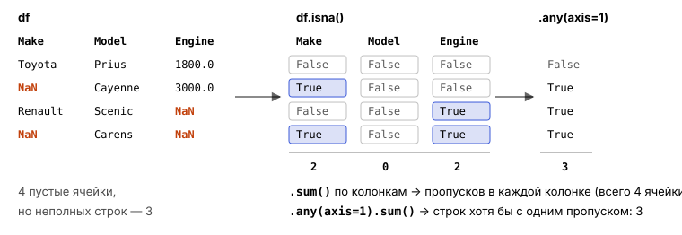

## Зачем это нужно

`info()` подсказал, что в некоторых колонках непустых значений меньше, чем строк. Теперь нужно **посчитать** точно: сколько пропусков в каждой колонке, сколько строк неполные и сколько объявлений полностью повторяют друг друга. От этих чисел зависят решения в уроке 2.6: что удалить, что оставить, что заполнить.

Третий вопрос осмотра — **категории**. Какие марки встречаются чаще всего? Сколько электромобилей? Есть ли в колонке значения, которых мы не ожидали? Ответ даёт подсчёт частот.

## Пропуски по колонкам

`df.isna()` возвращает таблицу того же размера из `True`/`False`: `True` — на месте пропуска. Дальше всё как с масками NumPy: сумма по колонке — число пропусков, среднее — их доля.



```python
missing = df.isna().sum()
print(missing)
print()
print('Доля пропусков:')
print(df.isna().mean().round(4))
```

Пропуски есть в четырёх колонках — `Make`, `Model`, `Engine_capacity(cm3)`, `Fuel_type`, по 205 в каждой. Доля пропусков в каждой из них:

$$
\frac{205}{41\,007} \approx 0.005 = 0.5\%.
$$

Немного, но решение о них всё равно принимать нам: модели и многие функции не умеют работать с пропусками.

## Неполные строки

Сколько **строк** затронуто? Нельзя просто сложить пропуски по колонкам: в одной строке может быть два пропуска. Маска «хотя бы один пропуск в строке» — `any(axis=1)`: проверка идёт вдоль строки, по всем её колонкам (оси — урок 1.10).

```python
print('Пустых ячеек всего:     ', df.isna().sum().sum())
print('Неполных строк:         ', df.isna().any(axis=1).sum())
print('Строк с двумя пропусками:', (df.isna().sum(axis=1) == 2).sum())
```

Пустых ячеек 820, а неполных строк — 816: в четырёх строках не хватает сразу двух значений. Пропуски разбросаны по разным строкам, поэтому если удалить все неполные строки, уйдёт 816 объявлений, а не 205.

## Полные повторы

`df.duplicated()` отмечает строки, которые **полностью** совпадают с какой-то **более ранней** строкой. Первое вхождение не отмечается — поэтому сумма маски равна числу строк, которые можно удалить, оставив по одному экземпляру.

```python
print('Повторных строк:', df.duplicated().sum())
print('Строк, у которых есть «двойник» (вместе с первыми):', df.duplicated(keep=False).sum())
```

3623 повторные строки — почти 9 % таблицы. С `keep=False` отмечаются все строки групп, включая первые: таких 6135. Рекордная группа — Mercedes E Class 2016 года с одинаковыми пробегом, объёмом и ценой: 57 одинаковых строк.

:::warning Повтор — это допущение, а не факт
В файле нет номера объявления. Две одинаковые строки могут быть повторной выгрузкой одного объявления, а могут описывать два разных автомобиля с одинаковыми характеристиками. 57 одинаковых Mercedes — почти наверняка одно объявление. А две одинаковые Lada 2010 года с пробегом 100 000 км — вполне возможно, две разные машины. Решение удалять повторы мы примем в уроке 2.6 и запишем его как допущение.
:::

## Частоты категорий

`s.value_counts()` считает, сколько раз встречается каждое значение колонки, и сортирует по убыванию. По умолчанию пропуски **не считаются**: `dropna=False` добавляет их отдельной строкой. `normalize=True` вместо количеств выдаёт доли.

```python
display(df['Fuel_type'].value_counts(dropna=False))
display(df['Fuel_type'].value_counts(normalize=True, dropna=False).round(4))
```

Дизелей больше всего — 18 810 (46 %), электромобилей всего 338. Пропуск тоже виден — 205 строк.

Знаменатель доли важен. С `dropna=False` доля электромобилей считается среди всех строк, без него — только среди строк с известным топливом:

$$
\frac{338}{41\,007} \approx 0.00824, \qquad \frac{338}{40\,802} \approx 0.00828.
$$

Разница мала, но в отчёте нужно писать, от чего считалась доля.

## Сколько разных значений

`s.nunique()` — число разных значений (без пропусков). Посмотрим, насколько разнообразны марки и модели и какие марки встречаются чаще всего:

```python
print('Марок:', df['Make'].nunique(), '| моделей:', df['Model'].nunique())
display(df['Make'].value_counts().head(5))
print('Марок, у которых всего одно объявление:', (df['Make'].value_counts() == 1).sum())
```

87 марок и 829 моделей. Пять самых частых марок — Volkswagen, Mercedes, Toyota, BMW, Renault, а у десяти марок (Lamborghini, McLaren, Aston Martin…) — ровно по одному объявлению. Для таких марок цену по данным не оценить — к этой проблеме мы вернёмся в уроке 2.10 о редких категориях.

## Типичные ошибки

:::mistake Сложили пропуски и назвали это строками
`df.isna().sum().sum()` — число пустых **ячеек**. Неполных **строк** может быть меньше: считайте их через `df.isna().any(axis=1).sum()`.
:::

:::mistake Поиск пропусков сравнением
`df['Make'] == np.nan` и `df['Make'] == 'NaN'` всегда дают `False`. Пропуски находят только через `isna()`.
:::

:::mistake value_counts спрятал пропуски
Без `dropna=False` пропуски не попадают в подсчёт, а доли с `normalize=True` считаются только среди известных значений.
:::

:::mistake Повторы считают вместе с первыми
`duplicated()` не отмечает первое вхождение. Число строк во всех группах повторов — `duplicated(keep=False).sum()`, а число лишних копий — `duplicated().sum()`.
:::

## Мини-квиз

```quiz
- q: "Пустых ячеек в таблице 820, а `df.isna().any(axis=1).sum()` дал 816. Почему?"
  options:
    - В некоторых строках не хватает сразу двух значений
    - "`any` считает с ошибкой"
    - Четыре пропуска — в индексе
  answer: 0
  explain: Две пустые ячейки одной строки дают одну неполную строку.
- q: "Колонка содержит значения A, A, A, B. Сколько `True` вернёт `duplicated()`?"
  options:
    - "1"
    - "2"
    - "3"
    - "4"
  answer: 1
  ordered: true
  explain: Первая A — первое вхождение, вторая и третья — повторы. B встречается один раз.
- q: "Что делает `value_counts()` с пропусками по умолчанию?"
  options:
    - Считает их отдельной строкой NaN
    - Не учитывает их
    - Выдаёт ошибку
  answer: 1
  explain: Чтобы увидеть пропуски в частотах, нужен параметр `dropna=False`.
```

## Что запомнить

- `df.isna().sum()` — пропуски по колонкам, `.mean()` — их доли.
- Неполные строки — `df.isna().any(axis=1).sum()`; это не то же самое, что число пустых ячеек.
- `df.duplicated().sum()` — число лишних копий полностью совпадающих строк; повтор без ID объявления — допущение.
- `value_counts()` — частоты категорий; `dropna=False` учитывает пропуски, `normalize=True` даёт доли.
- `nunique()` — число разных значений; у части марок всего одно объявление.
