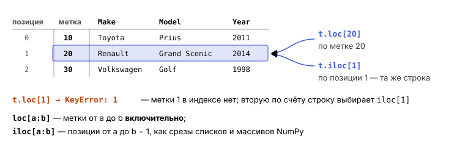

## Зачем это нужно

Аналитику постоянно нужны **части** таблицы: только марка, модель и цена; первые десять строк; строка, где нашлась ошибка; цена конкретного объявления. В NumPy мы выбирали по номерам: `X[0, 3]`, `X[:, 3]`. У таблицы pandas есть ещё и **имена** — колонок и строк, поэтому способов выбора два: по именам (`loc`) и по номерам (`iloc`).

Различать их важно: после сортировки или фильтрации строка с меткой 0 может оказаться где угодно, а первая по порядку строка — иметь метку 37 125. Перепутать метку и позицию — значит молча взять не ту строку.

## Одна колонка и несколько колонок

`df['Make']` возвращает **Series** — одну колонку. `df[['Make']]` — **DataFrame** из одной колонки: внутренние скобки — это список имён. Выбор нескольких колонок — тоже список, и колонки идут в порядке списка:

```python
make_series = df['Make']
make_table = df[['Make']]
print(type(make_series).__name__, make_series.shape)
print(type(make_table).__name__, make_table.shape)
df[['Make', 'Model', 'Year', 'Price(euro)']].head(3)
```

У Series форма — `(41007,)`, как у одномерного массива; у таблицы из одной колонки — `(41007, 1)`. Какой вариант нужен, зависит от того, что дальше: для статистики по колонке — Series, для таблицы или модели (модуль 5) — DataFrame.

## loc и iloc

Обе конструкции записываются как `[строки, колонки]`, но понимают их по-разному:

| Выражение | Что выбирает |
|---|---|
| `df.loc[метка, имя]` | строку по **метке** индекса, колонку по **имени** |
| `df.iloc[номер, номер]` | строку и колонку по **позиции**, начиная с нуля |
| `df.loc[0:5, ...]` | метки от 0 до 5 **включительно**, если они есть |
| `df.iloc[0:5, ...]` | позиции от 0 до 4 — правая граница **не включается** |

`iloc` работает как срезы NumPy из урока 1.3, `loc` — как поиск по меткам, причём правая граница среза меток включается:

```python
display(df.loc[0:5, ['Make', 'Year', 'Price(euro)']])
display(df.iloc[0:5, 0:3])
display(df.iloc[-1:])
```

В первой таблице 6 строк (метки 0…5), во второй — 5 (позиции 0…4) и первые три колонки по порядку. `iloc[-1:]` — последняя строка, как `a[-1:]` у массива. Число строк в срезах:

$$
\text{loc}[a:b] \to b - a + 1 \text{ строк}, \qquad \text{iloc}[a:b] \to b - a \text{ строк}.
$$

Например, `df.loc[100:200]` — 101 строка, а `df.iloc[100:200]` — 100.

## Одна строка и одно значение

Если указать одну метку, а не список, строка вернётся как **Series** (её индекс — названия колонок). Список из одной метки сохраняет двумерную таблицу. А метка строки вместе с именем колонки дают одно значение:

```python
display(df.loc[0, ['Make', 'Model', 'Price(euro)']])
display(df.loc[[0], ['Make', 'Model', 'Price(euro)']])
print('Цена объявления с меткой 0:', df.loc[0, 'Price(euro)'])
```

## Метка ≠ позиция

Сразу после чтения файла метки совпадают с позициями: 0, 1, 2, … Но так бывает не всегда. Зададим трём строкам метки 10, 20 и 30:

```python
index_example = df.head(3).copy()
index_example.index = [10, 20, 30]
display(index_example)
print(index_example.loc[20].equals(index_example.iloc[1]))
```

`loc[20]` выбирает строку с **меткой** 20, `iloc[1]` — **вторую по порядку**; это одна и та же строка. А `index_example.loc[1]` даст `KeyError: 1`: метки 1 в индексе нет.



В реальных данных метки расходятся с позициями после сортировки и фильтрации — сортировка переставляет строки вместе с их метками:

```python
by_price = df.sort_values('Price(euro)', ascending=False)
print('Метка первой по порядку строки:', by_price.index[0])
display(by_price.iloc[[0]])   # первая по порядку — самое дорогое объявление
display(by_price.loc[[0]])    # метка 0 — Toyota Prius из первой строки файла
```

Первая по порядку строка отсортированной таблицы имеет метку 37 125 — это Brilliance за 10 млн евро. А `loc[[0]]` по-прежнему находит Toyota Prius. Правило: **нужна строка по номеру в текущем порядке — `iloc`; нужна конкретная запись по её метке — `loc`**.

## Типичные ошибки

:::mistake Две колонки в одинарных скобках
`df['Make', 'Model']` даёт `KeyError: ('Make', 'Model')`: pandas ищет одну колонку с таким составным именем. Несколько колонок — только списком: `df[['Make', 'Model']]`.
:::

:::mistake loc вместо iloc после фильтрации
После сортировки или фильтрации `df.loc[0]` вернёт запись с меткой 0, где бы она ни стояла, или `KeyError`, если её больше нет. Первую по порядку строку выбирает `df.iloc[0]`.
:::

:::mistake Имена в iloc, номера в loc
`df.iloc[0:5, 'Make']` — ошибка: `iloc` понимает только позиции. Пишите `df.loc[0:5, 'Make']` или `df.iloc[0:5, 0]`.
:::

:::mistake df[0] для первой строки
Квадратные скобки без `loc`/`iloc` выбирают **колонки**: `df[0]` ищет колонку с именем `0` и даёт `KeyError: 0`. Первая строка — `df.iloc[0]`.
:::

## Мини-квиз

```quiz
- q: "Сколько строк в `df.loc[1:3]` и в `df.iloc[1:3]` у только что прочитанной таблицы?"
  options:
    - 3 и 2
    - 2 и 2
    - 3 и 3
    - 2 и 3
  answer: 0
  explain: "`loc` включает правую метку (строки 1, 2, 3), `iloc` не включает правую позицию (строки 1 и 2)."
- q: "У таблицы метки 10, 20, 30. Что вернёт `t.loc[1]`?"
  options:
    - Вторую строку
    - Ошибку KeyError — метки 1 нет
    - Первую строку
  answer: 1
  explain: "`loc` ищет по меткам. Вторую по счёту строку выбирает `t.iloc[1]`."
- q: "Какой тип у `df[['Price(euro)']]`?"
  options:
    - Series
    - DataFrame из одной колонки
    - число
  answer: 1
  explain: Внутренние скобки — список имён, а выбор списком всегда возвращает таблицу.
```

## Что запомнить

- `df['колонка']` — Series, `df[['колонка']]` и `df[[a, b]]` — DataFrame.
- `loc` — по меткам и именам, правая граница среза включается; `iloc` — по позициям, как срезы NumPy.
- Одна метка — строка как Series, список меток — таблица; `df.loc[метка, 'колонка']` — одно значение.
- Метки сохраняются при сортировке и фильтрации, поэтому метка ≠ позиция; первая по порядку строка — `iloc[0]`.
