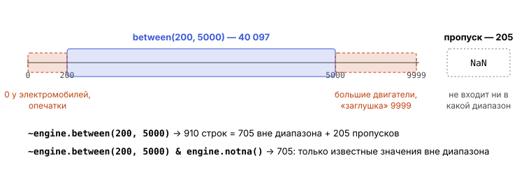

## Зачем это нужно

Большинство вопросов к данным начинаются со слов «среди тех, у кого…»: сколько стоят Toyota Land Cruiser Prado 2012 года с автоматом? Сколько машин с ручной коробкой? Какие объявления выглядят подозрительно? Ответ — **фильтр**: оставить только строки, где выполняется условие.

Механика та же, что у масок NumPy в уроке 1.5: сравнение даёт маску из `True`/`False`, маска отбирает строки. Новое здесь — удобные инструменты pandas (`isin`, `between`, `query`) и одна ловушка: пропуски не входят ни в какой диапазон.

## Маска отбирает строки

Сравнение колонки со значением даёт **маску** — Series из `True`/`False` той же длины, что и таблица. `df[маска]` оставляет строки с `True`, а `df.loc[маска, колонки]` — ещё и только нужные колонки:

```python
manual_mask = df['AutoTransmission'] == False
print('С ручной коробкой:', manual_mask.sum(), 'объявлений')
display(df.loc[manual_mask, ['Make', 'Model', 'Year', 'AutoTransmission']].head(3))
display(df[df['Year'] < 1970].head(3))
```

Метки строк после фильтра сохраняются — это те самые «старые номера», о которых шла речь в уроке 2.4.

## Несколько условий

Условия объединяют так же, как маски NumPy: `&` — «и», `|` — «или», `~` — «не». **Каждое сравнение — в скобках**: у `&` и `|` приоритет выше, чем у `==` и `<`.

Найдём Toyota Land Cruiser Prado 2012 года с автоматической коробкой и посмотрим, сколько их и сколько они стоят:

```python
selected = df.loc[
    (df['Make'] == 'Toyota') &
    (df['Model'] == 'Land Cruiser Prado') &
    (df['Year'] == 2012) &
    (df['AutoTransmission'] == True)
].copy()

display(selected[['Make', 'Model', 'Year', 'Distance', 'Price(euro)']])
print('Найдено записей:', len(selected))
print(f"Средняя цена: {selected['Price(euro)'].mean():.0f} евро, медиана: {selected['Price(euro)'].median():.0f} евро")
```

Нашлось 11 объявлений. Средняя цена — 38 354 евро, медиана — 22 000. Причина расхождения видна в таблице: одно объявление стоит 200 000 евро при пробеге 10 005 км — похоже на лишний ноль. Ещё у одной машины пробег 1 230 000 км. По 11 записям с двумя подозрительными уверенных выводов о цене «такой машины» не сделать — поэтому **число найденных записей печатают всегда**.

`.copy()` в конце делает отобранную часть независимой таблицей: если потом менять `selected`, исходная `df` не затронется.

:::info Тот же отбор через query
`df.query("Make == 'Toyota' and Model == 'Land Cruiser Prado' and Year == 2012 and AutoTransmission == True")` — то же условие, записанное строкой. Внутри строки можно писать `and`/`or`. Это собственный язык выражений pandas, а не SQL; имена колонок со скобками вроде `Price(euro)` в нём неудобны. В курсе основной способ — маски.
:::

```python
selected_query = df.query(
    "Make == 'Toyota' and Model == 'Land Cruiser Prado' "
    "and Year == 2012 and AutoTransmission == True"
)
print('Оба способа выбрали одни и те же строки:', selected.index.equals(selected_query.index))
```

## isin и between

Два частых условия записываются короче:

- `s.isin(['Toyota', 'BMW'])` — значение из списка; заменяет цепочку `(s == 'Toyota') | (s == 'BMW')`;
- `s.between(200, 5000)` — значение в диапазоне, **оба конца включены**; заменяет `(s >= 200) & (s <= 5000)`.

А теперь ловушка. Пропуск не равен ничему и не входит ни в какой диапазон: для `NaN` `between` даёт `False`. Поэтому «вне диапазона» `~between(...)` отмечает и значения вне диапазона, и **пропуски**:

```python
print('Toyota или BMW:', df['Make'].isin(['Toyota', 'BMW']).sum())
engine = df['Engine_capacity(cm3)']
inside = engine.between(200, 5000)
print('Объём 200–5000 см³:             ', inside.sum())
print('~between, «вне диапазона»:       ', (~inside).sum())
print('  из них пропусков:              ', engine.isna().sum())
print('  известный объём вне диапазона: ', (~inside & engine.notna()).sum())
```



910 «вне диапазона» — это 705 известных значений и 205 пропусков. Это разные проблемы: пропуск — «объём не указан», значение вне диапазона — «объём указан, но необычный». Смешивать их нельзя: решения для них разные (урок 2.6).

Отрицать нужно **весь** диапазон: `~((engine >= 200) & (engine <= 5000))`. Запись `~(engine >= 200) & (engine <= 5000)` отрицает только первую часть и означает «меньше 200» — совсем другое условие.

## Необычные сочетания — повод для проверки

Посмотрим, что именно оказалось вне диапазона объёма, и поищем странные сочетания признаков:

```python
outside_engine = ~engine.between(200, 5000) & engine.notna()
display(df.loc[outside_engine, ['Make', 'Model', 'Fuel_type', 'Engine_capacity(cm3)']].head(8))
print(df.loc[outside_engine, 'Fuel_type'].value_counts())

unusual = (df['Year'] < 1950) & (df['AutoTransmission'] == True)
display(df.loc[unusual, ['Make', 'Model', 'Year', 'AutoTransmission', 'Price(euro)']])
```

Вне диапазона оказались очень разные записи:

- **электромобили** с объёмом 0 (Renault ZOE, Hyundai Kona) — у них нет двигателя внутреннего сгорания, ноль здесь честный;
- **большие двигатели**: Ford F-150 5400 см³, Mercedes S Class 5461 см³ — настоящие машины;
- **опечатки и заглушки**: Renault Scenic с объёмом 110 см³, объём 9999 см³.

А пять машин «1900 года» с автоматом — Audi 100, Volvo S80, Peugeot 206, BMW 7 Series, Chrysler Voyager — модели, которых в 1900 году не существовало. Год 1900 — это «год не указан». Странное сочетание **не доказывает** ошибку само по себе, но показывает, какие записи проверить.

## Типичные ошибки

:::mistake Скобки вокруг сравнений
`df[df['Year'] > 2010 & df['Price(euro)'] < 5000]` — ошибка: `&` выполняется раньше сравнений. Пишите `df[(df['Year'] > 2010) & (df['Price(euro)'] < 5000)]`.
:::

:::mistake and, or, not вместо & | ~
`(df['Make'] == 'Toyota') and (df['Year'] == 2012)` даёт `ValueError: The truth value of a Series is ambiguous`. Для масок — только `&`, `|`, `~`.
:::

:::mistake ~between захватил пропуски
`~s.between(a, b)` — это «вне диапазона **или пропуск**». Если нужны только известные значения вне диапазона, добавьте `& s.notna()`.
:::

:::mistake Вывод по горстке записей
Среднее по 2–3 найденным строкам почти ничего не говорит о сегменте. Всегда печатайте `len(...)` рядом со статистикой.
:::

## Мини-квиз

```quiz
- q: "Какая запись выбирает объявления Toyota или BMW?"
  options:
    - "`df[df['Make'] == 'Toyota' or df['Make'] == 'BMW']`"
    - "`df[df['Make'].isin(['Toyota', 'BMW'])]`"
    - "`df[df['Make'] == ['Toyota', 'BMW']]`"
  answer: 1
  explain: "`isin` проверяет «значение из списка». Можно и `(df['Make'] == 'Toyota') | (df['Make'] == 'BMW')`, но не `or`."
- q: "В колонке 205 пропусков. Попадут ли они в маску `~s.between(200, 5000)`?"
  options:
    - Нет, пропуски игнорируются
    - Да — для NaN between даёт False, а отрицание даёт True
    - Только если значение равно 0
  answer: 1
  explain: Поэтому значения вне диапазона и пропуски разделяют через `& s.notna()`.
- q: "Какая запись означает «объём **вне** диапазона 200–5000»?"
  options:
    - "`~(engine >= 200) & (engine <= 5000)`"
    - "`~((engine >= 200) & (engine <= 5000))`"
    - "`not engine.between(200, 5000)`"
  answer: 1
  explain: Отрицать нужно всё условие диапазона в скобках. В первой записи `~` относится только к первой части, а `not` с масками не работает.
```

## Что запомнить

- Сравнение колонки даёт маску; `df[маска]` и `df.loc[маска, колонки]` отбирают строки.
- Условия объединяют `&`, `|`, `~`, каждое сравнение — в скобках; `and`/`or`/`not` с масками не работают.
- `isin([...])` — значение из списка, `between(a, b)` — диапазон с включёнными концами.
- `~between` захватывает пропуски: значения вне диапазона и пропуски разделяют через `notna()`.
- Необычное значение — повод проверить запись, а не доказательство ошибки; рядом со статистикой всегда число записей.
