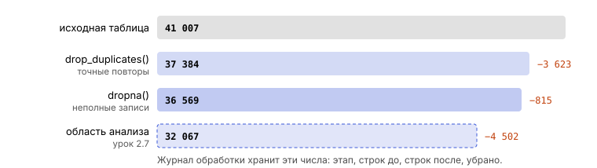

## Зачем это нужно

В уроках 2.1–2.5 мы **изучали** таблицу и ничего не удаляли. Теперь начинаем **обработку** — последовательность шагов, после которой останется таблица для анализа и моделей. Главные требования к ней:

- **воспроизводимость** — начинаем с исходной таблицы `raw`, а не с результатов учебных экспериментов в предыдущих ячейках;
- **прозрачность** — после каждого шага записываем, сколько строк было и сколько стало (журнал обработки);
- **проверяемость** — удалённые строки сохраняем отдельно, чтобы посмотреть, что именно ушло.

В этом уроке — два первых шага: точные повторы и неполные записи.



## Шаг 1. Точные повторы

`df.drop_duplicates()` возвращает таблицу без полностью совпадающих строк: из каждой группы повторов остаётся **первое** вхождение. Метки строк при этом сохраняются — по ним можно найти исходную строку.

В учебном сценарии считаем одинаковые описания повторами одного объявления. Это **допущение**: без номера объявления нельзя отличить повторную выгрузку от двух одинаковых машин (урок 2.3). Запишем его в выводы.

```python
df = raw.copy()
processing_log = []

n_before = len(df)
df = df.drop_duplicates().copy()
processing_log.append({'Этап': 'Удаление точных повторов',
                       'До': n_before, 'После': len(df), 'Убрано': n_before - len(df)})
print('Удалено повторных строк:', n_before - len(df))
print('Первые метки после удаления:', df.index[:8].tolist())
```

Удалено 3623 строки — почти 9 % таблицы:

$$
\frac{3\,623}{41\,007} \approx 0.088.
$$

Обратите внимание на устройство журнала: число строк **до** шага запоминаем в `n_before` перед изменением таблицы, а запись — словарь с одинаковыми ключами — добавляем в список `processing_log` после шага.

## Шаг 2. Неполные записи

Для основной учебной работы оставим строки, в которых заполнены **все** поля. Это упрощает дальнейшие шаги, но уменьшает выборку и может изменить её состав. Поэтому неполные записи сначала **сохраняем отдельно**, а потом удаляем:

```python
incomplete_mask = df.isna().any(axis=1)
incomplete_rows = df.loc[incomplete_mask].copy()
display(incomplete_rows.head(5))

n_before = len(df)
df = df.dropna().copy()
processing_log.append({'Этап': 'Отбор полных записей',
                       'До': n_before, 'После': len(df), 'Убрано': n_before - len(df)})
print('Неполных записей:', len(incomplete_rows), '| осталось строк:', len(df))
```

После удаления повторов неполных записей 815 (одна неполная строка была повтором и ушла на шаге 1). `df.dropna()` удаляет строки хотя бы с одним пропуском; параметр `subset=['колонка']` проверяет только выбранные колонки.

## Журнал обработки

Список словарей превращается в таблицу одной строкой — каждый словарь становится строкой, ключи — колонками:

```python
pd.DataFrame(processing_log)
```

Журнал отвечает на вопрос «куда делись строки?»: по нему видно, какой этап внёс наибольший вклад. В уроке 2.7 в него добавится третий этап.

## Удалить или заполнить?

Удаление — самое простое решение, но не единственное. Посмотрим на неполные записи внимательнее:

```python
print('Без марки:', incomplete_rows['Make'].isna().sum(),
      '| без модели:', incomplete_rows['Model'].isna().sum(),
      '| без объёма:', incomplete_rows['Engine_capacity(cm3)'].isna().sum(),
      '| без топлива:', incomplete_rows['Fuel_type'].isna().sum())
print(incomplete_rows['Fuel_type'].fillna('Unknown').value_counts().head(3))
dedup = raw.drop_duplicates()
print('Если удалять только строки без объёма:', len(dedup.dropna(subset=['Engine_capacity(cm3)'])), 'строк')
```

Варианты для **входных признаков**:

- **заполнить явной категорией**: пропущенный тип топлива → `'Unknown'` (`fillna('Unknown')`). Честно: мы не придумываем значение, а помечаем, что оно неизвестно;
- **восстановить по другим колонкам**: в строке без марки модель — Cayenne, а Cayenne выпускает только Porsche. Но так можно не всегда: одинаковое название модели встречается у разных марок;
- **заполнить типичным значением похожих записей** — например, медианным объёмом двигателя той же модели. Как считать статистики по группам, разберём в модуле 3.

:::important Целевую переменную не придумываем
Пропущенную **цену** нельзя заполнить средней: получится выдуманный ответ, на котором потом будет учиться модель. Заполняют только входные признаки — и с обоснованием. Строки без цены в обучении не участвуют.
:::

В нашем учебном маршруте неполных записей всего 2 %, и мы их удаляем. Хороший приём на будущее — держать две версии данных (с заполнением и без) и сравнить, какая даёт модель лучше.

## Порядок шагов

Влияет ли порядок шагов на результат? Проверим:

```python
a = raw.drop_duplicates().dropna()
b = raw.dropna().drop_duplicates()
print(len(a), len(b), a.index.equals(b.index))
```

Итоговые таблицы совпадают, но журнал выглядел бы по-разному: при обратном порядке на шаге «полные записи» ушло бы 816 строк, а на шаге «повторы» — 3622. Поэтому журнал всегда читают вместе с порядком шагов.

## Типичные ошибки

:::mistake Результат не присвоен
`df.drop_duplicates()` и `df.dropna()` возвращают **новую** таблицу. Без `df = ...` таблица не изменится.
:::

:::mistake inplace и присваивание вместе
`df = df.dropna(inplace=True)` превращает `df` в `None`: с `inplace=True` метод меняет таблицу на месте и ничего не возвращает. Используйте один вариант — лучше `df = df.dropna()`.
:::

:::mistake Удалили, не посмотрев
Если удалить строки сразу, не сохранив их, нельзя проверить, что ушло. Сохраняйте удаляемое: `incomplete_rows = df.loc[mask].copy()`.
:::

:::mistake Журнал с неверным «до»
Число строк до шага нужно запомнить **перед** изменением таблицы. Если записать `len(df)` после шага, «до» и «после» совпадут.
:::

## Мини-квиз

```quiz
- q: "Что окажется в `df` после строки `df = df.dropna(inplace=True)`?"
  options:
    - Таблица без пропусков
    - "`None`"
    - Исходная таблица
  answer: 1
  explain: С `inplace=True` метод меняет таблицу на месте и возвращает `None`, а присваивание записывает этот `None` в `df`.
- q: У части объявлений не указана цена. Что с ними делать в задаче оценки цены?
  options:
    - Заполнить средней ценой
    - Заполнить медианой цены по марке
    - Не использовать как обучающие примеры — придумывать целевую переменную нельзя
  answer: 2
  explain: Заполненная цена — выдуманный ответ. Модель научится на нём, и оценка качества станет нечестной.
- q: Зачем перед удалением неполных записей сохранять их в `incomplete_rows`?
  options:
    - Чтобы потом проверить, что именно удалено, и решить, нельзя ли часть записей восстановить
    - Без этого dropna не сработает
    - Чтобы освободить память
  answer: 0
  explain: Удалённые строки — тоже данные. Их состав показывает, не исказилась ли выборка.
```

## Что запомнить

- Обработку начинают с исходной таблицы: `df = raw.copy()`.
- `drop_duplicates()` оставляет первое вхождение; повторы без ID объявления — допущение.
- `dropna()` удаляет неполные строки (`subset` — только по выбранным колонкам); удаляемое сначала сохраняют.
- Журнал обработки: `n_before` до шага, словарь в список после шага, `pd.DataFrame(processing_log)`.
- Заполнять можно только входные признаки и с обоснованием; целевую переменную не придумывают.
