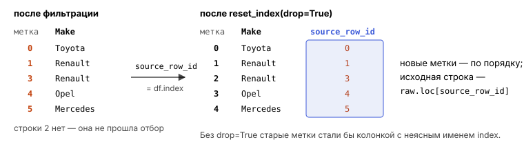

## Зачем это нужно

После уроков 2.3 и 2.5 мы знаем, что в данных есть машины «1900 года», пробеги в 100 млн км, цены в 1 евро и 10 млн евро, объёмы 0 и 9999 см³. Что с ними делать в учебном анализе?

Решение — **учебная область анализа**: явно записанные границы, внутри которых мы работаем. Это не «список ошибок», а рамка: «в этой работе изучаем машины 1951–2021 годов, с пробегом до миллиона километров, с объёмом двигателя 200–5000 см³ и ценой 101–500 000 евро». Всё, что вне рамки, сохраняем отдельно и изучаем.

Второй вопрос урока — **метки строк**. После удаления повторов, неполных записей и записей вне области в индексе остаются «дыры»: 0, 1, 3, 4, 5… Перенумеруем строки, но сначала сохраним старые метки — по ним всегда можно найти исходную строку файла.

## Границы — константы в одном месте

Правила включения из исходной практики курса:

| Условие включения | Как его понимать |
|---|---|
| Год выпуска 1951–2021 | максимальный год в файле — 2021; год 1900 обычно означает «не указан» |
| Пробег 0–1 000 000 км | ограничиваем диапазон для первых упражнений |
| Объём двигателя 200–5000 см³ | правило **исключит электромобили** с нулевым объёмом |
| Цена 101–500 000 евро | оставляем выбранный диапазон предложений |
| Исключаем пробег меньше 1100 км, если год выпуска до 2021 | старая машина с почти нулевым пробегом чаще означает «пробег не указан»; правило может исключить редкие малоэксплуатируемые машины |

Границы задаём **константами** в начале — так их видно, легко изменить и невозможно случайно написать в двух местах разные числа. Затем собираем одну маску `in_scope` и сохраняем всё, что в неё не попало:

```python
MIN_YEAR, MAX_YEAR = 1951, 2021
MIN_ENGINE, MAX_ENGINE = 200, 5000
MIN_PRICE, MAX_PRICE = 101, 500_000
MAX_DISTANCE = 1_000_000
MIN_DISTANCE_OLDER = 1100

in_scope = (
    df['Year'].between(MIN_YEAR, MAX_YEAR) &
    df['Distance'].between(0, MAX_DISTANCE) &
    df['Engine_capacity(cm3)'].between(MIN_ENGINE, MAX_ENGINE) &
    df['Price(euro)'].between(MIN_PRICE, MAX_PRICE) &
    ~((df['Year'] < MAX_YEAR) & (df['Distance'] < MIN_DISTANCE_OLDER))
)
out_of_scope = df.loc[~in_scope].copy()
print('Вне области анализа:', len(out_of_scope), 'из', len(df))
display(out_of_scope.head(6))
```

Пропусков здесь уже нет — их убрал урок 2.6, поэтому ловушка `~between` с пропусками не грозит.

## Какое правило сколько исключает

Посчитаем каждое правило отдельно. Одна запись может нарушать сразу несколько правил, поэтому сумма по правилам больше общего числа исключённых:

```python
rules = {
    'год вне 1951–2021':          ~df['Year'].between(MIN_YEAR, MAX_YEAR),
    'пробег вне 0–1 000 000':     ~df['Distance'].between(0, MAX_DISTANCE),
    'объём вне 200–5000':         ~df['Engine_capacity(cm3)'].between(MIN_ENGINE, MAX_ENGINE),
    'цена вне 101–500 000':       ~df['Price(euro)'].between(MIN_PRICE, MAX_PRICE),
    'пробег < 1100 до 2021 года': (df['Year'] < MAX_YEAR) & (df['Distance'] < MIN_DISTANCE_OLDER),
}
for name, mask in rules.items():
    print(f'{name:28} {mask.sum():5}')
print('Всего вне области (без двойного счёта):', (~in_scope).sum())
```

Больше всего записей исключает правило малого пробега — 3364: пробег 0 или 1 км у машины 1998 года почти наверняка значит «не указан». Объём двигателя исключает 621 запись, и среди них — **почти все электромобили**: 243 из 278, у которых указан объём 0. Оставшиеся 35 «электромобилей» с объёмом от 320 до 4100 см³ — смесь машин с запасным бензиновым двигателем (BMW i3 с объёмом 647 см³) и неточных описаний. Это ограничение учебной области: выводы этой работы к электромобилям не относятся, и это нужно написать в отчёте.

## Применяем отбор и смотрим на последствия

```python
n_before = len(df)
df = df.loc[in_scope].copy()
processing_log.append({'Этап': 'Учебная область анализа',
                       'До': n_before, 'После': len(df), 'Убрано': n_before - len(df)})
print('Осталось строк:', len(df), f'— {len(df) / len(raw):.1%} исходных')
print('Цена до обработки:    среднее', round(raw['Price(euro)'].mean()), '| медиана', raw['Price(euro)'].median())
print('Цена после обработки: среднее', round(df['Price(euro)'].mean()), '| медиана', df['Price(euro)'].median())
pd.DataFrame(processing_log)
```

Осталось 32 067 строк из 41 007:

$$
\frac{32\,067}{41\,007} \approx 0.782 = 78.2\%.
$$

Почти четверть записей ушла — это много. Медиана цены почти не изменилась (6600 → 6700 евро), а среднее сдвинулось сильнее: ушли экстремальные цены. Журнал показывает три этапа обработки и вклад каждого.

## Метка исходной строки и новый индекс

После всех фильтров индекс хранит метки исходных строк — с «дырами» на месте удалённых. Запишем их в колонку `source_row_id`, а потом перенумеруем строки методом `reset_index(drop=True)`:



```python
df['source_row_id'] = df.index
df = df.reset_index(drop=True)
display(df[['source_row_id', 'Make', 'Model', 'Year']].head(5))
```

`drop=True` выбрасывает старый индекс: он уже сохранён в `source_row_id`. Без `drop=True` pandas сам превратил бы его в колонку с неясным именем `index`.

`source_row_id` — технический номер строки CSV, а не номер объявления и **не признак для предсказания цены**. Его задача — проверка происхождения данных. Найдём исходную строку для первой записи обработанной таблицы и посмотрим на строку с меткой 2, которой в таблице больше нет:

```python
first_source = df.loc[0, 'source_row_id']
display(raw.loc[[first_source]])
display(raw.loc[[2]])
```

Строка 2 — Volkswagen Golf 1998 года с пробегом 1 км: её исключило правило малого пробега.

## Типичные ошибки

:::mistake reset_index до сохранения меток
Если сначала вызвать `reset_index(drop=True)`, а потом записать `df.index` в `source_row_id`, там окажутся новые номера 0, 1, 2, …, и связь с исходным файлом потеряется. Сначала сохраняем метки, потом перенумеровываем.
:::

:::mistake reset_index без drop=True
`df.reset_index()` добавляет колонку `index` со старыми метками. Если они уже сохранены в `source_row_id`, получится дубль; в CSV это лишняя колонка.
:::

:::mistake «Магические числа» по всему коду
Если порог 5000 вписан в три разные ячейки, изменить правило без ошибки трудно. Границы — константы в одном месте.
:::

:::mistake Область анализа как «очистка от ошибок»
Правила исключают и ошибки, и настоящие редкие машины (электромобили, малоэксплуатируемые авто). Называйте это рамкой анализа и перечисляйте ограничения в выводах.
:::

## Мини-квиз

```quiz
- q: "Что делает `df.reset_index(drop=True)`?"
  options:
    - Удаляет строки с пропусками
    - Заменяет метки строк на 0, 1, 2, … и выбрасывает старые метки
    - Сортирует таблицу по индексу
  answer: 1
  explain: Старые метки нужно сохранить заранее, например в колонку `source_row_id`.
- q: "Как найти исходную строку файла для записи с меткой 0 обработанной таблицы?"
  options:
    - "`raw.loc[0]`"
    - "`raw.loc[df.loc[0, 'source_row_id']]`"
    - "`raw.iloc[0]`"
  answer: 1
  explain: После фильтрации и перенумерации метка 0 обработанной таблицы обычно не совпадает с меткой исходной строки.
- q: Правило «объём 200–5000 см³» исключило почти все электромобили. Как это правильно описать в выводах?
  options:
    - Электромобили — ошибки в данных
    - Выводы работы не распространяются на электромобили — это ограничение учебной области анализа
    - Электромобилей в данных почти не было
  answer: 1
  explain: Объём 0 у электромобиля — честное значение. Мы сами исключили эти машины, и это нужно оговорить.
```

## Что запомнить

- Учебная область анализа — явные границы (константы в одном месте) и одна маска `in_scope`; исключённое сохраняем.
- Одна запись может нарушать несколько правил, поэтому вклад правил считают и по отдельности, и вместе.
- Отбор меняет выборку: сравнивайте долю оставшихся строк и статистики до и после, пишите ограничения.
- Перед перенумерацией: `df['source_row_id'] = df.index`, затем `df.reset_index(drop=True)`.
- `source_row_id` — для проверки происхождения данных, а не признак модели.
