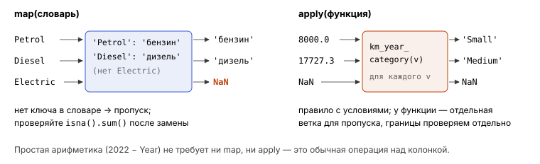

## Зачем это нужно

Не все новые признаки получаются арифметикой. Иногда нужно **перекодировать** значения: `True`/`False` → понятные `Automatic`/`Manual`. Иногда — применить **правило с условиями**: «до 10 000 км в год — малый пробег, до 30 000 — средний, больше — большой». А иногда — **поменять значения только в некоторых строках**: пометить записи, которые нужно проверить.

Для этих трёх задач в pandas есть три инструмента: `map` — замена по словарю, `apply` — своя функция для каждого значения, `loc` — запись по условию. Их «строительные блоки» вы уже знаете: словари и функции с ветками `if` из модуля 0 (и разминки 2.0).

## map: замена по словарю

`s.map(словарь)` заменяет каждое значение колонки на соответствующее ему значение словаря:

```python
transmission_names = {True: 'Automatic', False: 'Manual'}
df['Transmission'] = df['AutoTransmission'].map(transmission_names)
display(df[['AutoTransmission', 'Transmission']].head(4))
print(df['Transmission'].value_counts())
```

Исходную колонку `AutoTransmission` пока сохраняем. Важная деталь `map`: если значения **нет среди ключей** словаря, результатом будет пропуск — и никакой ошибки. Это легко пропустить:

```python
fuel_ru = {'Petrol': 'бензин', 'Diesel': 'дизель', 'Hybrid': 'гибрид'}
fuel_mapped = df['Fuel_type'].map(fuel_ru)
print('Не нашлось в словаре:', fuel_mapped.isna().sum())
print(df.loc[fuel_mapped.isna(), 'Fuel_type'].value_counts())
```

Для «Metan/Propan», «Plug-in Hybrid» и «Electric» в словаре нет ключей — 3971 значение стали пропусками. Правило: **после `map` всегда проверяйте `isna().sum()`**.



## apply: своя функция для каждого значения

Переведём условный годовой пробег в три категории:

| Категория | Условие |
|---|---|
| `Small` | до 10 000 км включительно |
| `Medium` | свыше 10 000 до 30 000 км включительно |
| `Large` | свыше 30 000 км |

Правило записываем функцией, а `s.apply(функция)` вызывает её для каждого значения колонки. У функции есть **отдельная ветка для пропуска**: сравнения с `nan` всегда дают `False`, и без этой ветки неизвестное значение тихо стало бы `Large`. Границы проверяем отдельно — до применения к 32 тысячам строк:

```python
def km_year_category(value):
    if pd.isna(value):
        return np.nan
    if value <= 10_000:
        return 'Small'
    if value <= 30_000:
        return 'Medium'
    return 'Large'

for v in [0, 10_000, 10_001, 30_000, 30_001, np.nan]:
    print(v, '→', km_year_category(v))
df['km_year_cat'] = df['km_year'].apply(km_year_category)
df['km_year_cat'].value_counts()
```

`pd.isna(value)` проверяет одно значение (в отличие от метода `.isna()` у колонки). Большинство машин — в категории `Medium`: 22 921 из 32 067.

:::tip То же самое через pd.cut
Разбиение по границам — частая задача, и для неё есть готовая функция: `pd.cut(df['km_year'], bins=[-np.inf, 10_000, 30_000, np.inf], labels=['Small', 'Medium', 'Large'])`. Интервалы вида (левая, правая] — правая граница включается, как в нашей функции. `apply` нужен, когда правило сложнее простых границ.
:::

## Изменение значений через loc

Чтобы записать значение **только в строки, где выполняется условие**, используют `loc` с маской — одной операцией:

```python
example = df.head(10).copy()
example['Проверка'] = 'Не отмечено'
example.loc[example['km_year'] > 30_000, 'Проверка'] = 'Высокий условный пробег'
display(example[['source_row_id', 'km_year', 'Проверка']])
```

Сначала колонка заполняется значением по умолчанию, затем `loc[маска, 'колонка'] = значение` перезаписывает подходящие строки. Пример сделан на отдельной копии `example`, поэтому основная таблица не меняется.

А вот так делать **нельзя** — присваивание по цепочке:

```python expect-warning
example2 = df.head(10).copy()
example2['Проверка'] = 'Не отмечено'
example2[example2['km_year'] > 30_000]['Проверка'] = 'Высокий'
print('Строк с отметкой «Высокий»:', (example2['Проверка'] == 'Высокий').sum())
```

`example2[маска]` создаёт промежуточную таблицу, и значение записывается в неё, а не в `example2`. В pandas 3 (режим Copy-on-Write) такая запись **никогда** не меняет исходную таблицу, и pandas выводит предупреждение `ChainedAssignmentError`. Результат — 0 отмеченных строк.

## map, apply или арифметика?

| Задача | Инструмент | Пример |
|---|---|---|
| Формула по колонкам | обычная операция над колонками | `2022 - df['Year']`, `df['Distance'] / df['Age']` |
| Замена по таблице соответствий | `map` | `True → 'Automatic'` |
| Правило с условиями | `apply` (или `pd.cut` для границ) | `km_year_category` |
| Изменить часть строк | `loc[маска, колонка] = значение` | пометить записи для проверки |

Арифметика над колонками — самая быстрая: она выполняется сразу над всем столбцом. `apply` вызывает функцию Python для каждой строки отдельно и работает заметно медленнее, поэтому для формул его не используют.

## Типичные ошибки

:::mistake map без проверки пропусков
Ключа нет в словаре — получается `NaN`, без ошибки. После `map` проверяйте `s.isna().sum()`.
:::

:::mistake Функция без ветки для пропуска
`km_year_category(np.nan)` без проверки `pd.isna` вернёт `'Large'`: все сравнения с `nan` ложны, и выполнение дойдёт до последнего `return`.
:::

:::mistake Присваивание по цепочке
`df[маска]['колонка'] = значение` не меняет `df`. Пишите `df.loc[маска, 'колонка'] = значение`.
:::

:::mistake apply для простой формулы
`df['Year'].apply(lambda y: 2022 - y)` даёт верный результат, но медленнее и длиннее, чем `2022 - df['Year']`.
:::

## Мини-квиз

```quiz
- q: "Что вернёт `pd.Series(['Petrol', 'Diesel', 'Electric']).map({'Petrol': 0, 'Diesel': 1})`?"
  options:
    - "Ошибку KeyError: 'Electric'"
    - "Значения 0, 1, NaN"
    - "Значения 0, 1, 'Electric'"
  answer: 1
  explain: Значение без ключа в словаре становится пропуском, без ошибки.
- q: "Какую категорию вернёт `km_year_category(10_000)`?"
  options:
    - "'Small'"
    - "'Medium'"
    - "'Large'"
  answer: 0
  ordered: true
  explain: Условие `value <= 10_000` нестрогое — граница входит в Small.
- q: "Как правильно записать 'high' в колонку `flag` для строк, где km_year > 30 000?"
  options:
    - "`df[df['km_year'] > 30_000]['flag'] = 'high'`"
    - "`df.loc[df['km_year'] > 30_000, 'flag'] = 'high'`"
    - "`df['flag'][df['km_year'] > 30_000] == 'high'`"
  answer: 1
  explain: Присваивание делают одной операцией через `loc[маска, колонка]`. Цепочка меняет промежуточную копию, а `==` — это сравнение.
```

## Что запомнить

- `map(словарь)` — замена по словарю; значение без ключа становится `NaN`, поэтому проверяйте `isna().sum()`.
- `apply(функция)` — своя функция для каждого значения; нужна ветка для пропуска и проверка границ.
- Запись по условию — одной операцией: `df.loc[маска, 'колонка'] = значение`; цепочка `df[маска]['колонка'] = …` не работает.
- Для формул — обычная арифметика над колонками: она быстрее и понятнее `apply`.
