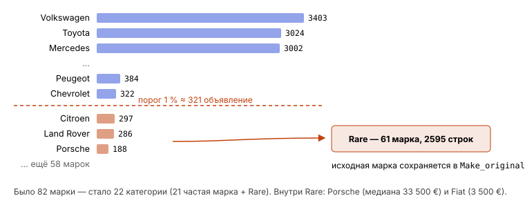

## Зачем это нужно

В уроке 2.3 мы видели: у части марок всего одно-два объявления. После обработки марок 82, и у многих из них — единицы записей. По единственному объявлению McLaren цену McLaren не оценить; модель, которая будет учиться на таких данных (модуль 5), тоже ничего полезного о них не узнает.

Это **дисбаланс категорий**: несколько частых значений и длинный «хвост» редких. Варианты действий:

- оставить как есть и честно признать, что для редких марок оценка ненадёжна;
- выбросить редкие марки из анализа;
- оценивать их отдельно, другим способом;
- **объединить** редкие марки в одну категорию `Rare`.

В исходной практике курса выбран последний вариант: марки с долей **не более 1 %** объединяются в `Rare`. Порог 1 % — учебное соглашение, а не закон.

## Доли категорий

Доля марки — число её объявлений, делённое на число всех строк. Тот же результат даёт `value_counts(normalize=True)`:

$$
\text{доля}_k = \frac{n_k}{n}, \qquad \text{редкая, если } \text{доля}_k \le 0.01 \iff n_k \le 0.01 \cdot 32\,067 \approx 321.
$$

```python
RARE_SHARE = 0.01
make_counts = df['Make'].value_counts()
make_share = make_counts / len(df)
print('Марок всего:', len(make_counts), '| порог в объявлениях:', round(RARE_SHARE * len(df), 1))
display(make_share.head(3).round(4))
display(make_share.iloc[18:24].round(4))
```

Chevrolet (322 объявления, доля 1.004 %) проходит порог, а Citroen (297) — уже нет. Граница произвольная: соседние марки по разные стороны порога почти не отличаются по числу объявлений.

## Объединяем в Rare, сохранив исходное

Сначала копируем исходную марку в `Make_original` — объединение не должно уничтожать информацию. Затем через `loc` записываем `'Rare'` в строки редких марок (урок 2.9):



```python
rare_makes = make_share.loc[make_share <= RARE_SHARE].index
df['Make_original'] = df['Make']
df.loc[df['Make'].isin(rare_makes), 'Make'] = 'Rare'

print('Марок объединено:', len(rare_makes))
print('Записей в Rare:', (df['Make'] == 'Rare').sum())
print('Категорий в Make после объединения:', df['Make'].nunique())
display(df[['Make_original', 'Make']].drop_duplicates().head(8))
```

61 марка превратилась в одну категорию `Rare` с 2595 объявлениями; в колонке `Make` осталась 21 частая марка и `Rare`. Число строк не изменилось — меняются только значения.

## Что скрывает Rare

Объединение упрощает представление, но **прячет различия** внутри категории. Посмотрим, кто попал в `Rare`:

```python
rare_part = df[df['Make'] == 'Rare']
print(rare_part['Make_original'].value_counts().head(6))
print('Медианная цена в Rare:', rare_part['Price'].median())
for make in ['Porsche', 'Land Rover', 'Fiat', 'Citroen']:
    prices = rare_part.loc[rare_part['Make_original'] == make, 'Price']
    print(f'{make:11} объявлений {len(prices):4}, медианная цена {prices.median():8.0f}')
```

В одной категории оказались Porsche с медианной ценой 33 500 евро и Fiat — 3 500 евро: разница почти в десять раз. Для модели `Rare` выглядит как одна «средняя» марка. Поэтому:

- для анализа конкретной марки используйте `Make_original`;
- объединение **не гарантирует** роста точности модели — это гипотеза, которую проверяют (модуль 7);
- при построении модели список редких категорий нужно определять **только по обучающей части** данных. Если считать доли по всем данным, информация о проверочных данных «просочится» в подготовку, и оценка качества станет нечестной — подробно в модуле 6.

## Редкие модели — осторожнее

Моделей ещё больше, чем марок, — 789, и у 413 из них меньше 10 объявлений. Может, объединить и их? Здесь есть подвох: одно и то же название модели встречается у разных марок.

```python
pairs = df[['Make_original', 'Model']].drop_duplicates()
model_makes = pairs['Model'].value_counts()
print('Моделей с меньше чем 10 объявлениями:', (df['Model'].value_counts() < 10).sum(), 'из', df['Model'].nunique())
print(model_makes[model_makes > 1].head(5))
```

`Altele` (по-румынски «другие») — не модель, а заглушка «другая модель», она встречается у 48 марок. Есть и настоящие совпадения: модель `3` бывает у разных марок. Значит, редкость модели нужно считать **в паре с маркой**, а заглушки вроде `Altele` — обсуждать отдельно, не заменяя их автоматически.

## Типичные ошибки

:::mistake Объединили, не сохранив исходное
Если сразу записать `'Rare'` в `Make`, исходные марки потеряны: нельзя ни проверить объединение, ни проанализировать редкую марку. Сначала `df['Make_original'] = df['Make']`.
:::

:::mistake Порог по всем данным при обучении модели
Список редких категорий, посчитанный по всей таблице, использует информацию о проверочной части. Для модели его определяют только по обучающей части.
:::

:::mistake «Rare улучшит модель»
Объединение — гипотеза. Оно может и ухудшить результат, смешав непохожие марки (Porsche и Fiat). Проверяют обучением и сравнением.
:::

:::mistake Редкие модели без учёта марки
Одинаковое название модели у разных марок — разные автомобили. Считайте частоты пар «марка — модель».
:::

## Мини-квиз

```quiz
- q: "В таблице 32 000 объявлений. Марка редкая, если её доля не больше 1 %. Сколько марок из списка 5000, 3100, 290, 15, 410, 1 попадут в Rare?"
  options:
    - "2"
    - "3"
    - "4"
  answer: 1
  ordered: true
  explain: "Порог 0.01 · 32 000 = 320. Не больше 320 — это 290, 15 и 1."
- q: Зачем перед объединением копировать марку в `Make_original`?
  options:
    - Чтобы сохранить исходную информацию для проверки и анализа конкретных марок
    - Без этого loc не работает
    - Чтобы таблица стала меньше
  answer: 0
  explain: Объединение необратимо, если не сохранить исходные значения.
- q: Почему для модели список редких марок нужно определять только по обучающей части данных?
  options:
    - В проверочной части нет марок
    - Иначе сведения о проверочных данных попадут в подготовку, и оценка качества станет нечестной
    - Так быстрее
  answer: 1
  explain: Любые решения о подготовке, принятые с учётом проверочных данных, делают оценку оптимистичнее, чем на самом деле.
```

## Что запомнить

- Доля категории — `value_counts() / len(df)` или `value_counts(normalize=True)`; редкие — с долей не больше порога.
- Перед объединением сохраняем исходное: `df['Make_original'] = df['Make']`, затем `df.loc[df['Make'].isin(rare), 'Make'] = 'Rare'`.
- `Rare` прячет различия (Porsche и Fiat в одной категории) и не гарантирует роста точности.
- Для модели редкие категории определяют только по обучающей части; редкие модели считают в паре с маркой.
