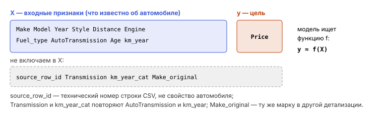

## Зачем это нужно

Вся обработка модуля 2 нужна ради одного результата — **подготовленной таблицы**, с которой будут работать следующие модули: сводный анализ (модуль 3), визуализация (модуль 4), модели (модули 5–7). Её нужно сохранить так, чтобы:

- файл читался без сюрпризов — без лишних колонок и потерянных значений;
- результат был **проверен**: прочитали обратно и сравнили;
- было понятно, какие колонки — **входные признаки** будущей модели, а какая — **цель**.

## Какие колонки сохраняем

В подготовленную таблицу войдут базовые характеристики, новые признаки, категории, исходная марка и номер исходной строки. Список колонок задаём явно — так порядок колонок в файле всегда одинаковый:

```python
output_columns = [
    'Make', 'Model', 'Year', 'Style', 'Distance', 'Engine', 'Fuel_type',
    'AutoTransmission', 'Price', 'Age', 'km_year', 'Transmission',
    'km_year_cat', 'Make_original', 'source_row_id'
]
processed = df[output_columns].copy()
processed.to_csv('cars_processed.csv', index=False)
print('Сохранено:', processed.shape)
```

`to_csv('файл.csv', index=False)` записывает таблицу в CSV. Параметр `index=False` запрещает записывать индекс отдельной колонкой: метки 0, 1, 2, … никому не нужны, а исходные номера строк мы сохранили явно в `source_row_id`.

Ещё два файла — численная часть таблицы и журнал обработки:

```python
processed.select_dtypes(include='number').drop(columns=['source_row_id']).to_csv('cars_processed_num.csv', index=False)
pd.DataFrame(processing_log).to_csv('cars_preprocessing_log.csv', index=False)
print(sorted(f for f in os.listdir('.') if f.endswith('.csv')))
```

`select_dtypes(include='number')` оставляет числовые колонки. Технический номер строки из численной таблицы убираем. Важно: численная таблица — **не готовая матрица признаков** модели, в ней ещё есть цена `Price`.

## Контроль: читаем обратно

Сохранили — проверяем. Читаем файл и сравниваем размер, пропуски и колонки:

```python
loaded = pd.read_csv('cars_processed.csv')
print('Совпадает размер:', loaded.shape == processed.shape)
print('Пропусков:', int(loaded.isna().sum().sum()))
print('Лишние колонки индекса:', [c for c in loaded.columns if c.startswith('Unnamed:')])
print(loaded.dtypes.value_counts())
```

При чтении CSV типы колонок определяются **заново** по значениям — в файле нет информации о типах. Поэтому для новых файлов типы стоит проверить: `AutoTransmission` снова прочиталась как `bool`, текст — как `str`.

А вот что будет, если забыть `index=False`:

```python
processed.head(3).to_csv('demo_with_index.csv')
print(pd.read_csv('demo_with_index.csv').columns.tolist()[:3])
```

Индекс записался безымянной первой колонкой, и при чтении она получила имя `Unnamed: 0`. Такие колонки потом попадают в признаки модели как «номер строки» — бессмысленный и вредный признак.

## Входные признаки X и целевая переменная y

Для будущей модели таблицу делят на две части:

- **y** — целевая переменная, то, что предсказываем: цена `Price`;
- **X** — входные признаки: то, что известно об автомобиле до назначения цены.

Модель (модуль 5) будет искать функцию, которая по признакам оценивает цену: $\hat{y} = f(X)$ — та самая идея «подобрать функцию по данным» из урока 0.2.



```python
feature_columns = [
    'Make', 'Model', 'Year', 'Style', 'Distance', 'Engine',
    'Fuel_type', 'AutoTransmission', 'Age', 'km_year'
]
X = loaded[feature_columns].copy()
y = loaded['Price'].copy()
print('Размер X:', X.shape, '| размер y:', y.shape)
X.head(3)
```

Чего **нет** в X и почему:

- `Price` — это цель. Если цена окажется среди признаков, модель просто «подсмотрит» ответ;
- `source_row_id` — технический номер строки CSV, а не свойство автомобиля;
- `Transmission` повторяет `AutoTransmission`, `km_year_cat` — грубую версию `km_year`, `Make_original` — ту же марку в другой детализации.

Выбор представления признаков и кодирование категорий (марка, кузов — это текст, а модели нужны числа) — отдельные шаги моделирования в модулях 5–7.

## Типичные ошибки

:::mistake Сохранили с индексом
`df.to_csv('file.csv')` без `index=False` добавляет колонку индекса, которая при чтении становится `Unnamed: 0`. Сохраняйте с `index=False`.
:::

:::mistake Не проверили сохранённое
Файл мог записаться не тем: без колонок, с лишней колонкой, с другими типами. Прочитайте его обратно и сравните размер, пропуски, колонки.
:::

:::mistake Цель среди признаков
`X = loaded.drop(columns=['source_row_id'])` оставляет в X цену `Price`. Признаки задают явным списком или удаляют из них цель.
:::

:::mistake Численная таблица как матрица признаков
`cars_processed_num.csv` содержит `Price`. Это учебный файл для статистик, а не готовые признаки модели.
:::

## Мини-квиз

```quiz
- q: "Какая колонка появится при чтении файла, сохранённого через `df.to_csv('f.csv')` без `index=False`?"
  options:
    - "`index`"
    - "`Unnamed: 0`"
    - "`source_row_id`"
  answer: 1
  explain: "Индекс записывается безымянной колонкой, а при чтении pandas называет её `Unnamed: 0`."
- q: Какую колонку нельзя включать во входные признаки X в задаче оценки цены?
  options:
    - "`km_year`"
    - "`Price`"
    - "`Age`"
  answer: 1
  explain: Price — целевая переменная. В X ей не место — иначе модель подсмотрит ответ.
- q: "Почему `source_row_id` не входит в признаки?"
  options:
    - Это технический номер строки файла, он ничего не говорит об автомобиле
    - В нём есть пропуски
    - Это текстовая колонка
  answer: 0
  explain: Номер строки — служебная метка для проверки происхождения данных, а не характеристика машины.
```

## Что запомнить

- `to_csv('файл.csv', index=False)` — сохранение без лишней колонки индекса; список колонок задаём явно.
- После сохранения читаем файл обратно и проверяем размер, пропуски и колонки `Unnamed:`; типы при чтении определяются заново.
- `select_dtypes(include='number')` — числовые колонки; численная таблица ещё содержит цену.
- y — цель (`Price`), X — входные признаки; цель, технические номера и дубли признаков в X не включаем.
