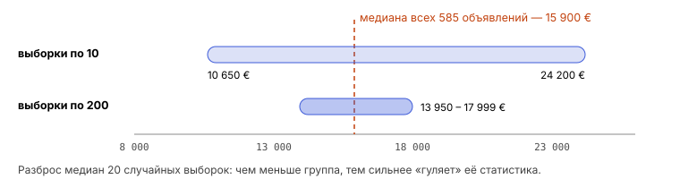

## Зачем это нужно

Отчёт «Топ-10 самых дорогих марок» выглядит убедительно. Но стоит заменить среднее на медиану — и половина мест меняется. А если взять не марки, а модели, наверх выходят машины, у которых всего **одно** объявление. Какой рейтинг правильный?

Этот урок — о третьем вопросе аналитика: **где данных мало и выводы требуют осторожности**. Правило простое: статистика группы без размера группы — полуправда.

## Рейтинг по среднему и по медиане

Посчитаем для каждой марки размер группы, среднюю и медианную цену и место в двух рейтингах. Метод `rank(ascending=False)` даёт место: 1 — самое большое значение:

```python
make_summary = df.groupby('Make').agg(
    n=('Price', 'size'), mean_price=('Price', 'mean'), median_price=('Price', 'median'))
make_summary['rank_mean'] = make_summary['mean_price'].rank(ascending=False)
make_summary['rank_median'] = make_summary['median_price'].rank(ascending=False)
make_summary.sort_values('rank_mean').head(10).round(0)
```

Сильнее всех «проваливается» категория `Rare`: 8-е место по среднему и 17-е по медиане. Внутри неё несколько очень дорогих машин (Porsche, урок 2.10) поднимают среднее, а типичное объявление `Rare` недорогое — медиана всего 5100 евро. Hyundai, наоборот, поднимается с 7-го места на 3-е: у него мало очень дорогих машин, но типичная цена высокая.

Какой рейтинг выбрать — зависит от вопроса: «типичная цена» — медиана; «сколько денег в сегменте в среднем на машину» — среднее. Но **ни один рейтинг не доказывает, что марка выгоднее для перепродажи**: затрат и цен сделок в данных нет.

## Маленькие группы «выигрывают» рейтинги

Возьмём более мелкие группы — пары «марка + модель»:

```python
model_summary = df.groupby(['Make', 'Model']).agg(n=('Price', 'size'), median_price=('Price', 'median'))
print('Групп «марка + модель»:', len(model_summary))
print('Из одного объявления:', (model_summary['n'] == 1).sum())
model_summary.sort_values('median_price', ascending=False).head(5)
```

Вверху — Cayenne Coupe и Cayman (это Porsche, в нашей таблице — категория `Rare`) и Audi SQ7, у каждой **по одному** объявлению. «Медиана» одной цены — это сама цена. Такие группы попадают в лидеры (и в аутсайдеры) просто потому, что одно случайное объявление ничем не уравновешено.

## Почему маленькая группа ненадёжна

Проверим на опыте, как в уроке 1.9: возьмём 20 случайных выборок цен Lexus — по 10 объявлений и по 200 — и посмотрим, как меняется медиана:

```python
lexus = df.loc[df['Make'] == 'Lexus', 'Price']
for k in [10, 200]:
    medians = [lexus.sample(k, random_state=i).median() for i in range(20)]
    print(f'по {k:3} объявлений: медианы от {min(medians):6.0f} до {max(medians):6.0f} евро')
print('медиана всех', len(lexus), 'объявлений Lexus:', lexus.median())
```



У выборок по 10 машин медиана «гуляет» от 10 650 до 24 200 евро — в два с лишним раза. У выборок по 200 — от 13 950 до 17 999. Это та же **выборочная изменчивость**, что в модуле 1: чем меньше группа, тем сильнее её статистика зависит от случая.

## Правило минимального размера группы

Практическое решение — показывать в рейтинге только группы не меньше некоторого размера (например, 30 объявлений), а остальные помечать «мало данных»:

```python
reliable = model_summary[model_summary['n'] >= 30]
print('Групп с 30+ объявлениями:', len(reliable), 'из', len(model_summary))
print('В них объявлений:', reliable['n'].sum(), f'({reliable["n"].sum() / len(df):.0%})')
reliable.sort_values('median_price', ascending=False).head(5)
```

Групп с 30+ объявлениями всего 185 из 822, но в них 85 % всех объявлений. Рейтинг по ним осмысленный: Mercedes GLE (55 объявлений), Cayenne из категории `Rare` (142), Mercedes GLC… Порог 30 — договорённость, а не закон: он должен быть указан в отчёте вместе с числом исключённых групп.

## Типичные ошибки

:::mistake Рейтинг без размера группы
«Самая дорогая модель — Cayenne Coupe» по одному объявлению — случайность. Рядом с медианой всегда печатайте `n`.
:::

:::mistake Среднее как «типичная цена»
При нескольких очень дорогих машинах среднее выше типичного объявления. Для «типичной цены» — медиана, для чувствительности к хвосту — сравнение среднего и медианы.
:::

:::mistake Тихое выбрасывание маленьких групп
Отбор `n >= 30` — решение аналитика. Указывайте порог и сколько групп и объявлений он исключил.
:::

:::mistake Рейтинг как совет
«Lexus выгоднее» из рейтинга цен не следует: нет затрат, сроков продажи и цен сделок.
:::

## Мини-квиз

```quiz
- q: "У модели X одно объявление за 95 900 евро, у модели Y — 140 объявлений с медианой 31 600. Какая медиана надёжнее описывает типичную цену модели?"
  options:
    - X — она больше
    - Y — посчитана по многим объявлениям
    - Одинаково надёжны
  answer: 1
  explain: Медиана одной цены — это сама цена; случайное объявление ничем не уравновешено.
- q: "Почему категория Rare опустилась с 8-го места по среднему на 17-е по медиане?"
  options:
    - В Rare несколько очень дорогих машин тянут среднее вверх, а типичное объявление дешёвое
    - Медиана посчитана с ошибкой
    - В Rare мало объявлений
  answer: 0
  explain: Среднее чувствительно к крайним значениям; в Rare 2594 объявления, так что дело не в размере группы.
- q: "Медианы выборок по 10 машин разбросаны сильнее, чем выборок по 200. Это пример…"
  options:
    - ошибки в данных
    - выборочной изменчивости
    - утечки целевой переменной
  answer: 1
  explain: Статистика маленькой выборки сильнее зависит от того, какие объекты случайно в неё попали (урок 1.9).
```

## Что запомнить

- Рейтинги по среднему и по медиане могут сильно различаться; выбор зависит от вопроса.
- Маленькие группы случайно попадают в лидеры и аутсайдеры: статистику всегда показывают с размером группы.
- Чем меньше группа, тем сильнее «гуляет» её статистика — выборочная изменчивость.
- Порог минимального размера группы — договорённость, которую указывают в отчёте вместе с числом исключённых групп.
