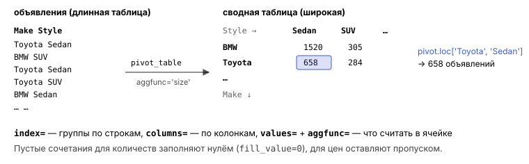

## Зачем это нужно

Группировка по одному признаку отвечает на вопрос «сколько стоит машина каждой марки». А если вопрос про **два** признака сразу — «какие кузова у каждой марки» или «насколько автомат дороже механики у каждой марки»? Результат удобно видеть таблицей: марки по строкам, кузова по колонкам, в ячейках — число объявлений или медианная цена. Это **сводная таблица** (pivot table) — та самая, что в Excel.

## pivot_table: марки × кузова

`pd.pivot_table` получает таблицу и три указания: что поставить в строки (`index`), что — в колонки (`columns`) и что считать в ячейке (`values` + `aggfunc`). `aggfunc='size'` — число объявлений; для сочетаний, которых в данных нет, получится пропуск, и `fill_value=0` заменяет его нулём: «таких объявлений ноль» — честный ответ для количества.



```python
pivot_style = pd.pivot_table(df, index='Make', columns='Style', aggfunc='size', fill_value=0)
print(pivot_style.shape)
pivot_style.head(6)
```

22 строки (марки) × 12 колонок (кузова). Сразу видно, что у Dacia нет кабриолетов, а у Chevrolet — ни одного Combi.

## Работа со сводной таблицей

Сводная таблица — обычный DataFrame: к ней применимы `loc`, суммы по осям, сортировка. Сумма по колонкам (`axis=0`, урок 1.10) даёт общее число объявлений каждого кузова, `idxmax` — самый частый кузов, `loc` — одну ячейку:

```python
style_totals = pivot_style.sum(axis=0).sort_values(ascending=False)
print(style_totals.head(5))
print('Самый частый кузов:', style_totals.idxmax())
print('Седанов Toyota:', pivot_style.loc['Toyota', 'Sedan'])
pivot_style.sort_values('Sedan', ascending=False).head(3)
```

Седанов больше всех у Mercedes (1611) и BMW (1520). Сумма по строкам (`axis=1`) вернула бы число объявлений каждой марки.

## В ячейке — не только количество

С `values='Price'` и `aggfunc='median'` в ячейках будут медианные цены. Сравним автомат и механику по маркам:

```python
price_pivot = df.pivot_table(index='Make', columns='Transmission', values='Price', aggfunc='median')
price_pivot['Разница'] = price_pivot['Automatic'] - price_pivot['Manual']
price_pivot.sort_values('Разница', ascending=False).head(5).round(0)
```

Здесь `fill_value=0` использовать **нельзя**: если у марки нет машин с механикой, «медиана цены 0 евро» — неправда. Отсутствие наблюдений оставляем пропуском `NaN` — подробнее в уроке 3.5. И ещё одна оговорка: разница медиан описывает выборку, а не «стоимость автомата» — машины с автоматом в среднем ещё и новее.

## Составной индекс после группировки

Группировка по двум колонкам (урок 3.2) даёт Series с **составным индексом** (MultiIndex): каждая метка — пара «марка, год». Выбирать из неё можно по первому уровню или по паре целиком:

```python
by_make_year = df.groupby(['Make', 'Year'])['Price'].mean()
print('Уровней индекса:', by_make_year.index.nlevels)
print('Toyota 2012:', round(by_make_year.loc[('Toyota', 2012)]))
by_make_year.loc['Toyota'].tail(4).round(0)
```

- `by_make_year.loc['Toyota']` — все годы Toyota (Series с годами в индексе);
- `by_make_year.loc[('Toyota', 2012)]` — одно значение: пара меток в круглых скобках.

Метод `unstack()` переносит последний уровень индекса в колонки — и получается та же сводная таблица. Три записи одной и той же сводки:

```python
wide = df.groupby(['Make', 'Style']).size().unstack(fill_value=0)
print('groupby + unstack совпадает с pivot_table:', wide.equals(pivot_style))
```

`pivot_table` удобнее читать, `groupby` гибче (можно добавить любые шаги до `unstack`), а для простых подсчётов сочетаний есть `crosstab` — следующий урок.

## Типичные ошибки

:::mistake fill_value=0 для цен
`pivot_table(..., values='Price', aggfunc='mean', fill_value=0)` превращает «нет данных» в «цена 0 евро». Ноль уместен только для количеств.
:::

:::mistake Перепутали index и columns
Если марки оказались в колонках, таблица выйдет «широкой» и неудобной: 22 колонки вместо 22 строк. Строки — то, по чему сравниваем объекты отчёта.
:::

:::mistake loc по паре без скобок
Для составного индекса одну группу выбирают парой: `s.loc[('Toyota', 2012)]`. Запись `s.loc['Toyota', 2012]` у Series может выбрать не то, что ожидается.
:::

:::mistake Ячейки без размера групп
Медиана в ячейке «Volvo × механика» может быть посчитана по двум объявлениям. Для надёжности рядом строят сводную с `aggfunc='size'` (урок 3.3).
:::

## Мини-квиз

```quiz
- q: "Что окажется в ячейке сводной `pd.pivot_table(df, index='Make', columns='Style', aggfunc='size', fill_value=0)` для сочетания, которого нет в данных?"
  options:
    - NaN
    - "0"
    - Ошибка
  answer: 1
  explain: Пустое сочетание дало бы NaN, а `fill_value=0` заменяет его нулём — для количества это верно.
- q: "Что вернёт `pivot_style.sum(axis=0)`?"
  options:
    - Число объявлений каждого кузова (суммы по колонкам)
    - Число объявлений каждой марки
    - Общее число объявлений
  answer: 0
  explain: "`axis=0` суммирует вдоль строк, результат — по одному числу на колонку (кузов)."
- q: "`s = df.groupby(['Make', 'Year'])['Price'].mean()`. Как получить среднюю цену Toyota 2012 года?"
  options:
    - "`s['Toyota 2012']`"
    - "`s.loc[('Toyota', 2012)]`"
    - "`s.iloc['Toyota', 2012]`"
  answer: 1
  explain: Метка составного индекса — пара значений в круглых скобках.
```

## Что запомнить

- `pd.pivot_table(df, index=..., columns=..., values=..., aggfunc=...)` — группы по строкам и колонкам, статистика в ячейках.
- `aggfunc='size'` + `fill_value=0` — число объявлений; для цен пустые сочетания оставляют `NaN`.
- Сводная — обычный DataFrame: `loc`, `sum(axis=0/1)`, `idxmax`, `sort_values`.
- Группировка по двум колонкам даёт составной индекс: `s.loc['Toyota']`, `s.loc[('Toyota', 2012)]`; `unstack()` переводит уровень в колонки.
