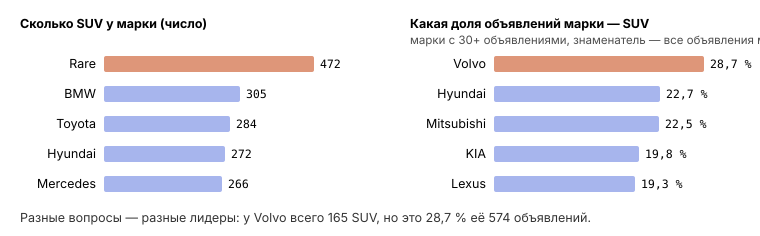

## Зачем это нужно

«У какой марки больше всего внедорожников?» и «Для какой марки внедорожники наиболее типичны?» звучат похоже, но это **разные вопросы**, и у них разные ответы. Первый — про **количество**, второй — про **долю** внутри марки. Перепутать их — частая ошибка аналитических отчётов: крупная марка «выигрывает» по количеству просто потому, что у неё много объявлений.

Инструмент для таких вопросов — **таблица сочетаний** `pd.crosstab`: сколько записей у каждого сочетания двух категорий и какую долю они составляют.

## crosstab: сколько записей у каждого сочетания

`pd.crosstab(строки, колонки)` получает две колонки-категории и считает, сколько раз встречается каждая пара значений. Это та же сводная `pivot_table(..., aggfunc='size', fill_value=0)` из урока 3.4, но короче:

```python
style_count = pd.crosstab(df['Make'], df['Style'])
top_makes = df['Make'].value_counts().head(10).index
style_count.loc[top_makes]
```

`top_makes` — десять самых частых марок (урок 2.3): `loc` по списку меток выбирает их строки в том же порядке.

## Доли внутри строки: normalize='index'

Параметр `normalize='index'` делит каждую строку на её сумму — получаются **доли внутри марки**: какая часть объявлений марки приходится на каждый кузов. Умножим на 100, чтобы читать проценты:

```python
style_share = 100 * pd.crosstab(df['Make'], df['Style'], normalize='index')
style_share.loc[top_makes, ['Sedan', 'SUV', 'Universal', 'Hatchback']].round(1)
```

Теперь видна **структура** каждой марки: у BMW и Mercedes больше половины объявлений — седаны (59 % и 54 %), у Renault 42 % — универсалы. По количествам это сравнить трудно: у марок разное число объявлений. Сумма каждой строки долей — 100 %.

## Число и доля — разные вопросы

Проверим на внедорожниках (SUV). Для доли возьмём только марки, у которых хотя бы 30 объявлений, — иначе доля из 3 записей окажется «рекордной» (урок 3.3):

```python
n_make = style_count.sum(axis=1)
print('Больше всего SUV:', style_count['SUV'].idxmax(), '—', style_count['SUV'].max(), 'объявлений')
big = n_make >= 30
best = style_share.loc[big, 'SUV'].idxmax()
print('Наибольшая доля SUV:', best, '—', round(style_share.loc[best, 'SUV'], 1), '% из', n_make[best], 'объявлений')
```



Больше всего внедорожников у `Rare` (472) — это объединение 61 марки, неудивительно, что объявлений много. А **наибольшая доля** — у Volvo: всего 165 SUV, но это 28,7 % её объявлений. Правило: **у каждой доли называют знаменатель** — «28,7 % из 574 объявлений Volvo».

$$
\text{доля SUV у марки} = \frac{\text{SUV марки}}{\text{все объявления марки}} = \frac{165}{574} \approx 0.287.
$$

## Три разных знаменателя

У `crosstab` три варианта долей — и это три разных вопроса:

- `normalize='index'` — доля внутри **строки**: какая часть объявлений Rare — внедорожники;
- `normalize='columns'` — доля внутри **колонки**: какая часть всех внедорожников — Rare;
- `normalize=True` — доля от **всех** объявлений: какая часть всей таблицы — «Rare и SUV» одновременно.

`margins=True` добавляет строку и колонку итогов `All` — удобно проверить знаменатели:

```python
print('Доля SUV среди объявлений Rare:', round(pd.crosstab(df['Make'], df['Style'], normalize='index').loc['Rare', 'SUV'], 3))
print('Доля Rare среди всех SUV:      ', round(pd.crosstab(df['Make'], df['Style'], normalize='columns').loc['Rare', 'SUV'], 3))
print('Доля «Rare и SUV» от всех:     ', round(pd.crosstab(df['Make'], df['Style'], normalize=True).loc['Rare', 'SUV'], 4))
pd.crosstab(df['Make'], df['Style'], margins=True).loc[['Toyota', 'All'], ['SUV', 'Sedan', 'All']]
```

18,2 %, 15,5 % и 1,5 % — три разных числа об одних и тех же 472 объявлениях.

## Пустая ячейка — не ноль

В таблице **количеств** пустое сочетание честно заменяется нулём: таких объявлений ноль. В таблице **цен** — нет. Построим медианные цены по марке и топливу:

```python
fuel_prices = df.pivot_table(index='Make', columns='Fuel_type', values='Price', aggfunc='median')
print('Пустых ячеек:', fuel_prices.isna().sum().sum(), 'из', fuel_prices.size)
display(pd.crosstab(df['Make'], df['Fuel_type']).loc[['Lexus', 'Dacia']])
fuel_prices.loc[['Lexus', 'Dacia']].round(0)
```

У Dacia нет ни одного электромобиля и гибрида — медиану посчитать не из чего, и в ячейке `NaN`. Если поставить там `fill_value=0`, получится «электрическая Dacia стоит 0 евро», а средняя по колонке медиана цены электромобилей упадёт с 11 423 до 6 750 евро. А медиана Lexus по электромобилям посчитана по **одному** объявлению — рядом со сводной цен всегда держат сводную количеств.

## Типичные ошибки

:::mistake Сравнили количества вместо долей
«У Rare больше всего SUV — значит, Rare любит внедорожники» — неверно: у Rare просто больше объявлений. Для структуры марки нужны доли внутри строки.
:::

:::mistake Доля без знаменателя
«SUV — 15,5 %» — от чего? От объявлений марки, от всех SUV или от всей таблицы? Пишите знаменатель словами и числом.
:::

:::mistake Ноль вместо «нет данных»
`fill_value=0` в таблице цен превращает отсутствие объявлений в нулевую цену и искажает любые средние по таблице.
:::

:::mistake Рекордная доля из горстки записей
Доля 100 % из двух объявлений — не рекорд. Перед поиском максимума отбирайте группы достаточного размера.
:::

## Мини-квиз

```quiz
- q: "Что показывает `pd.crosstab(df['Make'], df['Style'], normalize='index')`?"
  options:
    - Долю каждого кузова среди объявлений марки
    - Долю каждой марки среди объявлений кузова
    - Число объявлений каждого сочетания
  answer: 0
  explain: "`normalize='index'` делит каждую строку (марку) на её сумму."
- q: "У марки A 472 SUV из 2594 объявлений, у марки B — 165 из 574. У кого внедорожники типичнее?"
  options:
    - У A — у неё больше SUV
    - У B — 28,7 % против 18,2 %
    - Одинаково
  answer: 1
  explain: Для «типичности» сравнивают доли внутри марки, а не количества.
- q: "В сводной медианных цен у марки нет электромобилей. Что должно быть в ячейке?"
  options:
    - "0"
    - Пропуск (NaN) — цены нет, потому что нет объявлений
    - Средняя цена всех электромобилей
  answer: 1
  explain: Ноль означал бы известную нулевую цену. Отсутствие наблюдений оставляют пропуском.
```

## Что запомнить

- `pd.crosstab(a, b)` — число записей каждого сочетания двух категорий; `margins=True` добавляет итоги.
- `normalize='index'` — доли внутри строки, `'columns'` — внутри колонки, `True` — от всех записей: три разных знаменателя.
- «Сколько» и «какая доля» — разные вопросы с разными лидерами; у доли всегда называют знаменатель.
- Для долей отбирают группы достаточного размера; в таблице цен пустые сочетания — `NaN`, а не 0.
