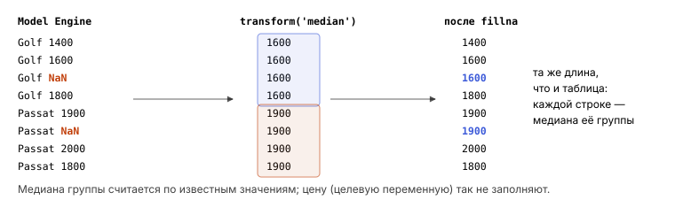

## Зачем это нужно

Сводные таблицы показывают не только «где много», но и «где почти ничего нет». Сочетание, которое встречается один-два раза, — повод присмотреться: это может быть **ошибка** (пикап Opel Astra), а может быть **редкая настоящая машина** (кабриолет Mercedes E Class действительно выпускался). Аналитик не удаляет такие записи автоматически, а принимает одно из трёх решений: **оставить**, **уточнить у источника** или **исправить подтверждённую ошибку**.

Вторая тема урока — пропуски. В модуле 2 мы удаляли неполные записи. Но пропуск входного признака часто можно **заполнить по похожим**: объём двигателя Volkswagen Golf скорее близок к медиане других Golf, чем к медиане всех машин.

## Редкие сочетания марки и кузова

Таблица сочетаний (урок 3.5) показывает их все. Метод `stack()` — обратный к `unstack()` из урока 3.4: превращает таблицу обратно в Series с парами «марка, кузов» в индексе. Отберём сочетания, которые встречаются один-два раза:

```python
pairs = pd.crosstab(df['Make'], df['Style']).stack()
present = pairs[pairs > 0]
print('Сочетаний марки и кузова:', len(present), '| встречаются 1–2 раза:', (present <= 2).sum())
present[present == 1].head(8)
```

Из 235 сочетаний 20 встречаются ровно один раз: Audi Roadster, BMW Pickup, Dacia Coupe… Часть из них правдоподобна (родстер Audi TT существует), часть — вряд ли.

## Сочетания внутри модели

Точнее проверять на уровне модели: у модели обычно один-два типичных кузова, и одинокое объявление с другим кузовом сразу заметно. Посчитаем кузова для каждой пары «марка, модель» и найдём кузова-одиночки у моделей, где объявлений много:

```python
by_model = df.groupby(['Make', 'Model', 'Style']).size().rename('n').reset_index()
by_model['model_total'] = by_model.groupby(['Make', 'Model'])['n'].transform('sum')
lonely = by_model[(by_model['n'] == 1) & (by_model['model_total'] >= 30)]
print('Кузовов-одиночек у моделей с 30+ объявлениями:', len(lonely))
lonely.sort_values('model_total', ascending=False).head(8)
```

`reset_index()` превращает уровни индекса обратно в колонки. Среди одиночек:

- Mercedes E Class **Cabriolet** — настоящая модификация: **оставить**;
- BMW 5 Series **Pickup**, Opel Astra **Pickup** и **Roadster** — таких машин не выпускали: скорее всего, продавец ошибся в поле кузова. Это **кандидаты на исправление** — но исправлять стоит, только если ошибка подтверждена (по фото, описанию, у источника);
- Mercedes E Class **SUV** — спорно (у E Class есть вседорожный универсал): **уточнить**.

## Аналитическая группа редких кузовов

Иногда редкие категории объединяют, чтобы отчёт читался: четыре редких кузова (Roadster, Cabriolet, Combi, Coupe) — в группу `Rare`. Это **изменение детализации отчёта, а не исправление ошибки**, поэтому исходный `Style` сохраняем, а группу пишем в новую колонку:

```python
df['Style_group'] = df['Style'].replace({x: 'Rare' for x in ['Roadster', 'Cabriolet', 'Combi', 'Coupe']})
print(df['Style_group'].value_counts())
pd.crosstab(df['Make'], df['Style_group']).loc[['BMW', 'Dacia']]
```

`replace(словарь)` заменяет значения по словарю, остальные оставляет как есть (в отличие от `map`, который превращает отсутствующие в словаре значения в пропуск, — урок 2.9). Генератор словаря `{x: 'Rare' for x in [...]}` строит словарь «каждый редкий кузов → Rare». Равное число объектов в группах не гарантирует лучшей модели — объединение должно иметь предметное обоснование.

## Самое частое значение группы

Для заполнения пропущенной **категории** нужен не средний, а **самый частый** вариант (мода) среди похожих. Самый частый кузов каждой марки:

```python
top_style = df.groupby('Make')['Style'].agg(lambda s: s.value_counts().index[0])
top_style.head(8)
```

`lambda` получает кузова одной марки, `value_counts()` упорядочивает их по частоте, `.index[0]` — самый частый. Подводные камни: при **равных частотах** выбор произволен (его нужно оговорить), а для **неизвестной марки** моды нет — такой пропуск не заполнить.

## Заполнение по похожим: transform

`transform` — родственник группировки: считает статистику группы, но возвращает её **для каждой строки** — результат той же длины, что и таблица. Это ровно то, что нужно для заполнения: каждой строке — медиана её группы.



Проверим идею честно: спрячем 300 известных значений объёма двигателя, заполним их медианой своей модели и сравним с настоящими значениями:

```python
hidden = df.copy()
rows = hidden.sample(300, random_state=1).index
true_engine = hidden.loc[rows, 'Engine']
hidden.loc[rows, 'Engine'] = np.nan

group_median = hidden.groupby(['Make', 'Model'])['Engine'].transform('median')
hidden['Engine'] = hidden['Engine'].fillna(group_median)

print('Ошибка медианы модели: ', round((hidden.loc[rows, 'Engine'] - true_engine).abs().mean()), 'см³')
print('Ошибка общей медианы:  ', round((df['Engine'].median() - true_engine).abs().mean()), 'см³')
```

Медиана своей модели ошибается в среднем на 169 см³, общая медиана — на 444 см³: похожие машины — гораздо лучшая подсказка. Так проверяют любой способ заполнения: прячут **известные** значения и сравнивают.

:::important Цену так не заполняют
Заполнять по похожим можно **входные признаки** (объём, кузов). Цена — целевая переменная: заполненная цена стала бы выдуманным ответом для модели (урок 2.6). А дорогой редкий автомобиль нельзя «исправлять» средней ценой только потому, что он редкий.
:::

## Типичные ошибки

:::mistake Удалить всё редкое
Редкое сочетание — повод проверить, а не удалить: кабриолет E Class существует. Удаление настоящих редких машин искажает выборку.
:::

:::mistake Затереть исходную категорию
`df['Style'] = ...replace(...)` уничтожает исходные кузова. Аналитическую группу пишут в новую колонку.
:::

:::mistake Мода по всей таблице
Пропущенный кузов, заполненный самым частым кузовом всей таблицы (Sedan), для внедорожной марки почти наверняка неверен. Мода считается внутри похожей группы.
:::

:::mistake Заполнение без проверки
Способ заполнения проверяют на спрятанных известных значениях. Без этого нельзя сказать, лучше ли он простого удаления.
:::

## Мини-квиз

```quiz
- q: "У модели 1 000 объявлений-седанов и одно — «пикап». Что разумно сделать?"
  options:
    - Сразу удалить объявление
    - Пометить и проверить запись; исправить, только если ошибка подтверждена
    - Оставить без внимания
  answer: 1
  explain: Редкое сочетание — повод проверить. Исправляют подтверждённые ошибки, а не всё редкое.
- q: "Чем `transform('median')` отличается от `groupby(...).median()`?"
  options:
    - Ничем
    - transform возвращает медиану группы для каждой строки — результат той же длины, что таблица
    - transform считает медиану по всей таблице
  answer: 1
  explain: Группировка даёт по одному числу на группу, transform «раздаёт» его всем строкам группы.
- q: Какую колонку нельзя заполнять значениями похожих машин в задаче оценки цены?
  options:
    - Объём двигателя
    - Тип кузова
    - Цену
  answer: 2
  explain: Цена — целевая переменная; её заполнение создаёт выдуманные ответы.
```

## Что запомнить

- Редкое сочетание — повод проверить: оставить, уточнить или исправить подтверждённую ошибку.
- Аналитическая группа (`Style_group`) меняет детализацию отчёта; исходную колонку сохраняют.
- Мода группы — `groupby(...)[колонка].agg(lambda s: s.value_counts().index[0])`; при равных частотах выбор нужно оговорить.
- `transform('median')` даёт каждой строке статистику её группы — так заполняют входные признаки по похожим.
- Способ заполнения проверяют на спрятанных известных значениях; цену не заполняют.
