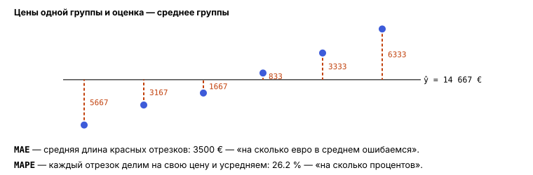

## Зачем это нужно

Четвёртый вопрос аналитика: может ли средняя цена похожих автомобилей служить **простой оценкой** цены? Продавец спрашивает: «Сколько просить за Audi 2016 года?» Самый простой ответ — «столько, сколько в среднем просят за Audi 2016 года». Это уже **модель**, пусть и очень простая: по признакам (марка, год) она выдаёт число.

Чтобы понять, хороша ли оценка, нужна **метрика** — число, которое измеряет ошибку. С метриками вы будете работать весь остаток курса: в модуле 5 мы сравним с этой простой оценкой первую модель машинного обучения, а в соревновании места распределит именно метрика.

## Оценка по группе

Средние цены по маркам и годам удобно держать в сводной таблице (урок 3.4). Возьмём из неё оценку для Audi 2016 года и сравним с настоящими ценами таких объявлений:

```python
pivot_make = df.pivot_table(index='Make', columns='Year', values='Price', aggfunc='mean')
estimate = pivot_make.loc['Audi', 2016]
audi_2016 = df.loc[(df['Make'] == 'Audi') & (df['Year'] == 2016), 'Price']
print(f'Оценка — средняя цена Audi 2016: {estimate:.0f} евро; таких объявлений: {len(audi_2016)}')
print('Первые настоящие цены:', audi_2016.head(6).tolist())
```

Оценка одна — 26 658 евро, а настоящие цены 88 объявлений разбросаны вокруг неё. Насколько сильно?

## MAE и MAPE



**MAE** (mean absolute error, средняя абсолютная ошибка) — среднее модулей разностей между настоящими ценами $y_i$ и оценками $\hat{y}_i$:

$$
\mathrm{MAE} = \frac{1}{N}\sum_{i=1}^{N} |y_i - \hat{y}_i|.
$$

MAE измеряется в евро: «в среднем оценка ошибается на столько-то евро». Модуль нужен, чтобы ошибки «вверх» и «вниз» не сокращали друг друга.

**MAPE** (mean absolute percentage error) — та же ошибка, но в процентах от настоящей цены:

$$
\mathrm{MAPE} = 100\% \cdot \frac{1}{N}\sum_{i=1}^{N} \frac{|y_i - \hat{y}_i|}{|y_i|}.
$$

Пример: цены 10 000, 12 000 и 20 000 евро, оценка 14 000. Ошибки 4000, 2000 и 6000, $\mathrm{MAE} = 12\,000 / 3 = 4000$ евро. В процентах: 40 %, 16,7 % и 30 %, $\mathrm{MAPE} \approx 28{,}9\,\%$. В pandas обе метрики — одна строка:

```python
mae = (audi_2016 - estimate).abs().mean()
mape = ((audi_2016 - estimate).abs() / audi_2016).mean() * 100
print(f'Audi 2016: MAE = {mae:.0f} евро, MAPE = {mape:.1f} %')
```

В среднем оценка ошибается на 11 167 евро, или на 45 % цены: внутри «Audi 2016» есть и A3, и Q7 — машины совсем разных классов.

## Оценка для всей таблицы

`transform('mean')` из урока 3.6 даёт каждой строке среднюю цену её группы — это и есть оценка для каждого объявления. Сравним её с самой наивной оценкой «одна средняя цена для всех»:

```python
estimate_all = df.groupby(['Make', 'Year'])['Price'].transform('mean')
mae_group = (df['Price'] - estimate_all).abs().mean()
mape_group = ((df['Price'] - estimate_all).abs() / df['Price']).mean() * 100
mae_naive = (df['Price'] - df['Price'].mean()).abs().mean()
print(f'Средняя марки и года: MAE = {mae_group:.0f} евро, MAPE = {mape_group:.1f} %')
print(f'Одна средняя для всех: MAE = {mae_naive:.0f} евро')
```

Учёт марки и года уменьшает ошибку вдвое: 3 128 евро вместо 6 459. Но MAPE — 47 %: процентная ошибка особенно велика у **дешёвых** машин. Ошибка 1000 евро для машины за 500 евро — это 200 %; среди объявлений дешевле 1000 евро средняя процентная ошибка — около 310 %. Поэтому MAE и MAPE смотрят вместе: одна про евро, другая про проценты.

## Ловушка: ошибка на тех же данных

Чем мельче группы, тем меньше ошибка — кажется, надо просто добавить модель:

```python
for keys in [['Make'], ['Make', 'Year'], ['Make', 'Model', 'Year']]:
    est = df.groupby(keys)['Price'].transform('mean')
    singles = (df.groupby(keys)['Price'].transform('size') == 1).sum()
    print(f'{" + ".join(keys):20} MAE = {(df["Price"] - est).abs().mean():5.0f} евро | строк в группах из одной машины: {singles}')
```

С моделью MAE падает до 1 507 евро. Но посмотрите на последнюю колонку: 1 988 объявлений оказались в группах **из одной машины**. Их «оценка» — их же собственная цена, ошибка — ноль. Метрика честно посчитала, что мы «угадали» цену, которую подсмотрели. **Среднее группы содержит цену самого оцениваемого автомобиля**, поэтому ошибка на тех же данных — это внутригрупповой разброс, а не качество прогноза для **новых** машин.

## Проверка на новых объявлениях

Честная проверка — оценивать машины, которых не было при расчёте средних. Разделим объявления пополам: по первой половине посчитаем средние групп, а вторую будем оценивать как «новые». Ключ группы соберём строкой, а оценку подставим через `map` с Series средних (урок 2.9):

```python
train = df.sample(frac=0.5, random_state=0)   # «известные» объявления
test = df.drop(train.index)                    # «новые» объявления

def key(t, with_model):
    k = t['Make'] + ' ' + t['Year'].astype(str)
    return k + ' ' + t['Model'] if with_model else k

for with_model in [False, True]:
    means = train.groupby(key(train, with_model))['Price'].mean()
    est = key(test, with_model).map(means)
    found = est.notna()
    mae_new = (test.loc[found, 'Price'] - est[found]).abs().mean()
    print('марка+год+модель' if with_model else 'марка+год       ',
          f'| группа нашлась для {found.mean():.0%} новых машин | MAE на них = {mae_new:.0f} евро')
```

Для «марка + год» ошибка на новых машинах почти такая же, как на старых (3 237 против 3 123 евро). С моделью — заметно хуже, чем казалось (1 895 против 1 352), а для 11 % новых машин подходящей группы нет вовсе. Это главный урок метрик: **качество проверяют на данных, которые не участвовали в построении оценки**. В модуле 5 эта идея станет разбиением на обучающую и проверочную выборки.

## Типичные ошибки

:::mistake Ошибка без модуля
`(y - y_hat).mean()` — ошибки разного знака сокращаются, и плохая оценка может показать «ошибку 0». Нужен модуль: `.abs()`.
:::

:::mistake MAPE при дешёвых машинах
Делим на цену — и машина за 200 евро даёт огромный процент. MAPE смотрят вместе с MAE и не используют, если встречаются нулевые цены.
:::

:::mistake Качество по тем же данным
Ошибка на тех же объявлениях, по которым считали средние, занижена: в группе из одной машины она равна нулю. Качество оценки проверяют на новых объявлениях.
:::

:::mistake Дробить группы до бесконечности
Мелкие группы уменьшают ошибку на старых данных, но для новых машин подходящей группы может не найтись, а средние по 1–2 машинам ненадёжны (урок 3.3).
:::

## Мини-квиз

```quiz
- q: "Цены 1000 и 3000 евро, оценка 2000. Чему равны MAE и MAPE?"
  options:
    - MAE = 1000 евро, MAPE ≈ 66,7 %
    - MAE = 0 евро, MAPE = 0 %
    - MAE = 2000 евро, MAPE = 50 %
  answer: 0
  explain: "Ошибки по модулю 1000 и 1000 → MAE = 1000. Проценты: 100 % и 33,3 % → MAPE ≈ 66,7 %."
- q: "Почему у группы из одной машины ошибка оценки «среднее группы» равна нулю?"
  options:
    - Оценка точная
    - Среднее группы — это цена самой машины: оценка подсмотрела ответ
    - Такие группы удаляются
  answer: 1
  explain: Поэтому ошибку на тех же данных нельзя считать качеством прогноза для новых машин.
- q: "Оценка с моделью даёт MAE 1 507 евро на тех же данных и 1 895 на новых объявлениях. Какая цифра честнее описывает качество?"
  options:
    - 1 507 — она меньше
    - 1 895 — посчитана на машинах, которых не было при расчёте средних
    - Они равноценны
  answer: 1
  explain: Качество проверяют на данных, не участвовавших в построении оценки.
```

## Что запомнить

- Простая оценка цены — средняя (или медиана) цен похожих машин; `transform` даёт её каждой строке.
- MAE = среднее |y − ŷ| — ошибка в евро; MAPE = среднее |y − ŷ| / |y| × 100 % — в процентах; смотрят обе.
- MAPE огромна у дешёвых машин и не определена при нулевой цене.
- Ошибка на тех же данных занижена (группа из одной машины «угадывает» себя); качество проверяют на новых объявлениях.
