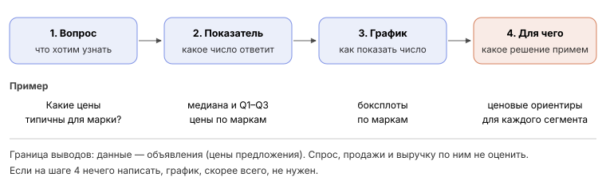

## Зачем это нужно

Мы помогаем запустить сервис продажи подержанных автомобилей: данные собраны и подготовлены (модуль 2), сводные таблицы посчитаны (модуль 3). Теперь графики. Они нужны для двух разных целей:

- **исследовать** данные — увидеть то, чего не видно в таблице: форму распределения, различия сегментов, подозрительные записи;
- **представить** результат — показать заказчику вывод так, чтобы он понял его за несколько секунд и принял решение.

Заказчику не нужны «p-value» и таблицы на сотню строк — ему нужен график, который отвечает на его вопрос. Поэтому любая визуализация начинается не с `plt.plot`, а с **вопроса**.

## Таблица или график

Сравним два представления одного ответа на вопрос «какие марки представлены в объявлениях?»:

```python
counts = df['Make'].value_counts()
print(counts.head(6))
counts.plot(kind='bar', figsize=(10, 3), rot=60,
            title='Число объявлений по маркам', xlabel='Марка', ylabel='Число объявлений');
```

В таблице видно только начало списка. На графике сразу заметна форма: несколько марок дают основную массу объявлений, дальше — длинный «хвост» марок с небольшим числом записей (их часть мы объединили в `Rare` в уроке 2.10). Такой вывод — «каталог сосредоточен в нескольких марках» — и есть ответ на вопрос.

## План: вопрос → показатель → график → для чего

Прежде чем рисовать, запишите четыре вещи: **вопрос**, **показатель** — какое число на него отвечает, **график**, который это число покажет, и **для чего** ответ нужен сервису. Так выглядит план исследования из лабораторной работы:

| Вопрос | Показатель | График | Для чего сервису |
|---|---|---|---|
| Какие марки представлены? | число и доля записей | столбцы | определить охват каталога |
| Какие цены типичны? | медиана и Q1–Q3 | боксплот | получить ценовые ориентиры |
| Как различается состав топлива? | доли внутри марки | тепловая карта | сравнивать сегменты |
| Где возможны ошибки? | необычные значения и сочетания | гистограмма, scatter | проверить качество данных |



Показатели для первых трёх вопросов мы уже умеем считать — графики модуля нарисуют именно эти числа:

```python
share = df['Make'].value_counts(normalize=True).head(5) * 100          # какие марки представлены
typical = df['Price'].quantile([0.25, 0.5, 0.75])                      # какие цены типичны
fuel = pd.crosstab(df['Make'], df['Fuel_type'], normalize='index')     # состав топлива внутри марки
print(share.round(1))
print(typical)
print(fuel.loc[['Toyota', 'Renault'], ['Diesel', 'Petrol', 'Hybrid']].round(2))
```

Уже по числам видно, что графики будут разными: у Renault 85 % дизелей, у Toyota четверть объявлений — гибриды. Такое различие «сегментов» удобно показать тепловой картой (урок 4.7).

## Какой график для какого вопроса

Тип графика определяется **вопросом** и **типом признаков** (урок 3.1):

| Вопрос | Пример | График | Урок |
|---|---|---|---|
| сколько записей в каждой категории | марки, кузова | отсортированные столбцы | 4.3 |
| из каких долей состоит целое | топ-5 марок и «остальные» | столбцы, кольцо, Парето | 4.4 |
| как распределён один числовой признак | цена, год | гистограмма, боксплот, ECDF | 4.5–4.6 |
| как числовой признак зависит от категории | цена по кузовам | боксплоты по группам | 4.7 |
| как связаны два числовых признака | цена и пробег | scatter, hexbin | 4.8 |
| как меняется значение по упорядоченному признаку | медиана по году выпуска | линия | 4.2 |
| из чего состоит каталог по иерархии | марка → модель | treemap | 4.10 |

:::tip Один вопрос — один главный график
Если на графике хочется показать «всё сразу», значит, вопросов несколько. Разделите их: каждый график отвечает на свой вопрос.
:::

## Границы выводов

В таблице — **объявления**: какие машины выставлены и сколько за них просят. Значит, по ней можно отвечать на вопросы о предложении («какие марки чаще встречаются в объявлениях», «сколько обычно просят за седан 2015 года»), но нельзя — о спросе, продажах и выручке: проданных машин и цен сделок в данных нет.

Вторая граница — сравнение без учёта других признаков. Автоматы в среднем дороже механики, но они и новее:

```python
print(df.groupby('Transmission')[['Price', 'Year']].median())
```

Разница медианных цен (около 7 600 евро) — это не «стоимость автоматической коробки»: в неё входит и разница в возрасте около 6 лет. На графике такие сравнения подписывают осторожно: «машины с автоматом в объявлениях дороже», а не «автомат добавляет к цене…».

## Типичные ошибки

:::mistake График без вопроса
«Нарисую всё, что есть, а там посмотрим» даёт десятки картинок без выводов. Сначала вопрос и показатель, потом график.
:::

:::mistake Выводы о продажах по объявлениям
«Toyota продаётся лучше всех» — неверно: в данных только предложения. Верно: «Toyota — одна из самых частых марок в объявлениях».
:::

:::mistake График не под тип признака
Линия между марками или круговая диаграмма из 22 секторов не отвечают ни на один вопрос. Для категорий — отсортированные столбцы.
:::

:::mistake Причина там, где только связь
«Автомат дороже на 7 600 евро» — сравнение, в котором смешаны коробка и возраст. Проверяйте, чем ещё различаются группы.
:::

## Мини-квиз

```quiz
- q: Какие две цели у визуализации данных?
  options:
    - Исследовать данные и представить результат заказчику
    - Украсить отчёт и увеличить его объём
    - Заменить вычисления и сводные таблицы
  answer: 0
  explain: Графики помогают увидеть закономерности и ошибки и объяснить вывод тем, кто будет принимать решение.
- q: Что записывают в план до того, как строить график?
  options:
    - Цвета и размер рисунка
    - Вопрос, показатель, тип графика и для чего ответ нужен
    - Только название файла с картинкой
  answer: 1
  explain: Вопрос определяет показатель, показатель — график, а «для чего» — какое решение примут по результату.
- q: "Какой вывод **можно** сделать по таблице объявлений?"
  options:
    - Toyota продаётся лучше остальных марок
    - Выручка продавцов седанов выше, чем у продавцов купе
    - Toyota — одна из самых частых марок в объявлениях
  answer: 2
  explain: В данных только предложения; продаж и выручки в них нет.
```

## Что запомнить

- Две цели графиков: исследовать данные и представить вывод.
- План: вопрос → показатель → график → для чего; без вопроса график не нужен.
- Тип графика выбирают по вопросу и типу признаков: категории — столбцы, распределение числа — гистограмма или боксплот, два числа — scatter.
- Объявления описывают предложение, а не продажи; сравнение групп не доказывает причину.
