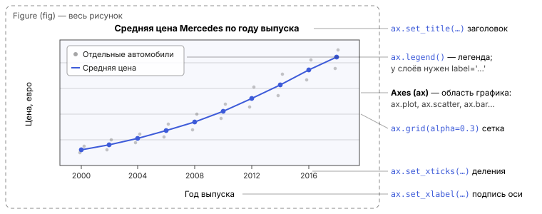

## Зачем это нужно

Метод `plot` из урока 3.8 рисует график одной строкой — для себя этого достаточно. Для заказчика нужно больше: подписать каждое второе деление, показать **разброс** цен рядом со средней, отметить, где машин мало, добавить легенду. Pandas внутри рисует средствами библиотеки **Matplotlib** — значит, всё это можно настроить, если работать с ней напрямую.

## Figure и Axes

У каждого графика Matplotlib две главные части:

- **Figure** (`fig`) — весь рисунок: размер, общий заголовок, сохранение в файл;
- **Axes** (`ax`) — одна область с графиком: свои оси X и Y, заголовок, подписи, деления, легенда.

Оба объекта создаёт `plt.subplots`; дальше рисуют **методами осей** — `ax.plot`, `ax.scatter`, `ax.bar` — и ими же подписывают.



Вернёмся к графику прошлого модуля — средней цене Mercedes по году выпуска — и построим его сами:

```python
make = 'Mercedes'
prices = df[df['Make'] == make].groupby('Year')['Price'].mean()

fig, ax = plt.subplots(figsize=(10, 3))
ax.plot(prices.index, prices.values, 'o-', linewidth=1.5)
ax.set(title=f'Средняя цена {make} по году выпуска', xlabel='Год выпуска', ylabel='Средняя цена, евро')
ax.grid(alpha=0.4)
plt.show()
```

`ax.plot(x, y, 'o-')` — первым аргументом координаты X (годы — индекс Series), вторым — Y; строка `'o-'` означает «маркеры-кружки, соединённые линией». `ax.set(...)` задаёт несколько свойств сразу — то же, что `ax.set_title`, `ax.set_xlabel`, `ax.set_ylabel` по отдельности. `plt.show()` показывает рисунок.

:::warning Без X по оси окажутся номера
`ax.plot(prices.values)` с одним аргументом рисует значения по номерам 0, 1, 2… — годы пропадут. Передавайте и X, и Y: `ax.plot(prices.index, prices.values)`.
:::

## Деления осей

Годы выпуска идут подряд, и подписи могут налезать друг на друга. Подпишем каждый второй год, промежуточные отметим мелкими делениями, а подписи повернём:

```python
start, end = int(prices.index.min()), int(prices.index.max())
fig, ax = plt.subplots(figsize=(10, 3))
ax.plot(prices.index, prices.values, 'o-')
ax.set_xticks(range(start, end + 1, 2))                 # подписанные деления — каждые 2 года
ax.set_xticks(range(start + 1, end + 1, 2), minor=True)  # мелкие деления между ними
ax.tick_params(axis='x', rotation=45)
ax.set(title=f'Средняя цена {make} по году выпуска', xlabel='Год выпуска', ylabel='Средняя цена, евро')
ax.grid(alpha=0.4)
plt.show()
```

`range(start, end + 1, 2)` — список положений делений, как в обычном цикле: от первого года до последнего включительно с шагом 2.

## Слои: отдельные машины, средняя и число записей

Средняя цена прячет главное: насколько различаются **отдельные** машины одного года и где машин мало. Нарисуем на одних осях три слоя — каждый вызов метода `ax` добавляет новый:

```python
cars = df[df['Make'] == make]
stats = cars.groupby('Year')['Price'].agg(['mean', 'count'])

fig, ax = plt.subplots(figsize=(10, 4))
ax.scatter(cars['Year'], cars['Price'], s=8, alpha=0.15, color='gray', label='Отдельные автомобили')
ax.plot(stats.index, stats['mean'], color='tab:blue', linewidth=1.5)
ax.scatter(stats.index, stats['mean'], s=300 * stats['count'] / stats['count'].max(),
           color='tab:blue', label='Средняя цена; размер — число машин')
ax.set(title=f'{make}: средняя цена, разброс и число машин', xlabel='Год выпуска', ylabel='Цена, евро')
ax.grid(alpha=0.3)
ax.legend()
plt.show()
```

- серое облако — каждая машина: `s` — площадь маркера, `alpha=0.15` — почти прозрачные точки, чтобы облако не закрывало линию;
- линия средних и поверх — кружки, у которых **площадь** пропорциональна числу машин года: самый частый год получает `s=300`, остальные — меньше;
- `label='…'` у слоёв и `ax.legend()` — легенда объясняет, что есть что.

Теперь видно, что у старых и самых новых машин кружки маленькие: средние по нескольким машинам ненадёжны (урок 3.3), а разброс цен внутри одного года огромный.

## Pandas рисует на ваших осях

Методу `plot` из Pandas можно передать готовые оси — `ax=ax`; он нарисует на них, а настроить график дальше можно методами Matplotlib. Так удобно совмещать быстрый `plot` и тонкую настройку:

```python
median_by_year = cars.groupby('Year')['Price'].median()
fig, ax = plt.subplots(figsize=(10, 3))
stats['mean'].plot(ax=ax, marker='o', label='Средняя')
median_by_year.plot(ax=ax, marker='o', label='Медиана')
ax.set(title=f'{make}: средняя и медианная цена', xlabel='Год выпуска', ylabel='Цена, евро')
ax.legend()
plt.show()
```

Средняя почти везде выше медианы: несколько дорогих машин тянут среднее вверх (урок 1.6).

## Типичные ошибки

:::mistake Один аргумент в `ax.plot`
`ax.plot(prices.values)` кладёт по оси X номера точек, а не годы. Нужно `ax.plot(prices.index, prices.values)`.
:::

:::mistake Легенда без подписей
`ax.legend()` собирает только слои с `label='…'`. Без подписей легенда пустая (Matplotlib предупредит).
:::

:::mistake Непрозрачное облако точек
Тысячи серых точек с `alpha=1` закрывают линию средних. Для фона — маленькие и почти прозрачные точки: `s=8, alpha=0.15`.
:::

:::mistake Радиус вместо площади
`s` — площадь маркера. Если сделать `s` пропорциональным квадрату числа машин, крупные группы будут выглядеть в разы больше, чем есть.
:::

## Мини-квиз

```quiz
- q: Что такое Axes в Matplotlib?
  options:
    - Весь рисунок вместе с полями
    - Одна область с графиком — своими осями, заголовком и подписями
    - Только ось X
  answer: 1
  explain: Figure — весь рисунок, Axes — область графика; на одном рисунке их может быть несколько.
- q: Что окажется по оси X после `ax.plot(prices.values)`, где `prices` — средние по годам?
  options:
    - Годы выпуска
    - Номера точек 0, 1, 2…
    - Цены
  answer: 1
  explain: С одним аргументом Matplotlib рисует значения по их номерам. Годы нужно передать первым аргументом.
- q: "Зачем серым точкам отдельных машин `alpha=0.15`?"
  options:
    - Чтобы облако не закрывало линию средних и было видно, где точек больше
    - Чтобы точки стали крупнее
    - Чтобы они попали в легенду
  answer: 0
  explain: Полупрозрачные точки накладываются и темнеют там, где машин много.
```

## Что запомнить

- `fig, ax = plt.subplots(figsize=...)`: Figure — весь рисунок, Axes — область графика; рисуют и подписывают методами `ax`.
- `ax.plot(x, y, 'o-')` — передавайте и X, и Y; `ax.set(title=..., xlabel=..., ylabel=...)`, `ax.grid(alpha=...)`.
- Деления — `ax.set_xticks(range(...))`, поворот подписей — `ax.tick_params(axis='x', rotation=45)`.
- Каждый вызов на тех же осях — новый слой; `label='…'` у слоёв и `ax.legend()` дают легенду; `s` — площадь маркера.
- `series.plot(ax=ax)` рисует Pandas-графиком на ваших осях.
