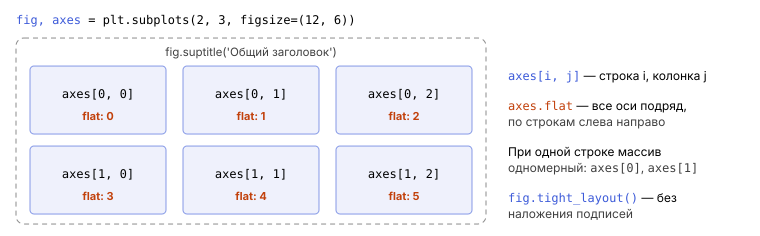

## Зачем это нужно

Один и тот же ответ — «из каких марок состоят объявления» — можно нарисовать десятком способов: столбцами, кольцом, точками, мозаикой, диаграммой Парето. Чтобы выбрать лучший, полезно увидеть варианты рядом. Для этого — и для будущих дашбордов — нужно уметь размещать **несколько графиков на одном рисунке**.

## Несколько графиков на рисунке

`plt.subplots(строк, колонок)` возвращает рисунок и **массив** осей. В каждую ось рисуют отдельно — теми же методами, что и раньше:



```python
counts = df['Make'].value_counts()
top = counts.head(10).sort_values()
share = 100 * top / len(df)

fig, axes = plt.subplots(1, 2, figsize=(12, 4))
bars = axes[0].barh(top.index, top.values, color='tab:blue')
axes[0].bar_label(bars, padding=4)
axes[0].set(title='Число объявлений', xlim=(0, top.max() * 1.25))
bars = axes[1].barh(top.index, share.values, color='tab:blue')
axes[1].bar_label(bars, fmt='%.1f%%', padding=4)
axes[1].set(title='Доля всех объявлений, %', xlim=(0, share.max() * 1.25))
fig.suptitle('Десять самых частых значений Make')
fig.tight_layout()
plt.show()
```

- при одной строке массив одномерный: `axes[0]`, `axes[1]`; при сетке — `axes[строка, колонка]`;
- `fmt='%.1f%%'` в `bar_label` — формат числа: один знак после точки и знак процента (`%%`);
- `fig.suptitle` — общий заголовок рисунка, `fig.tight_layout()` раздвигает оси, чтобы подписи не налезали.

## Одна доля — четыре формы

Нарисуем пять самых частых марок и «остальные» четырьмя способами и сравним, на каком графике проще ответить «во сколько раз Volkswagen больше BMW» и «какую часть занимают остальные»:

```python
parts = df['Make_original'].value_counts().head(5)
parts['Остальные'] = len(df) - parts.sum()
pct = 100 * parts / parts.sum()
colors = list(plt.cm.tab10.colors[:5]) + ['lightgray']

fig, axes = plt.subplots(2, 2, figsize=(12, 8))
ax = axes[0, 0]                                                    # 1. столбцы
bars = ax.barh(pct.index[::-1], pct.values[::-1], color=colors[::-1])
ax.bar_label(bars, fmt='%.1f%%', padding=4)
ax.set(title='Столбцы', xlim=(0, pct.max() * 1.25))

ax = axes[0, 1]                                                    # 2. кольцо
ax.pie(pct.values, colors=colors, startangle=90, counterclock=False, autopct='%1.0f%%',
       pctdistance=0.8, wedgeprops={'width': 0.4, 'edgecolor': 'white'})
ax.legend(pct.index, loc='center left', bbox_to_anchor=(1, 0.5), frameon=False)
ax.set_title('Кольцо')

ax = axes[1, 0]                                                    # 3. точки на «ниточках»
ax.hlines(pct.index[::-1], 0, pct.values[::-1], color='lightgray', linewidth=2)
ax.scatter(pct.values[::-1], pct.index[::-1], color='tab:blue', s=60)
ax.set(title='Точечная диаграмма', xlabel='Доля объявлений, %', xlim=(0, pct.max() * 1.15))

ax = axes[1, 1]                                                    # 4. Парето
ranked = df['Make_original'].value_counts().head(10)
ax.bar(ranked.index, ranked.values, color='tab:blue')
ax.tick_params(axis='x', rotation=60)
ax.set(title='Парето: число и накопленная доля', ylabel='Число объявлений')
ax2 = ax.twinx()
ax2.plot(ranked.index, 100 * ranked.cumsum() / len(df), 'o-', color='tab:red')
ax2.set(ylabel='Накопленная доля всех объявлений, %', ylim=(0, 100))

fig.suptitle('Пять самых частых марок и остальные — четыре формы')
fig.tight_layout()
plt.show()
```

`pct.index[::-1]` — срез с шагом −1 переворачивает порядок (урок 1.3): так первая марка оказывается сверху у горизонтальных форм.

## Сравниваем формы

| Форма | Чем хороша | Ограничения |
|---|---|---|
| столбцы | длины сравниваются точнее всего; подходит для любого числа категорий | доля «целого» видна хуже |
| кольцо (`pie` с `width`) | сразу видно «часть целого» | углы сравнивать трудно; только 3–6 частей |
| точечная диаграмма | мало «чернил», удобно для многих категорий | непривычна заказчику |
| Парето (столбцы + `twinx`) | видно, сколько категорий покрывают большую часть записей | две шкалы — нужно подписать обе |
| мозаика «квадрат ≈ 1 %» | наглядна для презентаций | грубая точность: 1 квадрат = 1 % |

На кольце почти невозможно сказать, какой сектор больше — Toyota или Mercedes; на столбцах это видно сразу. Поэтому для анализа выбирают столбцы, а кольцо оставляют для простых «частей целого» в презентации.

**Диаграмма Парето** отвечает на свой вопрос — «сколько категорий дают основную массу записей». Вторая ось `ax.twinx()` делит с первой ось X, но имеет свою шкалу Y справа: столбцы — в штуках, линия — в процентах. `cumsum()` — накопленная сумма: первая марка, первые две, первые три…

```python
ranked = df['Make_original'].value_counts()
cum_share = 100 * ranked.cumsum() / len(df)
print(cum_share.head(10).round(1))
print('Чтобы покрыть 80 % объявлений, нужно марок:', (cum_share < 80).sum() + 1)
```

## Вывод по категориальным признакам

Обычный вывод по частотам категорий — **какие категории редкие**. Сетка из четырёх графиков показывает это для всех категориальных признаков сразу:

```python
columns = ['Style', 'Fuel_type', 'Transmission', 'km_year_cat']
fig, axes = plt.subplots(2, 2, figsize=(12, 7))
for ax, column in zip(axes.flat, columns):
    counts = df[column].value_counts().sort_values()
    ax.barh(counts.index, counts.values, color='#3973a5')
    ax.set_title(column)
fig.suptitle('Частоты категориальных признаков')
fig.tight_layout()
plt.show()
```

Редкие значения — электромобили (31 объявление), родстеры (23), пикапы и кабриолеты (около 130 каждого): статистики по ним будут ненадёжными (урок 3.3). Категория `Large` годового пробега тоже небольшая — около 3,5 % объявлений.

## Типичные ошибки

:::mistake `plt.title` при нескольких осях
Короткие команды `plt.title(...)`, `plt.xlabel(...)` подписывают только **последние** оси. При `subplots` подписывайте каждую ось её методом: `axes[0].set_title(...)`.
:::

:::mistake Индекс одномерного массива как сетки
При `plt.subplots(1, 2)` массив одномерный: `axes[0, 1]` даст ошибку. Нужно `axes[1]`.
:::

:::mistake Кольцо из многих частей
Кольцо из 22 секторов нечитаемо. Для многих категорий — столбцы или точки; для кольца — 3–6 частей.
:::

:::mistake Накопленная доля от неполной суммы
Если делить `cumsum()` топ-10 на сумму этих же десяти, линия всегда придёт к 100 % — будто десять марок покрывают все объявления. Делите на число **всех** записей.
:::

## Мини-квиз

```quiz
- q: "Как обратиться к правому нижнему графику после `fig, axes = plt.subplots(2, 2)`?"
  options:
    - axes[1, 1]
    - axes[2, 2]
    - axes[4]
  answer: 0
  explain: Строки и колонки нумеруются с нуля; правый нижний — строка 1, колонка 1.
- q: Зачем на диаграмме Парето вторая ось `ax.twinx()`?
  options:
    - Чтобы показать накопленную долю в процентах рядом со столбцами в штуках
    - Чтобы удвоить высоту столбцов
    - Чтобы перевернуть ось X
  answer: 0
  explain: У двух рядов разные единицы — штуки и проценты, поэтому у линии своя шкала справа.
- q: На каком графике точнее всего сравнить доли Toyota и Mercedes?
  options:
    - Кольцо
    - Отсортированные столбцы
    - Мозаика из 100 квадратов
  answer: 1
  explain: Длины столбцов глаз сравнивает точнее, чем углы и площади.
```

## Что запомнить

- `fig, axes = plt.subplots(строк, колонок)`: `axes[i, j]` (при одной строке — `axes[k]`), `axes.flat` — все оси подряд; подписывают каждую ось её методами.
- `fig.suptitle(...)` — общий заголовок, `fig.tight_layout()` — без наложений.
- Одну долю можно показать столбцами, кольцом (3–6 частей), точками, мозаикой; для точного сравнения — столбцы.
- Парето: столбцы по убыванию и накопленная доля `100 * cumsum() / всего` на второй оси `ax.twinx()`.
- Главный вывод по частотам категорий — какие категории редкие.
