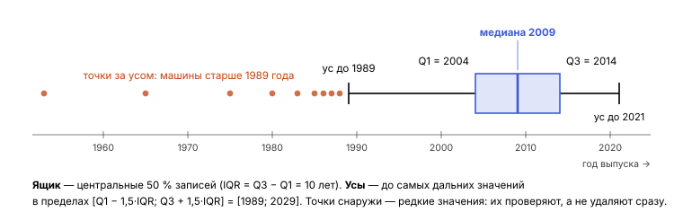

## Зачем это нужно

Гистограмма показывает форму распределения, но не на все вопросы отвечает удобно. Где границы «обычных» значений? Какая доля машин не новее 2010 года? Как сравнить распределения десятка групп на одном рисунке? Для этого есть другие **представления** распределения — боксплот, violin, ECDF — и библиотека **Seaborn**, которая рисует их одной строкой.

## Seaborn: график из таблицы

Seaborn построен поверх Matplotlib: функции принимают таблицу и **имена колонок**, а рисуют на обычных осях. Поэтому подписи и сетку настраивают как раньше — методами `ax`:

```python
fig, axes = plt.subplots(1, 2, figsize=(12, 3.5))
sns.histplot(data=df, x='Year', bins=30, ax=axes[0])
axes[0].set(title='Год выпуска: число объявлений', xlabel='Год выпуска', ylabel='Число объявлений')
sns.histplot(data=df, x='km_year', bins=50, binrange=(0, 60_000), kde=True, stat='probability', ax=axes[1])
axes[1].set(title='Пробег в год: доли и сглаженная кривая', xlabel='Пробег за год, км', ylabel='Доля объявлений')
fig.tight_layout()
plt.show()
```

- `data=df, x='Year'` — таблица и колонка; `ax=` — оси, на которых рисовать;
- `bins` и `binrange` — число интервалов и диапазон (как `bins` и `range` в `ax.hist`);
- `stat='probability'` — доли вместо числа записей, `kde=True` — сглаженная кривая поверх столбиков.

## Боксплот: ящик, усы и точки

**Боксплот** («ящик с усами») сжимает распределение до нескольких чисел, которые мы уже умеем считать (урок 1.7):



- **ящик** — от Q1 до Q3: центральные 50 % записей; его ширина — IQR;
- **линия внутри** — медиана;
- **усы** — до самых дальних значений, которые ещё лежат в пределах $[Q_1 - 1{,}5 \cdot IQR;\ Q_3 + 1{,}5 \cdot IQR]$;
- **точки за усами** — редкие значения, которые стоит **посмотреть отдельно**.

```python
q1, q3 = df['Year'].quantile([0.25, 0.75])
iqr = q3 - q1
low = q1 - 1.5 * iqr
print(f'Q1 = {q1:.0f}, Q3 = {q3:.0f}, IQR = {iqr:.0f}, нижняя граница = {low:.0f}')
print('Машин старше границы (точки за усом):', (df['Year'] < low).sum())

fig, axes = plt.subplots(1, 2, figsize=(12, 3.5))
sns.histplot(data=df, x='Year', bins=30, ax=axes[0])
axes[0].set(title='Год выпуска: гистограмма', xlabel='Год выпуска', ylabel='Число объявлений')
sns.boxplot(data=df, x='Year', ax=axes[1], color='lightgreen')
axes[1].set(title='Год выпуска: боксплот', xlabel='Год выпуска')
fig.tight_layout()
plt.show()
```

Ус слева заканчивается на 1989 году — это самый старый год, который ещё не дальше границы $Q_1 - 1{,}5 \cdot IQR$. Машины старше — точки: для первой простой модели их можно не брать, для подробного анализа — смотреть отдельно (это могут быть ретро-автомобили со своими ценами).

:::warning Точка за усом — не обязательно ошибка
Правило «1,5 IQR» отмечает **редкие** значения, а не неверные. Дорогой новый внедорожник — редкость, но не ошибка. Решение принимают, посмотрев на запись.
:::

## Другие представления распределения

Одно и то же распределение года выпуска — шестью способами:

```python
values = df['Year']
fig, axes = plt.subplots(2, 3, figsize=(15, 7))
sns.histplot(x=values, bins=30, ax=axes[0, 0])
axes[0, 0].set(title='Гистограмма: число записей', xlabel='Год выпуска', ylabel='Число записей')
sns.boxplot(y=values, ax=axes[0, 1], color='lightgreen')
axes[0, 1].set(title='Боксплот: квартили и редкие значения', ylabel='Год выпуска')
sns.violinplot(y=values, inner='quartile', cut=0, ax=axes[0, 2], color='lightblue')
axes[0, 2].set(title='Violin: форма плотности и квартили', ylabel='Год выпуска')
sns.kdeplot(x=values, fill=True, cut=0, ax=axes[1, 0])
axes[1, 0].set(title='KDE: сглаженная плотность', xlabel='Год выпуска', ylabel='Плотность')
sns.ecdfplot(x=values, ax=axes[1, 1])
axes[1, 1].set(title='ECDF: доля записей не новее x', xlabel='Год выпуска', ylabel='Доля записей')
sample = values.sample(n=500, random_state=42)
sns.stripplot(y=sample, jitter=0.3, alpha=0.3, size=3, ax=axes[1, 2])
axes[1, 2].set(title='Отдельные точки: 500 случайных записей', ylabel='Год выпуска')
fig.tight_layout()
plt.show()
print('Доля машин не новее 2010 года:', round((values <= 2010).mean(), 3))
```

| Представление | Что показывает | Когда полезно |
|---|---|---|
| гистограмма | число записей в интервалах | форма, пики, хвосты |
| боксплот | медиана, Q1–Q3, усы, редкие значения | сравнить много групп компактно |
| violin | боксплот + форма плотности | увидеть два пика, которые боксплот спрячет |
| KDE | сглаженная «гистограмма» | сравнить формы нескольких групп на одной оси |
| ECDF | доля записей со значением **не больше** x | читать доли: «55 % машин не новее 2010 года» |
| strip | отдельные точки со случайным смещением | увидеть сами записи (для выборки) |

ECDF читают так: по оси X выбираем значение, по оси Y — какая доля записей не превышает его. Доля «новее 2010 года» — это $1 - 0{,}551 = 0{,}449$. `cut=0` у violin и KDE не даёт кривой выходить за пределы данных (иначе появились бы машины 2025 года).

## Похоже ли распределение на нормальное

**Нормальное** распределение — симметричный «колокол»: около 68 % значений лежат в пределах $\bar{x} \pm \sigma$, около 95 % — в пределах $\bar{x} \pm 2\sigma$. Цены ограничены снизу нулём, и их распределение — с длинным правым хвостом. Но **логарифм** цены (урок 4.5) выглядит почти как колокол — такое распределение называют **логнормальным**. Проверим:

```python
from scipy.stats import norm

log_price = np.log10(df['Price'])
m, s = log_price.mean(), log_price.std()
grid = np.linspace(log_price.min(), log_price.max(), 300)

fig, ax = plt.subplots(figsize=(9, 3.5))
sns.histplot(x=log_price, bins=40, stat='density', ax=ax)
ax.plot(grid, norm.pdf(grid, m, s), 'r-', label='Нормальное распределение')
ax.set(title='Логарифм цены и нормальный колокол', xlabel='log₁₀(цена)', ylabel='Плотность')
ax.legend()
plt.show()
print('В пределах ±1σ:', round(log_price.between(m - s, m + s).mean(), 3))
print('В пределах ±2σ:', round(log_price.between(m - 2 * s, m + 2 * s).mean(), 3))
```

`stat='density'` нормирует гистограмму так, что площадь столбиков равна 1, — тогда её можно сравнить с кривой плотности `norm.pdf`. Доли 0,69 и 0,95 почти совпадают с правилом «68–95»: логарифм цены близок к нормальному. Это пригодится в модулях про модели: многие методы лучше работают с «колоколом», чем с длинным хвостом.

## Типичные ошибки

:::mistake Seaborn без `ax=` в сетке графиков
Если в `subplots` не передать `ax=axes[i]`, Seaborn нарисует на текущих осях — график окажется не в той ячейке.
:::

:::mistake Каждая точка за усом — ошибка
Правило «1,5 IQR» находит редкие значения. Удалять их без проверки — значит выбросить, например, все дорогие новые машины.
:::

:::mistake ECDF как плотность
ECDF — накопленная доля «не больше x», она всегда растёт от 0 до 1. Доля «больше x» — это 1 − ECDF.
:::

:::mistake Боксплот прячет форму
У распределения с двумя пиками боксплот выглядит как обычный. Если важна форма — violin или гистограмма.
:::

## Мини-квиз

```quiz
- q: Что показывает ящик боксплота?
  options:
    - Среднее ± стандартное отклонение
    - Центральные 50 % значений — от Q1 до Q3, линия внутри — медиана
    - Все значения от минимума до максимума
  answer: 1
  explain: Ящик — межквартильный размах, усы — в пределах 1,5·IQR, точки снаружи — редкие значения.
- q: "Для года выпуска Q1 = 2004, Q3 = 2014. Где нижняя граница усов?"
  options:
    - 1989
    - 1994
    - 2004
  answer: 0
  ordered: true
  explain: IQR = 10, Q1 − 1,5·IQR = 2004 − 15 = 1989.
- q: "По ECDF доля машин не новее 2010 года — 0,55. Какая доля новее 2010 года?"
  options:
    - 0,55
    - 0,45
    - нельзя узнать по ECDF
  answer: 1
  explain: ECDF — доля «не больше x»; «больше x» — это 1 − 0,55 = 0,45.
```

## Что запомнить

- Seaborn: `sns.histplot(data=df, x='колонка', ax=ax)` — таблица, колонка и оси; подписи — методами `ax`.
- Боксплот: ящик Q1–Q3 с медианой, усы до значений в пределах [Q1 − 1,5·IQR; Q3 + 1,5·IQR], точки снаружи — редкие значения для проверки.
- Violin — форма плотности, KDE — сглаженная гистограмма, ECDF — доля «не больше x», strip — отдельные точки.
- Логарифм цены почти нормален: в пределах ±1σ около 68 % значений, ±2σ — около 95 %.
