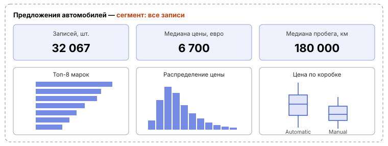

## Зачем это нужно

Заказчику сервиса нужен не десяток разрозненных графиков, а **один экран**, где видно главное о выбранном сегменте рынка: сколько объявлений, какая цена типична, какой пробег, какие марки, как распределены цены. Такой экран называют **BI-панелью** (дашбордом). Хорошая панель отвечает на заранее заданные вопросы (урок 4.1), считает все показатели по **одному** сегменту и пишет его название в заголовке. Если сменить сегмент, панель пересчитывается целиком.



## Plotly graph_objects и make_subplots

`plotly.express` строит **целый** рисунок одной функцией. Для панели нужно иначе: создать сетку ячеек и положить в каждую свой элемент. Для этого есть:

- `make_subplots(rows, cols, specs=...)` — сетка ячеек; в `specs` для каждой ячейки указан тип: `'indicator'` — крупное число, `'xy'` — обычный график с осями;
- `plotly.graph_objects` (`go`) — отдельные элементы-«ряды»: `go.Indicator`, `go.Bar`, `go.Histogram`, `go.Box`;
- `fig.add_trace(элемент, row=..., col=...)` — положить элемент в ячейку.

```python
fig = make_subplots(rows=1, cols=2, specs=[[{'type': 'indicator'}, {'type': 'xy'}]])
fig.add_trace(go.Indicator(mode='number', value=len(df), title={'text': 'Записей, шт.'}), row=1, col=1)
fig.add_trace(go.Histogram(x=df['Price'], nbinsx=60), row=1, col=2)
fig.update_xaxes(title_text='Цена, евро', range=[0, 60_000], row=1, col=2)
fig.update_layout(height=320, showlegend=False, title='Число объявлений и распределение цены')
fig.show()
```

`go.Indicator(mode='number', value=...)` рисует число крупно, `title={'text': ...}` — подпись. Оси конкретной ячейки настраивают `fig.update_xaxes(..., row=, col=)` и `fig.update_yaxes(...)`: здесь показан диапазон цен до 60 000 евро, а сами данные не изменились.

## Собираем панель

Панель лабораторной: три числа сверху и три графика снизу. Сегмент задаётся одной переменной — так все элементы гарантированно считаются по одним и тем же записям:

```python
dashboard_df = df.copy()
DASHBOARD_FILTER = 'Все записи'

fig = make_subplots(rows=2, cols=3,
                    specs=[[{'type': 'indicator'}] * 3, [{'type': 'xy'}] * 3],
                    subplot_titles=['', '', '', 'Топ-8 марок', 'Распределение цены', 'Цена по коробке'],
                    vertical_spacing=0.2)
metrics = [('Записей, шт.', len(dashboard_df)),
           ('Медиана цены, евро', dashboard_df['Price'].median()),
           ('Медиана пробега, км', dashboard_df['Distance'].median())]
for column, (label, value) in enumerate(metrics, start=1):
    fig.add_trace(go.Indicator(mode='number', value=float(value), title={'text': label},
                               number={'valueformat': ',.0f'}), row=1, col=column)

brand_counts = dashboard_df['Make'].value_counts().head(8).sort_values()
fig.add_trace(go.Bar(x=brand_counts.values, y=brand_counts.index, orientation='h', marker_color='#3973a5'), row=2, col=1)
fig.add_trace(go.Histogram(x=dashboard_df['Price'], nbinsx=50, marker_color='#3973a5'), row=2, col=2)
for transmission, group in dashboard_df.groupby('Transmission'):
    fig.add_trace(go.Box(y=group['Price'], name=transmission, boxpoints=False), row=2, col=3)

fig.update_xaxes(title_text='Число записей', row=2, col=1)
fig.update_xaxes(title_text='Цена, евро', row=2, col=2)
fig.update_yaxes(title_text='Цена, евро', type='log', row=2, col=3)
fig.update_layout(height=650, showlegend=False, template='plotly_white',
                  title=f'Предложения автомобилей — {DASHBOARD_FILTER}')
fig.show()
```

- `[{'type': 'indicator'}] * 3` — список из трёх одинаковых описаний ячеек (повторение списка, урок 0.7);
- `enumerate(metrics, start=1)` нумерует показатели с единицы — это и есть номер колонки;
- в числах — **медианы**, а не средние: цены с длинным хвостом (урок 4.5), и среднее завышено дорогими машинами;
- `boxpoints=False` прячет точки за усами, `type='log'` — логарифмическая ось цены в последней ячейке.

## Панель как функция сегмента

Чтобы построить ту же панель для другого сегмента, код оборачивают в функцию. Сегмент отбирает фильтр урока 4.10, а пустой сегмент останавливает построение понятной ошибкой:

```python
def build_dashboard(data, label):
    if data.empty:
        raise ValueError(f'Сегмент «{label}» не содержит записей')
    fig = make_subplots(rows=1, cols=3, specs=[[{'type': 'indicator'}, {'type': 'indicator'}, {'type': 'xy'}]])
    fig.add_trace(go.Indicator(mode='number', value=len(data), title={'text': 'Записей'}), row=1, col=1)
    fig.add_trace(go.Indicator(mode='number', value=float(data['Price'].median()), title={'text': 'Медиана цены, евро'},
                               number={'valueformat': ',.0f'}), row=1, col=2)
    fig.add_trace(go.Histogram(x=data['Price'], nbinsx=40), row=1, col=3)
    fig.update_layout(height=300, showlegend=False, title=f'Сегмент: {label}')
    return fig

build_dashboard(df[df['Transmission'] == 'Automatic'], 'только Automatic').show()
build_dashboard(df[(df['Make'] == 'Toyota') & (df['Fuel_type'] == 'Hybrid')], 'Toyota, гибрид').show()
```

Готовую панель сохраняют в HTML-файл и выкладывают на сайт — при пополнении базы её достаточно перестроить тем же кодом:

```python norun
fig.write_html('cars_bi_dashboard.html', include_plotlyjs='cdn')   # файл открывается в любом браузере
```

## Типичные ошибки

:::mistake Панель без вопросов
Двенадцать графиков «на всякий случай» превращают панель в свалку. Каждый элемент отвечает на один из заранее заданных вопросов.
:::

:::mistake Разные сегменты на одной панели
Числа посчитаны по всем данным, а графики — по сегменту (или наоборот). Все элементы считайте из одной таблицы сегмента.
:::

:::mistake Среднее для цены
У цен длинный хвост: среднее выше «типичной» цены. В ключевых числах — медиана.
:::

:::mistake Сегмент не подписан
Без названия сегмента в заголовке читатель примет «только Automatic» за весь рынок.
:::

## Мини-квиз

```quiz
- q: "Что задаёт `specs` в `make_subplots`?"
  options:
    - Тип каждой ячейки сетки — например, `'indicator'` для числа или `'xy'` для графика
    - Цвет графиков
    - Порядок строк в таблице
  answer: 0
  explain: Индикаторы и графики с осями требуют разных типов ячеек.
- q: Почему в ключевых числах панели — медиана цены, а не среднее?
  options:
    - Медиана считается быстрее
    - У цен длинный хвост, и среднее завышено редкими дорогими машинами
    - Plotly не умеет показывать среднее
  answer: 1
  explain: Медиана устойчива к хвосту и редким крайним значениям (урок 1.6).
- q: Зачем оборачивать панель в функцию `build_dashboard(data, label)`?
  options:
    - Чтобы построить ту же панель для любого сегмента, не копируя код
    - Без функции Plotly не работает
    - Чтобы панель рисовалась быстрее
  answer: 0
  explain: Одна функция — одинаковая панель для всех сегментов; меняется только таблица и подпись.
```

## Что запомнить

- BI-панель — ответы на несколько связанных вопросов на одном экране: ключевые числа сверху, графики ниже, всё по одному сегменту, сегмент — в заголовке.
- `make_subplots(rows, cols, specs=...)` — сетка; `fig.add_trace(go.Indicator(...) / go.Bar(...) / go.Histogram(...) / go.Box(...), row=, col=)` — элементы в ячейки.
- Оси ячейки — `fig.update_xaxes(..., row=, col=)`; общее оформление — `fig.update_layout(title=..., height=..., showlegend=False)`.
- Панель-функция `build_dashboard(data, label)` строит одинаковую панель для любого сегмента и не строит её для пустого.
