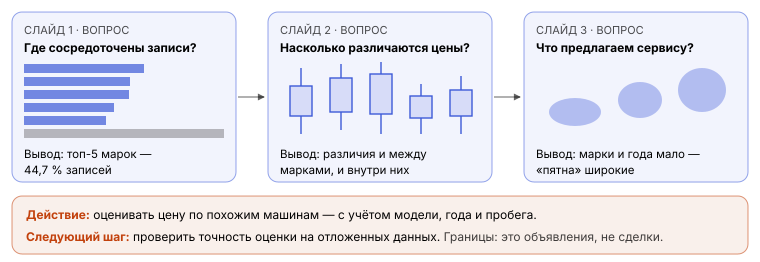

## Зачем это нужно

Исследование закончено: мы знаем, какие марки представлены, какие цены типичны, где ошибки. Теперь результат нужно **рассказать** заказчику — так, чтобы он понял вывод и принял решение. Набор из двадцати графиков с подписями «гистограмма цены» этого не сделает. Нужна **дата-история** (*Data Story*): несколько «слайдов», каждый отвечает на один вопрос аудитории, а вместе они ведут к предложению — что делать дальше.

## Как устроена история

Каждый слайд — четыре части:

1. **вопрос** аудитории («где сосредоточены записи?»);
2. **наблюдение** — график, который на него отвечает;
3. **интерпретация** — что это значит для сервиса;
4. **следующий шаг** — к чему это ведёт (на последнем слайде — предложение и границы выводов).



Главный приём — **заголовок-вывод**: заголовок слайда формулирует ответ, а не тип графика.

| Заголовок-описание | Заголовок-вывод |
|---|---|
| «Число записей по маркам» | «Топ-5 марок охватывают 44,7 % записей» |
| «Боксплоты цен по маркам» | «Цены различаются между марками и внутри них» |
| «Цена и год выпуска» | «Одной марки и года недостаточно для точной оценки» |

Числа в заголовке **вычисляют** из данных f-строкой: если данные обновятся, заголовок останется верным.

## Слайд 1. Где сосредоточены записи?

Для слайда берём настоящие названия марок — `Make_original`: группа `Rare` объединяет десятки редких марок и маркой не является.

```python
counts = df['Make_original'].value_counts()
top5 = counts.head(5)
share = 100 * top5.sum() / len(df)

plot_counts = top5.copy()
plot_counts['Остальные'] = len(df) - top5.sum()
fig, ax = plt.subplots(figsize=(10, 3.8))
bars = ax.barh(plot_counts.index, plot_counts.values, color=['tab:blue'] * 5 + ['lightgray'])
ax.invert_yaxis()
ax.bar_label(bars, labels=[f'{n} ({100 * n / len(df):.1f}%)' for n in plot_counts], padding=5)
ax.set_title(f'Топ-5 марок охватывают {share:.1f}% записей', fontsize=15)
ax.set_xlabel('Число объявлений')
ax.set_xlim(0, plot_counts.max() * 1.35)
fig.tight_layout()
plt.show()
```

**Интерпретация.** Почти половина объявлений — пять марок. С этих сегментов разумно начинать проверку функций сервиса: здесь больше всего продавцов и покупателей. Остальные 55 % распределены по 77 маркам — сервис должен работать и с «длинным хвостом».

## Слайд 2. Насколько различаются цены?

```python
selected = df[df['Make_original'].isin(top5.index)]
fig, ax = plt.subplots(figsize=(10, 3.8))
sns.boxplot(data=selected, x='Make_original', y='Price', order=top5.index, color='lightblue',
            showfliers=False, ax=ax)
ax.set_title('Цены различаются между марками и внутри них', fontsize=15)
ax.set(xlabel='Марка', ylabel='Цена предложения, евро')
fig.tight_layout()
plt.show()
print('Крайние точки скрыты, но учтены при расчёте квартилей.')
```

**Интерпретация.** Медианы марок различаются в полтора раза (от 5 900 евро у Volkswagen до 9 400 у BMW), а ящики — центральные 50 % цен — широкие и сильно перекрываются. Общей средней цены (и даже средней по марке) недостаточно: сервису нужны ценовые ориентиры по более узким сегментам. Подпись под графиком честно сообщает, что точки за усами скрыты.

## Слайд 3. Что предлагаем?

Посмотрим, как цена зависит от года внутри каждой марки. Логарифмическая шкала показывает и дешёвые старые, и дорогие новые машины:

```python
fig, axes = plt.subplots(1, 5, figsize=(16, 3.8), sharex=True, sharey=True)
for ax, make in zip(axes, top5.index):
    group = selected[selected['Make_original'] == make]
    ax.scatter(group['Year'], group['Price'], s=8, alpha=0.2)
    ax.set(title=make, xlabel='Год выпуска', yscale='log')
    ax.tick_params(axis='x', rotation=45)
axes[0].set_ylabel('Цена, евро (лог. шкала)')
fig.suptitle('Одной марки и года недостаточно для точной оценки', fontsize=15)
fig.tight_layout()
plt.show()
```

**Интерпретация.** Внутри одной марки и одного года цены различаются в разы — «пятна» широкие. **Предложение:** оценивать цену по похожим машинам — с учётом модели, года и пробега. **Следующий шаг:** проверить точность такой оценки на отложенных данных (это задача модулей про машинное обучение). **Границы выводов:** это цены объявлений, а не сделок.

## Что ещё нужно

Хватит ли пробега в год, чтобы сузить разброс? Сравним разброс цен Mercedes по пятилетним периодам без учёта и с учётом категории пробега:

```python
group = df[df['Make'] == 'Mercedes'].copy()
group['Период'] = group['Year'] // 5 * 5
fig, axes = plt.subplots(1, 2, figsize=(14, 4), sharey=True)
sns.boxplot(data=group, x='Период', y='Price', showfliers=False, color='lightblue', ax=axes[0])
axes[0].set(title='По периодам выпуска', xlabel='Начало пятилетнего периода', ylabel='Цена, евро')
sns.boxplot(data=group, x='Период', y='Price', hue='km_year_cat', hue_order=['Small', 'Medium', 'Large'],
            showfliers=False, ax=axes[1])
axes[1].set(title='Плюс категория пробега в год', xlabel='Начало пятилетнего периода')
for ax in axes:
    ax.tick_params(axis='x', rotation=45)
fig.tight_layout()
plt.show()
```

Ящики внутри периода почти не сузились: годовой пробег мало что объясняет. Разброс задают другие признаки — модель, комплектация, состояние. Это хороший финал истории: мы честно называем, **каких данных не хватает**, и следующий шаг становится понятен.

## Типичные ошибки

:::mistake Заголовок-описание
«Боксплот цен» заставляет зрителя самому искать вывод. Заголовок формулирует ответ на вопрос слайда.
:::

:::mistake Число, вписанное в заголовок руками
«Топ-5 марок — 44,7 %» устареет при обновлении данных. Вычисляйте число f-строкой.
:::

:::mistake Слайды без связи
Набор хороших графиков — ещё не история. Каждый следующий слайд опирается на предыдущий и ведёт к предложению.
:::

:::mistake Вывод шире данных
«Покупатели предпочитают Volkswagen» — о спросе по объявлениям не судят. Называйте границы выводов.
:::

## Мини-квиз

```quiz
- q: Из каких частей состоит слайд дата-истории?
  options:
    - Вопрос, наблюдение (график), интерпретация, следующий шаг
    - Только график и легенда
    - Таблица со всеми числами
  answer: 0
  explain: График — лишь наблюдение; без вопроса и интерпретации он не ведёт к решению.
- q: Какой заголовок — заголовок-вывод?
  options:
    - «Распределение цены по маркам»
    - «Цены различаются между марками и внутри них»
    - «Боксплот, seaborn»
  answer: 1
  explain: Он формулирует ответ, который зритель должен унести со слайда.
- q: Почему число в заголовке считают f-строкой из данных?
  options:
    - Так красивее
    - Чтобы заголовок оставался верным при обновлении данных
    - Matplotlib не принимает числа
  answer: 1
  explain: Вписанное руками число устареет и станет ошибкой.
```

## Что запомнить

- Дата-история — несколько слайдов: вопрос → наблюдение → интерпретация → следующий шаг; в конце — предложение и границы выводов.
- Заголовок-вывод формулирует ответ; числа в нём вычисляются f-строкой.
- Для слайдов — настоящие категории (марки из `Make_original`, без группы `Rare`), акцентный цвет и честные подписи («крайние точки скрыты»).
- Хорошая история называет, каких данных не хватает, — отсюда следующий шаг.
