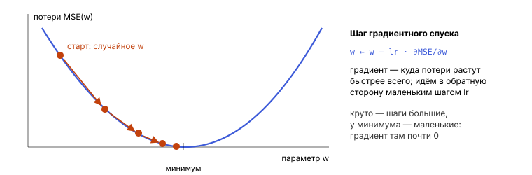

## Зачем это нужно

В уроке 5.1 мы сказали: модель находит функцию $f$ по примерам. Но функций бесконечно много — как выбрать? Ответ машинного обучения: заранее выбрать **вид** функции с неизвестными **параметрами**, а параметры подобрать так, чтобы ошибка на обучающих данных была как можно меньше. Разберём это на самой простой модели — прямой «год выпуска → цена». Именно так устроены и сложные модели: меняются только вид функции и способ подбора.

## Модель — семейство функций

**Линейная модель** с одним признаком:

$$
\hat{y} = w_0 + w_1 \cdot x,
$$

где $w_1$ — наклон (на сколько растёт прогноз при росте $x$ на единицу), $w_0$ — сдвиг (свободный член). Каждая пара $(w_0, w_1)$ — своя прямая; все прямые вместе — **параметрическое семейство**. **Обучение** — выбор одной пары по данным. С $n$ признаками модель та же: $\hat y = w_0 + w_1 x_1 + \dots + w_n x_n$.

Возьмём машины 2005 года и новее (`x` — год, `y` — цена в тысячах евро) и нарисуем три прямые-кандидата:

```python
candidates = [(-2400, 1.2), (-2800, 1.4), (-3200, 1.6)]
fig, ax = plt.subplots(figsize=(9, 4))
ax.scatter(x, y, s=4, alpha=0.08, color='gray')
grid = np.array([2005, 2021])
for w0, w1 in candidates:
    ax.plot(grid, w0 + w1 * grid, linewidth=2, label=f'w0={w0}, w1={w1}')
ax.set(title='Три модели из одного семейства', xlabel='Год выпуска', ylabel='Цена, тыс. евро', ylim=(0, 60))
ax.legend()
plt.show()
```

Какая из прямых лучше? Чтобы ответить, нужна мера ошибки.

## Функция потерь

**Функция потерь** (*loss*) — одно число, которое показывает, насколько прогнозы отличаются от ответов на обучающих данных. Для регрессии чаще всего берут **среднюю квадратичную ошибку**:

$$
\mathrm{MSE}(w_0, w_1) = \frac{1}{N}\sum_{i=1}^{N} \left(\hat y_i - y_i\right)^2 = \frac{1}{N}\sum_{i=1}^{N} \left(w_0 + w_1 x_i - y_i\right)^2 .
$$

Почему квадрат: ошибки не сокращаются по знаку; большие промахи штрафуются сильнее; функция гладкая — её удобно минимизировать. MAE тоже можно минимизировать, но её «излом» в нуле усложняет вычисления.

```python
for w0, w1 in candidates:
    mse = ((w0 + w1 * x - y) ** 2).mean()
    print(f'w0={w0}, w1={w1}: MSE = {mse:.1f}')
```

Из трёх кандидатов лучший — первый. Но, может быть, есть прямая ещё лучше?

## Метод наименьших квадратов

**Метод наименьших квадратов** выбирает параметры с **наименьшим** MSE. Для прямой ответ можно записать формулой (минимум там, где производные MSE по $w_0$ и $w_1$ равны нулю), и в NumPy она уже есть — `np.polyfit(x, y, 1)` (1 — степень многочлена, то есть прямая):

```python
w1_best, w0_best = np.polyfit(x, y, 1)
mse_best = ((w0_best + w1_best * x - y) ** 2).mean()
print(f'Наклон w1 = {w1_best:.3f} тыс. евро за год, сдвиг w0 = {w0_best:.1f}')
print(f'MSE = {mse_best:.1f} — меньше, чем у любого кандидата')
```

Наклон ≈ 1,46: в среднем прогноз растёт на 1 460 евро с каждым годом выпуска. Сдвиг $w_0 \approx -2\,933$ тысяч — это «цена машины 0 года», бессмысленная величина: прямая используется только в диапазоне данных.

Для многих признаков у метода наименьших квадратов тоже есть формула — её и решает `LinearRegression` в уроке 5.6. Но при миллионах объектов и тысячах признаков формула становится тяжёлой, и тогда параметры ищут по шагам.

## Градиентный спуск

Представим MSE как поверхность над плоскостью параметров — «чашу». **Градиент** — направление, в котором потери растут быстрее всего. Если сделать маленький шаг **против** градиента, потери уменьшатся. Повторяя шаги, спускаемся к минимуму.



Для прямой производные MSE по параметрам:

$$
\frac{\partial\, \mathrm{MSE}}{\partial w_1} = \frac{2}{N}\sum (\hat y_i - y_i)\, x_i, \qquad \frac{\partial\, \mathrm{MSE}}{\partial w_0} = \frac{2}{N}\sum (\hat y_i - y_i).
$$

Шаг: $w \leftarrow w - \text{lr} \cdot \text{градиент}$, где **lr** (*learning rate*) — размер шага. Годы ≈ 2 000 дают огромные градиенты, поэтому признак сначала стандартизируем (урок 1.10) — дальше это сделает `StandardScaler`:

```python
z = (x - x.mean()) / x.std()            # стандартизированный год
w1, w0, lr = 0.0, 0.0, 0.1
losses = []
for step in range(300):
    error = w0 + w1 * z - y
    losses.append((error ** 2).mean())
    w1 -= lr * 2 * (error * z).mean()
    w0 -= lr * 2 * error.mean()
print(f'Градиентный спуск: w1 = {w1:.3f}, w0 = {w0:.3f}')
print('Наименьшие квадраты:', np.round(np.polyfit(z, y, 1), 3))

fig, ax = plt.subplots(figsize=(8, 3))
ax.plot(losses)
ax.set(title='Потери падают с каждым шагом', xlabel='Шаг', ylabel='MSE')
plt.show()
```

Через 300 шагов градиентный спуск пришёл к тем же параметрам, что и формула. Если взять `lr` слишком большим (попробуйте `lr = 1.1`), шаги «перепрыгивают» минимум и потери растут; слишком маленьким — спуск займёт тысячи шагов.

## Типичные ошибки

:::mistake Обучение — это «запоминание» ответов
Модель подбирает несколько параметров формулы, а не хранит таблицу ответов. У прямой их два, сколько бы ни было машин.
:::

:::mistake Сдвиг как «цена машины 0 года»
Параметры имеют смысл только в диапазоне данных. За его пределами (0 год, 2050 год) прямая не описывает ничего.
:::

:::mistake Слишком большой шаг lr
При большом шаге градиентный спуск расходится: потери растут вместо того, чтобы уменьшаться. Уменьшите шаг или стандартизируйте признаки.
:::

:::mistake Сравнение кандидатов «на глаз»
Какая прямая лучше, решает функция потерь, а не впечатление от графика.
:::

## Мини-квиз

```quiz
- q: Что значит «обучить линейную модель»?
  options:
    - Подобрать параметры w0, w1, …, при которых функция потерь на обучающих данных минимальна
    - Запомнить все пары (x, y)
    - Выбрать признаки, которые нравятся аналитику
  answer: 0
  explain: Вид модели задан заранее, обучение подбирает параметры.
- q: "У прямой ŷ = 2 + 3x и точек (1; 4), (2; 9) какой MSE?"
  options:
    - "1"
    - "2"
    - "5"
  answer: 0
  ordered: true
  explain: "Прогнозы 5 и 8, ошибки 1 и −1, квадраты 1 и 1, среднее — 1."
- q: Градиентный спуск делает шаг…
  options:
    - в сторону градиента — туда, где потери растут
    - против градиента — туда, где потери уменьшаются быстрее всего
    - в случайную сторону
  answer: 1
  explain: "w ← w − lr · градиент: минус означает шаг против градиента."
```

## Что запомнить

- Модель — семейство функций с параметрами: линейная $\hat y = w_0 + w_1 x_1 + \dots + w_n x_n$; обучение — подбор параметров по данным.
- Функция потерь измеряет ошибку на обучающих данных; для регрессии — MSE, среднее квадратов ошибок.
- Метод наименьших квадратов — параметры с наименьшим MSE; для прямой — `np.polyfit(x, y, 1)`.
- Градиентный спуск: шаг $w \leftarrow w - \text{lr}\cdot$градиент; признаки стандартизируют, `lr` подбирают.
