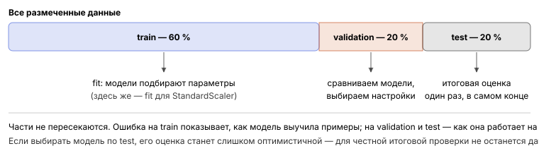

## Зачем это нужно

Ученик, который выучил ответы к задачнику наизусть, получит «отлично» на тех же задачах — и провалится на новых. С моделями то же самое: можно подобрать параметры, которые идеально повторяют обучающие примеры, но плохо предсказывают новые. Сервису нужны прогнозы для машин, которых ещё нет в данных, поэтому главное свойство модели — **обобщающая способность**: умение улавливать общие закономерности, а не случайности конкретной выборки.

## Опыт: зашумлённая синусоида

Чтобы видеть «правду», возьмём искусственные данные: настоящая зависимость $y = \sin(2\pi x)$, к каждому значению добавлен случайный шум. Обучающих точек 15; ещё 300 новых точек — для проверки. Модели — многочлены разной степени: чем выше степень, тем больше параметров и тем гибче кривая. `Polynomial.fit(x, y, степень)` подбирает многочлен методом наименьших квадратов (как `np.polyfit`, только устойчивее для высоких степеней).

```python
grid = np.linspace(x_train.min(), x_train.max(), 300)
fig, axes = plt.subplots(1, 3, figsize=(14, 3.8), sharey=True)
for ax, degree in zip(axes, [1, 3, 9]):
    model = Polynomial.fit(x_train, y_train, degree)
    ax.scatter(x_train, y_train, color='tab:blue', label='обучающие точки')
    ax.plot(grid, np.sin(2 * np.pi * grid), 'g--', label='настоящая зависимость')
    ax.plot(grid, model(grid), 'r-', label='модель')
    ax.set(title=f'Степень {degree}', ylim=(-2, 2), xlabel='x')
axes[0].legend(loc='lower left', fontsize=8)
fig.tight_layout()
plt.show()
```

- **Степень 1** — прямая не может повторить волну: модель **недообучена**, ошибается и на обучающих, и на новых точках;
- **степень 3** — кривая близка к настоящей зависимости;
- **степень 9** — кривая старается пройти через каждую точку и повторяет шум: модель **переобучена**.

## Ошибка на обучающих и на новых данных

Посчитаем MSE на обучающих точках (train) и на новых (test):

```python
for degree in [1, 3, 9]:
    model = Polynomial.fit(x_train, y_train, degree)
    mse_train = ((model(x_train) - y_train) ** 2).mean()
    mse_test = ((model(x_test) - y_test) ** 2).mean()
    print(f'степень {degree}: MSE train = {mse_train:.3f}, MSE test = {mse_test:.3f}')
```

Ошибка на train с ростом степени только падает: чем гибче модель, тем точнее она повторяет обучающие точки. А ошибка на новых данных сначала падает, потом растёт. **Признак переобучения — большой разрыв**: на train ошибка маленькая, на новых данных — заметно больше.

```python
degrees = range(0, 10)
train_err, test_err = [], []
for degree in degrees:
    model = Polynomial.fit(x_train, y_train, degree)
    train_err.append(((model(x_train) - y_train) ** 2).mean())
    test_err.append(((model(x_test) - y_test) ** 2).mean())
fig, ax = plt.subplots(figsize=(8, 3.5))
ax.plot(degrees, train_err, 'o-', label='train')
ax.plot(degrees, test_err, 'o-', label='новые данные')
ax.set(title='Ошибка и сложность модели', xlabel='Степень многочлена', ylabel='MSE', yscale='log')
ax.legend()
plt.show()
```

Слева — недообучение (обе ошибки большие), справа — переобучение (ошибки расходятся), посередине — лучшая сложность. Её и нужно найти.

## Три выборки

Чтобы найти лучшую модель и честно оценить её, данные делят на три непересекающиеся части:



| Часть | Для чего | Сколько раз смотрим |
|---|---|---|
| **train** (обучающая) | подбор параметров модели (`fit`) | сколько угодно |
| **validation** (валидационная) | сравнение моделей и настроек: степень, набор признаков | много раз — поэтому её оценка постепенно становится немного оптимистичной |
| **test** (тестовая) | итоговая оценка выбранной модели | **один раз**, в конце |

Если выбирать степень по test, мы фактически «обучаемся» на нём: из многих попыток найдём ту, которой повезло на этих данных, и честной оценки не останется. Частое деление — **60/20/20**; в уроке 5.4 сделаем его в Scikit-learn.

Деление случайное, поэтому оно проверяет модель на «таких же» машинах. Если рынок изменится (сдвиг данных, урок 0.3) или одна машина продаётся двумя объявлениями, оценка может оказаться слишком хорошей — об этом помнят при выводах.

## Типичные ошибки

:::mistake Хвалить модель по ошибке на train
Ошибка на обучающих данных почти всегда занижена — модель видела эти ответы. Качество показывает только отложенная выборка.
:::

:::mistake Чем сложнее модель, тем лучше
Гибкая модель с большим числом параметров легко запоминает шум. Сложность выбирают по валидации.
:::

:::mistake Подбор по test
Каждое сравнение на тестовой выборке «тратит» её. Сравнивают на validation, test открывают один раз.
:::

:::mistake Пересечение выборок
Если одна и та же строка попала и в train, и в test, модель «проверяется» на выученном примере — оценка завышена (утечка, урок 5.4).
:::

## Мини-квиз

```quiz
- q: "MSE на train = 0,01, MSE на новых данных = 2,5. Что это?"
  options:
    - Переобучение
    - Недообучение
    - Хорошая модель
  answer: 0
  explain: Огромный разрыв между ошибками — модель выучила шум обучающих данных.
- q: "MSE на train = 0,8, на новых данных = 0,85, а простая константа даёт 0,9. Что это?"
  options:
    - Переобучение
    - Недообучение — модель слишком проста
    - Утечка данных
  answer: 1
  explain: Ошибки близки, но обе большие — модель не улавливает закономерность.
- q: На какой выборке выбирают степень многочлена?
  options:
    - На обучающей
    - На валидационной
    - На тестовой
  answer: 1
  explain: На train ошибка всегда падает с ростом степени; test нужен для итоговой оценки.
```

## Что запомнить

- Обобщающая способность — качество на новых данных; его оценивают только на отложенной выборке.
- Недообучение: обе ошибки большие. Переобучение: на train маленькая, на новых данных — большая.
- Train — учим (`fit`), validation — сравниваем и выбираем, test — один раз в конце; части не пересекаются.
- Частое деление — 60/20/20; ошибку на train за качество модели не выдают.
