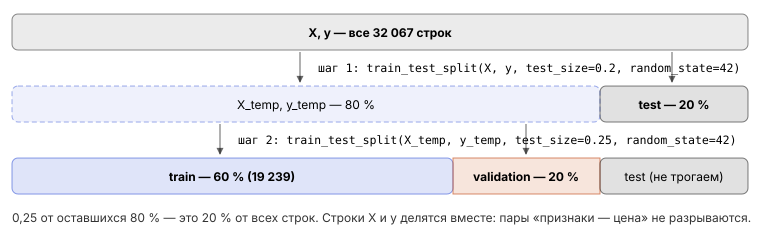

## Зачем это нужно

В уроке 5.3 мы договорились: модель учат на одной части данных, выбирают на второй, оценивают на третьей. Теперь сделаем это с автомобилями. Деление — первый шаг любого проекта машинного обучения, и именно здесь чаще всего допускают ошибку, после которой качество модели на проверке оказывается обманчиво хорошим.

## Scikit-learn

**Scikit-learn** — главная библиотека классического машинного обучения в Python: разбиение данных, подготовка признаков, десятки моделей и метрик с одинаковым интерфейсом. Пакет называется `scikit-learn`, а импортируют его как `sklearn`; обычно берут только нужные инструменты:

```python
import sklearn
from sklearn.model_selection import train_test_split
print('Версия scikit-learn:', sklearn.__version__)
```

Подключение библиотеки ещё ничего не обучает — это только доступ к инструментам.

## X и y

Признаки — таблица `X`, ответ — Series `y`; строки с одинаковой меткой индекса относятся к одной машине (урок 2.11):

```python
X = df[features]
y = df['Price']
print('X:', X.shape, '| y:', y.shape, '| индексы совпадают:', X.index.equals(y.index))
```

Форма `(32067, 4)` — 32 067 объектов и 4 признака; `(32067,)` — по ответу на объект.

## Два шага разбиения

`train_test_split` делит **вместе** несколько таблиц одинаковой длины: строки перемешиваются, но пары «признаки — цена» не разрываются. Результаты возвращаются в порядке: признаки обучения, признаки отложенной части, ответы обучения, ответы отложенной части.



```python
X_temp, X_test, y_temp, y_test = train_test_split(X, y, test_size=0.2, random_state=42)
X_train, X_valid, y_train, y_valid = train_test_split(X_temp, y_temp, test_size=0.25, random_state=42)

sizes = pd.Series({'train': len(X_train), 'valid': len(X_valid), 'test': len(X_test)})
print(sizes)
print('Доли:', (sizes / len(X)).round(3).to_dict())
print('В сумме:', sizes.sum(), '— исходных строк:', len(X))
```

- `test_size=0.2` — доля отложенной части; во втором шаге `0.25` берётся от оставшихся 80 %, то есть 20 % всех строк;
- `random_state=42` фиксирует случайное перемешивание: при повторном запуске получатся те же части. Само число 42 качество не улучшает — подойдёт любое, главное — одно и то же.

## Части не должны пересекаться

Проверим метки строк: `index.intersection` возвращает общие метки двух частей.

```python
print('train ∩ valid:', len(X_train.index.intersection(X_valid.index)))
print('train ∩ test: ', len(X_train.index.intersection(X_test.index)))
print('valid ∩ test: ', len(X_valid.index.intersection(X_test.index)))
```

Нули — значит, ни одна строка не попала в две части сразу.

## Утечка данных

**Утечка** — когда модель при обучении получает информацию, которой не будет при настоящем прогнозе. Качество на проверке выглядит лучше, чем окажется в работе. Основные виды:

| Вид утечки | Пример | Как избежать |
|---|---|---|
| ответ среди признаков | `AutoTransmission` при прогнозе коробки (урок 5.1) | признаки — только то, что известно в момент прогноза |
| пересечение частей | одна строка и в train, и в test | разбивать один раз, проверять `intersection` |
| подготовка по всем данным | средние для стандартизации или «цена как у похожих», посчитанные по всей таблице | статистики считать только по train (урок 5.7) |
| повторы объявлений | одна машина двумя объявлениями в разных частях | искать повторы до разделения (урок 2.6) |
| информация из будущего | число просмотров объявления после публикации | признаки — на момент прогноза |

Повторы — не теория: даже после удаления точных дублей в модуле 2 остались объявления с одинаковыми характеристиками и ценой — вероятно, одна машина выставлена дважды.

```python
same_car = df.duplicated(subset=['Make', 'Model', 'Year', 'Distance', 'Engine', 'Price'])
print('Объявлений-«двойников» с тем же набором характеристик и ценой:', same_car.sum())
```

Двести записей из 32 тысяч на оценку почти не влияют, но при сотнях повторов модель начала бы «узнавать» знакомые машины в тесте.

## Типичные ошибки

:::mistake Разбивать X и y по отдельности
Два независимых вызова с перемешиванием разорвут пары: машине достанется чужая цена. Передавайте X и y в один вызов `train_test_split`.
:::

:::mistake Перепутать порядок результатов
`train_test_split` возвращает: X обучения, X отложенный, y обучения, y отложенный. Перепутанные имена — частая и незаметная ошибка.
:::

:::mistake Второй шаг с тем же test_size = 0.2
0,2 от 80 % — это 16 % всех строк. Для 60/20/20 во втором шаге нужно 0,25.
:::

:::mistake Подготовка до разбиения
Стандартизация или «средняя цена модели» по всей таблице «подсказывают» модели тестовые ответы. Сначала разбиение — потом подготовка по train.
:::

## Мини-квиз

```quiz
- q: "Чему равна доля validation после `train_test_split(X, y, test_size=0.2)` и затем `train_test_split(X_temp, y_temp, test_size=0.25)`?"
  options:
    - 25 % всех строк
    - 20 % всех строк
    - 5 % всех строк
  answer: 1
  explain: 0,25 · 0,8 = 0,2.
- q: "Зачем `random_state=42`?"
  options:
    - Чтобы при повторном запуске получились те же части и результаты можно было сравнивать
    - Чтобы модель стала точнее
    - Чтобы в test попали 42 % строк
  answer: 0
  explain: Это «зерно» случайного перемешивания; конкретное число не важно.
- q: Аналитик заполнил пропуски медианами по всей таблице, а потом разделил данные. Что не так?
  options:
    - Ничего
    - Утечка — статистики подготовки посчитаны с участием тестовых строк
    - Медиану нельзя использовать для пропусков
  answer: 1
  explain: Статистики для подготовки считают только по обучающей части.
```

## Что запомнить

- `from sklearn.model_selection import train_test_split`; X и y делят одним вызовом, порядок результатов: `X_train, X_test, y_train, y_test`.
- 60/20/20 — два шага: `test_size=0.2`, затем `test_size=0.25` от остатка; `random_state` — воспроизводимость.
- Части проверяют на пересечение: `len(A.index.intersection(B.index)) == 0`.
- Утечка — информация, которой не будет при прогнозе: ответ в признаках, пересечение частей, подготовка по всем данным, повторы.
