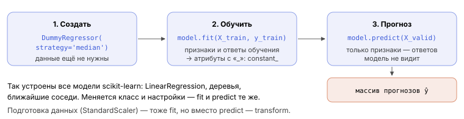

## Зачем это нужно

Допустим, модель оценивает цену с ошибкой 4 000 евро. Это хорошо или плохо? Без сравнения не понять. Поэтому сначала считают ошибку **модели-ориентира** (*baseline*) — самого простого прогноза, который не использует признаки: одно и то же число для всех машин. Настоящая модель полезна, только если её ошибка заметно меньше. Заодно на этой простейшей модели разберём, как устроены **все** модели scikit-learn.

## Как устроена модель scikit-learn

Работа с любой моделью — три шага:



```python
from sklearn.dummy import DummyRegressor

baseline = DummyRegressor(strategy='median')     # 1. создать: настройки, данные пока не нужны
print(baseline)
print('Есть ли выученная константа до обучения?', hasattr(baseline, 'constant_'))
```

`DummyRegressor` — модель-ориентир для регрессии; `strategy='median'` — предсказывать медиану ответов. Объект создан, но ещё ничего не знает о ценах.

## fit — обучение

`fit(X_train, y_train)` передаёт модели обучающие признаки и ответы. Модель-ориентир просто запоминает медиану `y_train`; другие модели подбирают коэффициенты или правила.

```python
baseline.fit(X_train, y_train)                   # 2. обучить
print('Медиана обучающих цен:', y_train.median())
print('Выучено моделью:', baseline.constant_)
```

Символ `_` на конце `constant_` — договорённость scikit-learn: так называют то, что модель **нашла при обучении**. Такие атрибуты есть у всех моделей (`coef_`, `intercept_` у линейной регрессии). До `fit` их нет.

## predict — прогнозы

В `predict` передаются **только признаки**: ответов модель не видит. Результат — массив NumPy, по одному прогнозу на строку, в том же порядке, что строки `X_valid`:

```python
baseline_pred = baseline.predict(X_valid)        # 3. прогноз
print('Прогнозов:', baseline_pred.shape)
print('Первые пять прогнозов:', baseline_pred[:5])
print('Первые пять настоящих цен:', y_valid.iloc[:5].tolist())
```

Все прогнозы одинаковые — 6 800 евро: модель не смотрит на признаки. Именно поэтому она — ориентир.

## Ошибка: руками и функцией

Ошибка для одной машины с направлением — $e_i = \hat y_i - y_i$ (плюс — завышение, минус — занижение), величина — $|e_i|$. **MAE** — средняя абсолютная ошибка (урок 3.7):

$$
\mathrm{MAE} = \frac{1}{N}\sum_{i=1}^{N} |\hat y_i - y_i|.
$$

Сначала посчитаем руками на трёх машинах, затем — функцией scikit-learn на всей валидации:

```python
from sklearn.metrics import mean_absolute_error

three_true = y_valid.iloc[:3].to_numpy()
three_pred = baseline_pred[:3]
print('Цены:', three_true, '| прогнозы:', three_pred)
print('Ошибки:', three_pred - three_true)
print('MAE руками:', np.abs(three_pred - three_true).mean())
print('MAE функцией:', mean_absolute_error(three_true, three_pred))

baseline_mae = mean_absolute_error(y_valid, baseline_pred)
print(f'MAE ориентира на валидации: {baseline_mae:.0f} евро')
```

`mean_absolute_error(настоящие, прогнозы)` — первым аргументом **известные ответы**, вторым — прогнозы; функция только считает, ничего не обучая. MAE ≈ 6 000 евро означает: **в среднем** на этих валидационных машинах ориентир ошибается на 6 000 евро. Это не обещание ошибки «не больше 6 000» для каждой машины.

Эта цифра — планка. Любая модель, которая её заметно не опускает, бесполезна.

## Типичные ошибки

:::mistake Передать в predict ответы
`predict` получает только признаки. Если передать `y_valid` или таблицу с ценой, модель «увидит» ответ (или упадёт с ошибкой формы).
:::

:::mistake Обучить на validation
`fit` вызывают только на обучающей части. Обучение на validation превращает её в train — честной проверки не останется.
:::

:::mistake Перепутать аргументы метрики
У MAE порядок не влияет на число, но у других метрик (R², MAPE) влияет. Привычка: сначала настоящие ответы, потом прогнозы.
:::

:::mistake Обойтись без ориентира
Без ориентира нельзя сказать, полезна ли модель. «MAE 4 000» значит много при ориентире 6 000 и ничего — при ориентире 4 100.
:::

## Мини-квиз

```quiz
- q: Что делает `baseline.fit(X_train, y_train)` у `DummyRegressor(strategy='median')`?
  options:
    - Запоминает медиану обучающих цен
    - Подбирает коэффициенты для каждого признака
    - Считает MAE на валидации
  answer: 0
  explain: Признаки ориентир не использует — только медиану ответов обучения.
- q: Что передают в `predict`?
  options:
    - Признаки и ответы
    - Только признаки объектов, для которых нужен прогноз
    - Только ответы
  answer: 1
  explain: Ответы — это то, что модель должна предсказать; при настоящем прогнозе их нет.
- q: "Почему у выученной константы имя `constant_` с подчёркиванием?"
  options:
    - Так в scikit-learn обозначают то, что модель нашла при обучении
    - Это скрытый служебный атрибут, трогать его нельзя
    - Это опечатка
  answer: 0
  explain: "`coef_`, `intercept_`, `constant_`, `mean_` — всё это появляется после `fit`."
```

## Что запомнить

- Модель scikit-learn: создать объект → `fit(X_train, y_train)` → `predict(X_новые)`; в `predict` — только признаки.
- Выученное при обучении — в атрибутах с `_`: `constant_`, `coef_`, `intercept_`.
- Модель-ориентир `DummyRegressor(strategy='median')` предсказывает медиану обучающих цен; её MAE — планка для любой модели.
- `mean_absolute_error(y_настоящие, прогнозы)` — средняя абсолютная ошибка на проверяемых строках.
