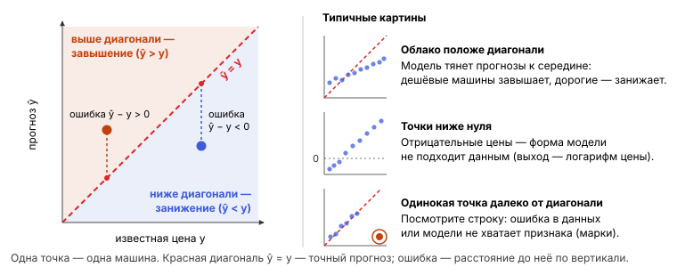

## Зачем это нужно

MAE = 4 270 евро, R² = 0,46 — это итог по шести тысячам машин. Но модель ошибается не «в среднем», а на конкретных машинах. Каких? Почему? Это нельзя прочитать из одного числа — нужно посмотреть на каждую машину. Разбор ошибок отвечает на главный практический вопрос: **что делать дальше** — искать ошибки в данных, добавлять признаки или менять вид модели. В конце урока мы сделаем одно из таких изменений и сразу получим заметно лучшую модель.

## График «известная цена — прогноз»

В уроке 5.6 у модели был один признак, и прямую можно было нарисовать поверх облака цен. У модели с четырьмя признаками такой картинки нет. Зато есть универсальный график для любой регрессии: по горизонтали — **настоящая** цена, по вертикали — **прогноз**, по точке на машину.



```python
fig, ax = plt.subplots(figsize=(7, 5))
ax.scatter(y_valid, pred, s=8, alpha=0.25)
lo = min(y_valid.min(), pred.min())
hi = max(y_valid.max(), pred.max())
ax.plot([lo, hi], [lo, hi], 'r--', label='прогноз = цена')
ax.axhline(0, color='black', linewidth=0.8)
ax.set(xlabel='Известная цена, евро', ylabel='Прогноз, евро', title='Линейная модель, 4 признака: validation')
ax.legend()
ax.grid(alpha=0.3)
plt.show()
```

Диагональ проводим от общего минимума до общего максимума — так она одинакова на обеих осях. Что видно:

- облако **положе** диагонали: прогнозы не поднимаются выше ≈ 37 000 евро, хотя цены доходят до 151 000. Модель «тянет» прогнозы к середине: дешёвые машины завышает, дорогие сильно занижает;
- часть точек **ниже нуля** — 506 отрицательных прогнозов, как и у модели по году;
- несколько точек справа внизу очень далеко от диагонали — посмотрим на них.

## Самые большие промахи

`train_test_split` сохраняет метки строк (урок 5.4), поэтому по `X_valid.index` можно достать из `df` марку и модель машины:

```python
res = df.loc[X_valid.index, ['Make', 'Model', 'Year', 'Distance', 'Engine', 'Price']].copy()
res['pred'] = pred.round()
res['error'] = res['pred'] - res['Price']
res['abs_error'] = res['error'].abs()
res.sort_values('abs_error', ascending=False).head(8)
```

Промахи на 80–125 тысяч евро — двух видов:

- **модели не хватает признака**: Mercedes G Class 2021 года за 151 450 евро, Mercedes GLE Coupe и два Porsche Cayenne (в данных — марка `Rare`, урок 2.10) по 105–108 тысяч. Модель видит «новая, 3 литра, маленький пробег» и не знает, что это за машина: марки и модели среди признаков нет;
- **подозрительные данные**: BMW 5 Series 2001 года с пробегом 404 500 км за 100 000 евро, Honda CR-V 2013 и Volkswagen Passat 2015 — тоже ровно по 100 000, машина 2009 года с моделью `Altele` («другое») — за 120 000. Скорее всего, это опечатки (лишний ноль) или объявления-«заглушки». Модель тут права, ошибается таблица.

Разбор ошибок — заодно и проверка качества данных. Такие строки возвращают на этап очистки (модуль 2): исправить, если ошибку можно доказать, или исключить из обучения — правило записывают в журнал обработки.

Удобно искать такие точки на **интерактивном** графике (урок 4.10): наведите курсор — и увидите машину.

```python
import plotly.express as px

fig = px.scatter(res, x='Price', y='pred', opacity=0.35, hover_data=['Make', 'Model', 'Year', 'Distance'],
                 labels={'Price': 'Известная цена, евро', 'pred': 'Прогноз, евро'},
                 title='Наведите на точку: какая это машина?')
top = res['Price'].max()
fig.add_shape(type='line', x0=0, y0=0, x1=top, y1=top, line=dict(color='red', dash='dash'))
fig.show()
```

## Ошибки по группам

Отдельные промахи — это истории; систематическая ошибка видна по группам. Разобьём машины на ценовые группы через `pd.cut` (урок 2.9: границы, правая включается) и сравним **среднюю ошибку со знаком** — она показывает перекос — и MAE:

```python
res['price_group'] = pd.cut(res['Price'], bins=[0, 3000, 7000, 15000, 30000, np.inf],
                            labels=['до 3k', '3–7k', '7–15k', '15–30k', '30k+'])
print(res.groupby('price_group', observed=True).agg(n=('error', 'size'), mean_error=('error', 'mean'),
                                                     mae=('abs_error', 'mean')).round(0))
expensive = res['Price'] > 30000
sq = res['error'] ** 2
print(f'\nМашин дороже 30 000: {expensive.mean():.1%}; их доля в сумме квадратов ошибок: {sq[expensive].sum() / sq.sum():.0%}')
top_makes = res['Make'].value_counts().head(8).index
print(res[res['Make'].isin(top_makes)].groupby('Make')['error'].mean().round(0).sort_values())
```

- дешевле 15 000 евро модель в среднем **завышает** (+550…+2 270), дороже 30 000 — занижает в среднем почти на 25 000;
- машины дороже 30 000 — всего 3,9 % выборки, но дают **63 %** суммы квадратов ошибок. Вот почему RMSE так сильно больше MAE (урок 5.8);
- по маркам: Audi, BMW, Mercedes модель занижает в среднем на 2 400–2 900 евро, Renault и Toyota — завышает. Модель не знает марку — кандидат в признаки (категориальные признаки — модуль 7).

## Модель для логарифма цены

Цены положительны и имеют длинный хвост: много дешёвых машин и немного очень дорогих. При этом цена меняется скорее **во сколько-то раз**, чем на столько-то евро: год возраста отнимает примерно одинаковую *долю* цены и у дешёвой машины, и у дорогой. Такую зависимость прямая для самой цены описывает плохо, а прямая для **логарифма** цены — хорошо (логарифмическая шкала — урок 4.5):

$$
\ln \hat y = w_0 + w_1 x_1 + \dots + w_k x_k \quad\Longrightarrow\quad \hat y = e^{w_0} \cdot e^{w_1 x_1} \cdots e^{w_k x_k}.
$$

Каждый признак теперь **умножает** цену, а не прибавляет к ней. Прогноз $e^{(\dots)}$ всегда положителен — отрицательных цен не бывает. Учим ту же `LinearRegression`, только на $\ln y$, и возвращаем прогноз в евро через `np.exp`:

```python
log_model = LinearRegression().fit(X_train_s, np.log(y_train))     # учим на логарифме цены
pred_log = np.exp(log_model.predict(X_valid_s))                     # обратно в евро
print('Асимметрия цены:', round(y_train.skew(), 1), '| логарифма цены:', round(np.log(y_train).skew(), 1))
print('Отрицательных прогнозов:', (pred < 0).sum(), '→', (pred_log < 0).sum())
print('Год +1σ: прогноз ×', round(np.exp(log_model.coef_[0]), 2))
table = pd.DataFrame({name: {'MAE': mean_absolute_error(y_valid, p), 'RMSE': root_mean_squared_error(y_valid, p),
                             'R²': r2_score(y_valid, p), 'MAPE, %': 100 * mean_absolute_percentage_error(y_valid, p)}
                      for name, p in {'цена': pred, 'логарифм цены': pred_log}.items()}).T
table.round(2)
```

Те же четыре признака, та же линейная модель — а MAE упала с 4 270 до 3 190 евро, MAPE — с 92 до 41 %, R² вырос с 0,46 до 0,56, отрицательных цен больше нет. Модель обогнала и «медиану года» (MAE ≈ 4 040) из урока 5.8. Коэффициенты читаются в процентах: +1 стандартное отклонение года умножает прогноз в ≈ 1,82 раза.

Важно: метрики считаем **в евро**, после `np.exp`. MAE в логарифмах (≈ 0,36) с MAE в евро сравнивать нельзя — это разные единицы.

Чудес нет: дорогие машины по-прежнему сильно занижены — марки модель так и не знает, а для машин за 15–30 тысяч ошибка даже выросла. Логарифм исправил **форму** зависимости; недостающие признаки он не заменит.

## Типичные ошибки

:::mistake Забыть np.exp
Модель на логарифме предсказывает числа около 8–10. Без `np.exp` «прогноз цены» — 9 евро, и MAE получается почти равной средней цене.
:::

:::mistake Сравнивать метрики в разных единицах
MAE по логарифмам и MAE в евро несравнимы. Сначала вернуть прогноз в евро, потом считать метрики — для всех моделей одинаково.
:::

:::mistake Перепутать оси
По X — настоящая цена, по Y — прогноз; тогда «выше диагонали» = завышение. Если поменять оси местами, смысл сторон меняется на противоположный.
:::

:::mistake Винить во всех промахах модель
Самые большие ошибки часто указывают на ошибки в данных. Прежде чем усложнять модель, посмотрите на строки.
:::

:::mistake Логарифм нуля
`np.log(0)` = −∞. Логарифм берут только от положительных значений; если в данных есть нули, используют `np.log1p` (ln(1 + y)) и обратное `np.expm1`.
:::

## Мини-квиз

```quiz
- q: На графике «известная цена — прогноз» точка лежит намного выше диагонали. Что это значит?
  options:
    - Модель сильно завысила цену этой машины
    - Модель сильно занизила цену
    - Машина очень дорогая
  answer: 0
  explain: По вертикали — прогноз; выше диагонали прогноз больше настоящей цены.
- q: Облако точек на графике заметно положе диагонали. О чём это говорит?
  options:
    - Модель тянет прогнозы к середине — дешёвые завышает, дорогие занижает
    - Модель переобучилась
    - Ошибок нет
  answer: 0
  explain: Слева облако выше диагонали (завышение), справа — ниже (занижение).
- q: "Модель обучили на `np.log(y_train)`. Как правильно посчитать MAE?"
  options:
    - "`mean_absolute_error(y_valid, np.exp(model.predict(X_valid_s)))`"
    - "`mean_absolute_error(np.log(y_valid), model.predict(X_valid_s))` — и сравнить с MAE в евро"
    - "`mean_absolute_error(y_valid, model.predict(X_valid_s))`"
  answer: 0
  explain: Прогноз возвращают в евро через np.exp; метрики всех моделей считают в одних единицах.
```

## Что запомнить

- График «известная цена — прогноз»: по X — настоящее значение, по Y — прогноз, диагональ — точный прогноз; выше — завышение, ниже — занижение.
- Самые большие ошибки смотрят построчно: они показывают либо ошибки в данных, либо недостающие признаки.
- Систематический перекос ищут по группам — средняя ошибка **со знаком** (`groupby` по ценовым группам, маркам).
- Если y положителен и с длинным хвостом, модель учат на `np.log(y)`, а прогноз возвращают `np.exp`: зависимость становится мультипликативной, отрицательных прогнозов нет.
- Метрики всегда считают в исходных единицах — после `np.exp`.
