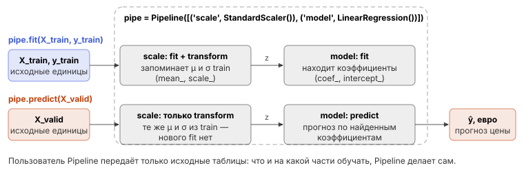

## Зачем это нужно

В уроке 5.7 модель по четырём признакам требовала пяти шагов в правильном порядке: обучить scaler на train, преобразовать train, обучить модель, преобразовать validation **тем же** scaler, сделать прогноз. Ошибиться легко: забыть `transform` для новых строк, обучить scaler не на той части, передать модели не тот массив. А в модуле 6 моделей станет много, и для каждой эту цепочку пришлось бы повторять.

**Pipeline** (конвейер) хранит шаги подготовки и модель как один объект. Снаружи он выглядит как обычная модель: `fit` и `predict` — и всё.

## Создаём Pipeline

`Pipeline` получает **список пар** «имя шага, объект». Имена придумываем сами — по ним потом можно обратиться к шагу. Последний шаг — модель, все предыдущие — преобразования.

```python
from sklearn.pipeline import Pipeline

pipe = Pipeline([
    ('scale', StandardScaler()),
    ('model', LinearRegression()),
])
print(pipe)
print('Обучен ли scaler:', hasattr(pipe.named_steps['scale'], 'mean_'))
```

Создание ничего не обучает: у scaler ещё нет средних, у модели — коэффициентов.

## fit и predict



Передаём **исходные** таблицы — масштабирование Pipeline сделает сам:

```python
pipe.fit(X_train, y_train)               # scale: fit + transform, model: fit
pred = pipe.predict(X_valid)             # scale: transform, model: predict
print(f'MAE Pipeline: {mean_absolute_error(y_valid, pred):.1f}')

scaler = StandardScaler().fit(X_train)   # тот же путь вручную, урок 5.7
manual = LinearRegression().fit(scaler.transform(X_train), y_train).predict(scaler.transform(X_valid))
print('Прогнозы совпадают:', np.allclose(pred, manual))
```

MAE та же — 4 269,9 евро: Pipeline не меняет модель, он только избавляет от ручных шагов. Внутри `fit` scaler учится на `X_train` и только на нём; внутри `predict` он лишь применяет запомненные μ и σ. Сделать `fit` на validation по ошибке теперь просто негде.

## Что внутри обученного Pipeline

К шагам обращаются по имени через `named_steps` (или короче — `pipe['scale']`):

```python
scale = pipe.named_steps['scale']
model = pipe.named_steps['model']
print('Средние признаков, запомненные scaler:', scale.mean_.round(1))
print('Средние X_train:                     ', X_train.mean().to_numpy().round(1))
print(pd.Series(model.coef_, index=features).round(0))
print('Свободный член:', round(model.intercept_, 1), '| средняя цена train:', round(y_train.mean(), 1))
```

- `mean_` scaler совпадает со средними `X_train` — подготовка училась на обучающей части;
- коэффициенты — на одно стандартное отклонение признака (урок 5.7): год и объём двигателя повышают прогноз сильнее всего, пробег понижает;
- свободный член равен средней цене train: у стандартизированных признаков среднее 0, и «машина со средними признаками» получает среднюю цену.

## Прогноз для новой машины

Новая строка — таблица с теми же колонками в том же порядке. Масштабировать её вручную не нужно:

```python
new_car = pd.DataFrame({'Year': [2015], 'Distance': [120000.0], 'Engine': [1600.0], 'km_year': [120000 / 7]})
print(f'Оценка цены: {pipe.predict(new_car)[0]:.0f} евро')
```

## Короткая запись: make_pipeline

`make_pipeline` создаёт тот же Pipeline без имён — они получаются из названий классов строчными буквами:

```python
from sklearn.pipeline import make_pipeline

short = make_pipeline(StandardScaler(), LinearRegression())
print(list(short.named_steps))
```

Имена `'standardscaler'` и `'linearregression'` длиннее, но придумывать их не надо. В этом модуле используем `Pipeline` с короткими именами `'scale'` и `'model'` — так проще обращаться к шагам.

## Зачем ещё нужен Pipeline

Главная польза проявится в уроке 6.8: при кросс-валидации модель учится много раз на разных частях данных, и подготовка должна каждый раз учиться заново — только на своей обучающей части. Pipeline делает это автоматически. Подготовку, сделанную до кросс-валидации, «заново» не обучишь — это утечка.

## Типичные ошибки

:::mistake Обучить на масштабированных, предсказать на исходных
Если передать в Pipeline уже преобразованный `X_train_s`, а прогноз попросить для исходного `X_valid`, шаги получат данные в разных единицах. Ошибка не падает с исключением — только предупреждение `X has feature names, but StandardScaler was fitted without feature names` и MAE в сотни миллионов евро. Pipeline получает **исходные** таблицы и для `fit`, и для `predict`.
:::

:::mistake Масштабировать до Pipeline
Масштабировать вручную и ещё раз внутри Pipeline бессмысленно: второй scaler получает уже стандартизированные данные. Хуже другое — ручная подготовка снова требует помнить, на какой части её обучать. Вся подготовка — внутри Pipeline.
:::

:::mistake Модель не последним шагом
Шаги выполняются сверху вниз; модель, которая делает прогноз, должна стоять последней. `Pipeline([('model', LinearRegression()), ('scale', StandardScaler())])` не обучится.
:::

:::mistake Ждать обучения от создания
`Pipeline([...])` только описывает шаги. Пока не вызван `fit`, у шагов нет ни средних, ни коэффициентов.
:::

## Мини-квиз

```quiz
- q: "Что делает шаг `'scale'` при вызове `pipe.predict(X_valid)`?"
  options:
    - Применяет средние и отклонения, запомненные на train (только transform)
    - Заново учится на X_valid и преобразует его
    - Ничего — масштабирование нужно сделать вручную
  answer: 0
  explain: При predict подготовка только применяется; учится она один раз — внутри fit на обучающей части.
- q: "Как получить коэффициенты модели из обученного `pipe` с шагами `'scale'` и `'model'`?"
  options:
    - "`pipe.named_steps['model'].coef_`"
    - "`pipe.coef_`"
    - "`pipe.named_steps['scale'].coef_`"
  answer: 0
  explain: Коэффициенты есть у модели — последнего шага; к шагу обращаются по его имени.
- q: Прогнозы Pipeline и ручной последовательности «scaler → модель» совпали. Что это значит?
  options:
    - Pipeline делает те же шаги, только сам и в правильном порядке
    - Pipeline — это другая, более точная модель
    - В Pipeline масштабирование не выполнялось
  answer: 0
  explain: Pipeline — не новая модель, а способ надёжно соединить подготовку и модель.
```

## Что запомнить

- `Pipeline([('scale', StandardScaler()), ('model', LinearRegression())])` — шаги по порядку, модель последней; имена шагов выбираем сами.
- `fit` и `predict` получают **исходные** таблицы: подготовка учится только внутри `fit` на обучающей части, при `predict` лишь применяется.
- Шаги — `pipe.named_steps['имя']` или `pipe['имя']`; `make_pipeline` даёт имена из названий классов.
- Pipeline не меняет модель, но избавляет от ручных шагов и утечки — особенно в кросс-валидации (урок 6.8).
