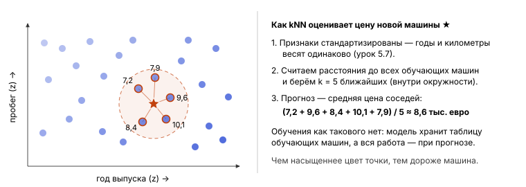

## Зачем это нужно

В разминке простая таблица «медиана цены машин того же года и объёма двигателя» оказалась почти вдвое точнее линейной регрессии. Но она требует **точного** совпадения: для машины с редким объёмом 2 300 см³ подходящей группы может не найтись, а пробег таблица не учитывает вовсе. **Метод k ближайших соседей** (kNN, k nearest neighbors) развивает ту же идею: для новой машины ищем k **самых похожих** обучающих машин — близких по всем признакам сразу — и берём среднюю цену.

## Идея kNN



1. Каждая машина — точка в пространстве признаков (год, пробег, объём, пробег в год).
2. Для новой машины считаем расстояние до **каждой** обучающей машины.
3. Берём k ближайших — соседей.
4. Прогноз — средняя цена соседей.

Обучения в привычном смысле нет: `fit` просто запоминает таблицу (и строит структуру для быстрого поиска). Вся работа — при прогнозе. Число соседей k задаёт человек; в этом уроке k = 10, выбирать его будем в уроке 6.3.

## Расстояние между машинами

Близость измеряют **евклидовым расстоянием** — как длину отрезка между точками, только по всем признакам:

$$
d(a, b) = \sqrt{\sum_{j=1}^{m} (a_j - b_j)^2}.
$$

Посчитаем для двух обучающих машин — сначала в исходных единицах, потом после стандартизации:

```python
scaler = StandardScaler().fit(X_train)
a, b = X_train.iloc[0].to_numpy(), X_train.iloc[1].to_numpy()
print(X_train.iloc[:2])
sq = (a - b) ** 2
print('Расстояние в исходных единицах:', round(np.sqrt(sq.sum()), 1))
print('Вклад признаков, %:', dict(zip(features, (100 * sq / sq.sum()).round(1))))
za, zb = scaler.transform(X_train.iloc[:2])
sqz = (za - zb) ** 2
print('Расстояние после стандартизации:', round(np.sqrt(sqz.sum()), 3))
print('Вклад признаков, %:', dict(zip(features, (100 * sqz / sqz.sum()).round(1))))
```

Машины отличаются на 6 лет и на 800 см³ объёма, но в исходных единицах расстояние почти целиком (99,7 %) складывается из километров — пробега и пробега в год: разница в 12 500 км весит куда больше, чем разница в 6 лет. После стандартизации каждый признак измеряется в своих стандартных отклонениях, и разница в годе и объёме двигателя снова заметна.

## KNeighborsRegressor в Pipeline

Стандартизация для kNN обязательна, поэтому сразу собираем Pipeline (урок 6.1):

```python
from sklearn.neighbors import KNeighborsRegressor

knn = Pipeline([
    ('scale', StandardScaler()),
    ('model', KNeighborsRegressor(n_neighbors=10)),
])
knn.fit(X_train, y_train)
knn_pred = knn.predict(X_valid)
print(f'kNN, 10 соседей: MAE = {mean_absolute_error(y_valid, knn_pred):.1f} евро')
```

MAE ≈ 2 706 евро — в полтора раза лучше линейной регрессии (4 270) и почти как медиана групп «год + объём» (2 699). Но kNN не требует точного совпадения и учитывает все четыре признака.

## Соседи одной машины

Метод `kneighbors` модели возвращает расстояния до соседей и их **позиции** в обучающей таблице. Признаки новой машины сначала нужно преобразовать тем же scaler из Pipeline:

```python
one_car = X_valid.iloc[[1]]
one_scaled = knn.named_steps['scale'].transform(one_car)
distances, positions = knn.named_steps['model'].kneighbors(one_scaled)
neighbors = X_train.iloc[positions[0]].assign(Price=y_train.iloc[positions[0]].to_numpy(),
                                                distance=distances[0].round(3))
print(one_car)
print(neighbors)
print('Средняя цена соседей:', round(neighbors['Price'].mean(), 1), '| прогноз:', round(knn.predict(one_car)[0], 1),
      '| настоящая цена:', y_valid.iloc[1])
```

Соседи — машины 2006 года (одна — 2007) с пробегом 306–333 тысячи км, почти все с двигателем 2 000 см³. Прогноз — ровно среднее их цен, 6 165 евро; настоящая цена — 8 000. Цены соседей разбросаны от 2 600 до 8 600 евро: у похожих по четырём признакам машин могут быть разные марки и состояние — этих признаков у модели нет.

`positions` — номера строк **по порядку** в `X_train`, а не метки индекса, поэтому для них нужен `iloc`, а не `loc` (урок 2.4).

## Без стандартизации

```python
raw_knn = KNeighborsRegressor(n_neighbors=10).fit(X_train, y_train)
print(f'kNN без scaler: MAE = {mean_absolute_error(y_valid, raw_knn.predict(X_valid)):.1f} евро')
d, pos = raw_knn.kneighbors(X_valid.iloc[[0]])
print(X_valid.iloc[[0]])
print(X_train.iloc[pos[0]])
```

MAE вырастает до 3 611 евро. Соседи первой машины validation без стандартизации подобраны почти только по пробегу (около 420 000 км), а годы у них — от 1997 до 2003, объём двигателя — от 200 до 3 000 см³. Такие «соседи» совсем не похожи на машину.

## Типичные ошибки

:::mistake kNN без стандартизации
Признаки в километрах захватывают расстояние, год и объём двигателя почти не влияют. Перед kNN — `StandardScaler`, лучше внутри Pipeline.
:::

:::mistake loc для позиций соседей
`kneighbors` возвращает номера строк по порядку (0, 1, 2, …), а не метки индекса `X_train`. `X_train.loc[positions[0]]` выберет совсем другие машины или упадёт с ошибкой — нужен `iloc`.
:::

:::mistake Ждать прогноза вне диапазона данных
Прогноз kNN — среднее цен обучающих машин, поэтому он никогда не выходит за пределы обучающих цен. Для машины «новее всех в данных» модель вернёт цену самых новых машин из train, а не продолжит тенденцию.
:::

:::mistake «Обучение» kNN бесплатно
`fit` почти мгновенный, но каждый прогноз требует поиска среди всех обучающих машин, а сама модель хранит всю таблицу. На миллионах строк kNN становится медленным.
:::

## Мини-квиз

```quiz
- q: Как kNN с k = 10 оценивает цену новой машины?
  options:
    - Средняя цена 10 ближайших по признакам обучающих машин
    - Средняя цена 10 случайных машин
    - Цена ближайшей машины, умноженная на 10
  answer: 0
  explain: Соседи — ближайшие точки в пространстве признаков; прогноз — среднее их ответов.
- q: Почему перед kNN признаки стандартизируют?
  options:
    - Иначе расстояние почти целиком определяют признаки с большими числами (километры)
    - Иначе kNN не запустится
    - Чтобы цены стали положительными
  answer: 0
  explain: Евклидово расстояние складывает квадраты разностей; разница в километрах на порядки больше разницы в годах.
- q: "Что возвращает `kneighbors`?"
  options:
    - Расстояния до соседей и их позиции в обучающей таблице
    - Цены соседей
    - Метки индекса соседей
  answer: 0
  explain: Позиции используют с iloc; цены соседей достают из y_train по тем же позициям.
```

## Что запомнить

- kNN: для новой машины находим k ближайших обучающих машин и усредняем их цены; `fit` только запоминает таблицу.
- Расстояние — евклидово: √Σ(aⱼ − bⱼ)²; без стандартизации его захватывают признаки с большими числами.
- `Pipeline([('scale', StandardScaler()), ('model', KNeighborsRegressor(n_neighbors=10))])`: MAE ≈ 2 706 против 4 270 у линейной модели.
- `kneighbors` даёт расстояния и **позиции** соседей — для них `iloc`.
