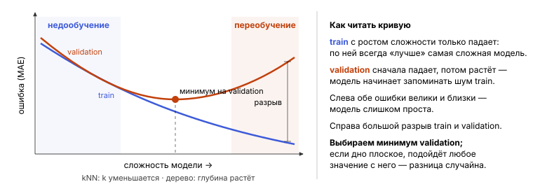

## Зачем это нужно

В уроке 6.2 мы взяли 10 соседей — просто так. Почему не 1, не 3, не 100? От k сильно зависит качество, а «правильного» k заранее никто не знает. Его нужно **выбрать по данным** — но так, чтобы итоговая оценка осталась честной.

## Параметры и гиперпараметры

| Модель | Параметры — находит `fit` | Гиперпараметры — задаёт человек до `fit` |
|---|---|---|
| линейная регрессия | коэффициенты `coef_`, свободный член `intercept_` | почти нет |
| kNN | — (хранит обучающую таблицу) | число соседей `n_neighbors`, способ усреднения `weights` |
| дерево решений (урок 6.4) | вопросы и пороги, значения в листьях | глубина `max_depth`, размер листа `min_samples_leaf` |
| случайный лес (урок 6.6) | деревья | число деревьев `n_estimators`, их глубина |

**Гиперпараметр** — настройка модели, которую `fit` не меняет. Перебрать варианты и сравнить их можно; главное — понимать, **по какой части данных** сравнивать.

## Два края: k = 1 и k = 2 000

```python
def knn_mae(k):
    model = Pipeline([('scale', StandardScaler()), ('model', KNeighborsRegressor(n_neighbors=k))])
    model.fit(X_train, y_train)
    return (mean_absolute_error(y_train, model.predict(X_train)),
            mean_absolute_error(y_valid, model.predict(X_valid)))

for k in [1, 2000]:
    tr, va = knn_mae(k)
    print(f'k = {k:>4}: MAE train = {tr:6.0f}, validation = {va:6.0f}')
```

- **k = 1** почти идеально «предсказывает» обучающие машины: ближайшая к машине из train — она сама. MAE на train всего 396 евро. Не ноль — потому что у многих обучающих машин есть двойники с теми же признаками, но другой ценой; точно «угадана» цена 87 % машин. А на validation — 3 292: модель запомнила шум, это **переобучение**.
- **k = 2 000** усредняет цены двух тысяч машин — почти всех похожих и непохожих сразу. Обе ошибки большие и близкие (3 364 и 3 401): модель слишком грубая, это **недообучение**.

## Кривая ошибки



Для kNN «сложность» растёт, когда k **уменьшается**: модель всё точнее подстраивается под отдельные машины. Построим ошибки для ряда значений k:

```python
ks = [1, 2, 3, 5, 10, 20, 30, 50, 100, 200, 500]
curve = pd.DataFrame([knn_mae(k) for k in ks], index=ks, columns=['train', 'valid'])
print(curve.round(0))

fig, ax = plt.subplots(figsize=(8, 4))
ax.plot(curve.index, curve['train'], 'o-', label='train')
ax.plot(curve.index, curve['valid'], 'o-', label='validation')
ax.set_xscale('log')
ax.set(xlabel='Число соседей k (логарифмическая шкала)', ylabel='MAE, евро', title='Кривая ошибки kNN')
ax.legend()
ax.grid(alpha=0.3)
plt.show()
print('Лучшее k по validation:', curve['valid'].idxmin())
```

Логарифмическая шкала по X (урок 4.5) нужна, чтобы и 1, и 500 поместились на график. Ошибка на validation минимальна при k = 20 (2 692 евро), но от k = 10 до k = 50 она меняется меньше чем на 25 евро — дно кривой **плоское**. Различия в 10–20 евро здесь случайны: другая validation выбрала бы соседнее значение. Важно попасть на дно, а не найти «единственно верное» k.

## По какой части выбирать

- **По train нельзя:** ошибка на train всегда лучше у самой сложной модели — она укажет на k = 1, самое переобученное.
- **По validation — да:** для этого её и отложили (урок 5.3).
- **По test нельзя:** если выбрать k по test, test перестанет быть «новыми данными» — его ошибка станет оптимистичной оценкой. Test открывают один раз, когда выбор уже сделан (урок 6.7).

## Типичные ошибки

:::mistake Выбирать гиперпараметр по train
Ошибка на train всегда «советует» самую сложную модель: k = 1, неограниченное дерево. По train видно только, насколько модель запомнила данные.
:::

:::mistake Подбирать по test
Подбор по test превращает его в ещё одну validation; итоговая оценка получается лучше, чем будет на новых данных. Для подбора — validation или кросс-валидация (урок 6.8).
:::

:::mistake Верить различиям в несколько евро
2 692 против 2 702 — не повод утверждать, что k = 20 лучше k = 15. Такие различия меняются от разбиения к разбиению.
:::

:::mistake Путать параметр и гиперпараметр
`coef_` модель находит сама — его не подбирают перебором. `n_neighbors` модель не меняет — его выбирает человек.
:::

## Мини-квиз

```quiz
- q: Что из этого — гиперпараметр?
  options:
    - Число соседей n_neighbors
    - Коэффициенты coef_ линейной регрессии
    - Средние mean_ у StandardScaler
  answer: 0
  explain: coef_ и mean_ находит fit; число соседей задаёт человек до обучения.
- q: "kNN с k = 1: MAE на train 396, на validation 3 292. Что это?"
  options:
    - Переобучение — модель запомнила обучающие машины
    - Недообучение — модель слишком простая
    - Утечка данных
  answer: 0
  explain: Маленькая ошибка на train и большая на новых данных — признак переобучения.
- q: Как выбрать k?
  options:
    - Перебрать значения и взять минимум ошибки на validation
    - Взять минимум ошибки на train
    - Взять минимум ошибки на test
  answer: 0
  explain: Train подсказывает самую сложную модель, test нужен для итоговой проверки.
```

## Что запомнить

- Параметры находит `fit`, гиперпараметры (`n_neighbors`, `max_depth`, `n_estimators`) задаёт человек.
- Кривая ошибки: train падает с ростом сложности, validation — сначала падает, потом растёт; слева недообучение, справа переобучение.
- Гиперпараметр выбирают по минимуму ошибки на validation; на плоском дне различия случайны.
- Test в подборе не участвует — он для одной итоговой проверки выбранной модели.
