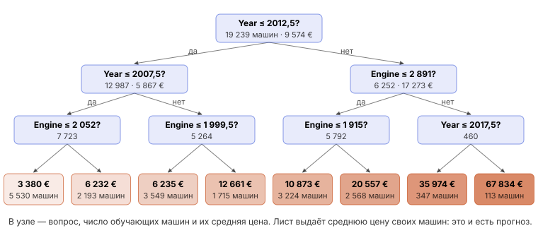

## Зачем это нужно

kNN точен, но ничего не объясняет: «цена как у десяти похожих машин» — и всё. Оценщик в автосалоне рассуждает иначе: «машина новее 2012 года? двигатель больше трёх литров?» — и по ответам называет цену. **Дерево решений** строит такие правила автоматически по обучающим данным. Его правила можно прочитать, признаки не нужно масштабировать, а ансамбли деревьев (случайный лес в уроке 6.6, бустинг в модуле 7) — одни из самых точных моделей для таблиц.

## Как дерево делает прогноз



Машина начинает путь в **корне** и на каждом **узле** отвечает на вопрос: «да» — налево, «нет» — направо. Путь заканчивается в **листе**, а прогноз — средняя цена обучающих машин, попавших в этот лист.

Например, машина 2001 года с двигателем 1 900 см³: «Year ≤ 2012,5?» — да; «Year ≤ 2007,5?» — да; «Engine ≤ 2 052?» — да → лист «3 380 €». У дерева глубины 3 всего 8 листьев, поэтому оно выдаёт только 8 разных цен: прогноз — **ступенчатая** функция признаков.

## Обучаем дерево

Глубина `max_depth` — гиперпараметр (урок 6.3): сколько вопросов подряд может задать дерево. Начнём с 3 — такое дерево можно прочитать целиком. `export_text` печатает его правила:

```python
from sklearn.tree import DecisionTreeRegressor, export_text

tree = DecisionTreeRegressor(max_depth=3, random_state=42)
tree.fit(X_train, y_train)
tree_pred = tree.predict(X_valid)
print(f'Дерево глубины 3: MAE train = {mean_absolute_error(y_train, tree.predict(X_train)):.0f}, '
      f'validation = {mean_absolute_error(y_valid, tree_pred):.0f}')
print('Листьев:', tree.get_n_leaves(), '| разных прогнозов на validation:', len(np.unique(tree_pred)))
print(export_text(tree, feature_names=features, decimals=1))
```

MAE ≈ 3 467 — лучше линейной модели (4 270), хотя дерево задало всего три вопроса. Ошибки на train и validation почти равны: восемь листьев — слишком грубая модель, чтобы переобучиться. `random_state` фиксирует выбор между одинаково хорошими разбиениями, чтобы дерево получалось одинаковым при каждом запуске.

То же дерево можно нарисовать — `plot_tree` показывает в каждом узле вопрос, число обучающих машин (`samples`) и их среднюю цену (`value`):

```python
from sklearn.tree import plot_tree

fig, ax = plt.subplots(figsize=(14, 6))
plot_tree(tree, feature_names=features, impurity=False, filled=True, rounded=True, fontsize=9, ax=ax)
ax.set_title('Дерево глубины 3: обучающая часть')
plt.show()
```

## Как дерево выбирает вопрос

Хороший вопрос делит машины на две группы, внутри которых цены **похожи**. Насколько похожи — измеряем знакомой суммой квадратов (урок 5.2): от средней цены своей группы. Для порога t по признаку x:

$$
\mathrm{SSE}(t) = \sum_{i:\,x_i \le t} (y_i - \bar y_{\text{лев}})^2 + \sum_{i:\,x_i > t} (y_i - \bar y_{\text{прав}})^2.
$$

Чем меньше SSE, тем лучше вопрос: в каждой группе дерево будет предсказывать её среднее. Проверим несколько порогов по году — какая доля исходного разброса цен остаётся после разбиения:

```python
yt = y_train.to_numpy()
total = ((yt - yt.mean()) ** 2).sum()                    # разброс до разбиения
year = X_train['Year'].to_numpy()
for t in [2005.5, 2010.5, 2012.5, 2014.5, 2016.5]:
    left, right = yt[year <= t], yt[year > t]
    sse = ((left - left.mean()) ** 2).sum() + ((right - right.mean()) ** 2).sum()
    print(f'Year ≤ {t}: {len(left):5} и {len(right):5} машин, средние {left.mean():6.0f} и {right.mean():6.0f}, '
          f'остаётся {sse / total:.1%} разброса')
```

Порог 2012,5 оставляет 74,9 % разброса — меньше всех: это и есть корень дерева. Алгоритм перебирает **все** признаки и **все** пороги между соседними значениями, лучшие варианты по каждому признаку: год — 74,9 %, объём двигателя — 88,7 %, пробег — 91,5 %, пробег в год — 97,8 %. Год выигрывает. Затем та же процедура повторяется отдельно внутри каждой из двух групп — и так до заданной глубины.

Алгоритм **жадный**: на каждом шаге берёт лучший вопрос «прямо сейчас» и не пересматривает его, даже если другой первый вопрос дал бы в итоге лучшее дерево.

## Деревья для классов: энтропия

Когда ответ — класс (например, коробка передач), среднее не подходит: лист выдаёт **самый частый** класс, а качество группы меряют её «чистотой». Энтропия группы с долями классов pₖ:

$$
H = -\sum_k p_k \log_2 p_k,
$$

0 — все объекты одного класса, 1 — два класса поровну. Хороший вопрос сильнее всего уменьшает энтропию (это называют **приростом информации**; так работает алгоритм ID3 из лекции). scikit-learn по умолчанию использует похожую меру — индекс Джини. Для регрессии — сумму квадратов, как выше.

## Масштаб не нужен

Вопрос «Distance ≤ 111 084?» сравнивает значения **одного** признака, поэтому единицы измерения не важны: дерево на стандартизированных признаках получит те же разбиения (с пересчитанными порогами) и те же прогнозы. Pipeline со scaler для дерева не нужен.

## Типичные ошибки

:::mistake value в узле — число машин
В `plot_tree` для регрессии `value` — средняя цена машин узла, а их число — `samples`.
:::

:::mistake Ждать плавного прогноза
Дерево выдаёт столько разных цен, сколько у него листьев. Две машины в одном листе получат одинаковую оценку, даже если одна заметно новее.
:::

:::mistake Корень — «главная причина цены»
Первый вопрос лучше всего разделяет **эти** обучающие данные. Это описание модели, а не доказательство причины, и с другими данными корень может смениться.
:::

:::mistake Ждать прогноза вне обучающих цен
Лист выдаёт среднее обучающих цен, поэтому дерево, как и kNN, не предскажет цену выше самой высокой средней в листьях.
:::

## Мини-квиз

```quiz
- q: Что выдаёт лист дерева регрессии?
  options:
    - Среднюю цену обучающих машин, попавших в этот лист
    - Цену ближайшей обучающей машины
    - Сумму квадратов ошибок
  answer: 0
  explain: Поэтому прогноз дерева ступенчатый — по одному значению на лист.
- q: Как дерево выбирает вопрос в узле?
  options:
    - Перебирает признаки и пороги и берёт разбиение с наименьшей суммой квадратов отклонений в двух частях
    - Берёт признак с самыми большими числами
    - Делит машины пополам по числу
  answer: 0
  explain: Это наибольшее уменьшение разброса ответов внутри групп; для классов — энтропии или индекса Джини.
- q: Нужен ли StandardScaler перед деревом?
  options:
    - Нет — каждый вопрос сравнивает значения одного признака, масштаб не влияет
    - Да, иначе пробег захватит все вопросы
    - Да, иначе дерево не обучится
  answer: 0
  explain: В отличие от kNN, дерево не складывает признаки в расстояние.
```

## Что запомнить

- Дерево решений: вопросы «признак ≤ порог?» в узлах, средняя цена обучающих машин в листьях; прогноз ступенчатый.
- `DecisionTreeRegressor(max_depth=3, random_state=42)`; правила — `export_text`, рисунок — `plot_tree` (`samples` — число машин, `value` — средняя цена).
- Вопрос выбирается жадно: перебор признаков и порогов, минимум суммы квадратов отклонений в двух частях; для классов — энтропия или индекс Джини.
- Масштабировать признаки для дерева не нужно.
