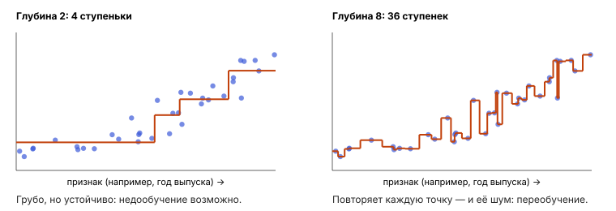

## Зачем это нужно

Дерево глубины 3 ошибается на 3 467 евро — у него всего 8 листьев, это грубая модель. Естественное желание — разрешить больше вопросов. Но у дерева нет «встроенного тормоза»: если его не ограничить, оно будет делить машины, пока в каждом листе не останется одна-две. Такое дерево идеально знает обучающие данные и плохо работает на новых. Глубина и размер листа — главные гиперпараметры дерева.

## Неограниченное дерево

```python
full = DecisionTreeRegressor(random_state=42).fit(X_train, y_train)
print('Глубина:', full.get_depth(), '| листьев:', full.get_n_leaves())
print(f'MAE train = {mean_absolute_error(y_train, full.predict(X_train)):.0f}, '
      f'validation = {mean_absolute_error(y_valid, full.predict(X_valid)):.0f}')
sizes = np.bincount(full.apply(X_train))                 # сколько машин в каждом листе
sizes = sizes[sizes > 0]
print('Листьев с одной машиной:', (sizes == 1).sum())
```

Глубина 39, больше 16 тысяч листьев, из них 14 170 — по одной машине. Лист с одной машиной «предсказывает» её собственную цену, поэтому MAE на train — всего 361 евро. А на validation — 3 345: почти столько же, сколько у дерева глубины 3 (3 467), хотя листьев в 2 000 раз больше. Дерево выучило шум: случайные скидки, опечатки, особенности конкретных объявлений. `apply` возвращает номер листа для каждой машины — так удобно посчитать размеры листьев.



## Кривая ошибки по глубине

Глубина — гиперпараметр, выбираем её по validation (урок 6.3):

```python
depths = [1, 2, 3, 4, 5, 6, 7, 8, 10, 12, 15, 20]
rows = []
for d in depths:
    m = DecisionTreeRegressor(max_depth=d, random_state=42).fit(X_train, y_train)
    rows.append({'train': mean_absolute_error(y_train, m.predict(X_train)),
                 'valid': mean_absolute_error(y_valid, m.predict(X_valid))})
depth_curve = pd.DataFrame(rows, index=depths)

fig, ax = plt.subplots(figsize=(8, 4))
ax.plot(depth_curve.index, depth_curve['train'], 'o-', label='train')
ax.plot(depth_curve.index, depth_curve['valid'], 'o-', label='validation')
ax.axvline(depth_curve['valid'].idxmin(), color='gray', linestyle='--')
ax.set(xlabel='Глубина дерева max_depth', ylabel='MAE, евро', title='Кривая ошибки дерева')
ax.legend()
ax.grid(alpha=0.3)
plt.show()
print(depth_curve.round(0))
```

Картина как у kNN, только зеркальная: сложность растёт вместе с глубиной. До глубины 7 обе ошибки падают; лучшая validation — при глубине 7 (≈ 2 759 евро). Дальше ошибка на train продолжает падать, а на validation растёт: с глубины 8 начинается переобучение, и к глубине 20 разрыв уже 2 500 евро.

## Размер листа

Второй способ ограничить дерево — запретить маленькие листья: `min_samples_leaf` — наименьшее число обучающих машин в листе. Лист из 50 машин выдаёт среднее 50 цен — оно устойчивее цены одной машины:

```python
for leaf in [1, 10, 50, 200]:
    m = DecisionTreeRegressor(min_samples_leaf=leaf, random_state=42).fit(X_train, y_train)
    print(f'min_samples_leaf = {leaf:>3}: листьев {m.get_n_leaves():5}, глубина {m.get_depth():2}, '
          f'MAE train = {mean_absolute_error(y_train, m.predict(X_train)):.0f}, '
          f'validation = {mean_absolute_error(y_valid, m.predict(X_valid)):.0f}')
```

Без ограничения глубины, но с листьями не меньше 50 машин дерево даёт ≈ 2 728 евро — лучше, чем лучшая глубина. Ограничения можно сочетать: например, `max_depth=10, min_samples_leaf=10` даёт ≈ 2 719. Но чем больше сочетаний мы перебираем по одной validation, тем выше риск подобрать настройки под случайные особенности именно этих 6 414 машин. Надёжнее сравнивать варианты кросс-валидацией (урок 6.8).

## Важность признаков

Каждое разбиение уменьшает сумму квадратов ошибок. Если сложить эти уменьшения по всем узлам с одним и тем же признаком и поделить на общий итог, получится **важность признака** — `feature_importances_` (в сумме 1):

```python
tree8 = DecisionTreeRegressor(max_depth=8, random_state=42).fit(X_train, y_train)
importance = pd.Series(tree8.feature_importances_, index=features).sort_values(ascending=False)
print(importance.round(3))
```

Дерево глубины 8 опирается в основном на год (0,45) и объём двигателя (0,37). Пробег почти не важен (0,03) — неожиданно? Дело в том, что пробег почти полностью выражается через другие признаки: `Distance = km_year × возраст`, а возраст — это год. Когда признаки похожи, дерево берёт один из них, и важность **делится**: уберите `km_year` — и важность пробега вырастет почти вчетверо, а MAE почти не изменится (задание со звёздочкой).

Поэтому важность описывает **эту модель на этих данных**: «на что опирается дерево», а не «что влияет на цену машины». Низкая важность не значит, что признак бесполезен, — его информацию могли «забрать» похожие признаки.

## Типичные ошибки

:::mistake Неограниченное дерево
По умолчанию `DecisionTreeRegressor()` растёт до листьев из одной машины и переобучается. Задавайте `max_depth` и/или `min_samples_leaf` и выбирайте их по validation.
:::

:::mistake Хвалить дерево за ошибку на train
MAE 361 евро на train — это не точность, а запоминание. Сравнивают только по данным, которых дерево не видело.
:::

:::mistake Важность как причина
`feature_importances_` — вклад признака в разбиения этой модели. Похожие признаки делят важность, и по ней нельзя сказать, что меняет цену в жизни.
:::

:::mistake Перебирать десятки настроек по одной validation
Чем больше вариантов сравнили на одних и тех же машинах, тем вероятнее, что «лучший» просто удачно подошёл к ним. Для большого перебора — кросс-валидация.
:::

## Мини-квиз

```quiz
- q: "Неограниченное дерево: MAE train = 361, validation = 3 345. Что это?"
  options:
    - Переобучение — листья запомнили отдельные машины
    - Недообучение
    - Утечка данных
  answer: 0
  explain: Огромный разрыв между train и validation — признак переобучения.
- q: "Что делает `min_samples_leaf=50`?"
  options:
    - Запрещает листья, в которых меньше 50 обучающих машин
    - Ограничивает глубину дерева 50 уровнями
    - Строит 50 деревьев
  answer: 0
  explain: Лист выдаёт среднее хотя бы 50 цен — прогноз устойчивее.
- q: "Важность пробега `Distance` в дереве — 0,03. Какой вывод верный?"
  options:
    - Дерево почти не использует пробег — его информацию дают похожие признаки (год, пробег в год)
    - Пробег не влияет на цену машины
    - Пробег надо удалить из данных
  answer: 0
  explain: Похожие признаки делят важность; о влиянии на цену в жизни она не говорит.
```

## Что запомнить

- Неограниченное дерево запоминает обучающие данные: листья по одной машине, MAE train ≈ 0, validation плохая.
- Сложность дерева ограничивают `max_depth` и `min_samples_leaf`; значения выбирают по validation (здесь лучшая глубина — 7).
- `feature_importances_` — доля уменьшения ошибки от разбиений по признаку, в сумме 1.
- Похожие признаки делят важность; важность описывает модель, а не причины.
