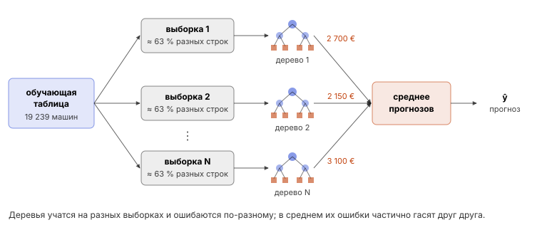

## Зачем это нужно

Неограниченное дерево из урока 6.5 запоминает шум. Но у этого есть обратная сторона: два таких дерева, обученные на чуть разных данных, ошибаются **по-разному**. Идея **ансамбля** — объединить много моделей так, чтобы их ошибки частично компенсировали друг друга. В лекции это пример с четырьмя алгоритмами: прогнозы 10,0; 11,2; 10,5 и 10,3 — их среднее 10,5 надёжнее любого отдельного. Условие одно: модели должны ошибаться **независимо** — объединять одинаковые модели бессмысленно.

## Бутстрэп: разные выборки из одних данных

Где взять много разных обучающих выборок, если данные одни? **Бутстрэп** — выбрать из таблицы столько же строк, сколько в ней есть, но **с повторениями**: одни строки попадут несколько раз, другие — ни разу.

```python
n = len(X_train)
rng = np.random.default_rng(0)
rows = rng.integers(0, n, size=n)              # номера строк с повторениями (урок 1.9)
print('Разных строк в выборке:', f'{len(np.unique(rows)) / n:.1%}')
print('Самая частая строка попала', np.bincount(rows).max(), 'раз')
```

В бутстрэп-выборку попадает около 63 % разных строк (теоретически 1 − 1/e ≈ 0,632), часть строк — по 2–7 раз. Каждая выборка немного другая — и дерево на ней получится немного другим.

## Бэггинг своими руками



**Бэггинг** (bootstrap aggregating): на каждой бутстрэп-выборке учим своё дерево, прогнозы усредняем. Обучим 10 неограниченных деревьев:

```python
Xt, yt, Xv = X_train.to_numpy(), y_train.to_numpy(), X_valid.to_numpy()
rng = np.random.default_rng(42)
preds = []
for i in range(10):
    idx = rng.integers(0, n, size=n)
    tree = DecisionTreeRegressor(random_state=i).fit(Xt[idx], yt[idx])
    preds.append(tree.predict(Xv))
preds = np.array(preds)                                   # 10 × 6 414
print('MAE отдельных деревьев:', [round(mean_absolute_error(y_valid, p)) for p in preds])
for m in [1, 2, 3, 5, 10]:
    print(f'Среднее {m:>2} деревьев: MAE = {mean_absolute_error(y_valid, preds[:m].mean(axis=0)):.0f}')
print('Прогнозы деревьев для первой машины:', preds[:, 0].round(0), '| настоящая цена:', y_valid.iloc[0])
```

Каждое дерево в отдельности ошибается на 3 300–3 470 евро. Их прогнозы для одной машины разбросаны от 1 300 до 3 100 евро — деревья действительно разные. А среднее 10 деревьев ошибается всего на ≈ 2 854 евро — лучше любого из них. Уже два дерева вместе (≈ 3 159) лучше одного.

## Случайный лес

**Случайный лес** — это бэггинг деревьев, собранный в одну модель `RandomForestRegressor`. Дополнительно при каждом разбиении дерево может рассматривать не все признаки, а случайную их часть (`max_features`) — так деревья становятся ещё разнообразнее. Для регрессии scikit-learn по умолчанию рассматривает все признаки, то есть строит обычный бэггинг.

```python
from sklearn.ensemble import RandomForestRegressor

forest = RandomForestRegressor(n_estimators=60, max_depth=10, random_state=42, n_jobs=1)
forest.fit(X_train, y_train)
forest_pred = forest.predict(X_valid)
print(f'Лес: MAE train = {mean_absolute_error(y_train, forest.predict(X_train)):.0f}, '
      f'validation = {mean_absolute_error(y_valid, forest_pred):.0f}')
manual = np.mean([t.predict(Xv) for t in forest.estimators_], axis=0)
print('Деревьев:', len(forest.estimators_), '| прогноз = среднее деревьев:', np.allclose(manual, forest_pred))
```

- `n_estimators=60` — число деревьев, `max_depth=10` — ограничение каждого; `random_state` фиксирует выборки, `n_jobs=1` — считать в одном потоке (в браузере других и нет);
- MAE ≈ 2 658 — лучший результат модуля: лучше kNN (≈ 2 692) и лучшего одиночного дерева (≈ 2 759);
- `forest.estimators_` — список обученных деревьев; прогноз леса — ровно их среднее.

## Сколько деревьев нужно

```python
for n_trees in [1, 3, 10, 30, 60, 100]:
    rf = RandomForestRegressor(n_estimators=n_trees, max_depth=10, random_state=42, n_jobs=1).fit(X_train, y_train)
    print(f'{n_trees:>3} деревьев: MAE = {mean_absolute_error(y_valid, rf.predict(X_valid)):.0f}')
```

Ошибка быстро падает (1 дерево — ≈ 2 808, 10 — ≈ 2 696) и выходит на плато: между 60 и 100 деревьями разница — 4 евро. Добавление деревьев почти никогда не ухудшает лес, но делает его медленнее: и обучение, и каждый прогноз проходят через все деревья.

При этом глубина деревьев по-прежнему важна: лес из 60 **неограниченных** деревьев на этих данных даёт ≈ 2 797 — хуже, чем с `max_depth=10`. Лес смягчает переобучение, но не отменяет подбор гиперпараметров.

## Что дальше: бустинг

В бэггинге деревья учатся независимо, и их ошибки гасятся усреднением. В **бустинге** деревья учатся **по очереди**: каждое следующее учится исправлять ошибки суммы предыдущих («первая модель ошиблась на 10 — учим вторую выдавать −10»). На табличных данных бустинг обычно точнее всех — его разберём в модуле 7.

## Типичные ошибки

:::mistake «Лес всегда лучше»
Вывод делают по числам на validation. Лес обычно точнее одного дерева, но не обязан быть лучше kNN или хорошо настроенной линейной модели на других данных.
:::

:::mistake Объединять одинаковые модели
Десять одинаковых деревьев дают тот же прогноз, что одно. Ансамблю нужно разнообразие — разные выборки, разные признаки, разные алгоритмы.
:::

:::mistake Забыть о цене
60 деревьев — в 60 раз больше вычислений при каждом прогнозе и памяти для хранения. Если 10 деревьев дают почти то же качество, это может быть разумным выбором.
:::

:::mistake Лес не нужно настраивать
Глубина деревьев, число признаков в разбиении, размер листа влияют на качество леса. Их выбирают так же, по validation или кросс-валидации.
:::

## Мини-квиз

```quiz
- q: Что такое бутстрэп-выборка?
  options:
    - Случайный выбор строк с повторениями того же размера, что исходная таблица
    - Случайные 63 % строк без повторений
    - Первые n строк после перемешивания
  answer: 0
  explain: Из-за повторений в неё попадает около 63 % разных строк.
- q: Почему среднее 10 деревьев точнее каждого из них?
  options:
    - Деревья ошибаются по-разному, и в среднем ошибки частично гасят друг друга
    - Каждое дерево видит все данные по 10 раз
    - Среднее всегда равно лучшему дереву
  answer: 0
  explain: Усреднение уменьшает разброс прогнозов, если ошибки моделей не одинаковы.
- q: Чем бустинг отличается от бэггинга?
  options:
    - В бустинге модели учатся по очереди, исправляя ошибки предыдущих; в бэггинге — независимо
    - Бустинг использует одно дерево
    - Ничем, это синонимы
  answer: 0
  explain: Бэггинг усредняет независимые модели, бустинг строит последовательную цепочку.
```

## Что запомнить

- Ансамбль объединяет модели, которые ошибаются по-разному; среднее (для классов — голосование) надёжнее отдельной модели.
- Бутстрэп — выбор с повторениями того же размера (≈ 63 % разных строк); бэггинг — свои модели на бутстрэп-выборках и среднее прогнозов.
- `RandomForestRegressor(n_estimators=60, max_depth=10, random_state=42, n_jobs=1)` — бэггинг деревьев (плюс случайные признаки через `max_features`); здесь MAE ≈ 2 658.
- Больше деревьев — не хуже, но медленнее; глубину и другие настройки леса всё равно подбирают.
