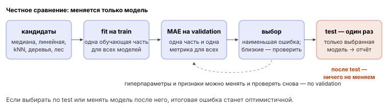

## Зачем это нужно

За модуль накопилось много моделей: линейная, kNN с разными k, деревья разной глубины, лес. Каждую мы проверяли отдельно — легко где-то взять другое разбиение, где-то другую метрику, и тогда сравнение теряет смысл. Нужен **протокол**: одна функция, один список кандидатов, одна таблица. И одно правило для test.

## Правила честного сравнения



1. **Одни и те же признаки и одно разбиение** для всех кандидатов.
2. **Одна метрика**, выбранная заранее (урок 5.8) — у нас MAE.
3. **Выбор — по validation.** Гиперпараметры можно менять и проверять снова, но только на validation.
4. **Test — один раз**, для выбранной модели. После него модель не меняют.

## Общая функция оценки

Каждый раз мы делали одно и то же: `fit`, два прогноза, две ошибки. Соберём это в функцию. Она ничего не выбирает и не трогает test:

```python
def evaluate(model, name, X_fit, y_fit, X_check, y_check):
    model.fit(X_fit, y_fit)
    return {'model': name,
            'train_mae': mean_absolute_error(y_fit, model.predict(X_fit)),
            'valid_mae': mean_absolute_error(y_check, model.predict(X_check)),
            'valid_rmse': root_mean_squared_error(y_check, model.predict(X_check))}

print(evaluate(DummyRegressor(strategy='median'), 'Медиана', X_train, y_train, X_valid, y_valid))
```

Функция обучает переданный объект: после вызова модель становится обученной. Pipeline (урок 6.1) здесь особенно удобен — подготовка спрятана внутри, и функция одинаково работает с любой моделью.

## Список кандидатов

```python
candidates = {
    'Медиана': DummyRegressor(strategy='median'),
    'Линейная': Pipeline([('scale', StandardScaler()), ('model', LinearRegression())]),
    'kNN, k=1': Pipeline([('scale', StandardScaler()), ('model', KNeighborsRegressor(n_neighbors=1))]),
    'kNN, k=20': Pipeline([('scale', StandardScaler()), ('model', KNeighborsRegressor(n_neighbors=20))]),
    'Дерево, глубина 3': DecisionTreeRegressor(max_depth=3, random_state=42),
    'Дерево, глубина 7': DecisionTreeRegressor(max_depth=7, random_state=42),
    'Дерево без ограничений': DecisionTreeRegressor(random_state=42),
    'Лес, 60 деревьев': RandomForestRegressor(n_estimators=60, max_depth=10, random_state=42, n_jobs=1),
}
results = pd.DataFrame([evaluate(m, name, X_train, y_train, X_valid, y_valid)
                        for name, m in candidates.items()])
results = results.set_index('model').sort_values('valid_mae')
results['gap'] = results['valid_mae'] - results['train_mae']
results.round(0)
```

Масштабирование есть только там, где оно нужно (линейная модель и kNN); деревьям и лесу оно не нужно.

## Читаем таблицу

- **Лучший по MAE — лес** (≈ 2 658), за ним kNN с k = 20 (≈ 2 692) и дерево глубины 7 (≈ 2 759). Все три — в полтора раза точнее линейной модели.
- **Переобучение видно по разрыву** `gap`: у kNN с k = 1 и неограниченного дерева ошибка на train меньше 400 евро, а на validation — больше 3 200.
- **Метрика может сменить победителя:** по RMSE лучше kNN с k = 20 (≈ 5 226 против ≈ 5 463 у леса) — у kNN реже бывают огромные промахи. Поэтому метрику выбирают **до** сравнения, исходя из задачи (урок 5.8). Мы выбрали MAE — значит, лес.

## Устойчив ли выбор

Лес опережает kNN на 34 евро. Не случайность ли это? Проверим на других разбиениях: test оставим тем же, а train и validation получим из остатка с другими `random_state`:

```python
top = ['kNN, k=20', 'Дерево, глубина 7', 'Лес, 60 деревьев']
rows = []
for seed in [0, 1, 2, 3, 4]:
    Xtr, Xva, ytr, yva = train_test_split(X_temp, y_temp, test_size=0.25, random_state=seed)
    rows.append({name: mean_absolute_error(yva, candidates[name].fit(Xtr, ytr).predict(Xva)) for name in top})
stability = pd.DataFrame(rows, index=[0, 1, 2, 3, 4])
print(stability.round(0))
print('Лучший на каждом разбиении:', list(stability.idxmin(axis=1)))
```

Лес выигрывает на всех пяти разбиениях, хотя его MAE меняется от разбиения к разбиению на ±40 евро. Выбор устойчив. Если бы победители менялись, различие между моделями было бы на уровне шума — и выбирать стоило бы по другим соображениям (скорость, простота). Систематически такую проверку делает кросс-валидация (урок 6.8).

## Итоговая проверка на test

Выбор сделан — теперь, и только теперь, открываем test для **одной** модели:

```python
best_name = results.index[0]
best = candidates[best_name].fit(X_train, y_train)
test_mae = mean_absolute_error(y_test, best.predict(X_test))
print(f'{best_name}: MAE validation = {results.loc[best_name, "valid_mae"]:.0f}, test = {test_mae:.0f}')
```

На test MAE ≈ 2 710 — немного хуже, чем на validation (≈ 2 658). Это нормально: модель выбрали как лучшую **на validation**, и часть её преимущества — удача именно на этих машинах. Test, который не участвовал в выборе, даёт честную оценку: «на новых машинах лес ошибается примерно на 2 700 евро». Это число и попадает в отчёт.

Часто перед проверкой на test выбранную модель обучают заново на train и validation вместе — данных больше, и модель обычно чуть точнее (здесь ≈ 2 703). Гиперпараметры при этом остаются выбранными по validation.

## Типичные ошибки

:::mistake Посчитать test для всех кандидатов и выбрать лучшего
Это тот же выбор по test: «победитель на test» получает оптимистичную оценку. Test — только для одной, уже выбранной модели.
:::

:::mistake Разные разбиения у разных моделей
Если kNN проверен на одной validation, а лес — на другой, разница в 30–50 евро может быть просто разницей между машинами в частях.
:::

:::mistake Менять модель после test
«Test показал 2 710 — добавлю признак и проверю ещё раз» — теперь test участвует в выборе, и новое число уже не честное.
:::

:::mistake Верить последнему знаку
Различия в десятки евро на одной validation часто случайны. Проверьте выбор на других разбиениях или кросс-валидацией.
:::

## Мини-квиз

```quiz
- q: Какой порядок действий честный?
  options:
    - Сравнить кандидатов на validation, выбрать одного, один раз проверить его на test
    - Проверить всех кандидатов на test и выбрать лучшего
    - Выбрать по train, проверить на validation и test
  answer: 0
  explain: Test не участвует в выборе — только тогда его оценка честная.
- q: По MAE лучше лес, по RMSE — kNN. Как поступить?
  options:
    - Выбрать по метрике, которую заранее определили по задаче
    - Выбрать ту модель, которая выглядит лучше
    - Взять среднее двух метрик
  answer: 0
  explain: Метрику выбирают до сравнения; после — это подгонка вывода под результат.
- q: "Лес: MAE validation 2 658, test 2 710. Что это значит?"
  options:
    - Нормальная картина — выбор по validation немного оптимистичен; честная оценка — 2 710
    - Модель сломалась на test
    - Нужно подобрать гиперпараметры по test
  answer: 0
  explain: Небольшое ухудшение на test ожидаемо; именно его и сообщают как итог.
```

## Что запомнить

- Честное сравнение: одни признаки, одно разбиение, одна заранее выбранная метрика; меняется только модель.
- Общая функция `evaluate` + словарь кандидатов + таблица, отсортированная по ошибке validation; разрыв train/validation показывает переобучение.
- Выбор проверяют на устойчивость (другие разбиения, кросс-валидация); различия в десятки евро могут быть шумом.
- Test — один раз, для выбранной модели; его ошибка — итоговая оценка, после неё модель не меняют.
