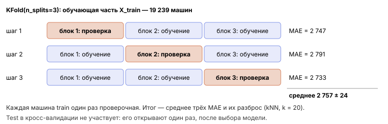

## Зачем это нужно

В уроке 6.7 MAE леса на разных разбиениях менялась от 2 589 до 2 673 евро — только потому, что в validation попадали разные машины. Одна validation — как один экзамен: можно случайно получить лёгкие или трудные билеты. **Кросс-валидация** (cross-validation, CV) устраивает несколько экзаменов на одних и тех же данных: каждый раз проверочной становится другая часть, и итог — среднее нескольких оценок вместе с их разбросом.

## Блоки KFold



Обучающая часть делится на k блоков (folds). На каждом шаге один блок — проверочный, остальные — обучение. За k шагов каждая строка ровно один раз побывает в проверке.

```python
from sklearn.model_selection import KFold

cv = KFold(n_splits=3, shuffle=True, random_state=42)
for step, (fit_pos, check_pos) in enumerate(cv.split(X_train), start=1):
    print(f'Шаг {step}: обучение {len(fit_pos)} машин, проверка {len(check_pos)}; первые позиции проверки: {check_pos[:5]}')
```

`cv.split` возвращает **позиции** строк (для них `iloc`). `shuffle=True` перемешивает строки перед делением на блоки — иначе блоки шли бы подряд по порядку файла; `random_state` делает перемешивание воспроизводимым. Внешние validation и test здесь не участвуют: CV работает внутри `X_train`.

## Кросс-валидация вручную

Чтобы увидеть, что происходит внутри, сделаем всё циклом. На каждом шаге нужна **новая** необученная модель — её даёт `clone`:

```python
from sklearn.base import clone

fold_mae = []
for fit_pos, check_pos in cv.split(X_train):
    model = clone(knn)                                   # чистая копия: те же настройки, без обучения
    model.fit(X_train.iloc[fit_pos], y_train.iloc[fit_pos])
    pred = model.predict(X_train.iloc[check_pos])
    fold_mae.append(mean_absolute_error(y_train.iloc[check_pos], pred))
fold_mae = np.array(fold_mae)
print('MAE по блокам:', fold_mae.round(1))
print(f'Среднее: {fold_mae.mean():.1f}, разброс (std): {fold_mae.std():.1f}')
```

Три оценки kNN: 2 747, 2 791 и 2 733 евро — среднее 2 757 ± 24. Разброс показывает, насколько оценка зависит от того, какие машины попали в проверку. Это не доверительный интервал и не гарантия будущей ошибки — просто изменчивость при этом способе проверки.

## cross_validate

`cross_validate` делает тот же цикл одной строкой:

```python
from sklearn.model_selection import cross_validate

res = cross_validate(knn, X_train, y_train, cv=cv, scoring='neg_mean_absolute_error', return_train_score=True)
print(sorted(res))
print('test_score:', res['test_score'].round(1))
print('MAE по блокам:', (-res['test_score']).round(1), '| совпадает с циклом:', np.allclose(-res['test_score'], fold_mae))
print('MAE на обучающих блоках:', (-res['train_score']).round(1))
```

Два важных соглашения scikit-learn:

- **Знак.** Все `scoring` устроены по правилу «больше — лучше». Для ошибки это неудобно, поэтому она возвращается **со знаком минус**: `neg_mean_absolute_error`. MAE = `-res['test_score']`.
- **Название.** `test_score` — ошибка на **проверочном блоке CV**, а не на нашем отложенном test. Отложенный test мы по-прежнему не трогали.

Есть и короткая функция `cross_val_score` — она возвращает только массив `test_score`.

## Сравниваем кандидатов по CV

```python
candidates = {
    'Линейная': Pipeline([('scale', StandardScaler()), ('model', LinearRegression())]),
    'kNN, k=20': knn,
    'Дерево, глубина 7': DecisionTreeRegressor(max_depth=7, random_state=42),
    'Лес, 60 деревьев': RandomForestRegressor(n_estimators=60, max_depth=10, random_state=42, n_jobs=1),
}
rows = []
for name, model in candidates.items():
    mae = -cross_validate(model, X_train, y_train, cv=cv, scoring='neg_mean_absolute_error')['test_score']
    rows.append({'model': name, 'cv_mae': mae.mean(), 'cv_std': mae.std()})
pd.DataFrame(rows).set_index('model').sort_values('cv_mae').round(1)
```

Порядок тот же, что на validation: лес (2 693 ± 14), kNN (2 757 ± 24), дерево глубины 7 (2 814 ± 78), линейная (4 261 ± 34). Разница между лесом и kNN — около 65 евро, а разброс по блокам — 15–25: преимущество леса больше случайных колебаний. У дерева разброс самый большой — одиночное дерево неустойчиво (урок 6.6).

Числа CV чуть хуже, чем на validation (у kNN 2 757 против 2 692): в каждом шаге модель учится лишь на двух третях `X_train`. CV и отдельная validation не обязаны совпадать — важно, что сравнение честное внутри каждого способа.

## Почему подготовка — внутри Pipeline

В каждом шаге CV scaler должен учиться только на **обучающих** блоках. Pipeline делает это сам: `cross_validate` клонирует весь Pipeline, и scaler заново учится на каждом шаге. Если масштабировать `X_train` целиком **до** CV, средние и отклонения будут посчитаны с участием проверочных блоков — это утечка:

```python
X_scaled = StandardScaler().fit_transform(X_train)                       # так делать не надо
leaky = -cross_validate(KNeighborsRegressor(n_neighbors=20), X_scaled, y_train, cv=cv,
                        scoring='neg_mean_absolute_error')['test_score']
print(f'Подготовка внутри Pipeline: {fold_mae.mean():.2f}; масштабирование до CV: {leaky.mean():.2f}')
```

Здесь разница меньше одного евро: средние и стандартные отклонения четырёх признаков на 19 тысячах машин почти не зависят от того, входят ли в расчёт проверочные блоки. Но правило важно не ради этого случая. В модуле 7 подготовка будет «учиться» на ответах (кодирование категорий средней ценой) — и та же ошибка сделает оценку CV заметно лучше реальности. Привычка «вся подготовка — внутри Pipeline» защищает от этого заранее.

## Сколько блоков

Больше блоков — больше данных для обучения в каждом шаге (при 5 блоках — 80 % вместо 67 %) и больше оценок, но и больше времени: модель обучается k раз. Для kNN 5 блоков дают 2 731 ± 55 против 2 757 ± 24 при трёх. На больших данных хватает 3–5 блоков; на маленьких (мини-проект с 442 пациентами) берут 5–10, чтобы каждая оценка опиралась на достаточно данных.

Кросс-валидацией удобно и подбирать гиперпараметры: для каждого значения считают средний CV-результат и берут лучший — так выбор меньше зависит от одной validation. В scikit-learn для этого есть `GridSearchCV` — он перебирает сетку значений с CV внутри.

## Типичные ошибки

:::mistake Забыть минус
`cross_validate(..., scoring='neg_mean_absolute_error')['test_score']` — отрицательные числа. «MAE = −2 757» — это MAE 2 757 евро; выбирают наибольший score, то есть наименьшую ошибку.
:::

:::mistake Принять test_score за отложенный test
`test_score` — проверочные блоки внутри обучающей части. Отложенный test в CV не участвует и открывается один раз в конце.
:::

:::mistake Подготовка до CV
Масштабирование (заполнение пропусков, кодирование) всей обучающей части до CV даёт подготовке «увидеть» проверочные блоки. Вся подготовка — в Pipeline.
:::

:::mistake KFold без перемешивания
Если строки в файле упорядочены (по дате, марке, цене), блоки без `shuffle=True` получатся непохожими друг на друга. Для данных во времени нужен особый способ — проверка «на будущем» (`TimeSeriesSplit`).
:::

## Мини-квиз

```quiz
- q: "При KFold(n_splits=3) сколько раз каждая строка обучающей части окажется в проверочном блоке?"
  options:
    - Ровно один раз
    - Три раза
    - Ни разу — проверка идёт на test
  answer: 0
  explain: Блоки не пересекаются, и каждый ровно один раз становится проверочным.
- q: "`cross_validate` вернул `test_score = [-2747, -2791, -2733]`. Что это?"
  options:
    - MAE на трёх проверочных блоках CV (со знаком минус)
    - Ошибки на отложенном test
    - Отрицательные цены
  answer: 0
  explain: В scikit-learn «больше — лучше», поэтому ошибки возвращаются со знаком минус; test_score — блоки CV.
- q: Почему scaler держат внутри Pipeline при кросс-валидации?
  options:
    - Чтобы он учился заново только на обучающих блоках каждого шага
    - Чтобы CV работала быстрее
    - Без этого cross_validate выдаст ошибку
  answer: 0
  explain: Подготовка, обученная на всех строках, «видела» проверочные блоки — это утечка.
```

## Что запомнить

- `KFold(n_splits=k, shuffle=True, random_state=42)` делит обучающую часть на k блоков; каждый по очереди проверочный.
- `cross_validate(pipe, X_train, y_train, cv=cv, scoring='neg_mean_absolute_error')`: MAE = `-test_score`; итог — среднее и разброс по блокам.
- `test_score` — проверочные блоки CV, а не отложенный test.
- Подготовка — внутри Pipeline: в каждом шаге она учится только на обучающих блоках.
- CV надёжнее одной validation: им сравнивают кандидатов и подбирают гиперпараметры; test — по-прежнему один раз в конце.
