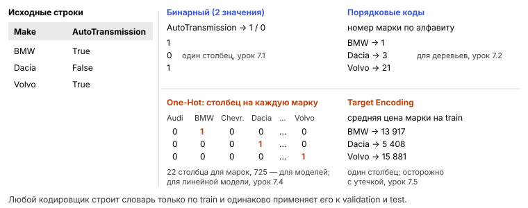

## Зачем это нужно

Попробуем дать линейной модели марку машины:

```python
try:
    LinearRegression().fit(X_train[['Year', 'Make']], y_train)
except ValueError as error:
    print('Ошибка:', error)
```

`could not convert string to float: 'Mitsubishi'` — модель не знает, что делать со словом. Все модели scikit-learn работают с числами, поэтому категориальные признаки нужно **закодировать**. Кодировать можно по-разному, и выбор зависит от модели. Весь модуль 7 — об этом.

## Способы кодирования



| Способ | Что получается | Для каких моделей | Урок |
|---|---|---|---|
| бинарный | один столбец 0/1 | любые; только для двух значений | 7.1 |
| порядковые коды | один столбец с номерами категорий | деревья, лес, бустинг | 7.2 |
| One-Hot | столбец-индикатор на каждую категорию | линейные модели | 7.4 |
| Target Encoding | один столбец: средний ответ категории | любые; опасность утечки | 7.5 |

Одно правило для всех: **кодировщик учится только на обучающей части**, а к validation и test применяется тот же словарь — как scaler в модуле 5.

## Бинарный признак

У коробки передач два значения, `True` (автомат) и `False` (механика). Такой признак записывают одним столбцом: 1 — автомат, 0 — механика. Применяем **один и тот же словарь** ко всем частям:

```python
auto_map = {True: 1, False: 0}
X_train_a = X_train[num_cols].assign(AutoTransmission=X_train['AutoTransmission'].map(auto_map))
X_valid_a = X_valid[num_cols].assign(AutoTransmission=X_valid['AutoTransmission'].map(auto_map))
print(X_train_a['AutoTransmission'].value_counts())
print(X_train_a.head(3))
```

В таблице есть и текстовая колонка `Transmission` («Automatic»/«Manual») — она несёт ту же информацию, поэтому вторая копия признака не нужна. Если бы мы взяли обе, модель получила бы один и тот же факт дважды.

## Что даёт коробка передач

Меняем только набор признаков — модели и разбиение те же:

```python
with_auto = num_cols + ['AutoTransmission']
for name, make_model in [('Линейная', LinearRegression),
                         ('Лес', lambda: RandomForestRegressor(n_estimators=60, max_depth=10, random_state=42, n_jobs=1))]:
    for cols in [num_cols, with_auto]:
        model = make_model().fit(X_train_a[cols], y_train)
        print(f'{name}, {len(cols)} признака: MAE = {mean_absolute_error(y_valid, model.predict(X_valid_a[cols])):.0f}')
lin = LinearRegression().fit(X_train_a[with_auto], y_train)
print('Коэффициент при AutoTransmission:', round(lin.coef_[-1]))
```

- линейная модель: 4 270 → 4 144 евро (−126); лес: 2 658 → 2 589 (−69). Один столбец 0/1 — и обе модели точнее;
- коэффициент ≈ +2 885 евро: при **одинаковых** годе, пробеге и объёме двигателя автомат модель оценивает на 2 885 евро дороже механики.

Сравните с разницей медиан — 7 400 евро. Почему коэффициент меньше? Автоматы в среднем новее (2011 против 2006 года) и с бо́льшим двигателем — часть разницы в ценах объясняют эти признаки. Коэффициент показывает добавку **при прочих равных**, и это по-прежнему связь, а не причина (урок 5.6).

## Дерево и бинарный признак

Дереву для бинарного признака нужен один вопрос — «AutoTransmission ≤ 0,5?», то есть «механика?»:

```python
tree = DecisionTreeRegressor(max_depth=3, random_state=42).fit(X_train_a[with_auto], y_train)
print(export_text(tree, feature_names=with_auto, decimals=1))
print(f'MAE дерева глубины 3: {mean_absolute_error(y_valid, tree.predict(X_valid_a[with_auto])):.0f}')
```

Для машин 2012 года и старше дерево вторым вопросом спрашивает о коробке. Но на validation дерево глубины 3 с коробкой даже чуть хуже (3 524 против 3 467 без неё): жадный выбор «лучшего вопроса сейчас» не гарантирует лучшего итога (урок 6.4). Более глубоким деревьям коробка помогает: при глубине 8 — 2 723 против 2 791. Поэтому решение «брать признак или нет» принимают по validation, а не по тому, что признак «выглядит полезным».

## Типичные ошибки

:::mistake Разные словари для разных частей
Если на train автомат — 1, а на validation по ошибке 0, модель получит противоположный смысл признака. Один словарь — для всех частей.
:::

:::mistake Две копии одного признака
`AutoTransmission` и `Transmission` — одна и та же информация. Для линейной модели две копии делают коэффициенты неустойчивыми, а пользы не добавляют.
:::

:::mistake Коэффициент как причина
+2 885 евро — разница прогнозов при прочих равных в этих данных, а не «цена установки автомата».
:::

:::mistake Ждать ошибки от логического столбца
`True`/`False` scikit-learn молча примет как 1/0. Но явный `map` делает смысл кода видимым и одинаковым во всех частях — и годится, если значения записаны текстом.
:::

## Мини-квиз

```quiz
- q: Почему `LinearRegression().fit(X_train[['Year', 'Make']], y_train)` падает?
  options:
    - Модели scikit-learn работают с числами, а Make — текст
    - В Make есть пропуски
    - Нельзя использовать два признака
  answer: 0
  explain: Категориальные признаки нужно закодировать числами.
- q: "Коэффициент при AutoTransmission = +2 885. Что это значит?"
  options:
    - При одинаковых остальных признаках модель оценивает автомат на 2 885 евро дороже
    - Автоматы в среднем дороже на 2 885 евро
    - Установка автомата повышает цену на 2 885 евро
  answer: 0
  explain: Это добавка при прочих равных; разница средних или медиан учитывает и то, что автоматы новее.
- q: Где кодировщик (словарь кодов) должен «учиться»?
  options:
    - Только на обучающей части; к validation и test применяется тот же словарь
    - На всех данных — так словарь полнее
    - На каждой части свой
  answer: 0
  explain: "Как scaler в модуле 5: подготовка учится на train, иначе утечка или несогласованные коды."
```

## Что запомнить

- Модели scikit-learn принимают только числа: категории кодируют — бинарно, порядковыми кодами, One-Hot или Target Encoding.
- Признак с двумя значениями — один столбец 0/1 через `map`; словарь один для всех частей.
- Коэффициент бинарного признака — разница прогнозов групп при прочих равных; это связь, а не причина.
- Брать признак или нет, решают по validation: даже полезный признак может не помочь конкретной модели.
