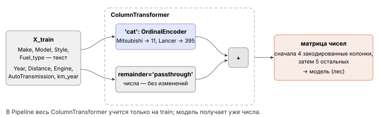

## Зачем это нужно

Признаков-категорий четыре, и у модели 725 значений. Самый короткий способ передать их модели — заменить каждое значение **номером**: Audi → 0, BMW → 1, … Один столбец на признак, как было. Номера ничего не значат — это просто ярлыки, — но дереву этого достаточно: вопросом «Make ≤ 1,5?» оно отделит Audi и BMW от остальных марок.

## OrdinalEncoder

`OrdinalEncoder` строит словарь по обучающей части: сортирует категории по алфавиту и нумерует с нуля. Категории, которой не было в train, по умолчанию он не знает и падает с ошибкой; параметры `handle_unknown='use_encoded_value', unknown_value=-1` дают ей код −1:

```python
fuel = OrdinalEncoder(handle_unknown='use_encoded_value', unknown_value=-1)
fuel.fit(X_train[['Fuel_type']])
print(list(fuel.categories_[0]))
print(fuel.transform(pd.DataFrame({'Fuel_type': ['Petrol', 'Diesel', 'Hydrogen']})).ravel())
```

Petrol → 4, Diesel → 0, а неизвестный Hydrogen → −1. Кодировщик принимает **таблицу** (двойные скобки), даже если колонка одна.

## ColumnTransformer: каждой колонке — своя подготовка

Кодировать нужно только текстовые колонки, числа — оставить как есть. `ColumnTransformer` получает список «имя, преобразование, колонки» и склеивает результаты:



```python
enc = ColumnTransformer(
    [('cat', OrdinalEncoder(handle_unknown='use_encoded_value', unknown_value=-1), cat_cols)],
    remainder='passthrough',            # остальные колонки — без изменений
    verbose_feature_names_out=False,
)
Z = enc.fit_transform(X_train)
print(list(enc.get_feature_names_out()))
print(X_train.iloc[0].to_dict())
print(Z[0])
```

- `remainder='passthrough'` пропускает колонки, которые не упомянуты; без него они были бы отброшены;
- порядок в результате — сначала колонки преобразований, потом остальные; `get_feature_names_out` показывает имена;
- результат — массив NumPy: Mitsubishi → 11, Lancer → 395, Sedan → 10, Petrol → 4, дальше год, пробег и т. д.

## Лес на всех признаках

ColumnTransformer — первый шаг Pipeline (урок 6.1). Тогда словари строятся только по train, а validation и test проходят через `transform`:

```python
forest = Pipeline([
    ('enc', enc),
    ('model', RandomForestRegressor(n_estimators=60, max_depth=16, random_state=42, n_jobs=1)),
])
forest.fit(X_train, y_train)
print(f'Лес, 9 признаков: MAE = {mean_absolute_error(y_valid, forest.predict(X_valid)):.0f}')
```

MAE ≈ 2 055 евро против ≈ 2 638 у того же леса на числах и коробке — минус 580 евро. Признаков стало больше, поэтому и деревья нужны глубже: с `max_depth=10` получилось бы ≈ 2 186. Гиперпараметры подбирают заново, когда меняется набор признаков.

Больше всего дают модель и марка. Если добавлять к числам по одной категории (лес из 20 деревьев), то модель снижает MAE до ≈ 2 192, марка — до ≈ 2 346, а кузов и топливо — до ≈ 2 578 и 2 563.

## Порядок номеров случайный

Алфавитный порядок ничем не лучше любого другого: Dacia стоит между Chevrolet и Ford не потому, что они похожи. Дереву приходится несколькими вопросами «вырезать» нужные категории из алфавитного ряда. Если перемешать номера, лес ошибётся немного иначе (≈ 2 093 вместо 2 055): порядок кодов на деревья влияет, но не сильно.

А вот **линейная модель** умножает номер на один коэффициент — «каждый шаг по алфавиту меняет цену на столько-то евро»:

```python
linear = Pipeline([('enc', enc), ('model', LinearRegression())]).fit(X_train, y_train)
print(f'Линейная модель с номерами категорий: MAE = {mean_absolute_error(y_valid, linear.predict(X_valid)):.0f}')
print(pd.Series(linear.named_steps['model'].coef_, index=enc.get_feature_names_out()).round(1)[cat_cols])
```

MAE ≈ 4 135 — почти как без категорий (4 144). Коэффициент при `Make` ≈ −50 евро «за одну букву алфавита» — бессмыслица. Линейной модели нужен другой способ — One-Hot (урок 7.4).

## Неизвестные категории

В validation 46 машин моделей, которых нет в train (Dodge Dakota, Citroën DS4, Jeep Renegade…; больше половины — редких марок из группы `Rare`). Они получают код −1, и лес оценивает их как «какую-то модель»: ошибка на них ≈ 5 800 евро против ≈ 2 030 на остальных. На новых данных такие машины будут всегда, и это нормально — главное, что код у них один и тот же и модель не падает.

## Типичные ошибки

:::mistake Учить кодировщик на всех данных
Словарь по всей таблице «знает» модели из validation и test — они не будут неизвестными, и оценка станет оптимистичнее реальности. Кодировщик учится внутри Pipeline на train.
:::

:::mistake Забыть handle_unknown
По умолчанию `OrdinalEncoder` падает на категории, которой не было в train. На validation и test такие найдутся почти всегда.
:::

:::mistake Забыть remainder
`ColumnTransformer` без `remainder='passthrough'` выбросит все колонки, которые не перечислены в его шагах, — модель останется без чисел.
:::

:::mistake Номера категорий в линейной модели
Номер — ярлык, а не величина. Линейная модель примет его за величину. Для неё — One-Hot или Target Encoding.
:::

## Мини-квиз

```quiz
- q: "Что делает `remainder='passthrough'` в ColumnTransformer?"
  options:
    - Пропускает не упомянутые колонки без изменений
    - Удаляет не упомянутые колонки
    - Кодирует все остальные колонки
  answer: 0
  explain: По умолчанию remainder='drop' — остальные колонки отбрасываются.
- q: Почему порядковые коды подходят деревьям, но не линейной модели?
  options:
    - Дерево делит коды порогами и может отделить любые категории, а линейная модель умножает номер на один коэффициент
    - Деревья не используют категориальные признаки
    - Линейная модель не принимает целые числа
  answer: 0
  explain: Для линейной модели номер — величина, хотя у категорий нет порядка.
- q: В validation есть модель машины, которой не было в train. Что с ней сделает OrdinalEncoder(handle_unknown='use_encoded_value', unknown_value=-1)?
  options:
    - Даст код −1
    - Добавит новую категорию в словарь
    - Удалит строку
  answer: 0
  explain: Словарь строится только по train; всё незнакомое получает один и тот же код.
```

## Что запомнить

- `OrdinalEncoder` нумерует категории по алфавиту; словарь — по train; `handle_unknown='use_encoded_value', unknown_value=-1` для незнакомых.
- `ColumnTransformer([('cat', кодировщик, cat_cols)], remainder='passthrough')` — подготовка по колонкам; первым шагом Pipeline.
- Деревьям и лесу порядковых кодов хватает: лес на 9 признаках — ≈ 2 055 евро против ≈ 2 638 на числах.
- Линейной модели номера категорий не подходят: у категорий нет порядка и «расстояния».
