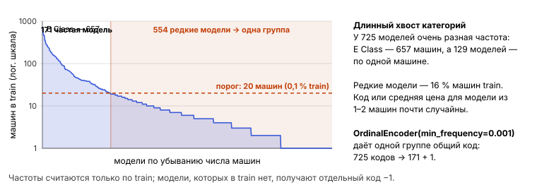

## Зачем это нужно

В уроке 7.0 мы видели: моделей 725, и у многих по одной-две машины. Порядковый код такой модели почти ничего не значит — дерево не может узнать о ней что-то надёжное по одной цене. Если объединить редкие модели в одну группу «прочие», признак станет проще: меньше кодов, меньше случайных разбиений. Вопрос — не потеряем ли мы точность. Тот же вопрос можно задать про целые признаки: все ли девять нужны?

## Длинный хвост категорий



```python
counts = X_train['Model'].value_counts()
share = counts / len(X_train)
for threshold in [0.001, 0.005, 0.01]:
    rare = share < threshold
    print(f'Порог {threshold:.1%}: редких моделей {rare.sum()}, в них {share[rare].sum():.1%} машин')
```

Порог задаём **долей строк обучающей части**: 0,1 % от 19 239 машин — это 19 машин. Моделей реже порога 554, но машин в них всего 16 %: категорий много, записей мало. При пороге 1 % редкими оказались бы уже 704 модели и 63 % машин.

## Редкие категории в кодировщике

`OrdinalEncoder` (и `OneHotEncoder`) умеют объединять редкие категории сами — параметр `min_frequency`. Частоты он считает при `fit`, то есть только по train:

```python
enc = OrdinalEncoder(handle_unknown='use_encoded_value', unknown_value=-1, min_frequency=0.001)
enc.fit(X_train[['Model']])
print('Категорий:', len(enc.categories_[0]), '| редких:', len(enc.infrequent_categories_[0]))
codes = enc.transform(X_train[['Model']]).ravel()
print('Разных кодов:', len(np.unique(codes)))
print(enc.transform(pd.DataFrame({'Model': ['Passat', '106', 'Нет такой']})).ravel())
```

171 частая модель получила свои коды 0–170, все редкие — общий код 171, а незнакомая модель — по-прежнему −1. Важно не путать: «редкая» модель была в train, но мало; «неизвестной» в train не было совсем.

Сравним лес при разных порогах (порог применяется ко всем текстовым признакам):

```python
for threshold in [None, 0.001, 0.005, 0.01]:
    model = forest_pipe(features, threshold).fit(X_train, y_train)
    print(f'min_frequency={threshold}: MAE = {mean_absolute_error(y_valid, model.predict(X_valid)):.0f}')
```

При пороге 0,1 % MAE ≈ 2 056 — столько же, сколько без объединения (2 055), хотя у `Model` вчетверо меньше кодов. Выше порог — хуже: 2 118 при 0,5 % и 2 132 при 1 %. Объединение перестаёт быть «чисткой шума» и начинает сливать модели, которые различаются по цене (у 0,5 % — уже модели с 90 машинами).

## Какие признаки важнее

Важность признаков леса (урок 6.5) — с именами из ColumnTransformer:

```python
full = forest_pipe(features).fit(X_train, y_train)
importance = pd.Series(full.named_steps['model'].feature_importances_,
                       index=full.named_steps['enc'].get_feature_names_out()).sort_values(ascending=False)
print(importance.round(3))
```

Год (0,38) и объём двигателя (0,29) — главные. Модель — всего 0,06, хотя в уроке 7.2 именно она одна давала больший выигрыш, чем любая другая категория. Противоречия нет: модель машины тесно связана с объёмом двигателя, годом и маркой, и важность делится между похожими признаками (урок 6.5). Меньше всего у кузова и топлива — по 0,013.

## Сокращение набора признаков

Меньше признаков — модель проще, быстрее и надёжнее при изменении данных. Правило выбора задаём **заранее**: убираем по одному наименее важные признаки и оставляем самый короткий набор, у которого MAE и RMSE на validation выросли не больше чем на 2 %.

```python
base = full.predict(X_valid)
mae0, rmse0 = mean_absolute_error(y_valid, base), root_mean_squared_error(y_valid, base)
order = list(importance.index)                         # по убыванию важности
for k in [1, 2, 3]:
    cols = [c for c in features if c in order[:-k]]
    pred = forest_pipe(cols).fit(X_train[cols], y_train).predict(X_valid[cols])
    mae, rmse = mean_absolute_error(y_valid, pred), root_mean_squared_error(y_valid, pred)
    print(f'Без {order[-k:]}: MAE {100 * (mae / mae0 - 1):+.1f} %, RMSE {100 * (rmse / rmse0 - 1):+.1f} %')
```

- без топлива: MAE +1,5 %, RMSE +0,7 % — в допуске;
- без топлива и кузова: MAE +1,1 %, RMSE −0,5 % — тоже в допуске, и это самый короткий такой набор;
- без марки в придачу: MAE +4,0 % — уже больше допуска.

Значит, оставляем 7 признаков. Обратите внимание: без двух признаков ошибка чуть меньше, чем без одного. Разницы в 1 % — на уровне шума одного разбиения, поэтому допуск и задают заранее, а не ищут «самый лучший» вариант по последнему знаку. Test в выборе не участвует.

## Типичные ошибки

:::mistake Считать частоты по всем данным
Порог редкости — по train. Если считать по всей таблице, в решение «какая модель редкая» попадут validation и test.
:::

:::mistake Путать редкую и неизвестную категорию
Редкая — была в train, но мало (общий код группы). Неизвестная — не было совсем (код −1). Модель ведёт себя с ними по-разному.
:::

:::mistake Удалять признак по одной лишь важности
Низкая важность может значить, что признак «делится» с похожими. Решение — по ошибке на validation при удалении, с допуском.
:::

:::mistake Подбирать допуск после результатов
«Возьмём 1,2 %, чтобы получился нужный набор» — это подгонка. Правило выбора задают до эксперимента.
:::

## Мини-квиз

```quiz
- q: "`OrdinalEncoder(min_frequency=0.001)` обучен на train из 19 239 машин. Что будет с моделью, у которой в train 12 машин?"
  options:
    - Она попадёт в общую группу редких и получит её код
    - Она получит код −1
    - Она получит свой отдельный код
  answer: 0
  explain: Порог — 0,1 % train, то есть 19 машин; у этой модели меньше. Код −1 — для моделей, которых в train нет совсем.
- q: Объединение редких моделей при пороге 0,1 % почти не изменило MAE. В чём польза?
  options:
    - Признак проще — 172 кода вместо 725, меньше разбиений по случайным кодам
    - MAE станет меньше на test
    - Пользы нет
  answer: 0
  explain: Та же точность при более простой модели — хороший обмен.
- q: Как честно решить, какие признаки убрать?
  options:
    - Заранее задать допуск и проверять удаление на validation
    - Убрать все признаки с важностью меньше 0,05
    - Выбрать набор с лучшей MAE на test
  answer: 0
  explain: Важность лишь подсказывает порядок проверки; решение — по validation и заранее заданному правилу.
```

## Что запомнить

- Редких категорий много, а записей в них мало: у 554 из 725 моделей меньше 20 машин, но это лишь 16 % train.
- `min_frequency` в OrdinalEncoder/OneHotEncoder объединяет редкие категории по частоте в train; незнакомые по-прежнему получают отдельный код.
- Умеренный порог (0,1 %) упрощает признак без потери точности; высокий — сливает непохожие категории.
- Сокращение набора: порядок — по важности, решение — по validation с заранее заданным допуском; test не участвует.
