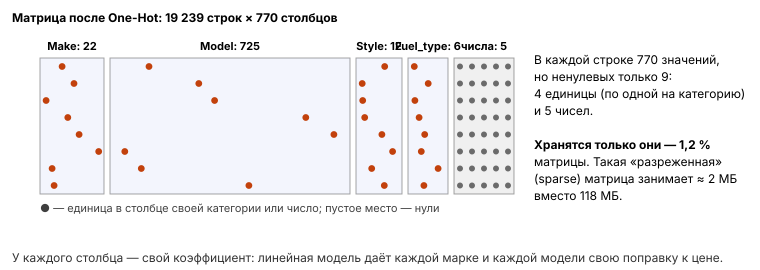

## Зачем это нужно

В уроке 7.2 линейная модель получила номера марок и ничего не выиграла: номер — ярлык, а она умножила его на один коэффициент. Линейной модели нужно другое: чтобы у **каждой** марки была своя поправка к цене. Для этого каждой категории отводят отдельный столбец: 1 — машина этой марки, 0 — другой. Это **One-Hot Encoding** («горячая единица»: в каждой строке единица ровно в одном столбце признака).

## OneHotEncoder

```python
fuel = OneHotEncoder(handle_unknown='ignore')
fuel.fit(X_train[['Fuel_type']])
print(list(fuel.get_feature_names_out()))
print(fuel.transform(pd.DataFrame({'Fuel_type': ['Petrol', 'Hydrogen']})).toarray())
```

Шесть видов топлива — шесть столбцов. У бензиновой машины единица в столбце `Fuel_type_Petrol`. Незнакомый `Hydrogen` при `handle_unknown='ignore'` получает **все нули** — «ни один из известных видов». Без этого параметра `transform` упал бы с ошибкой.

## 770 столбцов и разреженная матрица



В ColumnTransformer кодируем категории, а числовые признаки масштабируем — как в модулях 5–6:

```python
enc = ColumnTransformer([
    ('cat', OneHotEncoder(handle_unknown='ignore'), cat_cols),
    ('num', StandardScaler(), num_cols),
])
Z = enc.fit_transform(X_train)
print(type(Z).__name__, Z.shape)
print(f'Ненулевых значений: {Z.nnz} из {Z.shape[0] * Z.shape[1]} ({Z.nnz / (Z.shape[0] * Z.shape[1]):.1%})')
```

22 марки + 725 моделей + 12 кузовов + 6 видов топлива = 765 индикаторов, плюс 5 чисел — 770 столбцов. Почти все значения — нули, поэтому OneHotEncoder возвращает **разреженную** матрицу (`csr_matrix`): хранятся только ненулевые числа и их позиции — около 2 МБ вместо 118 МБ. Модели scikit-learn умеют с ней работать.

## Линейная модель с One-Hot

```python
linear = Pipeline([('enc', enc), ('model', LinearRegression())])
linear.fit(X_train, y_train)
print(f'Линейная модель + One-Hot: MAE = {mean_absolute_error(y_valid, linear.predict(X_valid)):.0f}')
print(f'На train: {mean_absolute_error(y_train, linear.predict(X_train)):.0f}')
```

MAE ≈ 3 190 евро против 4 144 без категорий — почти на 1 000 евро точнее. Основной вклад — модель машины: с одним только `Model` получилось бы ≈ 3 206, с одной маркой — ≈ 4 015. Лес с порядковыми кодами (≈ 2 055) всё ещё намного точнее: зависимость цены от года и пробега нелинейная, и One-Hot этого не исправит. Вернёмся к этому в уроке 7.6.

:::tip Зачем StandardScaler при разреженной матрице
С разреженной матрицей `LinearRegression` решает задачу приближённым итерационным методом. Если пробег (сотни тысяч) соседствует со столбцами 0/1, метод сходится плохо: без масштабирования здесь получилась бы MAE ≈ 4 264. Масштабирование числовых признаков — привычка, которая и тут спасает.
:::

## Как читать коэффициенты

Возьмём модель, где из категорий только марка:

```python
make_enc = ColumnTransformer([('cat', OneHotEncoder(handle_unknown='ignore'), ['Make']),
                              ('num', StandardScaler(), num_cols)])
make_model = Pipeline([('enc', make_enc), ('model', LinearRegression())]).fit(X_train[['Make'] + num_cols], y_train)
coef = pd.Series(make_model.named_steps['model'].coef_, index=make_model.named_steps['enc'].get_feature_names_out())
print('BMW дороже Dacia на', round(coef['cat__Make_BMW'] - coef['cat__Make_Dacia']), 'евро')
```

При одинаковых годе, пробеге, объёме и коробке модель оценивает BMW на ≈ 6 500 евро дороже Dacia. Читать имеет смысл **разности** коэффициентов категорий: из-за свободного члена сумма индикаторов признака всегда равна 1, и все коэффициенты можно сдвинуть на одно и то же число, не изменив прогнозы. Поэтому иногда один столбец выбрасывают (`OneHotEncoder(drop='first')`) — прогнозы не меняются, а остальные коэффициенты становятся поправками относительно выброшенной категории.

Если в модели и марка, и модель машины, коэффициенты марок читать нельзя: каждая модель принадлежит одной марке, и поправку можно как угодно поделить между ними.

## Ловушка pd.get_dummies

В pandas есть короткий способ — `pd.get_dummies`. Но он делает столбцы из того, что видит в **этой** таблице:

```python norun
d_train = pd.get_dummies(X_train, columns=cat_cols, dtype=int)
d_valid = pd.get_dummies(X_valid, columns=cat_cols, dtype=int)
print('Столбцов в train:', d_train.shape[1], '| в validation:', d_valid.shape[1])
print('Нет в validation:', len(set(d_train.columns) - set(d_valid.columns)), '| лишних в validation:', len(set(d_valid.columns) - set(d_train.columns)))
d_valid = d_valid.reindex(columns=d_train.columns, fill_value=0)          # выравниваем по train
```

В validation другой набор моделей: 191 столбца нет, 43 лишних. Модель обучена на 770 столбцах в определённом порядке — подать ей 622 нельзя. `reindex` по колонкам train исправляет это, а `OneHotEncoder` в Pipeline делает это сам — поэтому в работе удобнее он.

## Опасные коэффициенты редких моделей

```python
names = linear.named_steps['enc'].get_feature_names_out()
model_coef = pd.Series(linear.named_steps['model'].coef_, index=names).filter(like='Model_')
top = model_coef.abs().sort_values(ascending=False).head(5)
counts = X_train['Model'].value_counts()
print(pd.DataFrame({'коэффициент': model_coef[top.index].round(0),
                    'машин в train': [counts[n.split('Model_')[1]] for n in top.index]}))
```

Самые большие поправки — у моделей, которые встретились один-два раза. У Kia Clarus поправка +91 000 евро: единственная Clarus в train — объявление за 100 000 евро о машине 1998 года, явная ошибка в данных. Свой столбец позволил модели «выучить» эту цену. У Maserati Levante (одна машина) — +54 000. Такие коэффициенты — переобучение на отдельных машинах; сдерживать их будем регуляризацией (урок 7.6).

## Типичные ошибки

:::mistake get_dummies на каждой части отдельно
Наборы столбцов train и validation не совпадут. Выравнивайте по train (`reindex`) или используйте OneHotEncoder в Pipeline.
:::

:::mistake Забыть handle_unknown='ignore'
Модель, которой не было в train, уронит `transform`. С `'ignore'` она получит нули во всех столбцах признака.
:::

:::mistake Читать коэффициент категории сам по себе
Смысл имеют разности коэффициентов категорий одного признака; при вложенных признаках (марка и модель) — не имеют и они.
:::

:::mistake One-Hot для дерева «потому что правильно»
Деревьям хватает порядковых кодов: с One-Hot лес здесь обучается втрое дольше, а точнее лишь на 1–2 % (≈ 2 021 против 2 055). Для леса есть способ лучше — Target Encoding (урок 7.5).
:::

## Мини-квиз

```quiz
- q: Сколько столбцов даст One-Hot для признака с 12 значениями?
  options:
    - "12 — по столбцу на значение"
    - "1"
    - "2"
  answer: 0
  explain: Каждое значение — отдельный индикатор 0/1.
- q: "Что получит незнакомая категория в `OneHotEncoder(handle_unknown='ignore')`?"
  options:
    - Нули во всех столбцах этого признака
    - Единицу в последнем столбце
    - Код −1
  answer: 0
  explain: Ни один из известных индикаторов не включится.
- q: У модели, встретившейся в train один раз, коэффициент +91 000 евро. Почему это плохо?
  options:
    - Коэффициент подогнан под одну машину (здесь — ошибочную цену) и не обобщается
    - Коэффициенты не бывают больше 10 000
    - Это значит, что модель машины очень дорогая
  answer: 0
  explain: Один столбец — одна машина — идеальная подгонка её цены; это переобучение.
```

## Что запомнить

- One-Hot: по столбцу 0/1 на каждую категорию; линейная модель получает свою поправку для каждой.
- `OneHotEncoder(handle_unknown='ignore')` в ColumnTransformer (числа — со StandardScaler): 770 столбцов, разреженная матрица.
- Линейная модель + One-Hot: MAE ≈ 3 190 против 4 144 без категорий.
- Читают разности коэффициентов категорий; `pd.get_dummies` требует выравнивания столбцов по train.
- У редких категорий коэффициенты подгоняются под единичные машины — нужна регуляризация.
