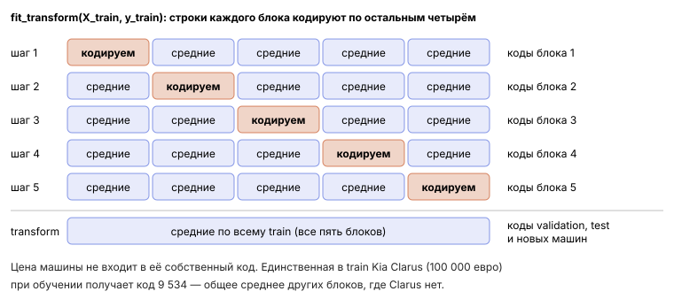

## Зачем это нужно

Порядковые коды выстраивают модели по алфавиту, и лесу приходится тратить разбиения, чтобы отделить дорогие модели от дешёвых. One-Hot даёт каждой модели свой столбец — всего их 770. Есть третий путь: заменить категорию числом, в котором уже есть смысл, — **средней ценой** машин этой категории. Это **Target Encoding** (кодирование по целевой переменной): 725 моделей превращаются в один числовой столбец, и модели в нём упорядочены по цене.

Но цена — это ответ, который модель должна предсказать. Признак, построенный из ответа, легко превращается в подсказку. Почти весь урок — о том, как этого не допустить.

## Среднее по train

```python
model_mean = y_train.groupby(X_train['Model']).mean()
print(model_mean[['E Class', 'Passat', 'Logan']].round(0))
global_mean = y_train.mean()
valid_codes = X_valid['Model'].map(model_mean)
print('Незнакомых моделей в validation:', valid_codes.isna().sum(), '| общее среднее:', round(global_mean))
valid_codes = valid_codes.fillna(global_mean)
```

E Class в train стоит в среднем 11 337 евро, Passat — 6 417, Logan — 3 462. У 46 машин validation модели, которой в train нет: среднего для неё нет, и ей ставят общее среднее — 9 574.

## Утечка первая: средние по всей таблице

Соблазнительно посчитать средние один раз — по всей таблице, до разбиения. Сравним с честным вариантом. Функция `mean_encode` заменяет четыре текстовые колонки средними, посчитанными по `X_from` и `y_from`:

```python
def mean_encode(table, X_from, y_from):
    out = table[num_cols].copy()
    for c in cat_cols:
        means = y_from.groupby(X_from[c]).mean()
        out[c] = table[c].map(means).fillna(y_from.mean())
    return out

honest = forest().fit(mean_encode(X_train, X_train, y_train), y_train)
print('Средние по train:', round(mean_absolute_error(y_valid, honest.predict(mean_encode(X_valid, X_train, y_train)))))
leaky = forest().fit(mean_encode(X_train, X, y), y_train)
print('Средние по всей таблице:', round(mean_absolute_error(y_valid, leaky.predict(mean_encode(X_valid, X, y)))))
```

Со средними по всей таблице MAE 1 846 вместо 1 911 — на 65 евро «лучше». Но в эти средние вошли цены машин validation: лес получил их ответы, пусть и усреднёнными с соседями. У нового объявления цены ещё нет, и там такой подсказки не будет. Значит, 1 846 — самообман. Правило то же, что для StandardScaler (урок 5.7): всё, что кодировщик узнаёт о данных, он узнаёт только по train.

## Утечка вторая: своя цена в своём среднем

Даже честные средние по train подсказывают ответ — строкам самого train. Если машина в своей категории одна, «средняя цена категории» и есть её цена. Возьмём признак с тысячами редких значений — сочетание модели и года выпуска — и посмотрим, каким прогнозом было бы само среднее сочетания:

```python
pair_train = X_train['Model'] + ' ' + X_train['Year'].astype(str)
pair_valid = X_valid['Model'] + ' ' + X_valid['Year'].astype(str)
counts = pair_train.value_counts()
print('Сочетаний:', len(counts), '| из одной машины:', (counts == 1).sum())
pair_mean = y_train.groupby(pair_train).mean()
print('Среднее сочетания как прогноз: train', round(mean_absolute_error(y_train, pair_train.map(pair_mean))),
      '| validation', round(mean_absolute_error(y_valid, pair_valid.map(pair_mean).fillna(y_train.mean()))))
```

Сочетаний 4 476, и 1 827 из них — одна машина. На train такой «прогноз» ошибается в среднем на 1 399 евро, на validation — на 2 518. На train признак выглядит почти вдвое лучше, чем он есть: у каждой десятой машины он в точности равен ответу. Модель, обученная на таком столбце, поверит ему. Лес, получивший это сочетание вдобавок к четырём средним, ошибается на validation на 2 445 евро — хуже, чем совсем без него (1 911).

## Перекрёстное кодирование



Выход похож на кросс-валидацию (урок 6.8). Train делят на 5 блоков, и строки каждого блока кодируют средними, посчитанными по остальным четырём. Так ни одна машина не участвует в собственном коде. Validation, test и новые машины кодируют средними по всему train. Вдобавок среднее редкой категории **сглаживают** — подтягивают к общему среднему $\bar y$:

$$
\text{код} = \frac{n \cdot \bar y_{\text{кат}} + m \cdot \bar y}{n + m}
$$

Здесь n — число машин категории, а m — сила сглаживания. При n = 1 и m = 20 цена единственной машины весит лишь 1/21. В scikit-learn всё это делает `TargetEncoder`. Силу сглаживания он подбирает сам (`smooth='auto'`) или берёт заданную: `smooth=20`.

```python
te = TargetEncoder(target_type='continuous', cv=5, random_state=42)
model_codes = te.fit_transform(X_train[['Model']], y_train).ravel()
print('Код единственной Clarus при обучении:', model_codes[(X_train['Model'] == 'Clarus').to_numpy()].round(0))

te_pair = TargetEncoder(target_type='continuous', cv=5, random_state=42)
pair_train_codes = te_pair.fit_transform(pair_train.to_frame(), y_train).ravel()   # по другим блокам
pair_valid_codes = te_pair.transform(pair_valid.to_frame()).ravel()                # по всему train
print('Код сочетания как прогноз: train', round(mean_absolute_error(y_train, pair_train_codes)),
      '| validation', round(mean_absolute_error(y_valid, pair_valid_codes)))
```

Единственная Kia Clarus продана за 100 000 евро, а её код при обучении — 9 534: в других блоках Clarus нет, и она получает их общее среднее. Код сочетания теперь ошибается на train на 2 626 евро, на validation — на 2 519. Признак выглядит на train таким же, как на новых данных, и модель доверяет ему ровно настолько, насколько он того стоит. Лес с сочетанием, закодированным через TargetEncoder, ошибается на 1 986 евро вместо 2 445.

:::warning fit_transform — не то же, что fit и transform
У большинства преобразований `fit_transform(X)` даёт то же, что `fit(X).transform(X)`. У TargetEncoder — нет: перекрёстное кодирование делает только `fit_transform`. Если обучить кодировщик, а потом вызвать `transform` на train, строки снова получат средние со своей ценой: лес с сочетанием ошибся бы на 2 370 евро. В Pipeline всё происходит правильно само: `fit` вызывает у кодировщика `fit_transform`, а `predict` — `transform`.
:::

:::tip Зачем target_type='continuous'
Цены в таблице — целые числа, и при `target_type='auto'` (по умолчанию) кодировщик решит, что это номера классов. Тогда каждый признак превратится в сотни столбцов — по одному на каждую встреченную цену. Для числового ответа тип указывают явно.
:::

## Лес и линейная модель с Target Encoding

```python
def te_encoder():
    return ColumnTransformer([('te', TargetEncoder(target_type='continuous', cv=5, random_state=42), cat_cols)],
                             remainder='passthrough')

forest_te = Pipeline([('enc', te_encoder()), ('model', forest())]).fit(X_train, y_train)
linear_te = Pipeline([('enc', te_encoder()), ('model', LinearRegression())]).fit(X_train, y_train)
print('Лес + Target Encoding:', round(mean_absolute_error(y_valid, forest_te.predict(X_valid))))
print('Линейная модель + Target Encoding:', round(mean_absolute_error(y_valid, linear_te.predict(X_valid))))
print('Коэффициент при te__Model:', round(linear_te.named_steps['model'].coef_[1], 2))
```

Сведём три способа кодирования вместе (MAE на validation, евро; лес — 60 деревьев глубины 16):

| Кодирование | Столбцов | Лес | Линейная модель |
|---|---|---|---|
| Порядковые коды (урок 7.2) | 9 | 2 055 | 4 135 |
| One-Hot (урок 7.4) | 770 | 2 021 | 3 190 |
| Target Encoding | 9 | 1 968 | 3 621 |

Для леса Target Encoding — самый точный и самый компактный вариант: дерево отделяет дорогие модели от дешёвых одним порогом. Лес с One-Hot немного точнее, чем с порядковыми кодами, но обучается втрое дольше. Линейной модели больше подходит One-Hot: там у каждой модели своя поправка к цене. С Target Encoding поправка одна на всех — 0,65 средней цены модели, и этого меньше, чем 725 отдельных поправок.

## Типичные ошибки

:::mistake Средние по всей таблице
Кодировщик обучают только на train. Средние, в которые вошли цены validation или test, приукрашивают оценку.
:::

:::mistake fit, а потом transform на train
Для TargetEncoder это не то же, что `fit_transform`: строки train получат средние со своей ценой. Используйте `fit_transform` для train или кладите кодировщик в Pipeline.
:::

:::mistake Ручные средние без сглаживания
Среднее одной-двух машин — почти их цены. Подтягивайте средние редких категорий к общему среднему или объединяйте редкие категории (урок 7.3).
:::

:::mistake Target Encoding везде, «потому что компактнее»
Компактность не гарантирует точности: у линейной модели Target Encoding на 430 евро хуже One-Hot. Способ кодирования выбирают по validation.
:::

## Мини-квиз

```quiz
- q: Почему средние цены категорий нельзя считать по всей таблице?
  options:
    - В них войдут цены validation и test — оценка станет обманчиво хорошей
    - Это слишком долго
    - На всей таблице средние получатся одинаковыми
  answer: 0
  explain: "Модель получит усреднённые ответы проверочных машин: 1 846 вместо честных 1 911."
- q: Машина — единственная своей модели в train. Какой код получит её строка, если кодировать средними по train без хитростей?
  options:
    - Её собственную цену
    - Общее среднее
    - Ноль
  answer: 0
  explain: Среднее одной цены — это она сама; признак подсказывает ответ.
- q: "Чем `TargetEncoder.fit_transform(X_train, y_train)` отличается от `fit(X_train, y_train).transform(X_train)`?"
  options:
    - fit_transform кодирует каждый блок train по остальным блокам, а transform — по всему train
    - Ничем
    - transform дополнительно сглаживает средние
  answer: 0
  explain: Перекрёстное кодирование делает только fit_transform; transform нужен для validation, test и новых данных.
- q: Какой модели Target Encoding помог больше всего?
  options:
    - Лесу — точнее, чем с порядковыми кодами и One-Hot
    - Линейной модели — точнее, чем с One-Hot
    - Обеим одинаково
  answer: 0
  explain: "Лес: 1 968 против 2 055 и 2 021. Линейной модели One-Hot подходит больше: 3 190 против 3 621."
```

## Что запомнить

- Target Encoding заменяет категорию средним ответом этой категории: один столбец, упорядоченный по цене.
- Средние считают только по train. Средние с участием validation или test — утечка, оценка становится обманчиво хорошей.
- Строки train кодируют по другим блокам и со сглаживанием: `TargetEncoder(target_type='continuous', cv=5, random_state=42)`, для train — `fit_transform`, для остального — `transform`.
- Лесу Target Encoding помог (1 968 против 2 055 с порядковыми кодами), а линейной модели лучше подходит One-Hot (3 190 против 3 621).
