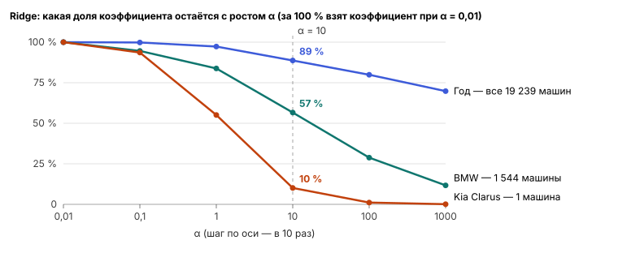

## Зачем это нужно

В уроке 7.4 линейная модель с One-Hot дала единственной Kia Clarus поправку +91 000 евро: свой столбец позволил подогнать коэффициент под одну ошибочную цену. Линейная регрессия не различает, сколько данных стоит за коэффициентом. Регуляризация учит модель «сомневаться»: за каждый большой коэффициент приходится платить. Большую поправку модель оставит, только если та окупается на многих машинах.

## Штраф за большие коэффициенты

**Ridge** (гребневая регрессия, регуляризация Тихонова, L2) минимизирует не просто сумму квадратов ошибок, а сумму с добавкой:

$$
\sum_{i=1}^{N} (\hat y_i - y_i)^2 + \alpha \sum_{j} w_j^2 \to \min
$$

- α — сила штрафа, гиперпараметр (урок 6.3). При α = 0 это обычная линейная регрессия, при очень большом α все коэффициенты стремятся к нулю, и прогноз — средняя цена.
- Свободный член не штрафуют: он задаёт средний уровень цены, а не поправку.
- Штраф одинаков для всех коэффициентов, поэтому признаки должны быть в одной шкале. Числа приводим StandardScaler, индикаторы One-Hot и так равны 0 или 1.

```python
for alpha in [0.3, 1, 10, 100]:
    ridge = linear_pipe(Ridge(alpha=alpha)).fit(X_train, y_train)
    coef = pd.Series(ridge.named_steps['model'].coef_, index=ridge.named_steps['enc'].get_feature_names_out())
    mae = mean_absolute_error(y_valid, ridge.predict(X_valid))
    print(f'alpha={alpha}: MAE = {mae:.0f}, поправка Clarus = {coef["cat__Model_Clarus"]:.0f}')
```

У LinearRegression было 3 190 евро и +90 976 у Clarus. При α = 0,3 ошибка чуть меньше (3 175), при α = 1 — почти та же, а поправка Clarus уже вдвое меньше: 49 155. При α = 10 от неё осталась десятая часть, но ошибка выросла до 3 318, а при α = 100 — до 3 621. Сильный штраф сжимает и полезные поправки: модель недообучается. Лучшее α выбирают по validation, как глубину дерева в модуле 6.

## Кого штраф сжимает сильнее



Коэффициент года уменьшает ошибку на всех 19 239 машинах. Штраф за него мал по сравнению с выигрышем, поэтому при α = 10 остаётся 89 % коэффициента. Поправка Clarus помогает одной строке и почти целиком «съедается» штрафом. Так Ridge и работает: сжимает сильнее то, за чем мало данных. Коэффициенты при этом связаны: когда поправки марок слабеют, часть их работы забирает объём двигателя, и его коэффициент растёт.

Где это заметно в ошибке? На машинах validation, чьих моделей в train одна-две:

```python
linear = linear_pipe(LinearRegression()).fit(X_train, y_train)
ridge = linear_pipe(Ridge(alpha=1)).fit(X_train, y_train)
print('Машин редких моделей в validation:', rare.sum())
for name, model in [('LinearRegression', linear), ('Ridge, alpha=1', ridge)]:
    pred = model.predict(X_valid)
    print(f'{name}: все машины {mean_absolute_error(y_valid, pred):.0f}, '
          f'редкие модели {mean_absolute_error(y_valid[rare], pred[rare]):.0f}')
```

На всей validation разница 12 евро, а на 102 машинах редких моделей — 646 евро: 6 708 вместо 7 354. Регуляризация защищает модель там, где данных мало.

## Логарифм цены и Ridge

Вспомним урок 5.9: если учить модель на `log(цены)`, поправки становятся относительными — «на 20 % дороже», а не «на 2 000 евро дороже». Для машин это естественнее: BMW дороже Dacia в разы, и год возраста стоит дорогой машине больше евро, чем дешёвой.

```python
log_train = np.log(y_train)
for name, model in [('LinearRegression', LinearRegression()), ('Ridge, alpha=0.3', Ridge(alpha=0.3))]:
    pipe = linear_pipe(model).fit(X_train, log_train)
    pred = np.exp(pipe.predict(X_valid))
    print(f'{name} на log(цены): все {mean_absolute_error(y_valid, pred):.0f}, '
          f'редкие модели {mean_absolute_error(y_valid[rare], pred[rare]):.0f}')
```

Одна только смена шкалы снижает MAE с 3 190 до 2 174 — больше, чем любое кодирование категорий. Ridge добавляет в целом немного (2 157), а машинам редких моделей — заметно: 3 916 вместо 5 453. Для логарифма α подбирают заново: в другой шкале ответа штраф весит по-другому. Из значений 0,1, 0,3, 1, 3 и 10 лучшее здесь — 0,3.

## Lasso: штраф, который обнуляет

**Lasso** (L1) штрафует сумму модулей коэффициентов:

$$
\frac{1}{2N}\sum_{i=1}^{N} (\hat y_i - y_i)^2 + \alpha \sum_{j} |w_j| \to \min
$$

У квадрата в Ridge штраф около нуля почти исчезает: 0,1² = 0,01. Поэтому Ridge оставляет слабые коэффициенты маленькими, но ненулевыми. Модуль тянет к нулю с одинаковой силой при любой величине коэффициента. Если признак приносит меньше, чем стоит штраф, Lasso обнуляет его **совсем** — так получается отбор признаков.

```python
for alpha in [0.0003, 0.001, 0.003, 0.01]:
    lasso = linear_pipe(Lasso(alpha=alpha)).fit(X_train, log_train)
    coef = lasso.named_steps['model'].coef_
    mae = mean_absolute_error(y_valid, np.exp(lasso.predict(X_valid)))
    print(f'alpha={alpha}: ненулевых коэффициентов {np.sum(coef != 0)} из {coef.size}, MAE = {mae:.0f}')
```

При α = 0,0003 остаётся 150 коэффициентов из 770, при α = 0,003 — 26, при α = 0,01 — 13. Ошибка растёт: 2 453, 2 774, 2 959. Что выжило при α = 0,003?

```python
lasso = linear_pipe(Lasso(alpha=0.003)).fit(X_train, log_train)
coef = pd.Series(lasso.named_steps['model'].coef_, index=lasso.named_steps['enc'].get_feature_names_out())
kept = coef[coef != 0].sort_values(key=abs, ascending=False)
print(kept.round(3).head(12))
print('Моделей машин среди оставшихся:', kept.index.str.startswith('cat__Model_').sum())
```

Остались все пять числовых признаков, 11 марок из 22, пять кузовов, три вида топлива — и всего две модели из 725: Logan и Superb. Коэффициенты читаются как относительные поправки: у Dacia −0,211, то есть она примерно на 19 % дешевле (e^−0,211 ≈ 0,81) машин тех марок, чьи коэффициенты обнулены. Такую модель легко объяснить, но точность ниже: 2 774 против 2 157 у Ridge. Lasso нужен, когда важны компактность и понятность, а за точностью идут к Ridge.

:::tip α у Ridge и Lasso — в разных шкалах
В scikit-learn у Lasso сумма квадратов ошибок делится на 2N, а у Ridge — нет. Поэтому α = 0,3 для Ridge и α = 0,003 для Lasso нельзя сравнивать напрямую: силу штрафа подбирают для каждой модели отдельно. Есть и смесь двух штрафов — `ElasticNet(alpha=..., l1_ratio=...)`: часть коэффициентов обнуляется, остальные сжимаются.
:::

## Типичные ошибки

:::mistake Регуляризация без масштабирования
Штраф одинаков для всех коэффициентов. Если пробег в километрах, а год в годах, штраф для них несопоставим. Числовые признаки сначала приводят StandardScaler.
:::

:::mistake Выбирать α по train
На train ошибка всегда меньше при меньшем α. Силу штрафа выбирают по validation или кросс-валидации, test в выборе не участвует.
:::

:::mistake Ждать от Ridge отбора признаков
Ridge сжимает коэффициенты, но не обнуляет их: все 770 остаются ненулевыми. Обнуляет Lasso.
:::

:::mistake Считать MAE в логарифмах
Модель для `log(цены)` прогнозирует логарифм. Перед расчётом ошибки прогноз возвращают в евро: `np.exp(pred)`.
:::

## Мини-квиз

```quiz
- q: Что будет с прогнозом Ridge при очень большом α?
  options:
    - Все коэффициенты станут близки к нулю, прогноз — почти средняя цена
    - Модель совпадёт с LinearRegression
    - Коэффициенты станут огромными
  answer: 0
  explain: Штраф перевешивает выигрыш от любых поправок, а свободный член не штрафуется — остаётся средний уровень.
- q: Почему при α = 10 коэффициент Clarus сжался в 10 раз, а коэффициент года — только на 11 %?
  options:
    - За Clarus одна машина, и штраф перевешивает пользу; год уменьшает ошибку на всех машинах
    - Ridge штрафует категории сильнее, чем числа
    - Коэффициент года не штрафуется
  answer: 0
  explain: Штраф один на всех, а польза коэффициента зависит от того, сколько машин он помогает предсказать.
- q: Чем Lasso отличается от Ridge?
  options:
    - Lasso обнуляет часть коэффициентов — это отбор признаков
    - Lasso всегда точнее
    - Lasso не нужен StandardScaler
  answer: 0
  explain: "Штраф по модулю тянет к нулю с одинаковой силой, и слабые признаки обнуляются: 26 из 770 при α = 0,003."
- q: По какой части данных выбирают α?
  options:
    - По validation (или кросс-валидации на train)
    - По train — там ошибка точнее
    - По test
  answer: 0
  explain: На train меньший штраф всегда выглядит лучше; test открывают один раз, после выбора модели.
```

## Что запомнить

- Регуляризация добавляет к ошибке штраф за большие коэффициенты. Сила штрафа α — гиперпараметр, его выбирают по validation. Свободный член не штрафуют, признаки масштабируют.
- Ridge (`Ridge(alpha=...)`, штраф α·Σw²) сжимает сильнее те коэффициенты, за которыми мало данных: поправка Clarus при α = 10 — 10 % от исходной, коэффициент года — 89 %.
- На машинах редких моделей Ridge снижает ошибку сильнее всего. Модель для логарифма цены плюс Ridge даёт MAE 2 157 против 3 190 у обычной линейной модели.
- Lasso (`Lasso(alpha=...)`, штраф α·Σ|w|) обнуляет часть коэффициентов: это отбор признаков, но обычно ценой точности.
