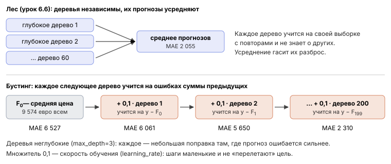

## Зачем это нужно

Лес (урок 6.6) строит много глубоких деревьев независимо друг от друга и усредняет их: ошибки отдельных деревьев гасят друг друга. **Градиентный бустинг** устроен иначе. Деревья строят по очереди, и каждое следующее учится исправлять то, в чём ошибается сумма предыдущих. На табличных данных — цены, кредиты, спрос — бустинг обычно точнее всего. LightGBM, XGBoost и CatBoost — частые победители соревнований по анализу данных.

## Идея: каждое дерево исправляет предыдущие



Начинаем с самого простого прогноза — средней цены. Затем повторяем:

1. считаем **остатки** — на сколько ошибается текущий прогноз: y − F;
2. обучаем неглубокое дерево предсказывать эти остатки;
3. добавляем его прогноз к текущему с маленьким множителем η — **скоростью обучения** (learning rate).

$$
F_0 = \bar y, \qquad F_m(x) = F_{m-1}(x) + \eta \cdot h_m(x)
$$

```python
pred_train = np.full(len(y_train), y_train.mean())
pred_valid = np.full(len(y_valid), y_train.mean())
print('Старт — средняя цена: MAE =', round(mean_absolute_error(y_valid, pred_valid)))
for step in range(1, 201):
    residual = y_train.to_numpy() - pred_train                 # что ещё не объяснено
    tree = DecisionTreeRegressor(max_depth=3, random_state=42).fit(Z_train, residual)
    pred_train += 0.1 * tree.predict(Z_train)
    pred_valid += 0.1 * tree.predict(Z_valid)
    if step in (1, 10, 50, 100, 200):
        print(f'Деревьев: {step}, MAE = {mean_absolute_error(y_valid, pred_valid):.0f}')
```

Средняя цена ошибается на 6 527 евро. Одно дерево с множителем 0,1 снижает ошибку лишь до 6 061, десять — до 3 788, двести — до 2 310. Каждое дерево глубины 3 само по себе — грубая модель всего с восемью листьями. Но каждое учится на том, что не объяснили предыдущие, и вместе они складываются в точную.

Почему бустинг «градиентный»? Остаток y − F — это направление, в котором квадратичная ошибка убывает быстрее всего (антиградиент по прогнозу, с точностью до множителя). Каждое дерево делает шаг градиентного спуска (урок 5.2), только шагают не коэффициенты, а сами прогнозы. Для других функций ошибки деревья учат на их антиградиент: так бустинг умеет оптимизировать и MAE (задание 5).

## GradientBoostingRegressor — то же самое

```python
gbr = GradientBoostingRegressor(n_estimators=200, learning_rate=0.1, max_depth=3, random_state=42)
gbr.fit(Z_train, y_train)
print(f'GradientBoostingRegressor, 200 деревьев: MAE = {mean_absolute_error(y_valid, gbr.predict(Z_valid)):.0f}')
```

Те же 2 310 евро: библиотека делает ровно то, что мы написали в цикле. Параметры те же: `n_estimators` — число деревьев, `learning_rate` — множитель η, `max_depth` — глубина каждого дерева. Лесу нужны глубокие деревья, а бустингу — неглубокие: каждое дерево — лишь небольшая поправка.

## Скорость обучения и число деревьев

`HistGradientBoostingRegressor` — быстрая версия бустинга. Значения каждого признака он заранее раскладывает по 255 корзинам (гистограммам) и ищет разбиения среди границ корзин, а не среди всех значений. Его деревья по умолчанию — до 31 листа. 500 деревьев он строит меньше чем за секунду, и так легко сравнить разные скорости обучения. Метод `staged_predict` даёт прогнозы после каждого добавленного дерева.

```python
fig, ax = plt.subplots(figsize=(7, 3.5))
for lr in [0.3, 0.1, 0.03]:
    hgb = HistGradientBoostingRegressor(max_iter=500, learning_rate=lr, early_stopping=False, random_state=42)
    hgb.fit(Z_train, y_train)
    curve = [mean_absolute_error(y_valid, p) for p in hgb.staged_predict(Z_valid)]
    ax.plot(range(1, 501), curve, label=f'learning_rate = {lr}')
    print(f'learning_rate={lr}: лучшая MAE {min(curve):.0f} на {np.argmin(curve) + 1} деревьях, на 500 — {curve[-1]:.0f}')
ax.set(xlabel='Число деревьев', ylabel='MAE на validation, евро', ylim=(1900, 3000))
ax.legend()
plt.show()
```

- Шаг 0,3 быстро доходит до минимума — 2 133 евро на 45 деревьях, — а дальше модель переобучается: к 500 деревьям ошибка растёт до 2 259.
- Шаг 0,1 идёт дольше, зато дальше: 2 040 на 264 деревьях, потом кривая почти не меняется.
- Шагу 0,03 и 500 деревьев мало: к концу ошибка 2 062, и кривая ещё снижается.

Чем меньше `learning_rate`, тем больше нужно деревьев, а результат обычно не хуже. Число деревьев — гиперпараметр, его выбирают по validation, как глубину дерева. Делают это и автоматически: **ранняя остановка** (`early_stopping=True`) прекращает добавлять деревья, когда ошибка на отложенной части train перестаёт падать.

## LightGBM: категории без кодирования

LightGBM — библиотека бустинга от Microsoft, тоже на гистограммах и очень быстрая. Она умеет работать с категориями напрямую, если колонка имеет тип `category`. В каждом разбиении LightGBM сортирует категории по средней поправке (по сути — по средней ошибке текущего прогноза) и ищет лучшее деление на две группы. Это Target Encoding, встроенный в каждое разбиение и пересчитанный заново для каждого дерева. Словарь категорий, как всегда, берём только из train:

```python
def as_category(table):
    out = table.copy()
    for c in cat_cols:
        cats = sorted(X_train[c].unique())                              # категории train
        out[c] = pd.Categorical(out[c].where(out[c].isin(cats)), categories=cats)   # незнакомые → пропуск
    return out

C_train, C_valid = as_category(X_train), as_category(X_valid)
lgbm = LGBMRegressor(n_estimators=300, learning_rate=0.1, random_state=42, verbosity=-1, n_jobs=1)
lgbm.fit(C_train, y_train)
print(f'LightGBM, категории как есть: MAE = {mean_absolute_error(y_valid, lgbm.predict(C_valid)):.0f}')
codes = LGBMRegressor(n_estimators=300, learning_rate=0.1, random_state=42, verbosity=-1, n_jobs=1)
codes.fit(Z_train, y_train)
print(f'LightGBM, порядковые коды: MAE = {mean_absolute_error(y_valid, codes.predict(Z_valid)):.0f}')
```

С категориями как есть — 1 939 евро, с порядковыми кодами — 2 050. Незнакомые модели validation превращаются в пропуски, и LightGBM отправляет их по ветке, выученной для пропусков. Наконец, вспомним урок 7.6: цены удобнее моделировать в логарифмах.

```python
lgbm_log = LGBMRegressor(n_estimators=300, learning_rate=0.1, random_state=42, verbosity=-1, n_jobs=1)
lgbm_log.fit(C_train, np.log(y_train))
print(f'LightGBM на log(цены): MAE = {mean_absolute_error(y_valid, np.exp(lgbm_log.predict(C_valid))):.0f}')
```

1 842 евро — лучший результат модуля. Сведём всё вместе (MAE на validation, евро):

| Модель | MAE |
|---|---|
| Средняя цена | 6 527 |
| Линейная модель + One-Hot (урок 7.4) | 3 190 |
| Ridge на log(цены) (урок 7.6) | 2 157 |
| Лес, порядковые коды (урок 7.2) | 2 055 |
| HistGradientBoosting, порядковые коды, лучшие 264 дерева | 2 040 |
| Лес + Target Encoding (урок 7.5) | 1 968 |
| LightGBM, категории как есть | 1 939 |
| LightGBM на log(цены) | 1 842 |

Это оценки на одном разбиении, а число деревьев для HistGradientBoosting выбрано по той же validation. Насколько устойчивы такие разницы и что покажет test, разберём в уроке 7.8.

:::tip XGBoost и CatBoost
XGBoost (`xgboost.XGBRegressor`) — ещё одна популярная библиотека бустинга, параметры похожи: `n_estimators`, `learning_rate`, `max_depth`. CatBoost от Яндекса особенно хорош с категориями. Он кодирует их средним ответом по «прошлым» строкам — родственник перекрёстного кодирования из урока 7.5. В браузере CatBoost недоступен, его пробуют в Colab или локально.
:::

## Типичные ошибки

:::mistake Большой learning_rate и много деревьев
С шагом 0,3 модель лучше всего на 45 деревьях, а на 500 — заметно хуже. Число деревьев подбирают вместе со скоростью обучения.
:::

:::mistake Глубокие деревья, как в лесу
Бустингу нужны неглубокие деревья (глубина 3–8 или до 31 листа): каждое — небольшая поправка. Глубокие деревья быстро подгоняются под шум.
:::

:::mistake Выбирать число деревьев по test
Число деревьев и скорость обучения — гиперпараметры. Их выбирают по validation или ранней остановкой на части train.
:::

:::mistake Словарь категорий по всем данным
Для LightGBM категории берут из train, незнакомые превращают в пропуски. Словарь по всей таблице — та же утечка, что в уроке 7.5, только мельче.
:::

## Мини-квиз

```quiz
- q: На чём учится каждое следующее дерево в бустинге?
  options:
    - На остатках — разнице между ценой и суммой прогнозов предыдущих деревьев
    - На случайной выборке с повторами, как в лесу
    - На тех же ценах, что и первое дерево
  answer: 0
  explain: Дерево исправляет то, что ещё не объяснено; его прогноз добавляют к сумме с множителем learning_rate.
- q: Что будет, если уменьшить learning_rate с 0,3 до 0,03 при тех же 500 деревьях?
  options:
    - Модель будет учиться медленнее; деревьев может не хватить
    - Модель переобучится быстрее
    - Ничего не изменится
  answer: 0
  explain: "Маленький шаг требует больше деревьев: при 0,03 кривая на 500 деревьях ещё снижается."
- q: Почему бустингу нужны неглубокие деревья, а лесу — глубокие?
  options:
    - В бустинге каждое дерево — небольшая поправка, ошибки исправляют следующие; в лесу ошибки гасит усреднение
    - Неглубокие деревья точнее
    - Лес не умеет строить неглубокие деревья
  answer: 0
  explain: Лес снижает разброс усреднением, бустинг — смещение последовательными поправками.
- q: Как LightGBM работает с колонкой типа category?
  options:
    - В каждом разбиении упорядочивает категории по средней поправке и делит на две группы
    - Делает One-Hot
    - Заменяет категории номерами по алфавиту
  answer: 0
  explain: Это похоже на Target Encoding внутри каждого разбиения.
```

## Что запомнить

- Градиентный бустинг строит деревья по очереди: каждое учится на остатках суммы предыдущих и добавляется с множителем learning_rate.
- Деревья в бустинге неглубокие. `GradientBoostingRegressor(n_estimators, learning_rate, max_depth)` делает ровно то, что цикл «остатки → дерево → маленький шаг».
- Чем меньше learning_rate, тем больше нужно деревьев. Число деревьев выбирают по validation или ранней остановкой; с большим шагом модель быстро переобучается.
- `HistGradientBoostingRegressor` и LightGBM — быстрые реализации на гистограммах. LightGBM принимает категории напрямую (тип `category`, словарь — по train).
- Лучший результат модуля — LightGBM на log(цены): 1 842 евро против 2 055 у леса и 3 190 у линейной модели.
